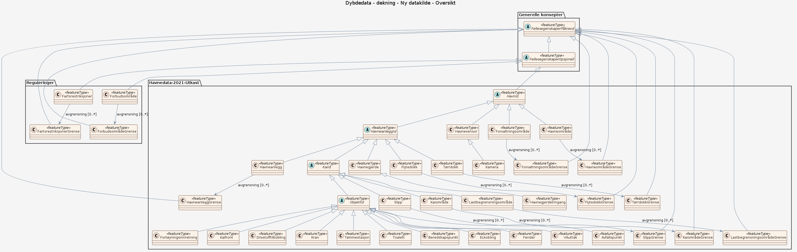
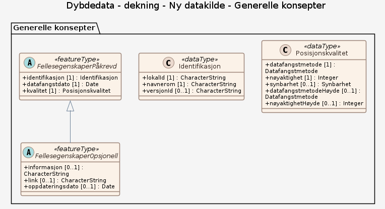
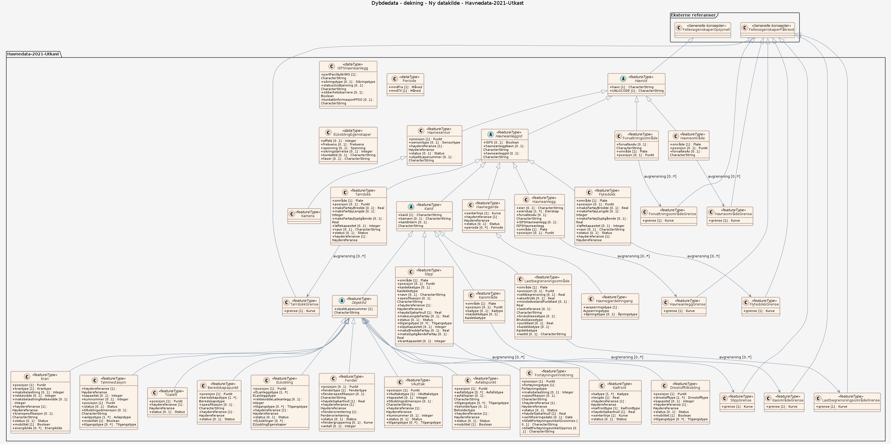
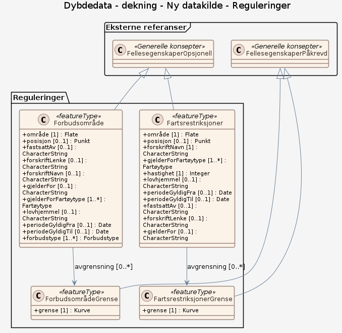
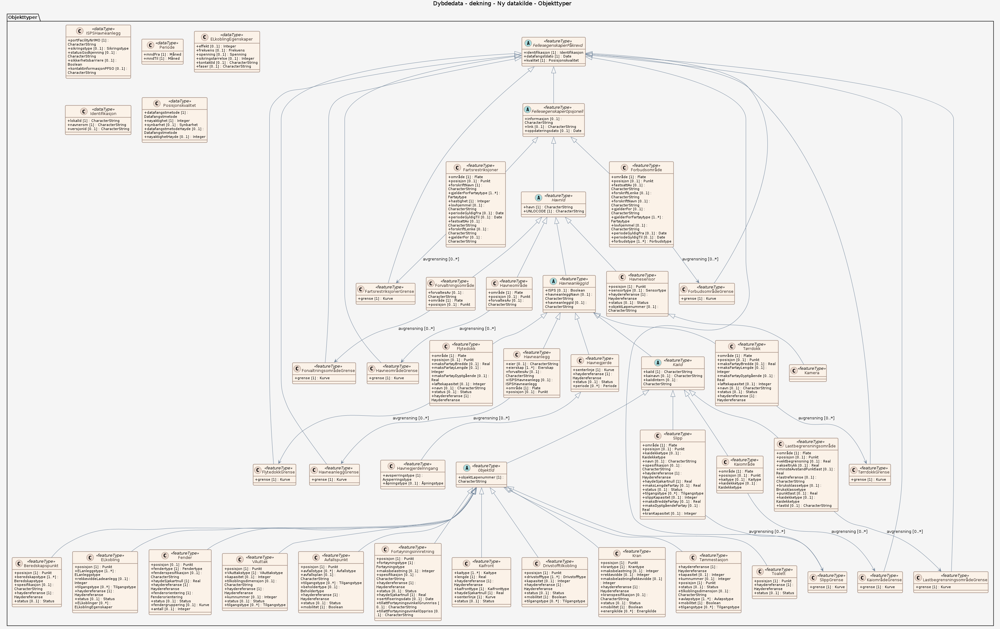

### Datamodell

**Kilde:** [SOSI UML XMI-fil](https://sosi.geonorge.no/svn/SOSI/SOSI%20Del%203/FKB/Havnedata.xml)

#### Oversikt

#### Pakke: Generelle konsepter

#### Pakke: Havnedata-2021-Utkast

#### Pakke: Reguleringer

#### Komplett diagram

#### Havneområde

Havn er et avgrenset område som inneholder kai/kaier tilknyttet land- og sjøarealer som er tilrettelagt for overføring av gods, personer eller lignende mellom land og sjø. Havneområde kjennetegnes ved at de har en UNLOCODE tilknyttet seg, og innenfor området må det være minst én kai og én kaifront. Havneområdet kan inneholde mange havneanlegg, mange kaier og andre objekter.

Egenskaper

<table class="feature-attribute-table">
  <thead>
    <tr>
      <th>Egenskap</th>
      <th>Beskrivelse</th>
      <th>Type</th>
      <th>Multiplisitet</th>
    </tr>
  </thead>
  <tbody>
    <tr>
      <td>område</td>
      <td>Polygon som viser geografisk utstrekning</td>
      <td>Flate</td>
      <td>1</td>
    </tr>
    <tr>
      <td>posisjon</td>
      <td>Opsjonelt representasjonspunkt.</td>
      <td>Punkt</td>
      <td>0..1</td>
    </tr>
    <tr>
      <td>forvaltes<wbr />Av</td>
      <td>Felt for å angi hvem som forvalter eller administrerer havneområdet.</td>
      <td>Character<wbr />String</td>
      <td>0..1</td>
    </tr>
    <tr class="inherited-from">
      <th colspan="4" scope="rowgroup">Arvet fra HavnId</th>
    </tr>
    <tr>
      <td>havn</td>
      <td>Stedsnavn på havnen som har blitt tildelt en UNLOCODE. Navnet må samsvare med UNLOCODE.</td>
      <td>Character<wbr />String</td>
      <td>1</td>
    </tr>
    <tr>
      <td>UNLOCODE</td>
      <td>Lokaliseringskode fra UNLOCODE-systemet som identifiserer et havneområde. Koden består av 5 bokstaver: de to første bokstavene angir landskode, mens de tre siste identifiserer havnen. Eks: NOSVG (Stavanger). Se liste med lovlige kodeverdier her: <a href="https://service.unece.org/trade/locode/no.htm">https://service.unece.org/trade/locode/no.htm</a></td>
      <td>Character<wbr />String</td>
      <td>1</td>
    </tr>
    <tr class="inherited-from">
      <th colspan="4" scope="rowgroup">Arvet fra FellesegenskaperOpsjonell</th>
    </tr>
    <tr>
      <td>informasjon</td>
      <td>generell opplysning</td>
      <td>Character<wbr />String</td>
      <td>0..1</td>
    </tr>
    <tr>
      <td>link</td>
      <td>Link i form av URL eller annet til mer informasjon om objektet.</td>
      <td>Character<wbr />String</td>
      <td>0..1</td>
    </tr>
    <tr>
      <td>oppdateringsdato</td>
      <td>dato for siste endring på objektetdataene.</td>
      <td>Date<wbr />Time</td>
      <td>0..1</td>
    </tr>
    <tr class="inherited-from">
      <th colspan="4" scope="rowgroup">Arvet fra FellesegenskaperPåkrevd</th>
    </tr>
    <tr>
      <td>identifikasjon</td>
      <td>Unik identifikasjon av objektet.</td>
      <td>Identifikasjon (datatype)</td>
      <td>1</td>
    </tr>
    <tr>
      <td>- lokal<wbr />Id</td>
      <td>Unik identifikator innenfor navnerommet. For FKB benyttes UUID.</td>
      <td>Character<wbr />String</td>
      <td>1</td>
    </tr>
    <tr>
      <td>- navnerom</td>
      <td>navnerom i form av en URI</td>
      <td>Character<wbr />String</td>
      <td>1</td>
    </tr>
    <tr>
      <td>- versjon<wbr />Id</td>
      <td>identifikasjon av en spesiell versjon av et geografisk objekt (instans), maksimum lengde på 25 karakterers. Dersom spesifikasjonen av et geografisk objekt med en identifikasjon inkludererer livsløpssyklusinformasjon, benyttes denne versjonId for å skille mellom ulike versjoner av samme objekt. versjonId er en unik  identifikasjon av versjonen. Benyttes normalt ikke i FKB.</td>
      <td>Character<wbr />String</td>
      <td>0..1</td>
    </tr>
    <tr>
      <td>datafangstdato</td>
      <td>dato når objektet siste gang ble registrert/observert/målt i terrenget</td>
      <td>Date</td>
      <td>1</td>
    </tr>
    <tr>
      <td>kvalitet</td>
      <td>Stedfestingskvalitet</td>
      <td>Posisjonskvalitet (datatype)</td>
      <td>1</td>
    </tr>
    <tr>
      <td>- datafangstmetode</td>
      <td>Metode for datafangst. Egenskapen beskriver datafangstmetode for grunnrisskoordinater (x,y), eller for både grunnriss og høyde (x,y,z) dersom det ikke er oppgitt noen verdi for datafangstmetodeHøyde.</td>
      <td><a href="#kodeliste-datafangstmetode">Datafangstmetode</a> (kodeliste)</td>
      <td>1</td>
    </tr>
    <tr>
      <td>- nøyaktighet</td>
      <td>Punktstandardavviket i grunnriss for punkter samt tverravvik for linjer.  Merknad: Oppgitt i cm</td>
      <td>Integer</td>
      <td>1</td>
    </tr>
    <tr>
      <td>- synbarhet</td>
      <td>Hvor godt den kartlagte detalj var synbar ved kartleggingen.</td>
      <td><a href="#kodeliste-synbarhet">Synbarhet</a> (kodeliste)</td>
      <td>0..1</td>
    </tr>
    <tr>
      <td>- datafangstmetode<wbr />Høyde</td>
      <td>Metode brukt for høyderegistrering av posisjon. Det er bare nødvending å angi en verdi for egenskapen dersom datafangstmetode for høyde avviker fra datafangstmetode for grunnriss.</td>
      <td><a href="#kodeliste-datafangstmetode">Datafangstmetode</a> (kodeliste)</td>
      <td>0..1</td>
    </tr>
    <tr>
      <td>- nøyaktighet<wbr />Høyde</td>
      <td>Nøyaktighet for høyden i cm.</td>
      <td>Integer</td>
      <td>0..1</td>
    </tr>
  </tbody>
</table>

Relasjoner

**Arv**
HavnId

**Assosiasjoner**
HavneområdeGrense – rolle: avgrensning – kardinalitet: 0..*

#### Havneanlegg

Med havneanlegg menes arealer, bygninger, innretninger og annen infrastruktur som brukes i havnevirksomhet eller havneformål. Herunder: kaier, terminalbygninger, laste-, losse- og omlastningsinnretninger og lager- og administrasjonsbygninger.

Egenskaper

<table class="feature-attribute-table">
  <thead>
    <tr>
      <th>Egenskap</th>
      <th>Beskrivelse</th>
      <th>Type</th>
      <th>Multiplisitet</th>
    </tr>
  </thead>
  <tbody>
    <tr>
      <td>eier</td>
      <td>Eier av havneanlegget.</td>
      <td>Character<wbr />String</td>
      <td>0..1</td>
    </tr>
    <tr>
      <td>eierskap</td>
      <td>Felt for å angi type eierskap.</td>
      <td><a href="#kodeliste-eierskap">Eierskap</a> (kodeliste)</td>
      <td>1..*</td>
    </tr>
    <tr>
      <td>forvaltes<wbr />Av</td>
      <td>Felt for å angi hvem havneanlegget forvaltes av.</td>
      <td>Character<wbr />String</td>
      <td>0..1</td>
    </tr>
    <tr>
      <td>ISPSHavneanlegg</td>
      <td>Egenskaper spesifikke for ISPSHavneanlegg.</td>
      <td>ISPSHavneanlegg (datatype)</td>
      <td>0..1</td>
    </tr>
    <tr>
      <td>- port<wbr />Facility<wbr />Nr<wbr />IMO</td>
      <td>Lokasjonskode for ISPS-området. Består av UNLOCODE, samt en 4-siffret tallkode.</td>
      <td>Character<wbr />String</td>
      <td>1</td>
    </tr>
    <tr>
      <td>- sikringstype</td>
      <td>Beskriver sikring/tilgang til havnesikkerhetsområdet.</td>
      <td><a href="#kodeliste-sikringstype">Sikringstype</a> (kodeliste)</td>
      <td>0..1</td>
    </tr>
    <tr>
      <td>- status<wbr />Godkjenning</td>
      <td>Felt for å angi status på ISPS godkjenning.</td>
      <td>Character<wbr />String</td>
      <td>0..1</td>
    </tr>
    <tr>
      <td>- sikkerhetsbarriere</td>
      <td>Attributt for å spesifisere om et havnesikkerhetsområde ikke har inngjerding eller annen form for sikkerhetsbarriere.</td>
      <td>Boolean</td>
      <td>0..1</td>
    </tr>
    <tr>
      <td>- kontaktinformasjon<wbr />PFSO</td>
      <td>Kontaktinformasjon til PFSP eller assisterende PFSO på det aktuelle ISPS-området.</td>
      <td>Character<wbr />String</td>
      <td>0..1</td>
    </tr>
    <tr>
      <td>område</td>
      <td>Polygon som viser geografisk utstrekning.</td>
      <td>Flate</td>
      <td>1</td>
    </tr>
    <tr>
      <td>posisjon</td>
      <td>Opsjonelt representasjonspunkt for området.</td>
      <td>Punkt</td>
      <td>0..1</td>
    </tr>
    <tr class="inherited-from">
      <th colspan="4" scope="rowgroup">Arvet fra HavneanleggId</th>
    </tr>
    <tr>
      <td>ISPS</td>
      <td>Boolsk verdi (JA/NEI) om angir om havneanlegget er et ISPS Havneanlegg.</td>
      <td>Boolean</td>
      <td>0..1</td>
    </tr>
    <tr>
      <td>havneanlegg<wbr />Navn</td>
      <td>Navn på havneanlegg. Navn bør stemme overens med SafeSeaNet.</td>
      <td>Character<wbr />String</td>
      <td>0..1</td>
    </tr>
    <tr>
      <td>havneanlegg<wbr />Id</td>
      <td>Unik identifisering av det enkelte havneanlegg.</td>
      <td>Character<wbr />String</td>
      <td>0..1</td>
    </tr>
    <tr class="inherited-from">
      <th colspan="4" scope="rowgroup">Arvet fra HavnId</th>
    </tr>
    <tr>
      <td>havn</td>
      <td>Stedsnavn på havnen som har blitt tildelt en UNLOCODE. Navnet må samsvare med UNLOCODE.</td>
      <td>Character<wbr />String</td>
      <td>1</td>
    </tr>
    <tr>
      <td>UNLOCODE</td>
      <td>Lokaliseringskode fra UNLOCODE-systemet som identifiserer et havneområde. Koden består av 5 bokstaver: de to første bokstavene angir landskode, mens de tre siste identifiserer havnen. Eks: NOSVG (Stavanger). Se liste med lovlige kodeverdier her: <a href="https://service.unece.org/trade/locode/no.htm">https://service.unece.org/trade/locode/no.htm</a></td>
      <td>Character<wbr />String</td>
      <td>1</td>
    </tr>
    <tr class="inherited-from">
      <th colspan="4" scope="rowgroup">Arvet fra FellesegenskaperOpsjonell</th>
    </tr>
    <tr>
      <td>informasjon</td>
      <td>generell opplysning</td>
      <td>Character<wbr />String</td>
      <td>0..1</td>
    </tr>
    <tr>
      <td>link</td>
      <td>Link i form av URL eller annet til mer informasjon om objektet.</td>
      <td>Character<wbr />String</td>
      <td>0..1</td>
    </tr>
    <tr>
      <td>oppdateringsdato</td>
      <td>dato for siste endring på objektetdataene.</td>
      <td>Date<wbr />Time</td>
      <td>0..1</td>
    </tr>
    <tr class="inherited-from">
      <th colspan="4" scope="rowgroup">Arvet fra FellesegenskaperPåkrevd</th>
    </tr>
    <tr>
      <td>identifikasjon</td>
      <td>Unik identifikasjon av objektet.</td>
      <td>Identifikasjon (datatype)</td>
      <td>1</td>
    </tr>
    <tr>
      <td>- lokal<wbr />Id</td>
      <td>Unik identifikator innenfor navnerommet. For FKB benyttes UUID.</td>
      <td>Character<wbr />String</td>
      <td>1</td>
    </tr>
    <tr>
      <td>- navnerom</td>
      <td>navnerom i form av en URI</td>
      <td>Character<wbr />String</td>
      <td>1</td>
    </tr>
    <tr>
      <td>- versjon<wbr />Id</td>
      <td>identifikasjon av en spesiell versjon av et geografisk objekt (instans), maksimum lengde på 25 karakterers. Dersom spesifikasjonen av et geografisk objekt med en identifikasjon inkludererer livsløpssyklusinformasjon, benyttes denne versjonId for å skille mellom ulike versjoner av samme objekt. versjonId er en unik  identifikasjon av versjonen. Benyttes normalt ikke i FKB.</td>
      <td>Character<wbr />String</td>
      <td>0..1</td>
    </tr>
    <tr>
      <td>datafangstdato</td>
      <td>dato når objektet siste gang ble registrert/observert/målt i terrenget</td>
      <td>Date</td>
      <td>1</td>
    </tr>
    <tr>
      <td>kvalitet</td>
      <td>Stedfestingskvalitet</td>
      <td>Posisjonskvalitet (datatype)</td>
      <td>1</td>
    </tr>
    <tr>
      <td>- datafangstmetode</td>
      <td>Metode for datafangst. Egenskapen beskriver datafangstmetode for grunnrisskoordinater (x,y), eller for både grunnriss og høyde (x,y,z) dersom det ikke er oppgitt noen verdi for datafangstmetodeHøyde.</td>
      <td><a href="#kodeliste-datafangstmetode">Datafangstmetode</a> (kodeliste)</td>
      <td>1</td>
    </tr>
    <tr>
      <td>- nøyaktighet</td>
      <td>Punktstandardavviket i grunnriss for punkter samt tverravvik for linjer.  Merknad: Oppgitt i cm</td>
      <td>Integer</td>
      <td>1</td>
    </tr>
    <tr>
      <td>- synbarhet</td>
      <td>Hvor godt den kartlagte detalj var synbar ved kartleggingen.</td>
      <td><a href="#kodeliste-synbarhet">Synbarhet</a> (kodeliste)</td>
      <td>0..1</td>
    </tr>
    <tr>
      <td>- datafangstmetode<wbr />Høyde</td>
      <td>Metode brukt for høyderegistrering av posisjon. Det er bare nødvending å angi en verdi for egenskapen dersom datafangstmetode for høyde avviker fra datafangstmetode for grunnriss.</td>
      <td><a href="#kodeliste-datafangstmetode">Datafangstmetode</a> (kodeliste)</td>
      <td>0..1</td>
    </tr>
    <tr>
      <td>- nøyaktighet<wbr />Høyde</td>
      <td>Nøyaktighet for høyden i cm.</td>
      <td>Integer</td>
      <td>0..1</td>
    </tr>
  </tbody>
</table>

Relasjoner

**Arv**
HavneanleggId

**Assosiasjoner**
HavneanleggGrense – rolle: avgrensning – kardinalitet: 0..*

#### HavnegjerdeInngang

Inngang, åpning eller innkjørsel til området som er avsperret av Havnegjerde.

Egenskaper

<table class="feature-attribute-table">
  <thead>
    <tr>
      <th>Egenskap</th>
      <th>Beskrivelse</th>
      <th>Type</th>
      <th>Multiplisitet</th>
    </tr>
  </thead>
  <tbody>
    <tr>
      <td>avsperringstype</td>
      <td>Kodeliste for å angi type avsperring for inngangen.</td>
      <td><a href="#kodeliste-avsperringstype">Avsperringstype</a> (kodeliste)</td>
      <td>1</td>
    </tr>
    <tr>
      <td>åpningstype</td>
      <td>Kodeliste for å spesifisere åpningsmekanisme av port, bom eller annet som avsperrer havnesikkerhetsområde.</td>
      <td><a href="#kodeliste-åpningstype">Åpningstype</a> (kodeliste)</td>
      <td>0..1</td>
    </tr>
    <tr class="inherited-from">
      <th colspan="4" scope="rowgroup">Arvet fra Havnegjerde</th>
    </tr>
    <tr>
      <td>senterlinje</td>
      <td>Forløp som følger overgang mellom ulike fenomener.</td>
      <td>Kurve</td>
      <td>1</td>
    </tr>
    <tr>
      <td>høydereferanse</td>
      <td>Høydereferanse til kartobjektet.</td>
      <td><a href="#kodeliste-høydereferanse">Høydereferanse</a> (kodeliste)</td>
      <td>1</td>
    </tr>
    <tr>
      <td>status</td>
      <td>Beskriver status til et objekt.</td>
      <td><a href="#kodeliste-status">Status</a> (kodeliste)</td>
      <td>0..1</td>
    </tr>
    <tr>
      <td>periode</td>
      <td>Periode havnegjerdet er satt opp. Brukes i tilfeller der havnegjerde er kun satt opp i visse tidsrom eller deler av året.  Attributt trengs ikke benyttes ved permanent gjerde.</td>
      <td>Periode (datatype)</td>
      <td>0..*</td>
    </tr>
    <tr>
      <td>- mnd<wbr />Fra</td>
      <td>Måned fra.</td>
      <td><a href="#kodeliste-måned">Måned</a> (kodeliste)</td>
      <td>1</td>
    </tr>
    <tr>
      <td>- mnd<wbr />Til</td>
      <td>Måned til.</td>
      <td><a href="#kodeliste-måned">Måned</a> (kodeliste)</td>
      <td>1</td>
    </tr>
    <tr class="inherited-from">
      <th colspan="4" scope="rowgroup">Arvet fra HavneanleggId</th>
    </tr>
    <tr>
      <td>ISPS</td>
      <td>Boolsk verdi (JA/NEI) om angir om havneanlegget er et ISPS Havneanlegg.</td>
      <td>Boolean</td>
      <td>0..1</td>
    </tr>
    <tr>
      <td>havneanlegg<wbr />Navn</td>
      <td>Navn på havneanlegg. Navn bør stemme overens med SafeSeaNet.</td>
      <td>Character<wbr />String</td>
      <td>0..1</td>
    </tr>
    <tr>
      <td>havneanlegg<wbr />Id</td>
      <td>Unik identifisering av det enkelte havneanlegg.</td>
      <td>Character<wbr />String</td>
      <td>0..1</td>
    </tr>
    <tr class="inherited-from">
      <th colspan="4" scope="rowgroup">Arvet fra HavnId</th>
    </tr>
    <tr>
      <td>havn</td>
      <td>Stedsnavn på havnen som har blitt tildelt en UNLOCODE. Navnet må samsvare med UNLOCODE.</td>
      <td>Character<wbr />String</td>
      <td>1</td>
    </tr>
    <tr>
      <td>UNLOCODE</td>
      <td>Lokaliseringskode fra UNLOCODE-systemet som identifiserer et havneområde. Koden består av 5 bokstaver: de to første bokstavene angir landskode, mens de tre siste identifiserer havnen. Eks: NOSVG (Stavanger). Se liste med lovlige kodeverdier her: <a href="https://service.unece.org/trade/locode/no.htm">https://service.unece.org/trade/locode/no.htm</a></td>
      <td>Character<wbr />String</td>
      <td>1</td>
    </tr>
    <tr class="inherited-from">
      <th colspan="4" scope="rowgroup">Arvet fra FellesegenskaperOpsjonell</th>
    </tr>
    <tr>
      <td>informasjon</td>
      <td>generell opplysning</td>
      <td>Character<wbr />String</td>
      <td>0..1</td>
    </tr>
    <tr>
      <td>link</td>
      <td>Link i form av URL eller annet til mer informasjon om objektet.</td>
      <td>Character<wbr />String</td>
      <td>0..1</td>
    </tr>
    <tr>
      <td>oppdateringsdato</td>
      <td>dato for siste endring på objektetdataene.</td>
      <td>Date<wbr />Time</td>
      <td>0..1</td>
    </tr>
    <tr class="inherited-from">
      <th colspan="4" scope="rowgroup">Arvet fra FellesegenskaperPåkrevd</th>
    </tr>
    <tr>
      <td>identifikasjon</td>
      <td>Unik identifikasjon av objektet.</td>
      <td>Identifikasjon (datatype)</td>
      <td>1</td>
    </tr>
    <tr>
      <td>- lokal<wbr />Id</td>
      <td>Unik identifikator innenfor navnerommet. For FKB benyttes UUID.</td>
      <td>Character<wbr />String</td>
      <td>1</td>
    </tr>
    <tr>
      <td>- navnerom</td>
      <td>navnerom i form av en URI</td>
      <td>Character<wbr />String</td>
      <td>1</td>
    </tr>
    <tr>
      <td>- versjon<wbr />Id</td>
      <td>identifikasjon av en spesiell versjon av et geografisk objekt (instans), maksimum lengde på 25 karakterers. Dersom spesifikasjonen av et geografisk objekt med en identifikasjon inkludererer livsløpssyklusinformasjon, benyttes denne versjonId for å skille mellom ulike versjoner av samme objekt. versjonId er en unik  identifikasjon av versjonen. Benyttes normalt ikke i FKB.</td>
      <td>Character<wbr />String</td>
      <td>0..1</td>
    </tr>
    <tr>
      <td>datafangstdato</td>
      <td>dato når objektet siste gang ble registrert/observert/målt i terrenget</td>
      <td>Date</td>
      <td>1</td>
    </tr>
    <tr>
      <td>kvalitet</td>
      <td>Stedfestingskvalitet</td>
      <td>Posisjonskvalitet (datatype)</td>
      <td>1</td>
    </tr>
    <tr>
      <td>- datafangstmetode</td>
      <td>Metode for datafangst. Egenskapen beskriver datafangstmetode for grunnrisskoordinater (x,y), eller for både grunnriss og høyde (x,y,z) dersom det ikke er oppgitt noen verdi for datafangstmetodeHøyde.</td>
      <td><a href="#kodeliste-datafangstmetode">Datafangstmetode</a> (kodeliste)</td>
      <td>1</td>
    </tr>
    <tr>
      <td>- nøyaktighet</td>
      <td>Punktstandardavviket i grunnriss for punkter samt tverravvik for linjer.  Merknad: Oppgitt i cm</td>
      <td>Integer</td>
      <td>1</td>
    </tr>
    <tr>
      <td>- synbarhet</td>
      <td>Hvor godt den kartlagte detalj var synbar ved kartleggingen.</td>
      <td><a href="#kodeliste-synbarhet">Synbarhet</a> (kodeliste)</td>
      <td>0..1</td>
    </tr>
    <tr>
      <td>- datafangstmetode<wbr />Høyde</td>
      <td>Metode brukt for høyderegistrering av posisjon. Det er bare nødvending å angi en verdi for egenskapen dersom datafangstmetode for høyde avviker fra datafangstmetode for grunnriss.</td>
      <td><a href="#kodeliste-datafangstmetode">Datafangstmetode</a> (kodeliste)</td>
      <td>0..1</td>
    </tr>
    <tr>
      <td>- nøyaktighet<wbr />Høyde</td>
      <td>Nøyaktighet for høyden i cm.</td>
      <td>Integer</td>
      <td>0..1</td>
    </tr>
  </tbody>
</table>

Relasjoner

**Arv**
Havnegjerde

#### Havnegjerde

Gjerde eller annen barriere. Følger ofte Havnesikkerhetsområde, men brukes ikke som avgrensning. Havnesikkerhetsområde avgrenses av HavnesikkerhetsområdeGrense. Havnegjerde vil også ofte være kartlagt i FKB-BygnAnlegg som AnnetGjerde, mur e.l. I så fall bør disse objektene ha sammenfallende geometri.

Egenskaper

<table class="feature-attribute-table">
  <thead>
    <tr>
      <th>Egenskap</th>
      <th>Beskrivelse</th>
      <th>Type</th>
      <th>Multiplisitet</th>
    </tr>
  </thead>
  <tbody>
    <tr>
      <td>senterlinje</td>
      <td>Forløp som følger overgang mellom ulike fenomener.</td>
      <td>Kurve</td>
      <td>1</td>
    </tr>
    <tr>
      <td>høydereferanse</td>
      <td>Høydereferanse til kartobjektet.</td>
      <td><a href="#kodeliste-høydereferanse">Høydereferanse</a> (kodeliste)</td>
      <td>1</td>
    </tr>
    <tr>
      <td>status</td>
      <td>Beskriver status til et objekt.</td>
      <td><a href="#kodeliste-status">Status</a> (kodeliste)</td>
      <td>0..1</td>
    </tr>
    <tr>
      <td>periode</td>
      <td>Periode havnegjerdet er satt opp. Brukes i tilfeller der havnegjerde er kun satt opp i visse tidsrom eller deler av året.  Attributt trengs ikke benyttes ved permanent gjerde.</td>
      <td>Periode (datatype)</td>
      <td>0..*</td>
    </tr>
    <tr>
      <td>- mnd<wbr />Fra</td>
      <td>Måned fra.</td>
      <td><a href="#kodeliste-måned">Måned</a> (kodeliste)</td>
      <td>1</td>
    </tr>
    <tr>
      <td>- mnd<wbr />Til</td>
      <td>Måned til.</td>
      <td><a href="#kodeliste-måned">Måned</a> (kodeliste)</td>
      <td>1</td>
    </tr>
    <tr class="inherited-from">
      <th colspan="4" scope="rowgroup">Arvet fra HavneanleggId</th>
    </tr>
    <tr>
      <td>ISPS</td>
      <td>Boolsk verdi (JA/NEI) om angir om havneanlegget er et ISPS Havneanlegg.</td>
      <td>Boolean</td>
      <td>0..1</td>
    </tr>
    <tr>
      <td>havneanlegg<wbr />Navn</td>
      <td>Navn på havneanlegg. Navn bør stemme overens med SafeSeaNet.</td>
      <td>Character<wbr />String</td>
      <td>0..1</td>
    </tr>
    <tr>
      <td>havneanlegg<wbr />Id</td>
      <td>Unik identifisering av det enkelte havneanlegg.</td>
      <td>Character<wbr />String</td>
      <td>0..1</td>
    </tr>
    <tr class="inherited-from">
      <th colspan="4" scope="rowgroup">Arvet fra HavnId</th>
    </tr>
    <tr>
      <td>havn</td>
      <td>Stedsnavn på havnen som har blitt tildelt en UNLOCODE. Navnet må samsvare med UNLOCODE.</td>
      <td>Character<wbr />String</td>
      <td>1</td>
    </tr>
    <tr>
      <td>UNLOCODE</td>
      <td>Lokaliseringskode fra UNLOCODE-systemet som identifiserer et havneområde. Koden består av 5 bokstaver: de to første bokstavene angir landskode, mens de tre siste identifiserer havnen. Eks: NOSVG (Stavanger). Se liste med lovlige kodeverdier her: <a href="https://service.unece.org/trade/locode/no.htm">https://service.unece.org/trade/locode/no.htm</a></td>
      <td>Character<wbr />String</td>
      <td>1</td>
    </tr>
    <tr class="inherited-from">
      <th colspan="4" scope="rowgroup">Arvet fra FellesegenskaperOpsjonell</th>
    </tr>
    <tr>
      <td>informasjon</td>
      <td>generell opplysning</td>
      <td>Character<wbr />String</td>
      <td>0..1</td>
    </tr>
    <tr>
      <td>link</td>
      <td>Link i form av URL eller annet til mer informasjon om objektet.</td>
      <td>Character<wbr />String</td>
      <td>0..1</td>
    </tr>
    <tr>
      <td>oppdateringsdato</td>
      <td>dato for siste endring på objektetdataene.</td>
      <td>Date<wbr />Time</td>
      <td>0..1</td>
    </tr>
    <tr class="inherited-from">
      <th colspan="4" scope="rowgroup">Arvet fra FellesegenskaperPåkrevd</th>
    </tr>
    <tr>
      <td>identifikasjon</td>
      <td>Unik identifikasjon av objektet.</td>
      <td>Identifikasjon (datatype)</td>
      <td>1</td>
    </tr>
    <tr>
      <td>- lokal<wbr />Id</td>
      <td>Unik identifikator innenfor navnerommet. For FKB benyttes UUID.</td>
      <td>Character<wbr />String</td>
      <td>1</td>
    </tr>
    <tr>
      <td>- navnerom</td>
      <td>navnerom i form av en URI</td>
      <td>Character<wbr />String</td>
      <td>1</td>
    </tr>
    <tr>
      <td>- versjon<wbr />Id</td>
      <td>identifikasjon av en spesiell versjon av et geografisk objekt (instans), maksimum lengde på 25 karakterers. Dersom spesifikasjonen av et geografisk objekt med en identifikasjon inkludererer livsløpssyklusinformasjon, benyttes denne versjonId for å skille mellom ulike versjoner av samme objekt. versjonId er en unik  identifikasjon av versjonen. Benyttes normalt ikke i FKB.</td>
      <td>Character<wbr />String</td>
      <td>0..1</td>
    </tr>
    <tr>
      <td>datafangstdato</td>
      <td>dato når objektet siste gang ble registrert/observert/målt i terrenget</td>
      <td>Date</td>
      <td>1</td>
    </tr>
    <tr>
      <td>kvalitet</td>
      <td>Stedfestingskvalitet</td>
      <td>Posisjonskvalitet (datatype)</td>
      <td>1</td>
    </tr>
    <tr>
      <td>- datafangstmetode</td>
      <td>Metode for datafangst. Egenskapen beskriver datafangstmetode for grunnrisskoordinater (x,y), eller for både grunnriss og høyde (x,y,z) dersom det ikke er oppgitt noen verdi for datafangstmetodeHøyde.</td>
      <td><a href="#kodeliste-datafangstmetode">Datafangstmetode</a> (kodeliste)</td>
      <td>1</td>
    </tr>
    <tr>
      <td>- nøyaktighet</td>
      <td>Punktstandardavviket i grunnriss for punkter samt tverravvik for linjer.  Merknad: Oppgitt i cm</td>
      <td>Integer</td>
      <td>1</td>
    </tr>
    <tr>
      <td>- synbarhet</td>
      <td>Hvor godt den kartlagte detalj var synbar ved kartleggingen.</td>
      <td><a href="#kodeliste-synbarhet">Synbarhet</a> (kodeliste)</td>
      <td>0..1</td>
    </tr>
    <tr>
      <td>- datafangstmetode<wbr />Høyde</td>
      <td>Metode brukt for høyderegistrering av posisjon. Det er bare nødvending å angi en verdi for egenskapen dersom datafangstmetode for høyde avviker fra datafangstmetode for grunnriss.</td>
      <td><a href="#kodeliste-datafangstmetode">Datafangstmetode</a> (kodeliste)</td>
      <td>0..1</td>
    </tr>
    <tr>
      <td>- nøyaktighet<wbr />Høyde</td>
      <td>Nøyaktighet for høyden i cm.</td>
      <td>Integer</td>
      <td>0..1</td>
    </tr>
  </tbody>
</table>

Relasjoner

**Arv**
HavneanleggId

#### Drivstofftilkobling

Tilkoblingspunkt for drivstoff på kaia.

Egenskaper

<table class="feature-attribute-table">
  <thead>
    <tr>
      <th>Egenskap</th>
      <th>Beskrivelse</th>
      <th>Type</th>
      <th>Multiplisitet</th>
    </tr>
  </thead>
  <tbody>
    <tr>
      <td>posisjon</td>
      <td>Posisjon</td>
      <td>Punkt</td>
      <td>1</td>
    </tr>
    <tr>
      <td>drivstofftype</td>
      <td>Type drivstoff.</td>
      <td><a href="#kodeliste-drivstofftype">Drivstofftype</a> (kodeliste)</td>
      <td>1..*</td>
    </tr>
    <tr>
      <td>kapasitet</td>
      <td>Kapasitet til fylling av drivstoff angitt i antall m3/time.</td>
      <td>Integer</td>
      <td>0..1</td>
    </tr>
    <tr>
      <td>høydereferanse</td>
      <td>Høydereferanse til kartobjektet.</td>
      <td><a href="#kodeliste-høydereferanse">Høydereferanse</a> (kodeliste)</td>
      <td>1</td>
    </tr>
    <tr>
      <td>status</td>
      <td>Beskriver status til et objekt.</td>
      <td><a href="#kodeliste-status">Status</a> (kodeliste)</td>
      <td>0..1</td>
    </tr>
    <tr>
      <td>mobilitet</td>
      <td>Egenskap for å anngi om drivstoffpunktet er fast montert eller flyttbart (mobilt drivstoffpunkt i form av en tankbil eller lignende).  For mobile tilkoblingspunkt er det vanskelig/meningsløst å stedfeste punktet nøyaktig. Punktet plasseres da på et passelig representativt punkt og gis en kvalitetskode som angir stor usikkerhet i innmåling.</td>
      <td>Boolean</td>
      <td>1</td>
    </tr>
    <tr>
      <td>tilgangstype</td>
      <td>Kodeliste for å spesifisere hvem som har mulighet til å benytte punktet.</td>
      <td><a href="#kodeliste-tilgangstype">Tilgangstype</a> (kodeliste)</td>
      <td>0..*</td>
    </tr>
    <tr class="inherited-from">
      <th colspan="4" scope="rowgroup">Arvet fra ObjektId</th>
    </tr>
    <tr>
      <td>objekt<wbr />Løpenummer</td>
      <td>Unikt løpenummer for identifisering av det enkelte objekt på kaien, i form av nummer/tekst.</td>
      <td>Character<wbr />String</td>
      <td>1</td>
    </tr>
    <tr class="inherited-from">
      <th colspan="4" scope="rowgroup">Arvet fra KaiId</th>
    </tr>
    <tr>
      <td>kai<wbr />Id</td>
      <td>Unik identifisering av den enkelte kai.</td>
      <td>Character<wbr />String</td>
      <td>1</td>
    </tr>
    <tr>
      <td>kainavn</td>
      <td>Navn på kaien. Det samme kainavnet brukes på alle kaifronter og kaiområder som regnes å tilhøre samme kai. Navn bør stemme overens med SafeSeaNet.</td>
      <td>Character<wbr />String</td>
      <td>0..1</td>
    </tr>
    <tr>
      <td>kai<wbr />Id<wbr />Intern</td>
      <td>Havnens interne egendefinerte nummering av kaier. Nummerering varierer fra havn til havn, noen bruker utelukkende tall eller bokstaver, mens andre bruker en kombinasjon.</td>
      <td>Character<wbr />String</td>
      <td>0..1</td>
    </tr>
    <tr class="inherited-from">
      <th colspan="4" scope="rowgroup">Arvet fra HavneanleggId</th>
    </tr>
    <tr>
      <td>ISPS</td>
      <td>Boolsk verdi (JA/NEI) om angir om havneanlegget er et ISPS Havneanlegg.</td>
      <td>Boolean</td>
      <td>0..1</td>
    </tr>
    <tr>
      <td>havneanlegg<wbr />Navn</td>
      <td>Navn på havneanlegg. Navn bør stemme overens med SafeSeaNet.</td>
      <td>Character<wbr />String</td>
      <td>0..1</td>
    </tr>
    <tr>
      <td>havneanlegg<wbr />Id</td>
      <td>Unik identifisering av det enkelte havneanlegg.</td>
      <td>Character<wbr />String</td>
      <td>0..1</td>
    </tr>
    <tr class="inherited-from">
      <th colspan="4" scope="rowgroup">Arvet fra HavnId</th>
    </tr>
    <tr>
      <td>havn</td>
      <td>Stedsnavn på havnen som har blitt tildelt en UNLOCODE. Navnet må samsvare med UNLOCODE.</td>
      <td>Character<wbr />String</td>
      <td>1</td>
    </tr>
    <tr>
      <td>UNLOCODE</td>
      <td>Lokaliseringskode fra UNLOCODE-systemet som identifiserer et havneområde. Koden består av 5 bokstaver: de to første bokstavene angir landskode, mens de tre siste identifiserer havnen. Eks: NOSVG (Stavanger). Se liste med lovlige kodeverdier her: <a href="https://service.unece.org/trade/locode/no.htm">https://service.unece.org/trade/locode/no.htm</a></td>
      <td>Character<wbr />String</td>
      <td>1</td>
    </tr>
    <tr class="inherited-from">
      <th colspan="4" scope="rowgroup">Arvet fra FellesegenskaperOpsjonell</th>
    </tr>
    <tr>
      <td>informasjon</td>
      <td>generell opplysning</td>
      <td>Character<wbr />String</td>
      <td>0..1</td>
    </tr>
    <tr>
      <td>link</td>
      <td>Link i form av URL eller annet til mer informasjon om objektet.</td>
      <td>Character<wbr />String</td>
      <td>0..1</td>
    </tr>
    <tr>
      <td>oppdateringsdato</td>
      <td>dato for siste endring på objektetdataene.</td>
      <td>Date<wbr />Time</td>
      <td>0..1</td>
    </tr>
    <tr class="inherited-from">
      <th colspan="4" scope="rowgroup">Arvet fra FellesegenskaperPåkrevd</th>
    </tr>
    <tr>
      <td>identifikasjon</td>
      <td>Unik identifikasjon av objektet.</td>
      <td>Identifikasjon (datatype)</td>
      <td>1</td>
    </tr>
    <tr>
      <td>- lokal<wbr />Id</td>
      <td>Unik identifikator innenfor navnerommet. For FKB benyttes UUID.</td>
      <td>Character<wbr />String</td>
      <td>1</td>
    </tr>
    <tr>
      <td>- navnerom</td>
      <td>navnerom i form av en URI</td>
      <td>Character<wbr />String</td>
      <td>1</td>
    </tr>
    <tr>
      <td>- versjon<wbr />Id</td>
      <td>identifikasjon av en spesiell versjon av et geografisk objekt (instans), maksimum lengde på 25 karakterers. Dersom spesifikasjonen av et geografisk objekt med en identifikasjon inkludererer livsløpssyklusinformasjon, benyttes denne versjonId for å skille mellom ulike versjoner av samme objekt. versjonId er en unik  identifikasjon av versjonen. Benyttes normalt ikke i FKB.</td>
      <td>Character<wbr />String</td>
      <td>0..1</td>
    </tr>
    <tr>
      <td>datafangstdato</td>
      <td>dato når objektet siste gang ble registrert/observert/målt i terrenget</td>
      <td>Date</td>
      <td>1</td>
    </tr>
    <tr>
      <td>kvalitet</td>
      <td>Stedfestingskvalitet</td>
      <td>Posisjonskvalitet (datatype)</td>
      <td>1</td>
    </tr>
    <tr>
      <td>- datafangstmetode</td>
      <td>Metode for datafangst. Egenskapen beskriver datafangstmetode for grunnrisskoordinater (x,y), eller for både grunnriss og høyde (x,y,z) dersom det ikke er oppgitt noen verdi for datafangstmetodeHøyde.</td>
      <td><a href="#kodeliste-datafangstmetode">Datafangstmetode</a> (kodeliste)</td>
      <td>1</td>
    </tr>
    <tr>
      <td>- nøyaktighet</td>
      <td>Punktstandardavviket i grunnriss for punkter samt tverravvik for linjer.  Merknad: Oppgitt i cm</td>
      <td>Integer</td>
      <td>1</td>
    </tr>
    <tr>
      <td>- synbarhet</td>
      <td>Hvor godt den kartlagte detalj var synbar ved kartleggingen.</td>
      <td><a href="#kodeliste-synbarhet">Synbarhet</a> (kodeliste)</td>
      <td>0..1</td>
    </tr>
    <tr>
      <td>- datafangstmetode<wbr />Høyde</td>
      <td>Metode brukt for høyderegistrering av posisjon. Det er bare nødvending å angi en verdi for egenskapen dersom datafangstmetode for høyde avviker fra datafangstmetode for grunnriss.</td>
      <td><a href="#kodeliste-datafangstmetode">Datafangstmetode</a> (kodeliste)</td>
      <td>0..1</td>
    </tr>
    <tr>
      <td>- nøyaktighet<wbr />Høyde</td>
      <td>Nøyaktighet for høyden i cm.</td>
      <td>Integer</td>
      <td>0..1</td>
    </tr>
  </tbody>
</table>

Relasjoner

**Arv**
ObjektId

#### ObjektId (abstrakt)

Abstrakt objekt som holder egenskaper for unik identifisering av objekt på kaien.

Egenskaper

<table class="feature-attribute-table">
  <thead>
    <tr>
      <th>Egenskap</th>
      <th>Beskrivelse</th>
      <th>Type</th>
      <th>Multiplisitet</th>
    </tr>
  </thead>
  <tbody>
    <tr>
      <td>objekt<wbr />Løpenummer</td>
      <td>Unikt løpenummer for identifisering av det enkelte objekt på kaien, i form av nummer/tekst.</td>
      <td>Character<wbr />String</td>
      <td>1</td>
    </tr>
    <tr class="inherited-from">
      <th colspan="4" scope="rowgroup">Arvet fra KaiId</th>
    </tr>
    <tr>
      <td>kai<wbr />Id</td>
      <td>Unik identifisering av den enkelte kai.</td>
      <td>Character<wbr />String</td>
      <td>1</td>
    </tr>
    <tr>
      <td>kainavn</td>
      <td>Navn på kaien. Det samme kainavnet brukes på alle kaifronter og kaiområder som regnes å tilhøre samme kai. Navn bør stemme overens med SafeSeaNet.</td>
      <td>Character<wbr />String</td>
      <td>0..1</td>
    </tr>
    <tr>
      <td>kai<wbr />Id<wbr />Intern</td>
      <td>Havnens interne egendefinerte nummering av kaier. Nummerering varierer fra havn til havn, noen bruker utelukkende tall eller bokstaver, mens andre bruker en kombinasjon.</td>
      <td>Character<wbr />String</td>
      <td>0..1</td>
    </tr>
    <tr class="inherited-from">
      <th colspan="4" scope="rowgroup">Arvet fra HavneanleggId</th>
    </tr>
    <tr>
      <td>ISPS</td>
      <td>Boolsk verdi (JA/NEI) om angir om havneanlegget er et ISPS Havneanlegg.</td>
      <td>Boolean</td>
      <td>0..1</td>
    </tr>
    <tr>
      <td>havneanlegg<wbr />Navn</td>
      <td>Navn på havneanlegg. Navn bør stemme overens med SafeSeaNet.</td>
      <td>Character<wbr />String</td>
      <td>0..1</td>
    </tr>
    <tr>
      <td>havneanlegg<wbr />Id</td>
      <td>Unik identifisering av det enkelte havneanlegg.</td>
      <td>Character<wbr />String</td>
      <td>0..1</td>
    </tr>
    <tr class="inherited-from">
      <th colspan="4" scope="rowgroup">Arvet fra HavnId</th>
    </tr>
    <tr>
      <td>havn</td>
      <td>Stedsnavn på havnen som har blitt tildelt en UNLOCODE. Navnet må samsvare med UNLOCODE.</td>
      <td>Character<wbr />String</td>
      <td>1</td>
    </tr>
    <tr>
      <td>UNLOCODE</td>
      <td>Lokaliseringskode fra UNLOCODE-systemet som identifiserer et havneområde. Koden består av 5 bokstaver: de to første bokstavene angir landskode, mens de tre siste identifiserer havnen. Eks: NOSVG (Stavanger). Se liste med lovlige kodeverdier her: <a href="https://service.unece.org/trade/locode/no.htm">https://service.unece.org/trade/locode/no.htm</a></td>
      <td>Character<wbr />String</td>
      <td>1</td>
    </tr>
    <tr class="inherited-from">
      <th colspan="4" scope="rowgroup">Arvet fra FellesegenskaperOpsjonell</th>
    </tr>
    <tr>
      <td>informasjon</td>
      <td>generell opplysning</td>
      <td>Character<wbr />String</td>
      <td>0..1</td>
    </tr>
    <tr>
      <td>link</td>
      <td>Link i form av URL eller annet til mer informasjon om objektet.</td>
      <td>Character<wbr />String</td>
      <td>0..1</td>
    </tr>
    <tr>
      <td>oppdateringsdato</td>
      <td>dato for siste endring på objektetdataene.</td>
      <td>Date<wbr />Time</td>
      <td>0..1</td>
    </tr>
    <tr class="inherited-from">
      <th colspan="4" scope="rowgroup">Arvet fra FellesegenskaperPåkrevd</th>
    </tr>
    <tr>
      <td>identifikasjon</td>
      <td>Unik identifikasjon av objektet.</td>
      <td>Identifikasjon (datatype)</td>
      <td>1</td>
    </tr>
    <tr>
      <td>- lokal<wbr />Id</td>
      <td>Unik identifikator innenfor navnerommet. For FKB benyttes UUID.</td>
      <td>Character<wbr />String</td>
      <td>1</td>
    </tr>
    <tr>
      <td>- navnerom</td>
      <td>navnerom i form av en URI</td>
      <td>Character<wbr />String</td>
      <td>1</td>
    </tr>
    <tr>
      <td>- versjon<wbr />Id</td>
      <td>identifikasjon av en spesiell versjon av et geografisk objekt (instans), maksimum lengde på 25 karakterers. Dersom spesifikasjonen av et geografisk objekt med en identifikasjon inkludererer livsløpssyklusinformasjon, benyttes denne versjonId for å skille mellom ulike versjoner av samme objekt. versjonId er en unik  identifikasjon av versjonen. Benyttes normalt ikke i FKB.</td>
      <td>Character<wbr />String</td>
      <td>0..1</td>
    </tr>
    <tr>
      <td>datafangstdato</td>
      <td>dato når objektet siste gang ble registrert/observert/målt i terrenget</td>
      <td>Date</td>
      <td>1</td>
    </tr>
    <tr>
      <td>kvalitet</td>
      <td>Stedfestingskvalitet</td>
      <td>Posisjonskvalitet (datatype)</td>
      <td>1</td>
    </tr>
    <tr>
      <td>- datafangstmetode</td>
      <td>Metode for datafangst. Egenskapen beskriver datafangstmetode for grunnrisskoordinater (x,y), eller for både grunnriss og høyde (x,y,z) dersom det ikke er oppgitt noen verdi for datafangstmetodeHøyde.</td>
      <td><a href="#kodeliste-datafangstmetode">Datafangstmetode</a> (kodeliste)</td>
      <td>1</td>
    </tr>
    <tr>
      <td>- nøyaktighet</td>
      <td>Punktstandardavviket i grunnriss for punkter samt tverravvik for linjer.  Merknad: Oppgitt i cm</td>
      <td>Integer</td>
      <td>1</td>
    </tr>
    <tr>
      <td>- synbarhet</td>
      <td>Hvor godt den kartlagte detalj var synbar ved kartleggingen.</td>
      <td><a href="#kodeliste-synbarhet">Synbarhet</a> (kodeliste)</td>
      <td>0..1</td>
    </tr>
    <tr>
      <td>- datafangstmetode<wbr />Høyde</td>
      <td>Metode brukt for høyderegistrering av posisjon. Det er bare nødvending å angi en verdi for egenskapen dersom datafangstmetode for høyde avviker fra datafangstmetode for grunnriss.</td>
      <td><a href="#kodeliste-datafangstmetode">Datafangstmetode</a> (kodeliste)</td>
      <td>0..1</td>
    </tr>
    <tr>
      <td>- nøyaktighet<wbr />Høyde</td>
      <td>Nøyaktighet for høyden i cm.</td>
      <td>Integer</td>
      <td>0..1</td>
    </tr>
  </tbody>
</table>

Relasjoner

**Arv**
KaiId

#### Kran

Innretning for å løfte eller flytte tunge gjenstander, og hører til på kaien/havnen.

Egenskaper

<table class="feature-attribute-table">
  <thead>
    <tr>
      <th>Egenskap</th>
      <th>Beskrivelse</th>
      <th>Type</th>
      <th>Multiplisitet</th>
    </tr>
  </thead>
  <tbody>
    <tr>
      <td>posisjon</td>
      <td>Posisjon</td>
      <td>Punkt</td>
      <td>1</td>
    </tr>
    <tr>
      <td>krantype</td>
      <td>Krantype.</td>
      <td><a href="#kodeliste-krantype">Krantype</a> (kodeliste)</td>
      <td>1</td>
    </tr>
    <tr>
      <td>maksbelastning</td>
      <td>Maks løfteevne for krana angitt i tonn (ved liten arm).</td>
      <td>Integer</td>
      <td>0..1</td>
    </tr>
    <tr>
      <td>rekkevidde</td>
      <td>Rekkevidden til kranen, ut fra kaifronten, i antall meter.</td>
      <td>Integer</td>
      <td>0..1</td>
    </tr>
    <tr>
      <td>maksbelastning<wbr />Rekkevidde</td>
      <td>Maks løfteevne for krana ved maksimal arm/rekkevidde angitt i antall tonn.</td>
      <td>Integer</td>
      <td>0..1</td>
    </tr>
    <tr>
      <td>høydereferanse</td>
      <td>Høydereferanse til kartobjektet.</td>
      <td><a href="#kodeliste-høydereferanse">Høydereferanse</a> (kodeliste)</td>
      <td>1</td>
    </tr>
    <tr>
      <td>kranspesifikasjon</td>
      <td>Spesifikasjon for kranen.</td>
      <td>Character<wbr />String</td>
      <td>0..1</td>
    </tr>
    <tr>
      <td>status</td>
      <td>Beskriver status til et objekt.</td>
      <td><a href="#kodeliste-status">Status</a> (kodeliste)</td>
      <td>0..1</td>
    </tr>
    <tr>
      <td>mobilitet</td>
      <td>Egenskap for å angi om en krane er fastmontert eller flyttbar (mobil). Fastmontert krane står i et fast punkt på kaia, mens mobile kraner kan flyttes. Skinnegående kraner eller andre semi-mobile kraner angis som mobile. For mobile kraner registreres punktet som en skjønnsmessig representativ koordinat for krana.</td>
      <td>Boolean</td>
      <td>1</td>
    </tr>
    <tr>
      <td>energikilde</td>
      <td>Kodeliste for å spesifisere energikilden til kranen.</td>
      <td><a href="#kodeliste-energikilde">Energikilde</a> (kodeliste)</td>
      <td>0..*</td>
    </tr>
    <tr class="inherited-from">
      <th colspan="4" scope="rowgroup">Arvet fra ObjektId</th>
    </tr>
    <tr>
      <td>objekt<wbr />Løpenummer</td>
      <td>Unikt løpenummer for identifisering av det enkelte objekt på kaien, i form av nummer/tekst.</td>
      <td>Character<wbr />String</td>
      <td>1</td>
    </tr>
    <tr class="inherited-from">
      <th colspan="4" scope="rowgroup">Arvet fra KaiId</th>
    </tr>
    <tr>
      <td>kai<wbr />Id</td>
      <td>Unik identifisering av den enkelte kai.</td>
      <td>Character<wbr />String</td>
      <td>1</td>
    </tr>
    <tr>
      <td>kainavn</td>
      <td>Navn på kaien. Det samme kainavnet brukes på alle kaifronter og kaiområder som regnes å tilhøre samme kai. Navn bør stemme overens med SafeSeaNet.</td>
      <td>Character<wbr />String</td>
      <td>0..1</td>
    </tr>
    <tr>
      <td>kai<wbr />Id<wbr />Intern</td>
      <td>Havnens interne egendefinerte nummering av kaier. Nummerering varierer fra havn til havn, noen bruker utelukkende tall eller bokstaver, mens andre bruker en kombinasjon.</td>
      <td>Character<wbr />String</td>
      <td>0..1</td>
    </tr>
    <tr class="inherited-from">
      <th colspan="4" scope="rowgroup">Arvet fra HavneanleggId</th>
    </tr>
    <tr>
      <td>ISPS</td>
      <td>Boolsk verdi (JA/NEI) om angir om havneanlegget er et ISPS Havneanlegg.</td>
      <td>Boolean</td>
      <td>0..1</td>
    </tr>
    <tr>
      <td>havneanlegg<wbr />Navn</td>
      <td>Navn på havneanlegg. Navn bør stemme overens med SafeSeaNet.</td>
      <td>Character<wbr />String</td>
      <td>0..1</td>
    </tr>
    <tr>
      <td>havneanlegg<wbr />Id</td>
      <td>Unik identifisering av det enkelte havneanlegg.</td>
      <td>Character<wbr />String</td>
      <td>0..1</td>
    </tr>
    <tr class="inherited-from">
      <th colspan="4" scope="rowgroup">Arvet fra HavnId</th>
    </tr>
    <tr>
      <td>havn</td>
      <td>Stedsnavn på havnen som har blitt tildelt en UNLOCODE. Navnet må samsvare med UNLOCODE.</td>
      <td>Character<wbr />String</td>
      <td>1</td>
    </tr>
    <tr>
      <td>UNLOCODE</td>
      <td>Lokaliseringskode fra UNLOCODE-systemet som identifiserer et havneområde. Koden består av 5 bokstaver: de to første bokstavene angir landskode, mens de tre siste identifiserer havnen. Eks: NOSVG (Stavanger). Se liste med lovlige kodeverdier her: <a href="https://service.unece.org/trade/locode/no.htm">https://service.unece.org/trade/locode/no.htm</a></td>
      <td>Character<wbr />String</td>
      <td>1</td>
    </tr>
    <tr class="inherited-from">
      <th colspan="4" scope="rowgroup">Arvet fra FellesegenskaperOpsjonell</th>
    </tr>
    <tr>
      <td>informasjon</td>
      <td>generell opplysning</td>
      <td>Character<wbr />String</td>
      <td>0..1</td>
    </tr>
    <tr>
      <td>link</td>
      <td>Link i form av URL eller annet til mer informasjon om objektet.</td>
      <td>Character<wbr />String</td>
      <td>0..1</td>
    </tr>
    <tr>
      <td>oppdateringsdato</td>
      <td>dato for siste endring på objektetdataene.</td>
      <td>Date<wbr />Time</td>
      <td>0..1</td>
    </tr>
    <tr class="inherited-from">
      <th colspan="4" scope="rowgroup">Arvet fra FellesegenskaperPåkrevd</th>
    </tr>
    <tr>
      <td>identifikasjon</td>
      <td>Unik identifikasjon av objektet.</td>
      <td>Identifikasjon (datatype)</td>
      <td>1</td>
    </tr>
    <tr>
      <td>- lokal<wbr />Id</td>
      <td>Unik identifikator innenfor navnerommet. For FKB benyttes UUID.</td>
      <td>Character<wbr />String</td>
      <td>1</td>
    </tr>
    <tr>
      <td>- navnerom</td>
      <td>navnerom i form av en URI</td>
      <td>Character<wbr />String</td>
      <td>1</td>
    </tr>
    <tr>
      <td>- versjon<wbr />Id</td>
      <td>identifikasjon av en spesiell versjon av et geografisk objekt (instans), maksimum lengde på 25 karakterers. Dersom spesifikasjonen av et geografisk objekt med en identifikasjon inkludererer livsløpssyklusinformasjon, benyttes denne versjonId for å skille mellom ulike versjoner av samme objekt. versjonId er en unik  identifikasjon av versjonen. Benyttes normalt ikke i FKB.</td>
      <td>Character<wbr />String</td>
      <td>0..1</td>
    </tr>
    <tr>
      <td>datafangstdato</td>
      <td>dato når objektet siste gang ble registrert/observert/målt i terrenget</td>
      <td>Date</td>
      <td>1</td>
    </tr>
    <tr>
      <td>kvalitet</td>
      <td>Stedfestingskvalitet</td>
      <td>Posisjonskvalitet (datatype)</td>
      <td>1</td>
    </tr>
    <tr>
      <td>- datafangstmetode</td>
      <td>Metode for datafangst. Egenskapen beskriver datafangstmetode for grunnrisskoordinater (x,y), eller for både grunnriss og høyde (x,y,z) dersom det ikke er oppgitt noen verdi for datafangstmetodeHøyde.</td>
      <td><a href="#kodeliste-datafangstmetode">Datafangstmetode</a> (kodeliste)</td>
      <td>1</td>
    </tr>
    <tr>
      <td>- nøyaktighet</td>
      <td>Punktstandardavviket i grunnriss for punkter samt tverravvik for linjer.  Merknad: Oppgitt i cm</td>
      <td>Integer</td>
      <td>1</td>
    </tr>
    <tr>
      <td>- synbarhet</td>
      <td>Hvor godt den kartlagte detalj var synbar ved kartleggingen.</td>
      <td><a href="#kodeliste-synbarhet">Synbarhet</a> (kodeliste)</td>
      <td>0..1</td>
    </tr>
    <tr>
      <td>- datafangstmetode<wbr />Høyde</td>
      <td>Metode brukt for høyderegistrering av posisjon. Det er bare nødvending å angi en verdi for egenskapen dersom datafangstmetode for høyde avviker fra datafangstmetode for grunnriss.</td>
      <td><a href="#kodeliste-datafangstmetode">Datafangstmetode</a> (kodeliste)</td>
      <td>0..1</td>
    </tr>
    <tr>
      <td>- nøyaktighet<wbr />Høyde</td>
      <td>Nøyaktighet for høyden i cm.</td>
      <td>Integer</td>
      <td>0..1</td>
    </tr>
  </tbody>
</table>

Relasjoner

**Arv**
ObjektId

#### Slipp

Skinnegående bane eller et forseggjort opptrekk som fartøy kan hales opp ved landsetting, fra flytende posisjon og opp på tørt land. Skråplanet går vanligvis ut og ned i vannet.

Egenskaper

<table class="feature-attribute-table">
  <thead>
    <tr>
      <th>Egenskap</th>
      <th>Beskrivelse</th>
      <th>Type</th>
      <th>Multiplisitet</th>
    </tr>
  </thead>
  <tbody>
    <tr>
      <td>område</td>
      <td>Polygon som viser geografisk utstrekning.</td>
      <td>Flate</td>
      <td>1</td>
    </tr>
    <tr>
      <td>posisjon</td>
      <td>Opsjonelt representasjonspunkt for området.</td>
      <td>Punkt</td>
      <td>0..1</td>
    </tr>
    <tr>
      <td>kaidekketype</td>
      <td>Beskrivelse av materialebruk på dekket av slippen.</td>
      <td><a href="#kodeliste-kaidekketype">Kaidekketype</a> (kodeliste)</td>
      <td>0..1</td>
    </tr>
    <tr>
      <td>navn</td>
      <td>Navn på slippen.</td>
      <td>Character<wbr />String</td>
      <td>0..1</td>
    </tr>
    <tr>
      <td>spesifikasjon</td>
      <td>Attributt for å spesifisere opptrekksmekanisme (vinsj, skinner el.) eller annen relevant informasjon.</td>
      <td>Character<wbr />String</td>
      <td>0..1</td>
    </tr>
    <tr>
      <td>høydereferanse</td>
      <td>Høydereferanse til kartobjektet.</td>
      <td><a href="#kodeliste-høydereferanse">Høydereferanse</a> (kodeliste)</td>
      <td>1</td>
    </tr>
    <tr>
      <td>høyde<wbr />Sjøkartnull</td>
      <td>Angitt høyde på høyeste del av slippen, i meter over vannet. Egenskapen høyde angis i forhold til sjøkartnull (dvs. høyder over lokal LAT-verdi) dersom ikke annet er angitt.</td>
      <td>Real</td>
      <td>1</td>
    </tr>
    <tr>
      <td>maks<wbr />Lengde<wbr />Fartøy</td>
      <td>Maksimal lengde på fartøy som slippen kan ta. Angis i meter.</td>
      <td>Real</td>
      <td>0..1</td>
    </tr>
    <tr>
      <td>status</td>
      <td>Beskriver status til et objekt.</td>
      <td><a href="#kodeliste-status">Status</a> (kodeliste)</td>
      <td>0..1</td>
    </tr>
    <tr>
      <td>tilgangstype</td>
      <td>Kodeliste for å spesifisere hvem som har mulighet til å benytte slippen.</td>
      <td><a href="#kodeliste-tilgangstype">Tilgangstype</a> (kodeliste)</td>
      <td>0..*</td>
    </tr>
    <tr>
      <td>slipp<wbr />Kapasitet</td>
      <td>Løftekapasitet til slippen, angitt i tonn.</td>
      <td>Integer</td>
      <td>0..1</td>
    </tr>
    <tr>
      <td>maks<wbr />Bredde<wbr />Fartøy</td>
      <td>Maksimal bredde på fartøyet som slippen kan ta. Angis i meter.</td>
      <td>Real</td>
      <td>0..1</td>
    </tr>
    <tr>
      <td>maks<wbr />Dyptgående<wbr />Fartøy</td>
      <td>Maksimal dyptgående på fartøyet som slippen kan ta. Angis i meter.</td>
      <td>Real</td>
      <td>0..1</td>
    </tr>
    <tr>
      <td>kran<wbr />Kapasitet</td>
      <td>Kapasitet til kran tilknyttet slipp, angitt i tonn.</td>
      <td>Integer</td>
      <td>0..1</td>
    </tr>
    <tr class="inherited-from">
      <th colspan="4" scope="rowgroup">Arvet fra KaiId</th>
    </tr>
    <tr>
      <td>kai<wbr />Id</td>
      <td>Unik identifisering av den enkelte kai.</td>
      <td>Character<wbr />String</td>
      <td>1</td>
    </tr>
    <tr>
      <td>kainavn</td>
      <td>Navn på kaien. Det samme kainavnet brukes på alle kaifronter og kaiområder som regnes å tilhøre samme kai. Navn bør stemme overens med SafeSeaNet.</td>
      <td>Character<wbr />String</td>
      <td>0..1</td>
    </tr>
    <tr>
      <td>kai<wbr />Id<wbr />Intern</td>
      <td>Havnens interne egendefinerte nummering av kaier. Nummerering varierer fra havn til havn, noen bruker utelukkende tall eller bokstaver, mens andre bruker en kombinasjon.</td>
      <td>Character<wbr />String</td>
      <td>0..1</td>
    </tr>
    <tr class="inherited-from">
      <th colspan="4" scope="rowgroup">Arvet fra HavneanleggId</th>
    </tr>
    <tr>
      <td>ISPS</td>
      <td>Boolsk verdi (JA/NEI) om angir om havneanlegget er et ISPS Havneanlegg.</td>
      <td>Boolean</td>
      <td>0..1</td>
    </tr>
    <tr>
      <td>havneanlegg<wbr />Navn</td>
      <td>Navn på havneanlegg. Navn bør stemme overens med SafeSeaNet.</td>
      <td>Character<wbr />String</td>
      <td>0..1</td>
    </tr>
    <tr>
      <td>havneanlegg<wbr />Id</td>
      <td>Unik identifisering av det enkelte havneanlegg.</td>
      <td>Character<wbr />String</td>
      <td>0..1</td>
    </tr>
    <tr class="inherited-from">
      <th colspan="4" scope="rowgroup">Arvet fra HavnId</th>
    </tr>
    <tr>
      <td>havn</td>
      <td>Stedsnavn på havnen som har blitt tildelt en UNLOCODE. Navnet må samsvare med UNLOCODE.</td>
      <td>Character<wbr />String</td>
      <td>1</td>
    </tr>
    <tr>
      <td>UNLOCODE</td>
      <td>Lokaliseringskode fra UNLOCODE-systemet som identifiserer et havneområde. Koden består av 5 bokstaver: de to første bokstavene angir landskode, mens de tre siste identifiserer havnen. Eks: NOSVG (Stavanger). Se liste med lovlige kodeverdier her: <a href="https://service.unece.org/trade/locode/no.htm">https://service.unece.org/trade/locode/no.htm</a></td>
      <td>Character<wbr />String</td>
      <td>1</td>
    </tr>
    <tr class="inherited-from">
      <th colspan="4" scope="rowgroup">Arvet fra FellesegenskaperOpsjonell</th>
    </tr>
    <tr>
      <td>informasjon</td>
      <td>generell opplysning</td>
      <td>Character<wbr />String</td>
      <td>0..1</td>
    </tr>
    <tr>
      <td>link</td>
      <td>Link i form av URL eller annet til mer informasjon om objektet.</td>
      <td>Character<wbr />String</td>
      <td>0..1</td>
    </tr>
    <tr>
      <td>oppdateringsdato</td>
      <td>dato for siste endring på objektetdataene.</td>
      <td>Date<wbr />Time</td>
      <td>0..1</td>
    </tr>
    <tr class="inherited-from">
      <th colspan="4" scope="rowgroup">Arvet fra FellesegenskaperPåkrevd</th>
    </tr>
    <tr>
      <td>identifikasjon</td>
      <td>Unik identifikasjon av objektet.</td>
      <td>Identifikasjon (datatype)</td>
      <td>1</td>
    </tr>
    <tr>
      <td>- lokal<wbr />Id</td>
      <td>Unik identifikator innenfor navnerommet. For FKB benyttes UUID.</td>
      <td>Character<wbr />String</td>
      <td>1</td>
    </tr>
    <tr>
      <td>- navnerom</td>
      <td>navnerom i form av en URI</td>
      <td>Character<wbr />String</td>
      <td>1</td>
    </tr>
    <tr>
      <td>- versjon<wbr />Id</td>
      <td>identifikasjon av en spesiell versjon av et geografisk objekt (instans), maksimum lengde på 25 karakterers. Dersom spesifikasjonen av et geografisk objekt med en identifikasjon inkludererer livsløpssyklusinformasjon, benyttes denne versjonId for å skille mellom ulike versjoner av samme objekt. versjonId er en unik  identifikasjon av versjonen. Benyttes normalt ikke i FKB.</td>
      <td>Character<wbr />String</td>
      <td>0..1</td>
    </tr>
    <tr>
      <td>datafangstdato</td>
      <td>dato når objektet siste gang ble registrert/observert/målt i terrenget</td>
      <td>Date</td>
      <td>1</td>
    </tr>
    <tr>
      <td>kvalitet</td>
      <td>Stedfestingskvalitet</td>
      <td>Posisjonskvalitet (datatype)</td>
      <td>1</td>
    </tr>
    <tr>
      <td>- datafangstmetode</td>
      <td>Metode for datafangst. Egenskapen beskriver datafangstmetode for grunnrisskoordinater (x,y), eller for både grunnriss og høyde (x,y,z) dersom det ikke er oppgitt noen verdi for datafangstmetodeHøyde.</td>
      <td><a href="#kodeliste-datafangstmetode">Datafangstmetode</a> (kodeliste)</td>
      <td>1</td>
    </tr>
    <tr>
      <td>- nøyaktighet</td>
      <td>Punktstandardavviket i grunnriss for punkter samt tverravvik for linjer.  Merknad: Oppgitt i cm</td>
      <td>Integer</td>
      <td>1</td>
    </tr>
    <tr>
      <td>- synbarhet</td>
      <td>Hvor godt den kartlagte detalj var synbar ved kartleggingen.</td>
      <td><a href="#kodeliste-synbarhet">Synbarhet</a> (kodeliste)</td>
      <td>0..1</td>
    </tr>
    <tr>
      <td>- datafangstmetode<wbr />Høyde</td>
      <td>Metode brukt for høyderegistrering av posisjon. Det er bare nødvending å angi en verdi for egenskapen dersom datafangstmetode for høyde avviker fra datafangstmetode for grunnriss.</td>
      <td><a href="#kodeliste-datafangstmetode">Datafangstmetode</a> (kodeliste)</td>
      <td>0..1</td>
    </tr>
    <tr>
      <td>- nøyaktighet<wbr />Høyde</td>
      <td>Nøyaktighet for høyden i cm.</td>
      <td>Integer</td>
      <td>0..1</td>
    </tr>
  </tbody>
</table>

Relasjoner

**Arv**
KaiId

**Assosiasjoner**
SlippGrense – rolle: avgrensning – kardinalitet: 0..*

#### Tømmestasjon

Tømmestasjon eller punkt for tømming av væske (avløpsvann, septik eller tilsvarende).

Egenskaper

<table class="feature-attribute-table">
  <thead>
    <tr>
      <th>Egenskap</th>
      <th>Beskrivelse</th>
      <th>Type</th>
      <th>Multiplisitet</th>
    </tr>
  </thead>
  <tbody>
    <tr>
      <td>høydereferanse</td>
      <td>Høydereferanse</td>
      <td><a href="#kodeliste-høydereferanse">Høydereferanse</a> (kodeliste)</td>
      <td>1</td>
    </tr>
    <tr>
      <td>kapasitet</td>
      <td>Kapasitet til tømming, angitt i antall m3/time.</td>
      <td>Integer</td>
      <td>0..1</td>
    </tr>
    <tr>
      <td>kumnummer</td>
      <td>ID-merking av kummer. Kan tas fra havnas eget merkesystem eller kommunens SID-nr.</td>
      <td>Integer</td>
      <td>0..1</td>
    </tr>
    <tr>
      <td>posisjon</td>
      <td>Posisjon</td>
      <td>Punkt</td>
      <td>1</td>
    </tr>
    <tr>
      <td>status</td>
      <td>Beskriver status til et objekt.</td>
      <td><a href="#kodeliste-status">Status</a> (kodeliste)</td>
      <td>0..1</td>
    </tr>
    <tr>
      <td>tilkoblingsdimensjon</td>
      <td>Størrelse/dimensjon på rørene som skal kobles sammen.</td>
      <td>Character<wbr />String</td>
      <td>0..1</td>
    </tr>
    <tr>
      <td>avløpstype</td>
      <td>Beskrivelse av hva slags tømming/avløpstype som er tilgjengelig.</td>
      <td><a href="#kodeliste-avløpstype">Avløpstype</a> (kodeliste)</td>
      <td>1..*</td>
    </tr>
    <tr>
      <td>mobilitet</td>
      <td>Egenskap for å anngi om tømmestasjonen er fast montert eller flyttbart (i form av en tankbil eller lignende).  For mobile tilkoblingspunkt er det vanskelig/meningsløst å stedfeste punktet nøyaktig. Punktet plasseres da på et passelig representativt punkt og gis en kvalitetskode som angir stor usikkerhet i innmåling.</td>
      <td>Boolean</td>
      <td>1</td>
    </tr>
    <tr>
      <td>tilgangstype</td>
      <td>Kodeliste for å spesifisere hvem som har mulighet til å benytte tømmestasjonen.</td>
      <td><a href="#kodeliste-tilgangstype">Tilgangstype</a> (kodeliste)</td>
      <td>0..*</td>
    </tr>
    <tr class="inherited-from">
      <th colspan="4" scope="rowgroup">Arvet fra ObjektId</th>
    </tr>
    <tr>
      <td>objekt<wbr />Løpenummer</td>
      <td>Unikt løpenummer for identifisering av det enkelte objekt på kaien, i form av nummer/tekst.</td>
      <td>Character<wbr />String</td>
      <td>1</td>
    </tr>
    <tr class="inherited-from">
      <th colspan="4" scope="rowgroup">Arvet fra KaiId</th>
    </tr>
    <tr>
      <td>kai<wbr />Id</td>
      <td>Unik identifisering av den enkelte kai.</td>
      <td>Character<wbr />String</td>
      <td>1</td>
    </tr>
    <tr>
      <td>kainavn</td>
      <td>Navn på kaien. Det samme kainavnet brukes på alle kaifronter og kaiområder som regnes å tilhøre samme kai. Navn bør stemme overens med SafeSeaNet.</td>
      <td>Character<wbr />String</td>
      <td>0..1</td>
    </tr>
    <tr>
      <td>kai<wbr />Id<wbr />Intern</td>
      <td>Havnens interne egendefinerte nummering av kaier. Nummerering varierer fra havn til havn, noen bruker utelukkende tall eller bokstaver, mens andre bruker en kombinasjon.</td>
      <td>Character<wbr />String</td>
      <td>0..1</td>
    </tr>
    <tr class="inherited-from">
      <th colspan="4" scope="rowgroup">Arvet fra HavneanleggId</th>
    </tr>
    <tr>
      <td>ISPS</td>
      <td>Boolsk verdi (JA/NEI) om angir om havneanlegget er et ISPS Havneanlegg.</td>
      <td>Boolean</td>
      <td>0..1</td>
    </tr>
    <tr>
      <td>havneanlegg<wbr />Navn</td>
      <td>Navn på havneanlegg. Navn bør stemme overens med SafeSeaNet.</td>
      <td>Character<wbr />String</td>
      <td>0..1</td>
    </tr>
    <tr>
      <td>havneanlegg<wbr />Id</td>
      <td>Unik identifisering av det enkelte havneanlegg.</td>
      <td>Character<wbr />String</td>
      <td>0..1</td>
    </tr>
    <tr class="inherited-from">
      <th colspan="4" scope="rowgroup">Arvet fra HavnId</th>
    </tr>
    <tr>
      <td>havn</td>
      <td>Stedsnavn på havnen som har blitt tildelt en UNLOCODE. Navnet må samsvare med UNLOCODE.</td>
      <td>Character<wbr />String</td>
      <td>1</td>
    </tr>
    <tr>
      <td>UNLOCODE</td>
      <td>Lokaliseringskode fra UNLOCODE-systemet som identifiserer et havneområde. Koden består av 5 bokstaver: de to første bokstavene angir landskode, mens de tre siste identifiserer havnen. Eks: NOSVG (Stavanger). Se liste med lovlige kodeverdier her: <a href="https://service.unece.org/trade/locode/no.htm">https://service.unece.org/trade/locode/no.htm</a></td>
      <td>Character<wbr />String</td>
      <td>1</td>
    </tr>
    <tr class="inherited-from">
      <th colspan="4" scope="rowgroup">Arvet fra FellesegenskaperOpsjonell</th>
    </tr>
    <tr>
      <td>informasjon</td>
      <td>generell opplysning</td>
      <td>Character<wbr />String</td>
      <td>0..1</td>
    </tr>
    <tr>
      <td>link</td>
      <td>Link i form av URL eller annet til mer informasjon om objektet.</td>
      <td>Character<wbr />String</td>
      <td>0..1</td>
    </tr>
    <tr>
      <td>oppdateringsdato</td>
      <td>dato for siste endring på objektetdataene.</td>
      <td>Date<wbr />Time</td>
      <td>0..1</td>
    </tr>
    <tr class="inherited-from">
      <th colspan="4" scope="rowgroup">Arvet fra FellesegenskaperPåkrevd</th>
    </tr>
    <tr>
      <td>identifikasjon</td>
      <td>Unik identifikasjon av objektet.</td>
      <td>Identifikasjon (datatype)</td>
      <td>1</td>
    </tr>
    <tr>
      <td>- lokal<wbr />Id</td>
      <td>Unik identifikator innenfor navnerommet. For FKB benyttes UUID.</td>
      <td>Character<wbr />String</td>
      <td>1</td>
    </tr>
    <tr>
      <td>- navnerom</td>
      <td>navnerom i form av en URI</td>
      <td>Character<wbr />String</td>
      <td>1</td>
    </tr>
    <tr>
      <td>- versjon<wbr />Id</td>
      <td>identifikasjon av en spesiell versjon av et geografisk objekt (instans), maksimum lengde på 25 karakterers. Dersom spesifikasjonen av et geografisk objekt med en identifikasjon inkludererer livsløpssyklusinformasjon, benyttes denne versjonId for å skille mellom ulike versjoner av samme objekt. versjonId er en unik  identifikasjon av versjonen. Benyttes normalt ikke i FKB.</td>
      <td>Character<wbr />String</td>
      <td>0..1</td>
    </tr>
    <tr>
      <td>datafangstdato</td>
      <td>dato når objektet siste gang ble registrert/observert/målt i terrenget</td>
      <td>Date</td>
      <td>1</td>
    </tr>
    <tr>
      <td>kvalitet</td>
      <td>Stedfestingskvalitet</td>
      <td>Posisjonskvalitet (datatype)</td>
      <td>1</td>
    </tr>
    <tr>
      <td>- datafangstmetode</td>
      <td>Metode for datafangst. Egenskapen beskriver datafangstmetode for grunnrisskoordinater (x,y), eller for både grunnriss og høyde (x,y,z) dersom det ikke er oppgitt noen verdi for datafangstmetodeHøyde.</td>
      <td><a href="#kodeliste-datafangstmetode">Datafangstmetode</a> (kodeliste)</td>
      <td>1</td>
    </tr>
    <tr>
      <td>- nøyaktighet</td>
      <td>Punktstandardavviket i grunnriss for punkter samt tverravvik for linjer.  Merknad: Oppgitt i cm</td>
      <td>Integer</td>
      <td>1</td>
    </tr>
    <tr>
      <td>- synbarhet</td>
      <td>Hvor godt den kartlagte detalj var synbar ved kartleggingen.</td>
      <td><a href="#kodeliste-synbarhet">Synbarhet</a> (kodeliste)</td>
      <td>0..1</td>
    </tr>
    <tr>
      <td>- datafangstmetode<wbr />Høyde</td>
      <td>Metode brukt for høyderegistrering av posisjon. Det er bare nødvending å angi en verdi for egenskapen dersom datafangstmetode for høyde avviker fra datafangstmetode for grunnriss.</td>
      <td><a href="#kodeliste-datafangstmetode">Datafangstmetode</a> (kodeliste)</td>
      <td>0..1</td>
    </tr>
    <tr>
      <td>- nøyaktighet<wbr />Høyde</td>
      <td>Nøyaktighet for høyden i cm.</td>
      <td>Integer</td>
      <td>0..1</td>
    </tr>
  </tbody>
</table>

Relasjoner

**Arv**
ObjektId

#### FlytedokkGrense

Avgrensning av Flytedokk.

Egenskaper

<table class="feature-attribute-table">
  <thead>
    <tr>
      <th>Egenskap</th>
      <th>Beskrivelse</th>
      <th>Type</th>
      <th>Multiplisitet</th>
    </tr>
  </thead>
  <tbody>
    <tr>
      <td>grense</td>
      <td>Forløp som følger overgang mellom ulike fenomener.</td>
      <td>Kurve</td>
      <td>1</td>
    </tr>
    <tr class="inherited-from">
      <th colspan="4" scope="rowgroup">Arvet fra FellesegenskaperPåkrevd</th>
    </tr>
    <tr>
      <td>identifikasjon</td>
      <td>Unik identifikasjon av objektet.</td>
      <td>Identifikasjon (datatype)</td>
      <td>1</td>
    </tr>
    <tr>
      <td>- lokal<wbr />Id</td>
      <td>Unik identifikator innenfor navnerommet. For FKB benyttes UUID.</td>
      <td>Character<wbr />String</td>
      <td>1</td>
    </tr>
    <tr>
      <td>- navnerom</td>
      <td>navnerom i form av en URI</td>
      <td>Character<wbr />String</td>
      <td>1</td>
    </tr>
    <tr>
      <td>- versjon<wbr />Id</td>
      <td>identifikasjon av en spesiell versjon av et geografisk objekt (instans), maksimum lengde på 25 karakterers. Dersom spesifikasjonen av et geografisk objekt med en identifikasjon inkludererer livsløpssyklusinformasjon, benyttes denne versjonId for å skille mellom ulike versjoner av samme objekt. versjonId er en unik  identifikasjon av versjonen. Benyttes normalt ikke i FKB.</td>
      <td>Character<wbr />String</td>
      <td>0..1</td>
    </tr>
    <tr>
      <td>datafangstdato</td>
      <td>dato når objektet siste gang ble registrert/observert/målt i terrenget</td>
      <td>Date</td>
      <td>1</td>
    </tr>
    <tr>
      <td>kvalitet</td>
      <td>Stedfestingskvalitet</td>
      <td>Posisjonskvalitet (datatype)</td>
      <td>1</td>
    </tr>
    <tr>
      <td>- datafangstmetode</td>
      <td>Metode for datafangst. Egenskapen beskriver datafangstmetode for grunnrisskoordinater (x,y), eller for både grunnriss og høyde (x,y,z) dersom det ikke er oppgitt noen verdi for datafangstmetodeHøyde.</td>
      <td><a href="#kodeliste-datafangstmetode">Datafangstmetode</a> (kodeliste)</td>
      <td>1</td>
    </tr>
    <tr>
      <td>- nøyaktighet</td>
      <td>Punktstandardavviket i grunnriss for punkter samt tverravvik for linjer.  Merknad: Oppgitt i cm</td>
      <td>Integer</td>
      <td>1</td>
    </tr>
    <tr>
      <td>- synbarhet</td>
      <td>Hvor godt den kartlagte detalj var synbar ved kartleggingen.</td>
      <td><a href="#kodeliste-synbarhet">Synbarhet</a> (kodeliste)</td>
      <td>0..1</td>
    </tr>
    <tr>
      <td>- datafangstmetode<wbr />Høyde</td>
      <td>Metode brukt for høyderegistrering av posisjon. Det er bare nødvending å angi en verdi for egenskapen dersom datafangstmetode for høyde avviker fra datafangstmetode for grunnriss.</td>
      <td><a href="#kodeliste-datafangstmetode">Datafangstmetode</a> (kodeliste)</td>
      <td>0..1</td>
    </tr>
    <tr>
      <td>- nøyaktighet<wbr />Høyde</td>
      <td>Nøyaktighet for høyden i cm.</td>
      <td>Integer</td>
      <td>0..1</td>
    </tr>
  </tbody>
</table>

Relasjoner

**Arv**
FellesegenskaperPåkrevd

#### HavneanleggId (abstrakt)

Abstrakt objekt som holder egenskaper for unik identifisering av et havneanlegg. Egenskapene arves ned til øvrige objektklasser i Havnedata.

Egenskaper

<table class="feature-attribute-table">
  <thead>
    <tr>
      <th>Egenskap</th>
      <th>Beskrivelse</th>
      <th>Type</th>
      <th>Multiplisitet</th>
    </tr>
  </thead>
  <tbody>
    <tr>
      <td>ISPS</td>
      <td>Boolsk verdi (JA/NEI) om angir om havneanlegget er et ISPS Havneanlegg.</td>
      <td>Boolean</td>
      <td>0..1</td>
    </tr>
    <tr>
      <td>havneanlegg<wbr />Navn</td>
      <td>Navn på havneanlegg. Navn bør stemme overens med SafeSeaNet.</td>
      <td>Character<wbr />String</td>
      <td>0..1</td>
    </tr>
    <tr>
      <td>havneanlegg<wbr />Id</td>
      <td>Unik identifisering av det enkelte havneanlegg.</td>
      <td>Character<wbr />String</td>
      <td>0..1</td>
    </tr>
    <tr class="inherited-from">
      <th colspan="4" scope="rowgroup">Arvet fra HavnId</th>
    </tr>
    <tr>
      <td>havn</td>
      <td>Stedsnavn på havnen som har blitt tildelt en UNLOCODE. Navnet må samsvare med UNLOCODE.</td>
      <td>Character<wbr />String</td>
      <td>1</td>
    </tr>
    <tr>
      <td>UNLOCODE</td>
      <td>Lokaliseringskode fra UNLOCODE-systemet som identifiserer et havneområde. Koden består av 5 bokstaver: de to første bokstavene angir landskode, mens de tre siste identifiserer havnen. Eks: NOSVG (Stavanger). Se liste med lovlige kodeverdier her: <a href="https://service.unece.org/trade/locode/no.htm">https://service.unece.org/trade/locode/no.htm</a></td>
      <td>Character<wbr />String</td>
      <td>1</td>
    </tr>
    <tr class="inherited-from">
      <th colspan="4" scope="rowgroup">Arvet fra FellesegenskaperOpsjonell</th>
    </tr>
    <tr>
      <td>informasjon</td>
      <td>generell opplysning</td>
      <td>Character<wbr />String</td>
      <td>0..1</td>
    </tr>
    <tr>
      <td>link</td>
      <td>Link i form av URL eller annet til mer informasjon om objektet.</td>
      <td>Character<wbr />String</td>
      <td>0..1</td>
    </tr>
    <tr>
      <td>oppdateringsdato</td>
      <td>dato for siste endring på objektetdataene.</td>
      <td>Date<wbr />Time</td>
      <td>0..1</td>
    </tr>
    <tr class="inherited-from">
      <th colspan="4" scope="rowgroup">Arvet fra FellesegenskaperPåkrevd</th>
    </tr>
    <tr>
      <td>identifikasjon</td>
      <td>Unik identifikasjon av objektet.</td>
      <td>Identifikasjon (datatype)</td>
      <td>1</td>
    </tr>
    <tr>
      <td>- lokal<wbr />Id</td>
      <td>Unik identifikator innenfor navnerommet. For FKB benyttes UUID.</td>
      <td>Character<wbr />String</td>
      <td>1</td>
    </tr>
    <tr>
      <td>- navnerom</td>
      <td>navnerom i form av en URI</td>
      <td>Character<wbr />String</td>
      <td>1</td>
    </tr>
    <tr>
      <td>- versjon<wbr />Id</td>
      <td>identifikasjon av en spesiell versjon av et geografisk objekt (instans), maksimum lengde på 25 karakterers. Dersom spesifikasjonen av et geografisk objekt med en identifikasjon inkludererer livsløpssyklusinformasjon, benyttes denne versjonId for å skille mellom ulike versjoner av samme objekt. versjonId er en unik  identifikasjon av versjonen. Benyttes normalt ikke i FKB.</td>
      <td>Character<wbr />String</td>
      <td>0..1</td>
    </tr>
    <tr>
      <td>datafangstdato</td>
      <td>dato når objektet siste gang ble registrert/observert/målt i terrenget</td>
      <td>Date</td>
      <td>1</td>
    </tr>
    <tr>
      <td>kvalitet</td>
      <td>Stedfestingskvalitet</td>
      <td>Posisjonskvalitet (datatype)</td>
      <td>1</td>
    </tr>
    <tr>
      <td>- datafangstmetode</td>
      <td>Metode for datafangst. Egenskapen beskriver datafangstmetode for grunnrisskoordinater (x,y), eller for både grunnriss og høyde (x,y,z) dersom det ikke er oppgitt noen verdi for datafangstmetodeHøyde.</td>
      <td><a href="#kodeliste-datafangstmetode">Datafangstmetode</a> (kodeliste)</td>
      <td>1</td>
    </tr>
    <tr>
      <td>- nøyaktighet</td>
      <td>Punktstandardavviket i grunnriss for punkter samt tverravvik for linjer.  Merknad: Oppgitt i cm</td>
      <td>Integer</td>
      <td>1</td>
    </tr>
    <tr>
      <td>- synbarhet</td>
      <td>Hvor godt den kartlagte detalj var synbar ved kartleggingen.</td>
      <td><a href="#kodeliste-synbarhet">Synbarhet</a> (kodeliste)</td>
      <td>0..1</td>
    </tr>
    <tr>
      <td>- datafangstmetode<wbr />Høyde</td>
      <td>Metode brukt for høyderegistrering av posisjon. Det er bare nødvending å angi en verdi for egenskapen dersom datafangstmetode for høyde avviker fra datafangstmetode for grunnriss.</td>
      <td><a href="#kodeliste-datafangstmetode">Datafangstmetode</a> (kodeliste)</td>
      <td>0..1</td>
    </tr>
    <tr>
      <td>- nøyaktighet<wbr />Høyde</td>
      <td>Nøyaktighet for høyden i cm.</td>
      <td>Integer</td>
      <td>0..1</td>
    </tr>
  </tbody>
</table>

Relasjoner

**Arv**
HavnId

#### Tørrdokk

Et basseng stort nok til at skip kan seile ut og inn. Bunnen ligger lavere enn havnivået og innløpet kan lukkes med porter. Vann kan pumpes ut, slik skip kan stå tørt, for vedlikehold og reperasjon.

Egenskaper

<table class="feature-attribute-table">
  <thead>
    <tr>
      <th>Egenskap</th>
      <th>Beskrivelse</th>
      <th>Type</th>
      <th>Multiplisitet</th>
    </tr>
  </thead>
  <tbody>
    <tr>
      <td>område</td>
      <td>Polygon som viser geografisk utstrekning.</td>
      <td>Flate</td>
      <td>1</td>
    </tr>
    <tr>
      <td>posisjon</td>
      <td>Opsjonelt representasjonspunkt for området.</td>
      <td>Punkt</td>
      <td>0..1</td>
    </tr>
    <tr>
      <td>maks<wbr />Fartøy<wbr />Bredde</td>
      <td>Maksimal bredde på fartøyet som dokken kan romme. Angis i meter.</td>
      <td>Real</td>
      <td>0..1</td>
    </tr>
    <tr>
      <td>maks<wbr />Fartøy<wbr />Lengde</td>
      <td>Maksimal lengde på fartøyet som dokken kan romme. Angis i meter.</td>
      <td>Integer</td>
      <td>0..1</td>
    </tr>
    <tr>
      <td>maks<wbr />Fartøy<wbr />Dyptgående</td>
      <td>Maksimal dyptgående på fartøyet som dokken kan romme. Angis i meter.</td>
      <td>Real</td>
      <td>0..1</td>
    </tr>
    <tr>
      <td>løftekapasitet</td>
      <td>Maksimal løftekapasitet, angitt i tonn.</td>
      <td>Integer</td>
      <td>0..1</td>
    </tr>
    <tr>
      <td>navn</td>
      <td>Navn på tørrdokken.</td>
      <td>Character<wbr />String</td>
      <td>0..1</td>
    </tr>
    <tr>
      <td>status</td>
      <td>Beskriver status til et objekt.</td>
      <td><a href="#kodeliste-status">Status</a> (kodeliste)</td>
      <td>0..1</td>
    </tr>
    <tr>
      <td>høydereferanse</td>
      <td>Høydereferanse til kartobjektet.</td>
      <td><a href="#kodeliste-høydereferanse">Høydereferanse</a> (kodeliste)</td>
      <td>1</td>
    </tr>
    <tr class="inherited-from">
      <th colspan="4" scope="rowgroup">Arvet fra HavneanleggId</th>
    </tr>
    <tr>
      <td>ISPS</td>
      <td>Boolsk verdi (JA/NEI) om angir om havneanlegget er et ISPS Havneanlegg.</td>
      <td>Boolean</td>
      <td>0..1</td>
    </tr>
    <tr>
      <td>havneanlegg<wbr />Navn</td>
      <td>Navn på havneanlegg. Navn bør stemme overens med SafeSeaNet.</td>
      <td>Character<wbr />String</td>
      <td>0..1</td>
    </tr>
    <tr>
      <td>havneanlegg<wbr />Id</td>
      <td>Unik identifisering av det enkelte havneanlegg.</td>
      <td>Character<wbr />String</td>
      <td>0..1</td>
    </tr>
    <tr class="inherited-from">
      <th colspan="4" scope="rowgroup">Arvet fra HavnId</th>
    </tr>
    <tr>
      <td>havn</td>
      <td>Stedsnavn på havnen som har blitt tildelt en UNLOCODE. Navnet må samsvare med UNLOCODE.</td>
      <td>Character<wbr />String</td>
      <td>1</td>
    </tr>
    <tr>
      <td>UNLOCODE</td>
      <td>Lokaliseringskode fra UNLOCODE-systemet som identifiserer et havneområde. Koden består av 5 bokstaver: de to første bokstavene angir landskode, mens de tre siste identifiserer havnen. Eks: NOSVG (Stavanger). Se liste med lovlige kodeverdier her: <a href="https://service.unece.org/trade/locode/no.htm">https://service.unece.org/trade/locode/no.htm</a></td>
      <td>Character<wbr />String</td>
      <td>1</td>
    </tr>
    <tr class="inherited-from">
      <th colspan="4" scope="rowgroup">Arvet fra FellesegenskaperOpsjonell</th>
    </tr>
    <tr>
      <td>informasjon</td>
      <td>generell opplysning</td>
      <td>Character<wbr />String</td>
      <td>0..1</td>
    </tr>
    <tr>
      <td>link</td>
      <td>Link i form av URL eller annet til mer informasjon om objektet.</td>
      <td>Character<wbr />String</td>
      <td>0..1</td>
    </tr>
    <tr>
      <td>oppdateringsdato</td>
      <td>dato for siste endring på objektetdataene.</td>
      <td>Date<wbr />Time</td>
      <td>0..1</td>
    </tr>
    <tr class="inherited-from">
      <th colspan="4" scope="rowgroup">Arvet fra FellesegenskaperPåkrevd</th>
    </tr>
    <tr>
      <td>identifikasjon</td>
      <td>Unik identifikasjon av objektet.</td>
      <td>Identifikasjon (datatype)</td>
      <td>1</td>
    </tr>
    <tr>
      <td>- lokal<wbr />Id</td>
      <td>Unik identifikator innenfor navnerommet. For FKB benyttes UUID.</td>
      <td>Character<wbr />String</td>
      <td>1</td>
    </tr>
    <tr>
      <td>- navnerom</td>
      <td>navnerom i form av en URI</td>
      <td>Character<wbr />String</td>
      <td>1</td>
    </tr>
    <tr>
      <td>- versjon<wbr />Id</td>
      <td>identifikasjon av en spesiell versjon av et geografisk objekt (instans), maksimum lengde på 25 karakterers. Dersom spesifikasjonen av et geografisk objekt med en identifikasjon inkludererer livsløpssyklusinformasjon, benyttes denne versjonId for å skille mellom ulike versjoner av samme objekt. versjonId er en unik  identifikasjon av versjonen. Benyttes normalt ikke i FKB.</td>
      <td>Character<wbr />String</td>
      <td>0..1</td>
    </tr>
    <tr>
      <td>datafangstdato</td>
      <td>dato når objektet siste gang ble registrert/observert/målt i terrenget</td>
      <td>Date</td>
      <td>1</td>
    </tr>
    <tr>
      <td>kvalitet</td>
      <td>Stedfestingskvalitet</td>
      <td>Posisjonskvalitet (datatype)</td>
      <td>1</td>
    </tr>
    <tr>
      <td>- datafangstmetode</td>
      <td>Metode for datafangst. Egenskapen beskriver datafangstmetode for grunnrisskoordinater (x,y), eller for både grunnriss og høyde (x,y,z) dersom det ikke er oppgitt noen verdi for datafangstmetodeHøyde.</td>
      <td><a href="#kodeliste-datafangstmetode">Datafangstmetode</a> (kodeliste)</td>
      <td>1</td>
    </tr>
    <tr>
      <td>- nøyaktighet</td>
      <td>Punktstandardavviket i grunnriss for punkter samt tverravvik for linjer.  Merknad: Oppgitt i cm</td>
      <td>Integer</td>
      <td>1</td>
    </tr>
    <tr>
      <td>- synbarhet</td>
      <td>Hvor godt den kartlagte detalj var synbar ved kartleggingen.</td>
      <td><a href="#kodeliste-synbarhet">Synbarhet</a> (kodeliste)</td>
      <td>0..1</td>
    </tr>
    <tr>
      <td>- datafangstmetode<wbr />Høyde</td>
      <td>Metode brukt for høyderegistrering av posisjon. Det er bare nødvending å angi en verdi for egenskapen dersom datafangstmetode for høyde avviker fra datafangstmetode for grunnriss.</td>
      <td><a href="#kodeliste-datafangstmetode">Datafangstmetode</a> (kodeliste)</td>
      <td>0..1</td>
    </tr>
    <tr>
      <td>- nøyaktighet<wbr />Høyde</td>
      <td>Nøyaktighet for høyden i cm.</td>
      <td>Integer</td>
      <td>0..1</td>
    </tr>
  </tbody>
</table>

Relasjoner

**Arv**
HavneanleggId

**Assosiasjoner**
TørrdokkGrense – rolle: avgrensning – kardinalitet: 0..*

#### Toalett

Offentlig toalett.

Egenskaper

<table class="feature-attribute-table">
  <thead>
    <tr>
      <th>Egenskap</th>
      <th>Beskrivelse</th>
      <th>Type</th>
      <th>Multiplisitet</th>
    </tr>
  </thead>
  <tbody>
    <tr>
      <td>posisjon</td>
      <td>Posisjon</td>
      <td>Punkt</td>
      <td>1</td>
    </tr>
    <tr>
      <td>høydereferanse</td>
      <td>Høydereferanse til kartobjektet.</td>
      <td><a href="#kodeliste-høydereferanse">Høydereferanse</a> (kodeliste)</td>
      <td>1</td>
    </tr>
    <tr>
      <td>status</td>
      <td>Beskriver status til et objekt.</td>
      <td><a href="#kodeliste-status">Status</a> (kodeliste)</td>
      <td>0..1</td>
    </tr>
    <tr class="inherited-from">
      <th colspan="4" scope="rowgroup">Arvet fra ObjektId</th>
    </tr>
    <tr>
      <td>objekt<wbr />Løpenummer</td>
      <td>Unikt løpenummer for identifisering av det enkelte objekt på kaien, i form av nummer/tekst.</td>
      <td>Character<wbr />String</td>
      <td>1</td>
    </tr>
    <tr class="inherited-from">
      <th colspan="4" scope="rowgroup">Arvet fra KaiId</th>
    </tr>
    <tr>
      <td>kai<wbr />Id</td>
      <td>Unik identifisering av den enkelte kai.</td>
      <td>Character<wbr />String</td>
      <td>1</td>
    </tr>
    <tr>
      <td>kainavn</td>
      <td>Navn på kaien. Det samme kainavnet brukes på alle kaifronter og kaiområder som regnes å tilhøre samme kai. Navn bør stemme overens med SafeSeaNet.</td>
      <td>Character<wbr />String</td>
      <td>0..1</td>
    </tr>
    <tr>
      <td>kai<wbr />Id<wbr />Intern</td>
      <td>Havnens interne egendefinerte nummering av kaier. Nummerering varierer fra havn til havn, noen bruker utelukkende tall eller bokstaver, mens andre bruker en kombinasjon.</td>
      <td>Character<wbr />String</td>
      <td>0..1</td>
    </tr>
    <tr class="inherited-from">
      <th colspan="4" scope="rowgroup">Arvet fra HavneanleggId</th>
    </tr>
    <tr>
      <td>ISPS</td>
      <td>Boolsk verdi (JA/NEI) om angir om havneanlegget er et ISPS Havneanlegg.</td>
      <td>Boolean</td>
      <td>0..1</td>
    </tr>
    <tr>
      <td>havneanlegg<wbr />Navn</td>
      <td>Navn på havneanlegg. Navn bør stemme overens med SafeSeaNet.</td>
      <td>Character<wbr />String</td>
      <td>0..1</td>
    </tr>
    <tr>
      <td>havneanlegg<wbr />Id</td>
      <td>Unik identifisering av det enkelte havneanlegg.</td>
      <td>Character<wbr />String</td>
      <td>0..1</td>
    </tr>
    <tr class="inherited-from">
      <th colspan="4" scope="rowgroup">Arvet fra HavnId</th>
    </tr>
    <tr>
      <td>havn</td>
      <td>Stedsnavn på havnen som har blitt tildelt en UNLOCODE. Navnet må samsvare med UNLOCODE.</td>
      <td>Character<wbr />String</td>
      <td>1</td>
    </tr>
    <tr>
      <td>UNLOCODE</td>
      <td>Lokaliseringskode fra UNLOCODE-systemet som identifiserer et havneområde. Koden består av 5 bokstaver: de to første bokstavene angir landskode, mens de tre siste identifiserer havnen. Eks: NOSVG (Stavanger). Se liste med lovlige kodeverdier her: <a href="https://service.unece.org/trade/locode/no.htm">https://service.unece.org/trade/locode/no.htm</a></td>
      <td>Character<wbr />String</td>
      <td>1</td>
    </tr>
    <tr class="inherited-from">
      <th colspan="4" scope="rowgroup">Arvet fra FellesegenskaperOpsjonell</th>
    </tr>
    <tr>
      <td>informasjon</td>
      <td>generell opplysning</td>
      <td>Character<wbr />String</td>
      <td>0..1</td>
    </tr>
    <tr>
      <td>link</td>
      <td>Link i form av URL eller annet til mer informasjon om objektet.</td>
      <td>Character<wbr />String</td>
      <td>0..1</td>
    </tr>
    <tr>
      <td>oppdateringsdato</td>
      <td>dato for siste endring på objektetdataene.</td>
      <td>Date<wbr />Time</td>
      <td>0..1</td>
    </tr>
    <tr class="inherited-from">
      <th colspan="4" scope="rowgroup">Arvet fra FellesegenskaperPåkrevd</th>
    </tr>
    <tr>
      <td>identifikasjon</td>
      <td>Unik identifikasjon av objektet.</td>
      <td>Identifikasjon (datatype)</td>
      <td>1</td>
    </tr>
    <tr>
      <td>- lokal<wbr />Id</td>
      <td>Unik identifikator innenfor navnerommet. For FKB benyttes UUID.</td>
      <td>Character<wbr />String</td>
      <td>1</td>
    </tr>
    <tr>
      <td>- navnerom</td>
      <td>navnerom i form av en URI</td>
      <td>Character<wbr />String</td>
      <td>1</td>
    </tr>
    <tr>
      <td>- versjon<wbr />Id</td>
      <td>identifikasjon av en spesiell versjon av et geografisk objekt (instans), maksimum lengde på 25 karakterers. Dersom spesifikasjonen av et geografisk objekt med en identifikasjon inkludererer livsløpssyklusinformasjon, benyttes denne versjonId for å skille mellom ulike versjoner av samme objekt. versjonId er en unik  identifikasjon av versjonen. Benyttes normalt ikke i FKB.</td>
      <td>Character<wbr />String</td>
      <td>0..1</td>
    </tr>
    <tr>
      <td>datafangstdato</td>
      <td>dato når objektet siste gang ble registrert/observert/målt i terrenget</td>
      <td>Date</td>
      <td>1</td>
    </tr>
    <tr>
      <td>kvalitet</td>
      <td>Stedfestingskvalitet</td>
      <td>Posisjonskvalitet (datatype)</td>
      <td>1</td>
    </tr>
    <tr>
      <td>- datafangstmetode</td>
      <td>Metode for datafangst. Egenskapen beskriver datafangstmetode for grunnrisskoordinater (x,y), eller for både grunnriss og høyde (x,y,z) dersom det ikke er oppgitt noen verdi for datafangstmetodeHøyde.</td>
      <td><a href="#kodeliste-datafangstmetode">Datafangstmetode</a> (kodeliste)</td>
      <td>1</td>
    </tr>
    <tr>
      <td>- nøyaktighet</td>
      <td>Punktstandardavviket i grunnriss for punkter samt tverravvik for linjer.  Merknad: Oppgitt i cm</td>
      <td>Integer</td>
      <td>1</td>
    </tr>
    <tr>
      <td>- synbarhet</td>
      <td>Hvor godt den kartlagte detalj var synbar ved kartleggingen.</td>
      <td><a href="#kodeliste-synbarhet">Synbarhet</a> (kodeliste)</td>
      <td>0..1</td>
    </tr>
    <tr>
      <td>- datafangstmetode<wbr />Høyde</td>
      <td>Metode brukt for høyderegistrering av posisjon. Det er bare nødvending å angi en verdi for egenskapen dersom datafangstmetode for høyde avviker fra datafangstmetode for grunnriss.</td>
      <td><a href="#kodeliste-datafangstmetode">Datafangstmetode</a> (kodeliste)</td>
      <td>0..1</td>
    </tr>
    <tr>
      <td>- nøyaktighet<wbr />Høyde</td>
      <td>Nøyaktighet for høyden i cm.</td>
      <td>Integer</td>
      <td>0..1</td>
    </tr>
  </tbody>
</table>

Relasjoner

**Arv**
ObjektId

#### ForvaltningsområdeGrense

Avgrensning av forvaltningsområde.

Egenskaper

<table class="feature-attribute-table">
  <thead>
    <tr>
      <th>Egenskap</th>
      <th>Beskrivelse</th>
      <th>Type</th>
      <th>Multiplisitet</th>
    </tr>
  </thead>
  <tbody>
    <tr>
      <td>grense</td>
      <td>Forløp som følger overgang mellom ulike fenomener.</td>
      <td>Kurve</td>
      <td>1</td>
    </tr>
    <tr class="inherited-from">
      <th colspan="4" scope="rowgroup">Arvet fra FellesegenskaperPåkrevd</th>
    </tr>
    <tr>
      <td>identifikasjon</td>
      <td>Unik identifikasjon av objektet.</td>
      <td>Identifikasjon (datatype)</td>
      <td>1</td>
    </tr>
    <tr>
      <td>- lokal<wbr />Id</td>
      <td>Unik identifikator innenfor navnerommet. For FKB benyttes UUID.</td>
      <td>Character<wbr />String</td>
      <td>1</td>
    </tr>
    <tr>
      <td>- navnerom</td>
      <td>navnerom i form av en URI</td>
      <td>Character<wbr />String</td>
      <td>1</td>
    </tr>
    <tr>
      <td>- versjon<wbr />Id</td>
      <td>identifikasjon av en spesiell versjon av et geografisk objekt (instans), maksimum lengde på 25 karakterers. Dersom spesifikasjonen av et geografisk objekt med en identifikasjon inkludererer livsløpssyklusinformasjon, benyttes denne versjonId for å skille mellom ulike versjoner av samme objekt. versjonId er en unik  identifikasjon av versjonen. Benyttes normalt ikke i FKB.</td>
      <td>Character<wbr />String</td>
      <td>0..1</td>
    </tr>
    <tr>
      <td>datafangstdato</td>
      <td>dato når objektet siste gang ble registrert/observert/målt i terrenget</td>
      <td>Date</td>
      <td>1</td>
    </tr>
    <tr>
      <td>kvalitet</td>
      <td>Stedfestingskvalitet</td>
      <td>Posisjonskvalitet (datatype)</td>
      <td>1</td>
    </tr>
    <tr>
      <td>- datafangstmetode</td>
      <td>Metode for datafangst. Egenskapen beskriver datafangstmetode for grunnrisskoordinater (x,y), eller for både grunnriss og høyde (x,y,z) dersom det ikke er oppgitt noen verdi for datafangstmetodeHøyde.</td>
      <td><a href="#kodeliste-datafangstmetode">Datafangstmetode</a> (kodeliste)</td>
      <td>1</td>
    </tr>
    <tr>
      <td>- nøyaktighet</td>
      <td>Punktstandardavviket i grunnriss for punkter samt tverravvik for linjer.  Merknad: Oppgitt i cm</td>
      <td>Integer</td>
      <td>1</td>
    </tr>
    <tr>
      <td>- synbarhet</td>
      <td>Hvor godt den kartlagte detalj var synbar ved kartleggingen.</td>
      <td><a href="#kodeliste-synbarhet">Synbarhet</a> (kodeliste)</td>
      <td>0..1</td>
    </tr>
    <tr>
      <td>- datafangstmetode<wbr />Høyde</td>
      <td>Metode brukt for høyderegistrering av posisjon. Det er bare nødvending å angi en verdi for egenskapen dersom datafangstmetode for høyde avviker fra datafangstmetode for grunnriss.</td>
      <td><a href="#kodeliste-datafangstmetode">Datafangstmetode</a> (kodeliste)</td>
      <td>0..1</td>
    </tr>
    <tr>
      <td>- nøyaktighet<wbr />Høyde</td>
      <td>Nøyaktighet for høyden i cm.</td>
      <td>Integer</td>
      <td>0..1</td>
    </tr>
  </tbody>
</table>

Relasjoner

**Arv**
FellesegenskaperPåkrevd

#### SlippGrense

Avgrensning av Slipp.

Egenskaper

<table class="feature-attribute-table">
  <thead>
    <tr>
      <th>Egenskap</th>
      <th>Beskrivelse</th>
      <th>Type</th>
      <th>Multiplisitet</th>
    </tr>
  </thead>
  <tbody>
    <tr>
      <td>grense</td>
      <td>forløp som følger overgang mellom ulike fenomener.</td>
      <td>Kurve</td>
      <td>1</td>
    </tr>
    <tr class="inherited-from">
      <th colspan="4" scope="rowgroup">Arvet fra FellesegenskaperPåkrevd</th>
    </tr>
    <tr>
      <td>identifikasjon</td>
      <td>Unik identifikasjon av objektet.</td>
      <td>Identifikasjon (datatype)</td>
      <td>1</td>
    </tr>
    <tr>
      <td>- lokal<wbr />Id</td>
      <td>Unik identifikator innenfor navnerommet. For FKB benyttes UUID.</td>
      <td>Character<wbr />String</td>
      <td>1</td>
    </tr>
    <tr>
      <td>- navnerom</td>
      <td>navnerom i form av en URI</td>
      <td>Character<wbr />String</td>
      <td>1</td>
    </tr>
    <tr>
      <td>- versjon<wbr />Id</td>
      <td>identifikasjon av en spesiell versjon av et geografisk objekt (instans), maksimum lengde på 25 karakterers. Dersom spesifikasjonen av et geografisk objekt med en identifikasjon inkludererer livsløpssyklusinformasjon, benyttes denne versjonId for å skille mellom ulike versjoner av samme objekt. versjonId er en unik  identifikasjon av versjonen. Benyttes normalt ikke i FKB.</td>
      <td>Character<wbr />String</td>
      <td>0..1</td>
    </tr>
    <tr>
      <td>datafangstdato</td>
      <td>dato når objektet siste gang ble registrert/observert/målt i terrenget</td>
      <td>Date</td>
      <td>1</td>
    </tr>
    <tr>
      <td>kvalitet</td>
      <td>Stedfestingskvalitet</td>
      <td>Posisjonskvalitet (datatype)</td>
      <td>1</td>
    </tr>
    <tr>
      <td>- datafangstmetode</td>
      <td>Metode for datafangst. Egenskapen beskriver datafangstmetode for grunnrisskoordinater (x,y), eller for både grunnriss og høyde (x,y,z) dersom det ikke er oppgitt noen verdi for datafangstmetodeHøyde.</td>
      <td><a href="#kodeliste-datafangstmetode">Datafangstmetode</a> (kodeliste)</td>
      <td>1</td>
    </tr>
    <tr>
      <td>- nøyaktighet</td>
      <td>Punktstandardavviket i grunnriss for punkter samt tverravvik for linjer.  Merknad: Oppgitt i cm</td>
      <td>Integer</td>
      <td>1</td>
    </tr>
    <tr>
      <td>- synbarhet</td>
      <td>Hvor godt den kartlagte detalj var synbar ved kartleggingen.</td>
      <td><a href="#kodeliste-synbarhet">Synbarhet</a> (kodeliste)</td>
      <td>0..1</td>
    </tr>
    <tr>
      <td>- datafangstmetode<wbr />Høyde</td>
      <td>Metode brukt for høyderegistrering av posisjon. Det er bare nødvending å angi en verdi for egenskapen dersom datafangstmetode for høyde avviker fra datafangstmetode for grunnriss.</td>
      <td><a href="#kodeliste-datafangstmetode">Datafangstmetode</a> (kodeliste)</td>
      <td>0..1</td>
    </tr>
    <tr>
      <td>- nøyaktighet<wbr />Høyde</td>
      <td>Nøyaktighet for høyden i cm.</td>
      <td>Integer</td>
      <td>0..1</td>
    </tr>
  </tbody>
</table>

Relasjoner

**Arv**
FellesegenskaperPåkrevd

#### TørrdokkGrense

Avgrensning av Tørrdokk.

Egenskaper

<table class="feature-attribute-table">
  <thead>
    <tr>
      <th>Egenskap</th>
      <th>Beskrivelse</th>
      <th>Type</th>
      <th>Multiplisitet</th>
    </tr>
  </thead>
  <tbody>
    <tr>
      <td>grense</td>
      <td>forløp som følger overgang mellom ulike fenomener.</td>
      <td>Kurve</td>
      <td>1</td>
    </tr>
    <tr class="inherited-from">
      <th colspan="4" scope="rowgroup">Arvet fra FellesegenskaperPåkrevd</th>
    </tr>
    <tr>
      <td>identifikasjon</td>
      <td>Unik identifikasjon av objektet.</td>
      <td>Identifikasjon (datatype)</td>
      <td>1</td>
    </tr>
    <tr>
      <td>- lokal<wbr />Id</td>
      <td>Unik identifikator innenfor navnerommet. For FKB benyttes UUID.</td>
      <td>Character<wbr />String</td>
      <td>1</td>
    </tr>
    <tr>
      <td>- navnerom</td>
      <td>navnerom i form av en URI</td>
      <td>Character<wbr />String</td>
      <td>1</td>
    </tr>
    <tr>
      <td>- versjon<wbr />Id</td>
      <td>identifikasjon av en spesiell versjon av et geografisk objekt (instans), maksimum lengde på 25 karakterers. Dersom spesifikasjonen av et geografisk objekt med en identifikasjon inkludererer livsløpssyklusinformasjon, benyttes denne versjonId for å skille mellom ulike versjoner av samme objekt. versjonId er en unik  identifikasjon av versjonen. Benyttes normalt ikke i FKB.</td>
      <td>Character<wbr />String</td>
      <td>0..1</td>
    </tr>
    <tr>
      <td>datafangstdato</td>
      <td>dato når objektet siste gang ble registrert/observert/målt i terrenget</td>
      <td>Date</td>
      <td>1</td>
    </tr>
    <tr>
      <td>kvalitet</td>
      <td>Stedfestingskvalitet</td>
      <td>Posisjonskvalitet (datatype)</td>
      <td>1</td>
    </tr>
    <tr>
      <td>- datafangstmetode</td>
      <td>Metode for datafangst. Egenskapen beskriver datafangstmetode for grunnrisskoordinater (x,y), eller for både grunnriss og høyde (x,y,z) dersom det ikke er oppgitt noen verdi for datafangstmetodeHøyde.</td>
      <td><a href="#kodeliste-datafangstmetode">Datafangstmetode</a> (kodeliste)</td>
      <td>1</td>
    </tr>
    <tr>
      <td>- nøyaktighet</td>
      <td>Punktstandardavviket i grunnriss for punkter samt tverravvik for linjer.  Merknad: Oppgitt i cm</td>
      <td>Integer</td>
      <td>1</td>
    </tr>
    <tr>
      <td>- synbarhet</td>
      <td>Hvor godt den kartlagte detalj var synbar ved kartleggingen.</td>
      <td><a href="#kodeliste-synbarhet">Synbarhet</a> (kodeliste)</td>
      <td>0..1</td>
    </tr>
    <tr>
      <td>- datafangstmetode<wbr />Høyde</td>
      <td>Metode brukt for høyderegistrering av posisjon. Det er bare nødvending å angi en verdi for egenskapen dersom datafangstmetode for høyde avviker fra datafangstmetode for grunnriss.</td>
      <td><a href="#kodeliste-datafangstmetode">Datafangstmetode</a> (kodeliste)</td>
      <td>0..1</td>
    </tr>
    <tr>
      <td>- nøyaktighet<wbr />Høyde</td>
      <td>Nøyaktighet for høyden i cm.</td>
      <td>Integer</td>
      <td>0..1</td>
    </tr>
  </tbody>
</table>

Relasjoner

**Arv**
FellesegenskaperPåkrevd

#### HavnId (abstrakt)

Abstrakt objekt som holder egenskaper for unik identifisering av en havn. Egenskapene arves ned til øvrige objektklasser i Havnedata.

Egenskaper

<table class="feature-attribute-table">
  <thead>
    <tr>
      <th>Egenskap</th>
      <th>Beskrivelse</th>
      <th>Type</th>
      <th>Multiplisitet</th>
    </tr>
  </thead>
  <tbody>
    <tr>
      <td>havn</td>
      <td>Stedsnavn på havnen som har blitt tildelt en UNLOCODE. Navnet må samsvare med UNLOCODE.</td>
      <td>Character<wbr />String</td>
      <td>1</td>
    </tr>
    <tr>
      <td>UNLOCODE</td>
      <td>Lokaliseringskode fra UNLOCODE-systemet som identifiserer et havneområde. Koden består av 5 bokstaver: de to første bokstavene angir landskode, mens de tre siste identifiserer havnen. Eks: NOSVG (Stavanger). Se liste med lovlige kodeverdier her: <a href="https://service.unece.org/trade/locode/no.htm">https://service.unece.org/trade/locode/no.htm</a></td>
      <td>Character<wbr />String</td>
      <td>1</td>
    </tr>
    <tr class="inherited-from">
      <th colspan="4" scope="rowgroup">Arvet fra FellesegenskaperOpsjonell</th>
    </tr>
    <tr>
      <td>informasjon</td>
      <td>generell opplysning</td>
      <td>Character<wbr />String</td>
      <td>0..1</td>
    </tr>
    <tr>
      <td>link</td>
      <td>Link i form av URL eller annet til mer informasjon om objektet.</td>
      <td>Character<wbr />String</td>
      <td>0..1</td>
    </tr>
    <tr>
      <td>oppdateringsdato</td>
      <td>dato for siste endring på objektetdataene.</td>
      <td>Date<wbr />Time</td>
      <td>0..1</td>
    </tr>
    <tr class="inherited-from">
      <th colspan="4" scope="rowgroup">Arvet fra FellesegenskaperPåkrevd</th>
    </tr>
    <tr>
      <td>identifikasjon</td>
      <td>Unik identifikasjon av objektet.</td>
      <td>Identifikasjon (datatype)</td>
      <td>1</td>
    </tr>
    <tr>
      <td>- lokal<wbr />Id</td>
      <td>Unik identifikator innenfor navnerommet. For FKB benyttes UUID.</td>
      <td>Character<wbr />String</td>
      <td>1</td>
    </tr>
    <tr>
      <td>- navnerom</td>
      <td>navnerom i form av en URI</td>
      <td>Character<wbr />String</td>
      <td>1</td>
    </tr>
    <tr>
      <td>- versjon<wbr />Id</td>
      <td>identifikasjon av en spesiell versjon av et geografisk objekt (instans), maksimum lengde på 25 karakterers. Dersom spesifikasjonen av et geografisk objekt med en identifikasjon inkludererer livsløpssyklusinformasjon, benyttes denne versjonId for å skille mellom ulike versjoner av samme objekt. versjonId er en unik  identifikasjon av versjonen. Benyttes normalt ikke i FKB.</td>
      <td>Character<wbr />String</td>
      <td>0..1</td>
    </tr>
    <tr>
      <td>datafangstdato</td>
      <td>dato når objektet siste gang ble registrert/observert/målt i terrenget</td>
      <td>Date</td>
      <td>1</td>
    </tr>
    <tr>
      <td>kvalitet</td>
      <td>Stedfestingskvalitet</td>
      <td>Posisjonskvalitet (datatype)</td>
      <td>1</td>
    </tr>
    <tr>
      <td>- datafangstmetode</td>
      <td>Metode for datafangst. Egenskapen beskriver datafangstmetode for grunnrisskoordinater (x,y), eller for både grunnriss og høyde (x,y,z) dersom det ikke er oppgitt noen verdi for datafangstmetodeHøyde.</td>
      <td><a href="#kodeliste-datafangstmetode">Datafangstmetode</a> (kodeliste)</td>
      <td>1</td>
    </tr>
    <tr>
      <td>- nøyaktighet</td>
      <td>Punktstandardavviket i grunnriss for punkter samt tverravvik for linjer.  Merknad: Oppgitt i cm</td>
      <td>Integer</td>
      <td>1</td>
    </tr>
    <tr>
      <td>- synbarhet</td>
      <td>Hvor godt den kartlagte detalj var synbar ved kartleggingen.</td>
      <td><a href="#kodeliste-synbarhet">Synbarhet</a> (kodeliste)</td>
      <td>0..1</td>
    </tr>
    <tr>
      <td>- datafangstmetode<wbr />Høyde</td>
      <td>Metode brukt for høyderegistrering av posisjon. Det er bare nødvending å angi en verdi for egenskapen dersom datafangstmetode for høyde avviker fra datafangstmetode for grunnriss.</td>
      <td><a href="#kodeliste-datafangstmetode">Datafangstmetode</a> (kodeliste)</td>
      <td>0..1</td>
    </tr>
    <tr>
      <td>- nøyaktighet<wbr />Høyde</td>
      <td>Nøyaktighet for høyden i cm.</td>
      <td>Integer</td>
      <td>0..1</td>
    </tr>
  </tbody>
</table>

Relasjoner

**Arv**
FellesegenskaperOpsjonell

#### Kamera

Kamera tilknyttet havnen.

Egenskaper

<table class="feature-attribute-table">
  <thead>
    <tr>
      <th>Egenskap</th>
      <th>Beskrivelse</th>
      <th>Type</th>
      <th>Multiplisitet</th>
    </tr>
  </thead>
  <tbody>
    <tr class="inherited-from">
      <th colspan="4" scope="rowgroup">Arvet fra Havnesensor</th>
    </tr>
    <tr>
      <td>posisjon</td>
      <td>Posisjon</td>
      <td>Punkt</td>
      <td>1</td>
    </tr>
    <tr>
      <td>sensortype</td>
      <td>Type sensor.</td>
      <td><a href="#kodeliste-sensortype">Sensortype</a> (kodeliste)</td>
      <td>0..1</td>
    </tr>
    <tr>
      <td>høydereferanse</td>
      <td>Høydereferanse til kartobjektet.</td>
      <td><a href="#kodeliste-høydereferanse">Høydereferanse</a> (kodeliste)</td>
      <td>1</td>
    </tr>
    <tr>
      <td>status</td>
      <td>Beskriver status til et objekt.</td>
      <td><a href="#kodeliste-status">Status</a> (kodeliste)</td>
      <td>0..1</td>
    </tr>
    <tr>
      <td>objekt<wbr />Løpenummer</td>
      <td>Unik identisfisering av det enkelte objekt på kaia i form av URL, nummer, navn eller annet.</td>
      <td>Character<wbr />String</td>
      <td>0..1</td>
    </tr>
    <tr class="inherited-from">
      <th colspan="4" scope="rowgroup">Arvet fra HavnId</th>
    </tr>
    <tr>
      <td>havn</td>
      <td>Stedsnavn på havnen som har blitt tildelt en UNLOCODE. Navnet må samsvare med UNLOCODE.</td>
      <td>Character<wbr />String</td>
      <td>1</td>
    </tr>
    <tr>
      <td>UNLOCODE</td>
      <td>Lokaliseringskode fra UNLOCODE-systemet som identifiserer et havneområde. Koden består av 5 bokstaver: de to første bokstavene angir landskode, mens de tre siste identifiserer havnen. Eks: NOSVG (Stavanger). Se liste med lovlige kodeverdier her: <a href="https://service.unece.org/trade/locode/no.htm">https://service.unece.org/trade/locode/no.htm</a></td>
      <td>Character<wbr />String</td>
      <td>1</td>
    </tr>
    <tr class="inherited-from">
      <th colspan="4" scope="rowgroup">Arvet fra FellesegenskaperOpsjonell</th>
    </tr>
    <tr>
      <td>informasjon</td>
      <td>generell opplysning</td>
      <td>Character<wbr />String</td>
      <td>0..1</td>
    </tr>
    <tr>
      <td>link</td>
      <td>Link i form av URL eller annet til mer informasjon om objektet.</td>
      <td>Character<wbr />String</td>
      <td>0..1</td>
    </tr>
    <tr>
      <td>oppdateringsdato</td>
      <td>dato for siste endring på objektetdataene.</td>
      <td>Date<wbr />Time</td>
      <td>0..1</td>
    </tr>
    <tr class="inherited-from">
      <th colspan="4" scope="rowgroup">Arvet fra FellesegenskaperPåkrevd</th>
    </tr>
    <tr>
      <td>identifikasjon</td>
      <td>Unik identifikasjon av objektet.</td>
      <td>Identifikasjon (datatype)</td>
      <td>1</td>
    </tr>
    <tr>
      <td>- lokal<wbr />Id</td>
      <td>Unik identifikator innenfor navnerommet. For FKB benyttes UUID.</td>
      <td>Character<wbr />String</td>
      <td>1</td>
    </tr>
    <tr>
      <td>- navnerom</td>
      <td>navnerom i form av en URI</td>
      <td>Character<wbr />String</td>
      <td>1</td>
    </tr>
    <tr>
      <td>- versjon<wbr />Id</td>
      <td>identifikasjon av en spesiell versjon av et geografisk objekt (instans), maksimum lengde på 25 karakterers. Dersom spesifikasjonen av et geografisk objekt med en identifikasjon inkludererer livsløpssyklusinformasjon, benyttes denne versjonId for å skille mellom ulike versjoner av samme objekt. versjonId er en unik  identifikasjon av versjonen. Benyttes normalt ikke i FKB.</td>
      <td>Character<wbr />String</td>
      <td>0..1</td>
    </tr>
    <tr>
      <td>datafangstdato</td>
      <td>dato når objektet siste gang ble registrert/observert/målt i terrenget</td>
      <td>Date</td>
      <td>1</td>
    </tr>
    <tr>
      <td>kvalitet</td>
      <td>Stedfestingskvalitet</td>
      <td>Posisjonskvalitet (datatype)</td>
      <td>1</td>
    </tr>
    <tr>
      <td>- datafangstmetode</td>
      <td>Metode for datafangst. Egenskapen beskriver datafangstmetode for grunnrisskoordinater (x,y), eller for både grunnriss og høyde (x,y,z) dersom det ikke er oppgitt noen verdi for datafangstmetodeHøyde.</td>
      <td><a href="#kodeliste-datafangstmetode">Datafangstmetode</a> (kodeliste)</td>
      <td>1</td>
    </tr>
    <tr>
      <td>- nøyaktighet</td>
      <td>Punktstandardavviket i grunnriss for punkter samt tverravvik for linjer.  Merknad: Oppgitt i cm</td>
      <td>Integer</td>
      <td>1</td>
    </tr>
    <tr>
      <td>- synbarhet</td>
      <td>Hvor godt den kartlagte detalj var synbar ved kartleggingen.</td>
      <td><a href="#kodeliste-synbarhet">Synbarhet</a> (kodeliste)</td>
      <td>0..1</td>
    </tr>
    <tr>
      <td>- datafangstmetode<wbr />Høyde</td>
      <td>Metode brukt for høyderegistrering av posisjon. Det er bare nødvending å angi en verdi for egenskapen dersom datafangstmetode for høyde avviker fra datafangstmetode for grunnriss.</td>
      <td><a href="#kodeliste-datafangstmetode">Datafangstmetode</a> (kodeliste)</td>
      <td>0..1</td>
    </tr>
    <tr>
      <td>- nøyaktighet<wbr />Høyde</td>
      <td>Nøyaktighet for høyden i cm.</td>
      <td>Integer</td>
      <td>0..1</td>
    </tr>
  </tbody>
</table>

Relasjoner

**Arv**
Havnesensor

#### Lastbegrensningsområde

Område i havnen eller på kai som har begrensinger for hva det tåler av belastning.

Egenskaper

<table class="feature-attribute-table">
  <thead>
    <tr>
      <th>Egenskap</th>
      <th>Beskrivelse</th>
      <th>Type</th>
      <th>Multiplisitet</th>
    </tr>
  </thead>
  <tbody>
    <tr>
      <td>område</td>
      <td>Område</td>
      <td>Flate</td>
      <td>1</td>
    </tr>
    <tr>
      <td>posisjon</td>
      <td>Opsjonelt representasjonspunkt for området.</td>
      <td>Punkt</td>
      <td>0..1</td>
    </tr>
    <tr>
      <td>vektbegrensning</td>
      <td>Vekten av jevnt fordelt last over et område. Øvre grense for jevnt fordelt last. Måles i antall tonn pr. kvadratmeter (t/m2).</td>
      <td>Real</td>
      <td>0..1</td>
    </tr>
    <tr>
      <td>akseltrykk</td>
      <td>Det trykk som må bæres av én aksel på en vogn eller kjøretøy. Øvre grense for akseltrykk. Måles i tonn (t).</td>
      <td>Real</td>
      <td>0..1</td>
    </tr>
    <tr>
      <td>minste<wbr />Avstand<wbr />Punktlast</td>
      <td>Hvor tett to punktlaster kan stå for å ikke overbelaste kaien. Henger sammen med egenskapen punktlast. Måles i meter (m).</td>
      <td>Real</td>
      <td>0..1</td>
    </tr>
    <tr>
      <td>lastreferanse</td>
      <td>Referanse til originaldokument, tegning e.l. som inneholder informasjon om lastebegrensing.</td>
      <td>Character<wbr />String</td>
      <td>0..1</td>
    </tr>
    <tr>
      <td>bruksklassetype</td>
      <td>Bruksklasse</td>
      <td><a href="#kodeliste-bruksklassetype">Bruksklassetype</a> (kodeliste)</td>
      <td>0..1</td>
    </tr>
    <tr>
      <td>punktlast</td>
      <td>Vekten av last fordelt i et punkt. Øvre grense for maksimal vekt av en punktlast. Måles i tonn (t).</td>
      <td>Real</td>
      <td>0..1</td>
    </tr>
    <tr>
      <td>kaidekketype</td>
      <td>Kaidekke</td>
      <td><a href="#kodeliste-kaidekketype">Kaidekketype</a> (kodeliste)</td>
      <td>0..1</td>
    </tr>
    <tr>
      <td>last<wbr />Id</td>
      <td>Tall eller tekst havnen bruker for å identifisere et lastbegrensningsområde.</td>
      <td>Character<wbr />String</td>
      <td>0..1</td>
    </tr>
    <tr class="inherited-from">
      <th colspan="4" scope="rowgroup">Arvet fra KaiId</th>
    </tr>
    <tr>
      <td>kai<wbr />Id</td>
      <td>Unik identifisering av den enkelte kai.</td>
      <td>Character<wbr />String</td>
      <td>1</td>
    </tr>
    <tr>
      <td>kainavn</td>
      <td>Navn på kaien. Det samme kainavnet brukes på alle kaifronter og kaiområder som regnes å tilhøre samme kai. Navn bør stemme overens med SafeSeaNet.</td>
      <td>Character<wbr />String</td>
      <td>0..1</td>
    </tr>
    <tr>
      <td>kai<wbr />Id<wbr />Intern</td>
      <td>Havnens interne egendefinerte nummering av kaier. Nummerering varierer fra havn til havn, noen bruker utelukkende tall eller bokstaver, mens andre bruker en kombinasjon.</td>
      <td>Character<wbr />String</td>
      <td>0..1</td>
    </tr>
    <tr class="inherited-from">
      <th colspan="4" scope="rowgroup">Arvet fra HavneanleggId</th>
    </tr>
    <tr>
      <td>ISPS</td>
      <td>Boolsk verdi (JA/NEI) om angir om havneanlegget er et ISPS Havneanlegg.</td>
      <td>Boolean</td>
      <td>0..1</td>
    </tr>
    <tr>
      <td>havneanlegg<wbr />Navn</td>
      <td>Navn på havneanlegg. Navn bør stemme overens med SafeSeaNet.</td>
      <td>Character<wbr />String</td>
      <td>0..1</td>
    </tr>
    <tr>
      <td>havneanlegg<wbr />Id</td>
      <td>Unik identifisering av det enkelte havneanlegg.</td>
      <td>Character<wbr />String</td>
      <td>0..1</td>
    </tr>
    <tr class="inherited-from">
      <th colspan="4" scope="rowgroup">Arvet fra HavnId</th>
    </tr>
    <tr>
      <td>havn</td>
      <td>Stedsnavn på havnen som har blitt tildelt en UNLOCODE. Navnet må samsvare med UNLOCODE.</td>
      <td>Character<wbr />String</td>
      <td>1</td>
    </tr>
    <tr>
      <td>UNLOCODE</td>
      <td>Lokaliseringskode fra UNLOCODE-systemet som identifiserer et havneområde. Koden består av 5 bokstaver: de to første bokstavene angir landskode, mens de tre siste identifiserer havnen. Eks: NOSVG (Stavanger). Se liste med lovlige kodeverdier her: <a href="https://service.unece.org/trade/locode/no.htm">https://service.unece.org/trade/locode/no.htm</a></td>
      <td>Character<wbr />String</td>
      <td>1</td>
    </tr>
    <tr class="inherited-from">
      <th colspan="4" scope="rowgroup">Arvet fra FellesegenskaperOpsjonell</th>
    </tr>
    <tr>
      <td>informasjon</td>
      <td>generell opplysning</td>
      <td>Character<wbr />String</td>
      <td>0..1</td>
    </tr>
    <tr>
      <td>link</td>
      <td>Link i form av URL eller annet til mer informasjon om objektet.</td>
      <td>Character<wbr />String</td>
      <td>0..1</td>
    </tr>
    <tr>
      <td>oppdateringsdato</td>
      <td>dato for siste endring på objektetdataene.</td>
      <td>Date<wbr />Time</td>
      <td>0..1</td>
    </tr>
    <tr class="inherited-from">
      <th colspan="4" scope="rowgroup">Arvet fra FellesegenskaperPåkrevd</th>
    </tr>
    <tr>
      <td>identifikasjon</td>
      <td>Unik identifikasjon av objektet.</td>
      <td>Identifikasjon (datatype)</td>
      <td>1</td>
    </tr>
    <tr>
      <td>- lokal<wbr />Id</td>
      <td>Unik identifikator innenfor navnerommet. For FKB benyttes UUID.</td>
      <td>Character<wbr />String</td>
      <td>1</td>
    </tr>
    <tr>
      <td>- navnerom</td>
      <td>navnerom i form av en URI</td>
      <td>Character<wbr />String</td>
      <td>1</td>
    </tr>
    <tr>
      <td>- versjon<wbr />Id</td>
      <td>identifikasjon av en spesiell versjon av et geografisk objekt (instans), maksimum lengde på 25 karakterers. Dersom spesifikasjonen av et geografisk objekt med en identifikasjon inkludererer livsløpssyklusinformasjon, benyttes denne versjonId for å skille mellom ulike versjoner av samme objekt. versjonId er en unik  identifikasjon av versjonen. Benyttes normalt ikke i FKB.</td>
      <td>Character<wbr />String</td>
      <td>0..1</td>
    </tr>
    <tr>
      <td>datafangstdato</td>
      <td>dato når objektet siste gang ble registrert/observert/målt i terrenget</td>
      <td>Date</td>
      <td>1</td>
    </tr>
    <tr>
      <td>kvalitet</td>
      <td>Stedfestingskvalitet</td>
      <td>Posisjonskvalitet (datatype)</td>
      <td>1</td>
    </tr>
    <tr>
      <td>- datafangstmetode</td>
      <td>Metode for datafangst. Egenskapen beskriver datafangstmetode for grunnrisskoordinater (x,y), eller for både grunnriss og høyde (x,y,z) dersom det ikke er oppgitt noen verdi for datafangstmetodeHøyde.</td>
      <td><a href="#kodeliste-datafangstmetode">Datafangstmetode</a> (kodeliste)</td>
      <td>1</td>
    </tr>
    <tr>
      <td>- nøyaktighet</td>
      <td>Punktstandardavviket i grunnriss for punkter samt tverravvik for linjer.  Merknad: Oppgitt i cm</td>
      <td>Integer</td>
      <td>1</td>
    </tr>
    <tr>
      <td>- synbarhet</td>
      <td>Hvor godt den kartlagte detalj var synbar ved kartleggingen.</td>
      <td><a href="#kodeliste-synbarhet">Synbarhet</a> (kodeliste)</td>
      <td>0..1</td>
    </tr>
    <tr>
      <td>- datafangstmetode<wbr />Høyde</td>
      <td>Metode brukt for høyderegistrering av posisjon. Det er bare nødvending å angi en verdi for egenskapen dersom datafangstmetode for høyde avviker fra datafangstmetode for grunnriss.</td>
      <td><a href="#kodeliste-datafangstmetode">Datafangstmetode</a> (kodeliste)</td>
      <td>0..1</td>
    </tr>
    <tr>
      <td>- nøyaktighet<wbr />Høyde</td>
      <td>Nøyaktighet for høyden i cm.</td>
      <td>Integer</td>
      <td>0..1</td>
    </tr>
  </tbody>
</table>

Relasjoner

**Arv**
KaiId

**Assosiasjoner**
LastbegrensningsområdeGrense – rolle: avgrensning – kardinalitet: 0..*

#### Kaiområde

Kaiområde er området direkte innenfor kaifronten som tilhører den samme kaien. Kaiområde avgrenses av KaiområdeGrense. Kaifront brukes ikke som avgrensning til kaiområde, men ligger som et eget objekt.

Egenskaper

<table class="feature-attribute-table">
  <thead>
    <tr>
      <th>Egenskap</th>
      <th>Beskrivelse</th>
      <th>Type</th>
      <th>Multiplisitet</th>
    </tr>
  </thead>
  <tbody>
    <tr>
      <td>område</td>
      <td>Område</td>
      <td>Flate</td>
      <td>1</td>
    </tr>
    <tr>
      <td>posisjon</td>
      <td>Opsjonelt representasjonspunkt for området.</td>
      <td>Punkt</td>
      <td>0..1</td>
    </tr>
    <tr>
      <td>kaitype</td>
      <td>Angivelse av kaitype.</td>
      <td><a href="#kodeliste-kaitype">Kaitype</a> (kodeliste)</td>
      <td>0..1</td>
    </tr>
    <tr>
      <td>kaidekketype</td>
      <td>Beskrivelse av materialbruk på dekke av kaia (betong, asfalt, tre e.l.)</td>
      <td><a href="#kodeliste-kaidekketype">Kaidekketype</a> (kodeliste)</td>
      <td>0..1</td>
    </tr>
    <tr class="inherited-from">
      <th colspan="4" scope="rowgroup">Arvet fra KaiId</th>
    </tr>
    <tr>
      <td>kai<wbr />Id</td>
      <td>Unik identifisering av den enkelte kai.</td>
      <td>Character<wbr />String</td>
      <td>1</td>
    </tr>
    <tr>
      <td>kainavn</td>
      <td>Navn på kaien. Det samme kainavnet brukes på alle kaifronter og kaiområder som regnes å tilhøre samme kai. Navn bør stemme overens med SafeSeaNet.</td>
      <td>Character<wbr />String</td>
      <td>0..1</td>
    </tr>
    <tr>
      <td>kai<wbr />Id<wbr />Intern</td>
      <td>Havnens interne egendefinerte nummering av kaier. Nummerering varierer fra havn til havn, noen bruker utelukkende tall eller bokstaver, mens andre bruker en kombinasjon.</td>
      <td>Character<wbr />String</td>
      <td>0..1</td>
    </tr>
    <tr class="inherited-from">
      <th colspan="4" scope="rowgroup">Arvet fra HavneanleggId</th>
    </tr>
    <tr>
      <td>ISPS</td>
      <td>Boolsk verdi (JA/NEI) om angir om havneanlegget er et ISPS Havneanlegg.</td>
      <td>Boolean</td>
      <td>0..1</td>
    </tr>
    <tr>
      <td>havneanlegg<wbr />Navn</td>
      <td>Navn på havneanlegg. Navn bør stemme overens med SafeSeaNet.</td>
      <td>Character<wbr />String</td>
      <td>0..1</td>
    </tr>
    <tr>
      <td>havneanlegg<wbr />Id</td>
      <td>Unik identifisering av det enkelte havneanlegg.</td>
      <td>Character<wbr />String</td>
      <td>0..1</td>
    </tr>
    <tr class="inherited-from">
      <th colspan="4" scope="rowgroup">Arvet fra HavnId</th>
    </tr>
    <tr>
      <td>havn</td>
      <td>Stedsnavn på havnen som har blitt tildelt en UNLOCODE. Navnet må samsvare med UNLOCODE.</td>
      <td>Character<wbr />String</td>
      <td>1</td>
    </tr>
    <tr>
      <td>UNLOCODE</td>
      <td>Lokaliseringskode fra UNLOCODE-systemet som identifiserer et havneområde. Koden består av 5 bokstaver: de to første bokstavene angir landskode, mens de tre siste identifiserer havnen. Eks: NOSVG (Stavanger). Se liste med lovlige kodeverdier her: <a href="https://service.unece.org/trade/locode/no.htm">https://service.unece.org/trade/locode/no.htm</a></td>
      <td>Character<wbr />String</td>
      <td>1</td>
    </tr>
    <tr class="inherited-from">
      <th colspan="4" scope="rowgroup">Arvet fra FellesegenskaperOpsjonell</th>
    </tr>
    <tr>
      <td>informasjon</td>
      <td>generell opplysning</td>
      <td>Character<wbr />String</td>
      <td>0..1</td>
    </tr>
    <tr>
      <td>link</td>
      <td>Link i form av URL eller annet til mer informasjon om objektet.</td>
      <td>Character<wbr />String</td>
      <td>0..1</td>
    </tr>
    <tr>
      <td>oppdateringsdato</td>
      <td>dato for siste endring på objektetdataene.</td>
      <td>Date<wbr />Time</td>
      <td>0..1</td>
    </tr>
    <tr class="inherited-from">
      <th colspan="4" scope="rowgroup">Arvet fra FellesegenskaperPåkrevd</th>
    </tr>
    <tr>
      <td>identifikasjon</td>
      <td>Unik identifikasjon av objektet.</td>
      <td>Identifikasjon (datatype)</td>
      <td>1</td>
    </tr>
    <tr>
      <td>- lokal<wbr />Id</td>
      <td>Unik identifikator innenfor navnerommet. For FKB benyttes UUID.</td>
      <td>Character<wbr />String</td>
      <td>1</td>
    </tr>
    <tr>
      <td>- navnerom</td>
      <td>navnerom i form av en URI</td>
      <td>Character<wbr />String</td>
      <td>1</td>
    </tr>
    <tr>
      <td>- versjon<wbr />Id</td>
      <td>identifikasjon av en spesiell versjon av et geografisk objekt (instans), maksimum lengde på 25 karakterers. Dersom spesifikasjonen av et geografisk objekt med en identifikasjon inkludererer livsløpssyklusinformasjon, benyttes denne versjonId for å skille mellom ulike versjoner av samme objekt. versjonId er en unik  identifikasjon av versjonen. Benyttes normalt ikke i FKB.</td>
      <td>Character<wbr />String</td>
      <td>0..1</td>
    </tr>
    <tr>
      <td>datafangstdato</td>
      <td>dato når objektet siste gang ble registrert/observert/målt i terrenget</td>
      <td>Date</td>
      <td>1</td>
    </tr>
    <tr>
      <td>kvalitet</td>
      <td>Stedfestingskvalitet</td>
      <td>Posisjonskvalitet (datatype)</td>
      <td>1</td>
    </tr>
    <tr>
      <td>- datafangstmetode</td>
      <td>Metode for datafangst. Egenskapen beskriver datafangstmetode for grunnrisskoordinater (x,y), eller for både grunnriss og høyde (x,y,z) dersom det ikke er oppgitt noen verdi for datafangstmetodeHøyde.</td>
      <td><a href="#kodeliste-datafangstmetode">Datafangstmetode</a> (kodeliste)</td>
      <td>1</td>
    </tr>
    <tr>
      <td>- nøyaktighet</td>
      <td>Punktstandardavviket i grunnriss for punkter samt tverravvik for linjer.  Merknad: Oppgitt i cm</td>
      <td>Integer</td>
      <td>1</td>
    </tr>
    <tr>
      <td>- synbarhet</td>
      <td>Hvor godt den kartlagte detalj var synbar ved kartleggingen.</td>
      <td><a href="#kodeliste-synbarhet">Synbarhet</a> (kodeliste)</td>
      <td>0..1</td>
    </tr>
    <tr>
      <td>- datafangstmetode<wbr />Høyde</td>
      <td>Metode brukt for høyderegistrering av posisjon. Det er bare nødvending å angi en verdi for egenskapen dersom datafangstmetode for høyde avviker fra datafangstmetode for grunnriss.</td>
      <td><a href="#kodeliste-datafangstmetode">Datafangstmetode</a> (kodeliste)</td>
      <td>0..1</td>
    </tr>
    <tr>
      <td>- nøyaktighet<wbr />Høyde</td>
      <td>Nøyaktighet for høyden i cm.</td>
      <td>Integer</td>
      <td>0..1</td>
    </tr>
  </tbody>
</table>

Relasjoner

**Arv**
KaiId

**Assosiasjoner**
KaiområdeGrense – rolle: avgrensning – kardinalitet: 0..*

#### KaiområdeGrense

Avgrensning av kaiområde.

Egenskaper

<table class="feature-attribute-table">
  <thead>
    <tr>
      <th>Egenskap</th>
      <th>Beskrivelse</th>
      <th>Type</th>
      <th>Multiplisitet</th>
    </tr>
  </thead>
  <tbody>
    <tr>
      <td>grense</td>
      <td>Forløp som følger overgang mellom ulike fenomener.</td>
      <td>Kurve</td>
      <td>1</td>
    </tr>
    <tr class="inherited-from">
      <th colspan="4" scope="rowgroup">Arvet fra FellesegenskaperPåkrevd</th>
    </tr>
    <tr>
      <td>identifikasjon</td>
      <td>Unik identifikasjon av objektet.</td>
      <td>Identifikasjon (datatype)</td>
      <td>1</td>
    </tr>
    <tr>
      <td>- lokal<wbr />Id</td>
      <td>Unik identifikator innenfor navnerommet. For FKB benyttes UUID.</td>
      <td>Character<wbr />String</td>
      <td>1</td>
    </tr>
    <tr>
      <td>- navnerom</td>
      <td>navnerom i form av en URI</td>
      <td>Character<wbr />String</td>
      <td>1</td>
    </tr>
    <tr>
      <td>- versjon<wbr />Id</td>
      <td>identifikasjon av en spesiell versjon av et geografisk objekt (instans), maksimum lengde på 25 karakterers. Dersom spesifikasjonen av et geografisk objekt med en identifikasjon inkludererer livsløpssyklusinformasjon, benyttes denne versjonId for å skille mellom ulike versjoner av samme objekt. versjonId er en unik  identifikasjon av versjonen. Benyttes normalt ikke i FKB.</td>
      <td>Character<wbr />String</td>
      <td>0..1</td>
    </tr>
    <tr>
      <td>datafangstdato</td>
      <td>dato når objektet siste gang ble registrert/observert/målt i terrenget</td>
      <td>Date</td>
      <td>1</td>
    </tr>
    <tr>
      <td>kvalitet</td>
      <td>Stedfestingskvalitet</td>
      <td>Posisjonskvalitet (datatype)</td>
      <td>1</td>
    </tr>
    <tr>
      <td>- datafangstmetode</td>
      <td>Metode for datafangst. Egenskapen beskriver datafangstmetode for grunnrisskoordinater (x,y), eller for både grunnriss og høyde (x,y,z) dersom det ikke er oppgitt noen verdi for datafangstmetodeHøyde.</td>
      <td><a href="#kodeliste-datafangstmetode">Datafangstmetode</a> (kodeliste)</td>
      <td>1</td>
    </tr>
    <tr>
      <td>- nøyaktighet</td>
      <td>Punktstandardavviket i grunnriss for punkter samt tverravvik for linjer.  Merknad: Oppgitt i cm</td>
      <td>Integer</td>
      <td>1</td>
    </tr>
    <tr>
      <td>- synbarhet</td>
      <td>Hvor godt den kartlagte detalj var synbar ved kartleggingen.</td>
      <td><a href="#kodeliste-synbarhet">Synbarhet</a> (kodeliste)</td>
      <td>0..1</td>
    </tr>
    <tr>
      <td>- datafangstmetode<wbr />Høyde</td>
      <td>Metode brukt for høyderegistrering av posisjon. Det er bare nødvending å angi en verdi for egenskapen dersom datafangstmetode for høyde avviker fra datafangstmetode for grunnriss.</td>
      <td><a href="#kodeliste-datafangstmetode">Datafangstmetode</a> (kodeliste)</td>
      <td>0..1</td>
    </tr>
    <tr>
      <td>- nøyaktighet<wbr />Høyde</td>
      <td>Nøyaktighet for høyden i cm.</td>
      <td>Integer</td>
      <td>0..1</td>
    </tr>
  </tbody>
</table>

Relasjoner

**Arv**
FellesegenskaperPåkrevd

#### Flytedokk

En flytedokk eller våtdokk er en flytende plattform for å heve skip opp av sjøen når det skal gjøres vedlikehold eller reperasjoner av skip.

Egenskaper

<table class="feature-attribute-table">
  <thead>
    <tr>
      <th>Egenskap</th>
      <th>Beskrivelse</th>
      <th>Type</th>
      <th>Multiplisitet</th>
    </tr>
  </thead>
  <tbody>
    <tr>
      <td>område</td>
      <td>Polygon som viser geografisk utstrekning.</td>
      <td>Flate</td>
      <td>1</td>
    </tr>
    <tr>
      <td>posisjon</td>
      <td>Opsjonelt representasjonspunkt for området.</td>
      <td>Punkt</td>
      <td>0..1</td>
    </tr>
    <tr>
      <td>maks<wbr />Fartøy<wbr />Bredde</td>
      <td>Maksimal bredde på fartøyet som dokken kan romme. Angis i meter.</td>
      <td>Real</td>
      <td>0..1</td>
    </tr>
    <tr>
      <td>maks<wbr />Fartøy<wbr />Lengde</td>
      <td>Maksimal lengde på fartøyet som dokken kan romme. Angis i meter.</td>
      <td>Integer</td>
      <td>0..1</td>
    </tr>
    <tr>
      <td>maks<wbr />Fartøy<wbr />Dyptgående</td>
      <td>Maksimal dyptgående på fartøyet som dokken kan romme. Angis i meter.</td>
      <td>Real</td>
      <td>0..1</td>
    </tr>
    <tr>
      <td>løftekapasitet</td>
      <td>Maksimal løftekapasitet, angitt i tonn.</td>
      <td>Integer</td>
      <td>0..1</td>
    </tr>
    <tr>
      <td>navn</td>
      <td>Navn på flytedokken.</td>
      <td>Character<wbr />String</td>
      <td>0..1</td>
    </tr>
    <tr>
      <td>status</td>
      <td>Beskriver status til et objekt.</td>
      <td><a href="#kodeliste-status">Status</a> (kodeliste)</td>
      <td>0..1</td>
    </tr>
    <tr>
      <td>høydereferanse</td>
      <td>Høydereferanse til kartobjektet.</td>
      <td><a href="#kodeliste-høydereferanse">Høydereferanse</a> (kodeliste)</td>
      <td>1</td>
    </tr>
    <tr class="inherited-from">
      <th colspan="4" scope="rowgroup">Arvet fra HavneanleggId</th>
    </tr>
    <tr>
      <td>ISPS</td>
      <td>Boolsk verdi (JA/NEI) om angir om havneanlegget er et ISPS Havneanlegg.</td>
      <td>Boolean</td>
      <td>0..1</td>
    </tr>
    <tr>
      <td>havneanlegg<wbr />Navn</td>
      <td>Navn på havneanlegg. Navn bør stemme overens med SafeSeaNet.</td>
      <td>Character<wbr />String</td>
      <td>0..1</td>
    </tr>
    <tr>
      <td>havneanlegg<wbr />Id</td>
      <td>Unik identifisering av det enkelte havneanlegg.</td>
      <td>Character<wbr />String</td>
      <td>0..1</td>
    </tr>
    <tr class="inherited-from">
      <th colspan="4" scope="rowgroup">Arvet fra HavnId</th>
    </tr>
    <tr>
      <td>havn</td>
      <td>Stedsnavn på havnen som har blitt tildelt en UNLOCODE. Navnet må samsvare med UNLOCODE.</td>
      <td>Character<wbr />String</td>
      <td>1</td>
    </tr>
    <tr>
      <td>UNLOCODE</td>
      <td>Lokaliseringskode fra UNLOCODE-systemet som identifiserer et havneområde. Koden består av 5 bokstaver: de to første bokstavene angir landskode, mens de tre siste identifiserer havnen. Eks: NOSVG (Stavanger). Se liste med lovlige kodeverdier her: <a href="https://service.unece.org/trade/locode/no.htm">https://service.unece.org/trade/locode/no.htm</a></td>
      <td>Character<wbr />String</td>
      <td>1</td>
    </tr>
    <tr class="inherited-from">
      <th colspan="4" scope="rowgroup">Arvet fra FellesegenskaperOpsjonell</th>
    </tr>
    <tr>
      <td>informasjon</td>
      <td>generell opplysning</td>
      <td>Character<wbr />String</td>
      <td>0..1</td>
    </tr>
    <tr>
      <td>link</td>
      <td>Link i form av URL eller annet til mer informasjon om objektet.</td>
      <td>Character<wbr />String</td>
      <td>0..1</td>
    </tr>
    <tr>
      <td>oppdateringsdato</td>
      <td>dato for siste endring på objektetdataene.</td>
      <td>Date<wbr />Time</td>
      <td>0..1</td>
    </tr>
    <tr class="inherited-from">
      <th colspan="4" scope="rowgroup">Arvet fra FellesegenskaperPåkrevd</th>
    </tr>
    <tr>
      <td>identifikasjon</td>
      <td>Unik identifikasjon av objektet.</td>
      <td>Identifikasjon (datatype)</td>
      <td>1</td>
    </tr>
    <tr>
      <td>- lokal<wbr />Id</td>
      <td>Unik identifikator innenfor navnerommet. For FKB benyttes UUID.</td>
      <td>Character<wbr />String</td>
      <td>1</td>
    </tr>
    <tr>
      <td>- navnerom</td>
      <td>navnerom i form av en URI</td>
      <td>Character<wbr />String</td>
      <td>1</td>
    </tr>
    <tr>
      <td>- versjon<wbr />Id</td>
      <td>identifikasjon av en spesiell versjon av et geografisk objekt (instans), maksimum lengde på 25 karakterers. Dersom spesifikasjonen av et geografisk objekt med en identifikasjon inkludererer livsløpssyklusinformasjon, benyttes denne versjonId for å skille mellom ulike versjoner av samme objekt. versjonId er en unik  identifikasjon av versjonen. Benyttes normalt ikke i FKB.</td>
      <td>Character<wbr />String</td>
      <td>0..1</td>
    </tr>
    <tr>
      <td>datafangstdato</td>
      <td>dato når objektet siste gang ble registrert/observert/målt i terrenget</td>
      <td>Date</td>
      <td>1</td>
    </tr>
    <tr>
      <td>kvalitet</td>
      <td>Stedfestingskvalitet</td>
      <td>Posisjonskvalitet (datatype)</td>
      <td>1</td>
    </tr>
    <tr>
      <td>- datafangstmetode</td>
      <td>Metode for datafangst. Egenskapen beskriver datafangstmetode for grunnrisskoordinater (x,y), eller for både grunnriss og høyde (x,y,z) dersom det ikke er oppgitt noen verdi for datafangstmetodeHøyde.</td>
      <td><a href="#kodeliste-datafangstmetode">Datafangstmetode</a> (kodeliste)</td>
      <td>1</td>
    </tr>
    <tr>
      <td>- nøyaktighet</td>
      <td>Punktstandardavviket i grunnriss for punkter samt tverravvik for linjer.  Merknad: Oppgitt i cm</td>
      <td>Integer</td>
      <td>1</td>
    </tr>
    <tr>
      <td>- synbarhet</td>
      <td>Hvor godt den kartlagte detalj var synbar ved kartleggingen.</td>
      <td><a href="#kodeliste-synbarhet">Synbarhet</a> (kodeliste)</td>
      <td>0..1</td>
    </tr>
    <tr>
      <td>- datafangstmetode<wbr />Høyde</td>
      <td>Metode brukt for høyderegistrering av posisjon. Det er bare nødvending å angi en verdi for egenskapen dersom datafangstmetode for høyde avviker fra datafangstmetode for grunnriss.</td>
      <td><a href="#kodeliste-datafangstmetode">Datafangstmetode</a> (kodeliste)</td>
      <td>0..1</td>
    </tr>
    <tr>
      <td>- nøyaktighet<wbr />Høyde</td>
      <td>Nøyaktighet for høyden i cm.</td>
      <td>Integer</td>
      <td>0..1</td>
    </tr>
  </tbody>
</table>

Relasjoner

**Arv**
HavneanleggId

**Assosiasjoner**
FlytedokkGrense – rolle: avgrensning – kardinalitet: 0..*

#### Beredskapspunkt

Punkt på kaia der det er plassert utstyr for beredskap/sikkerhet.

Egenskaper

<table class="feature-attribute-table">
  <thead>
    <tr>
      <th>Egenskap</th>
      <th>Beskrivelse</th>
      <th>Type</th>
      <th>Multiplisitet</th>
    </tr>
  </thead>
  <tbody>
    <tr>
      <td>posisjon</td>
      <td>Posisjon</td>
      <td>Punkt</td>
      <td>1</td>
    </tr>
    <tr>
      <td>beredskapstype</td>
      <td>Beredskapstype</td>
      <td><a href="#kodeliste-beredskapstype">Beredskapstype</a> (kodeliste)</td>
      <td>1..*</td>
    </tr>
    <tr>
      <td>spesifikasjon</td>
      <td>Egenskap for å spesifisere beredskapstype.</td>
      <td>Character<wbr />String</td>
      <td>0..1</td>
    </tr>
    <tr>
      <td>høydereferanse</td>
      <td>Høydereferanse til kartobjektet.</td>
      <td><a href="#kodeliste-høydereferanse">Høydereferanse</a> (kodeliste)</td>
      <td>1</td>
    </tr>
    <tr>
      <td>status</td>
      <td>Beskriver status til et objekt.</td>
      <td><a href="#kodeliste-status">Status</a> (kodeliste)</td>
      <td>0..1</td>
    </tr>
    <tr class="inherited-from">
      <th colspan="4" scope="rowgroup">Arvet fra ObjektId</th>
    </tr>
    <tr>
      <td>objekt<wbr />Løpenummer</td>
      <td>Unikt løpenummer for identifisering av det enkelte objekt på kaien, i form av nummer/tekst.</td>
      <td>Character<wbr />String</td>
      <td>1</td>
    </tr>
    <tr class="inherited-from">
      <th colspan="4" scope="rowgroup">Arvet fra KaiId</th>
    </tr>
    <tr>
      <td>kai<wbr />Id</td>
      <td>Unik identifisering av den enkelte kai.</td>
      <td>Character<wbr />String</td>
      <td>1</td>
    </tr>
    <tr>
      <td>kainavn</td>
      <td>Navn på kaien. Det samme kainavnet brukes på alle kaifronter og kaiområder som regnes å tilhøre samme kai. Navn bør stemme overens med SafeSeaNet.</td>
      <td>Character<wbr />String</td>
      <td>0..1</td>
    </tr>
    <tr>
      <td>kai<wbr />Id<wbr />Intern</td>
      <td>Havnens interne egendefinerte nummering av kaier. Nummerering varierer fra havn til havn, noen bruker utelukkende tall eller bokstaver, mens andre bruker en kombinasjon.</td>
      <td>Character<wbr />String</td>
      <td>0..1</td>
    </tr>
    <tr class="inherited-from">
      <th colspan="4" scope="rowgroup">Arvet fra HavneanleggId</th>
    </tr>
    <tr>
      <td>ISPS</td>
      <td>Boolsk verdi (JA/NEI) om angir om havneanlegget er et ISPS Havneanlegg.</td>
      <td>Boolean</td>
      <td>0..1</td>
    </tr>
    <tr>
      <td>havneanlegg<wbr />Navn</td>
      <td>Navn på havneanlegg. Navn bør stemme overens med SafeSeaNet.</td>
      <td>Character<wbr />String</td>
      <td>0..1</td>
    </tr>
    <tr>
      <td>havneanlegg<wbr />Id</td>
      <td>Unik identifisering av det enkelte havneanlegg.</td>
      <td>Character<wbr />String</td>
      <td>0..1</td>
    </tr>
    <tr class="inherited-from">
      <th colspan="4" scope="rowgroup">Arvet fra HavnId</th>
    </tr>
    <tr>
      <td>havn</td>
      <td>Stedsnavn på havnen som har blitt tildelt en UNLOCODE. Navnet må samsvare med UNLOCODE.</td>
      <td>Character<wbr />String</td>
      <td>1</td>
    </tr>
    <tr>
      <td>UNLOCODE</td>
      <td>Lokaliseringskode fra UNLOCODE-systemet som identifiserer et havneområde. Koden består av 5 bokstaver: de to første bokstavene angir landskode, mens de tre siste identifiserer havnen. Eks: NOSVG (Stavanger). Se liste med lovlige kodeverdier her: <a href="https://service.unece.org/trade/locode/no.htm">https://service.unece.org/trade/locode/no.htm</a></td>
      <td>Character<wbr />String</td>
      <td>1</td>
    </tr>
    <tr class="inherited-from">
      <th colspan="4" scope="rowgroup">Arvet fra FellesegenskaperOpsjonell</th>
    </tr>
    <tr>
      <td>informasjon</td>
      <td>generell opplysning</td>
      <td>Character<wbr />String</td>
      <td>0..1</td>
    </tr>
    <tr>
      <td>link</td>
      <td>Link i form av URL eller annet til mer informasjon om objektet.</td>
      <td>Character<wbr />String</td>
      <td>0..1</td>
    </tr>
    <tr>
      <td>oppdateringsdato</td>
      <td>dato for siste endring på objektetdataene.</td>
      <td>Date<wbr />Time</td>
      <td>0..1</td>
    </tr>
    <tr class="inherited-from">
      <th colspan="4" scope="rowgroup">Arvet fra FellesegenskaperPåkrevd</th>
    </tr>
    <tr>
      <td>identifikasjon</td>
      <td>Unik identifikasjon av objektet.</td>
      <td>Identifikasjon (datatype)</td>
      <td>1</td>
    </tr>
    <tr>
      <td>- lokal<wbr />Id</td>
      <td>Unik identifikator innenfor navnerommet. For FKB benyttes UUID.</td>
      <td>Character<wbr />String</td>
      <td>1</td>
    </tr>
    <tr>
      <td>- navnerom</td>
      <td>navnerom i form av en URI</td>
      <td>Character<wbr />String</td>
      <td>1</td>
    </tr>
    <tr>
      <td>- versjon<wbr />Id</td>
      <td>identifikasjon av en spesiell versjon av et geografisk objekt (instans), maksimum lengde på 25 karakterers. Dersom spesifikasjonen av et geografisk objekt med en identifikasjon inkludererer livsløpssyklusinformasjon, benyttes denne versjonId for å skille mellom ulike versjoner av samme objekt. versjonId er en unik  identifikasjon av versjonen. Benyttes normalt ikke i FKB.</td>
      <td>Character<wbr />String</td>
      <td>0..1</td>
    </tr>
    <tr>
      <td>datafangstdato</td>
      <td>dato når objektet siste gang ble registrert/observert/målt i terrenget</td>
      <td>Date</td>
      <td>1</td>
    </tr>
    <tr>
      <td>kvalitet</td>
      <td>Stedfestingskvalitet</td>
      <td>Posisjonskvalitet (datatype)</td>
      <td>1</td>
    </tr>
    <tr>
      <td>- datafangstmetode</td>
      <td>Metode for datafangst. Egenskapen beskriver datafangstmetode for grunnrisskoordinater (x,y), eller for både grunnriss og høyde (x,y,z) dersom det ikke er oppgitt noen verdi for datafangstmetodeHøyde.</td>
      <td><a href="#kodeliste-datafangstmetode">Datafangstmetode</a> (kodeliste)</td>
      <td>1</td>
    </tr>
    <tr>
      <td>- nøyaktighet</td>
      <td>Punktstandardavviket i grunnriss for punkter samt tverravvik for linjer.  Merknad: Oppgitt i cm</td>
      <td>Integer</td>
      <td>1</td>
    </tr>
    <tr>
      <td>- synbarhet</td>
      <td>Hvor godt den kartlagte detalj var synbar ved kartleggingen.</td>
      <td><a href="#kodeliste-synbarhet">Synbarhet</a> (kodeliste)</td>
      <td>0..1</td>
    </tr>
    <tr>
      <td>- datafangstmetode<wbr />Høyde</td>
      <td>Metode brukt for høyderegistrering av posisjon. Det er bare nødvending å angi en verdi for egenskapen dersom datafangstmetode for høyde avviker fra datafangstmetode for grunnriss.</td>
      <td><a href="#kodeliste-datafangstmetode">Datafangstmetode</a> (kodeliste)</td>
      <td>0..1</td>
    </tr>
    <tr>
      <td>- nøyaktighet<wbr />Høyde</td>
      <td>Nøyaktighet for høyden i cm.</td>
      <td>Integer</td>
      <td>0..1</td>
    </tr>
  </tbody>
</table>

Relasjoner

**Arv**
ObjektId

#### Havnesensor

Sensor som måler, samler inn data eller registrerer annet i tilknytning til havnen.

Egenskaper

<table class="feature-attribute-table">
  <thead>
    <tr>
      <th>Egenskap</th>
      <th>Beskrivelse</th>
      <th>Type</th>
      <th>Multiplisitet</th>
    </tr>
  </thead>
  <tbody>
    <tr>
      <td>posisjon</td>
      <td>Posisjon</td>
      <td>Punkt</td>
      <td>1</td>
    </tr>
    <tr>
      <td>sensortype</td>
      <td>Type sensor.</td>
      <td><a href="#kodeliste-sensortype">Sensortype</a> (kodeliste)</td>
      <td>0..1</td>
    </tr>
    <tr>
      <td>høydereferanse</td>
      <td>Høydereferanse til kartobjektet.</td>
      <td><a href="#kodeliste-høydereferanse">Høydereferanse</a> (kodeliste)</td>
      <td>1</td>
    </tr>
    <tr>
      <td>status</td>
      <td>Beskriver status til et objekt.</td>
      <td><a href="#kodeliste-status">Status</a> (kodeliste)</td>
      <td>0..1</td>
    </tr>
    <tr>
      <td>objekt<wbr />Løpenummer</td>
      <td>Unik identisfisering av det enkelte objekt på kaia i form av URL, nummer, navn eller annet.</td>
      <td>Character<wbr />String</td>
      <td>0..1</td>
    </tr>
    <tr class="inherited-from">
      <th colspan="4" scope="rowgroup">Arvet fra HavnId</th>
    </tr>
    <tr>
      <td>havn</td>
      <td>Stedsnavn på havnen som har blitt tildelt en UNLOCODE. Navnet må samsvare med UNLOCODE.</td>
      <td>Character<wbr />String</td>
      <td>1</td>
    </tr>
    <tr>
      <td>UNLOCODE</td>
      <td>Lokaliseringskode fra UNLOCODE-systemet som identifiserer et havneområde. Koden består av 5 bokstaver: de to første bokstavene angir landskode, mens de tre siste identifiserer havnen. Eks: NOSVG (Stavanger). Se liste med lovlige kodeverdier her: <a href="https://service.unece.org/trade/locode/no.htm">https://service.unece.org/trade/locode/no.htm</a></td>
      <td>Character<wbr />String</td>
      <td>1</td>
    </tr>
    <tr class="inherited-from">
      <th colspan="4" scope="rowgroup">Arvet fra FellesegenskaperOpsjonell</th>
    </tr>
    <tr>
      <td>informasjon</td>
      <td>generell opplysning</td>
      <td>Character<wbr />String</td>
      <td>0..1</td>
    </tr>
    <tr>
      <td>link</td>
      <td>Link i form av URL eller annet til mer informasjon om objektet.</td>
      <td>Character<wbr />String</td>
      <td>0..1</td>
    </tr>
    <tr>
      <td>oppdateringsdato</td>
      <td>dato for siste endring på objektetdataene.</td>
      <td>Date<wbr />Time</td>
      <td>0..1</td>
    </tr>
    <tr class="inherited-from">
      <th colspan="4" scope="rowgroup">Arvet fra FellesegenskaperPåkrevd</th>
    </tr>
    <tr>
      <td>identifikasjon</td>
      <td>Unik identifikasjon av objektet.</td>
      <td>Identifikasjon (datatype)</td>
      <td>1</td>
    </tr>
    <tr>
      <td>- lokal<wbr />Id</td>
      <td>Unik identifikator innenfor navnerommet. For FKB benyttes UUID.</td>
      <td>Character<wbr />String</td>
      <td>1</td>
    </tr>
    <tr>
      <td>- navnerom</td>
      <td>navnerom i form av en URI</td>
      <td>Character<wbr />String</td>
      <td>1</td>
    </tr>
    <tr>
      <td>- versjon<wbr />Id</td>
      <td>identifikasjon av en spesiell versjon av et geografisk objekt (instans), maksimum lengde på 25 karakterers. Dersom spesifikasjonen av et geografisk objekt med en identifikasjon inkludererer livsløpssyklusinformasjon, benyttes denne versjonId for å skille mellom ulike versjoner av samme objekt. versjonId er en unik  identifikasjon av versjonen. Benyttes normalt ikke i FKB.</td>
      <td>Character<wbr />String</td>
      <td>0..1</td>
    </tr>
    <tr>
      <td>datafangstdato</td>
      <td>dato når objektet siste gang ble registrert/observert/målt i terrenget</td>
      <td>Date</td>
      <td>1</td>
    </tr>
    <tr>
      <td>kvalitet</td>
      <td>Stedfestingskvalitet</td>
      <td>Posisjonskvalitet (datatype)</td>
      <td>1</td>
    </tr>
    <tr>
      <td>- datafangstmetode</td>
      <td>Metode for datafangst. Egenskapen beskriver datafangstmetode for grunnrisskoordinater (x,y), eller for både grunnriss og høyde (x,y,z) dersom det ikke er oppgitt noen verdi for datafangstmetodeHøyde.</td>
      <td><a href="#kodeliste-datafangstmetode">Datafangstmetode</a> (kodeliste)</td>
      <td>1</td>
    </tr>
    <tr>
      <td>- nøyaktighet</td>
      <td>Punktstandardavviket i grunnriss for punkter samt tverravvik for linjer.  Merknad: Oppgitt i cm</td>
      <td>Integer</td>
      <td>1</td>
    </tr>
    <tr>
      <td>- synbarhet</td>
      <td>Hvor godt den kartlagte detalj var synbar ved kartleggingen.</td>
      <td><a href="#kodeliste-synbarhet">Synbarhet</a> (kodeliste)</td>
      <td>0..1</td>
    </tr>
    <tr>
      <td>- datafangstmetode<wbr />Høyde</td>
      <td>Metode brukt for høyderegistrering av posisjon. Det er bare nødvending å angi en verdi for egenskapen dersom datafangstmetode for høyde avviker fra datafangstmetode for grunnriss.</td>
      <td><a href="#kodeliste-datafangstmetode">Datafangstmetode</a> (kodeliste)</td>
      <td>0..1</td>
    </tr>
    <tr>
      <td>- nøyaktighet<wbr />Høyde</td>
      <td>Nøyaktighet for høyden i cm.</td>
      <td>Integer</td>
      <td>0..1</td>
    </tr>
  </tbody>
</table>

Relasjoner

**Arv**
HavnId

#### ELkobling

Tilkoblingspunkt for strøm på kaia.

Egenskaper

<table class="feature-attribute-table">
  <thead>
    <tr>
      <th>Egenskap</th>
      <th>Beskrivelse</th>
      <th>Type</th>
      <th>Multiplisitet</th>
    </tr>
  </thead>
  <tbody>
    <tr>
      <td>posisjon</td>
      <td>Posisjon</td>
      <td>Punkt</td>
      <td>1</td>
    </tr>
    <tr>
      <td>ELanleggstype</td>
      <td>Beskrivelse av hva slags type strømtilkobling som kan gjøres.</td>
      <td><a href="#kodeliste-elanleggstype">ELanleggstype</a> (kodeliste)</td>
      <td>1..*</td>
    </tr>
    <tr>
      <td>rekkevidde<wbr />Ladeanlegg</td>
      <td>Attributt som benyttes ved ladeannlegg, for å spesifisere lengde på kabeltrommel som er tilgjengelig. Oppgis i meter.</td>
      <td>Integer</td>
      <td>0..1</td>
    </tr>
    <tr>
      <td>tilgangstype</td>
      <td>Kodeliste for å spesifisere hvem som har mulighet til å benytte punktet.</td>
      <td><a href="#kodeliste-tilgangstype">Tilgangstype</a> (kodeliste)</td>
      <td>0..*</td>
    </tr>
    <tr>
      <td>høydereferanse</td>
      <td>Høydereferanse til kartobjektet.</td>
      <td><a href="#kodeliste-høydereferanse">Høydereferanse</a> (kodeliste)</td>
      <td>1</td>
    </tr>
    <tr>
      <td>status</td>
      <td>Beskriver status til et objekt.</td>
      <td><a href="#kodeliste-status">Status</a> (kodeliste)</td>
      <td>0..1</td>
    </tr>
    <tr>
      <td>ELkoblinger</td>
      <td>Spesifikasjon av de ulike kombinasjonene EL-koblingspunkt som finnes.</td>
      <td>ELkobling<wbr />Egenskaper (datatype)</td>
      <td>0..*</td>
    </tr>
    <tr>
      <td>- effekt</td>
      <td>Watt. Arbeid pr. sekund.</td>
      <td>Integer</td>
      <td>0..1</td>
    </tr>
    <tr>
      <td>- frekvens</td>
      <td>Hvor mange ganger en elektrisk spenning veksler i løpet av ett sekund. Måles i Hz.</td>
      <td><a href="#kodeliste-frekvens">Frekvens</a> (kodeliste)</td>
      <td>0..1</td>
    </tr>
    <tr>
      <td>- spenning</td>
      <td>Volt. Elektrisk spenning.</td>
      <td><a href="#kodeliste-spenning">Spenning</a> (kodeliste)</td>
      <td>0..1</td>
    </tr>
    <tr>
      <td>- sikringstørrelse</td>
      <td>Strømstyrke, oppgis i ampere, SI-enheten for elektrisk strøm. Strømstyrke er lik ladning som passerer et tverrsnitt av en leder pr. sekund.</td>
      <td>Integer</td>
      <td>0..1</td>
    </tr>
    <tr>
      <td>- kontakt<wbr />Id</td>
      <td>Id-nummer eller annen beskrivelse som spesifiserer hvilken type kontakt.</td>
      <td>Character<wbr />String</td>
      <td>0..1</td>
    </tr>
    <tr>
      <td>- faser</td>
      <td>Betegnelse på de enkelte polene eller lederne i et vekselstrømsystem.</td>
      <td>Character<wbr />String</td>
      <td>0..1</td>
    </tr>
    <tr class="inherited-from">
      <th colspan="4" scope="rowgroup">Arvet fra ObjektId</th>
    </tr>
    <tr>
      <td>objekt<wbr />Løpenummer</td>
      <td>Unikt løpenummer for identifisering av det enkelte objekt på kaien, i form av nummer/tekst.</td>
      <td>Character<wbr />String</td>
      <td>1</td>
    </tr>
    <tr class="inherited-from">
      <th colspan="4" scope="rowgroup">Arvet fra KaiId</th>
    </tr>
    <tr>
      <td>kai<wbr />Id</td>
      <td>Unik identifisering av den enkelte kai.</td>
      <td>Character<wbr />String</td>
      <td>1</td>
    </tr>
    <tr>
      <td>kainavn</td>
      <td>Navn på kaien. Det samme kainavnet brukes på alle kaifronter og kaiområder som regnes å tilhøre samme kai. Navn bør stemme overens med SafeSeaNet.</td>
      <td>Character<wbr />String</td>
      <td>0..1</td>
    </tr>
    <tr>
      <td>kai<wbr />Id<wbr />Intern</td>
      <td>Havnens interne egendefinerte nummering av kaier. Nummerering varierer fra havn til havn, noen bruker utelukkende tall eller bokstaver, mens andre bruker en kombinasjon.</td>
      <td>Character<wbr />String</td>
      <td>0..1</td>
    </tr>
    <tr class="inherited-from">
      <th colspan="4" scope="rowgroup">Arvet fra HavneanleggId</th>
    </tr>
    <tr>
      <td>ISPS</td>
      <td>Boolsk verdi (JA/NEI) om angir om havneanlegget er et ISPS Havneanlegg.</td>
      <td>Boolean</td>
      <td>0..1</td>
    </tr>
    <tr>
      <td>havneanlegg<wbr />Navn</td>
      <td>Navn på havneanlegg. Navn bør stemme overens med SafeSeaNet.</td>
      <td>Character<wbr />String</td>
      <td>0..1</td>
    </tr>
    <tr>
      <td>havneanlegg<wbr />Id</td>
      <td>Unik identifisering av det enkelte havneanlegg.</td>
      <td>Character<wbr />String</td>
      <td>0..1</td>
    </tr>
    <tr class="inherited-from">
      <th colspan="4" scope="rowgroup">Arvet fra HavnId</th>
    </tr>
    <tr>
      <td>havn</td>
      <td>Stedsnavn på havnen som har blitt tildelt en UNLOCODE. Navnet må samsvare med UNLOCODE.</td>
      <td>Character<wbr />String</td>
      <td>1</td>
    </tr>
    <tr>
      <td>UNLOCODE</td>
      <td>Lokaliseringskode fra UNLOCODE-systemet som identifiserer et havneområde. Koden består av 5 bokstaver: de to første bokstavene angir landskode, mens de tre siste identifiserer havnen. Eks: NOSVG (Stavanger). Se liste med lovlige kodeverdier her: <a href="https://service.unece.org/trade/locode/no.htm">https://service.unece.org/trade/locode/no.htm</a></td>
      <td>Character<wbr />String</td>
      <td>1</td>
    </tr>
    <tr class="inherited-from">
      <th colspan="4" scope="rowgroup">Arvet fra FellesegenskaperOpsjonell</th>
    </tr>
    <tr>
      <td>informasjon</td>
      <td>generell opplysning</td>
      <td>Character<wbr />String</td>
      <td>0..1</td>
    </tr>
    <tr>
      <td>link</td>
      <td>Link i form av URL eller annet til mer informasjon om objektet.</td>
      <td>Character<wbr />String</td>
      <td>0..1</td>
    </tr>
    <tr>
      <td>oppdateringsdato</td>
      <td>dato for siste endring på objektetdataene.</td>
      <td>Date<wbr />Time</td>
      <td>0..1</td>
    </tr>
    <tr class="inherited-from">
      <th colspan="4" scope="rowgroup">Arvet fra FellesegenskaperPåkrevd</th>
    </tr>
    <tr>
      <td>identifikasjon</td>
      <td>Unik identifikasjon av objektet.</td>
      <td>Identifikasjon (datatype)</td>
      <td>1</td>
    </tr>
    <tr>
      <td>- lokal<wbr />Id</td>
      <td>Unik identifikator innenfor navnerommet. For FKB benyttes UUID.</td>
      <td>Character<wbr />String</td>
      <td>1</td>
    </tr>
    <tr>
      <td>- navnerom</td>
      <td>navnerom i form av en URI</td>
      <td>Character<wbr />String</td>
      <td>1</td>
    </tr>
    <tr>
      <td>- versjon<wbr />Id</td>
      <td>identifikasjon av en spesiell versjon av et geografisk objekt (instans), maksimum lengde på 25 karakterers. Dersom spesifikasjonen av et geografisk objekt med en identifikasjon inkludererer livsløpssyklusinformasjon, benyttes denne versjonId for å skille mellom ulike versjoner av samme objekt. versjonId er en unik  identifikasjon av versjonen. Benyttes normalt ikke i FKB.</td>
      <td>Character<wbr />String</td>
      <td>0..1</td>
    </tr>
    <tr>
      <td>datafangstdato</td>
      <td>dato når objektet siste gang ble registrert/observert/målt i terrenget</td>
      <td>Date</td>
      <td>1</td>
    </tr>
    <tr>
      <td>kvalitet</td>
      <td>Stedfestingskvalitet</td>
      <td>Posisjonskvalitet (datatype)</td>
      <td>1</td>
    </tr>
    <tr>
      <td>- datafangstmetode</td>
      <td>Metode for datafangst. Egenskapen beskriver datafangstmetode for grunnrisskoordinater (x,y), eller for både grunnriss og høyde (x,y,z) dersom det ikke er oppgitt noen verdi for datafangstmetodeHøyde.</td>
      <td><a href="#kodeliste-datafangstmetode">Datafangstmetode</a> (kodeliste)</td>
      <td>1</td>
    </tr>
    <tr>
      <td>- nøyaktighet</td>
      <td>Punktstandardavviket i grunnriss for punkter samt tverravvik for linjer.  Merknad: Oppgitt i cm</td>
      <td>Integer</td>
      <td>1</td>
    </tr>
    <tr>
      <td>- synbarhet</td>
      <td>Hvor godt den kartlagte detalj var synbar ved kartleggingen.</td>
      <td><a href="#kodeliste-synbarhet">Synbarhet</a> (kodeliste)</td>
      <td>0..1</td>
    </tr>
    <tr>
      <td>- datafangstmetode<wbr />Høyde</td>
      <td>Metode brukt for høyderegistrering av posisjon. Det er bare nødvending å angi en verdi for egenskapen dersom datafangstmetode for høyde avviker fra datafangstmetode for grunnriss.</td>
      <td><a href="#kodeliste-datafangstmetode">Datafangstmetode</a> (kodeliste)</td>
      <td>0..1</td>
    </tr>
    <tr>
      <td>- nøyaktighet<wbr />Høyde</td>
      <td>Nøyaktighet for høyden i cm.</td>
      <td>Integer</td>
      <td>0..1</td>
    </tr>
  </tbody>
</table>

Relasjoner

**Arv**
ObjektId

#### Forvaltningsområde

Areal som viser utstrekningen på det område en kommune eller en kommunal/interkommunal havneadministrasjonen har ansvaret for. Dette området er ofte sammenfallende med kommunens sjøområde, som er det område hvor kommunen har planmyndighet etter plan- og bygningsloven med unntak av hoved- og biled (Hoved- og biled forvaltes av Kystverket).

Egenskaper

<table class="feature-attribute-table">
  <thead>
    <tr>
      <th>Egenskap</th>
      <th>Beskrivelse</th>
      <th>Type</th>
      <th>Multiplisitet</th>
    </tr>
  </thead>
  <tbody>
    <tr>
      <td>forvaltes<wbr />Av</td>
      <td>Felt for å angi hvem som forvalter området. Vanligvis kommune, IKS eller havneadministrasjon på vegne av kommune.</td>
      <td>Character<wbr />String</td>
      <td>0..1</td>
    </tr>
    <tr>
      <td>område</td>
      <td>Polygon som viser geografisk utstrekning.</td>
      <td>Flate</td>
      <td>1</td>
    </tr>
    <tr>
      <td>posisjon</td>
      <td>Opsjonelt representasjonspunkt for området.</td>
      <td>Punkt</td>
      <td>0..1</td>
    </tr>
    <tr class="inherited-from">
      <th colspan="4" scope="rowgroup">Arvet fra HavnId</th>
    </tr>
    <tr>
      <td>havn</td>
      <td>Stedsnavn på havnen som har blitt tildelt en UNLOCODE. Navnet må samsvare med UNLOCODE.</td>
      <td>Character<wbr />String</td>
      <td>1</td>
    </tr>
    <tr>
      <td>UNLOCODE</td>
      <td>Lokaliseringskode fra UNLOCODE-systemet som identifiserer et havneområde. Koden består av 5 bokstaver: de to første bokstavene angir landskode, mens de tre siste identifiserer havnen. Eks: NOSVG (Stavanger). Se liste med lovlige kodeverdier her: <a href="https://service.unece.org/trade/locode/no.htm">https://service.unece.org/trade/locode/no.htm</a></td>
      <td>Character<wbr />String</td>
      <td>1</td>
    </tr>
    <tr class="inherited-from">
      <th colspan="4" scope="rowgroup">Arvet fra FellesegenskaperOpsjonell</th>
    </tr>
    <tr>
      <td>informasjon</td>
      <td>generell opplysning</td>
      <td>Character<wbr />String</td>
      <td>0..1</td>
    </tr>
    <tr>
      <td>link</td>
      <td>Link i form av URL eller annet til mer informasjon om objektet.</td>
      <td>Character<wbr />String</td>
      <td>0..1</td>
    </tr>
    <tr>
      <td>oppdateringsdato</td>
      <td>dato for siste endring på objektetdataene.</td>
      <td>Date<wbr />Time</td>
      <td>0..1</td>
    </tr>
    <tr class="inherited-from">
      <th colspan="4" scope="rowgroup">Arvet fra FellesegenskaperPåkrevd</th>
    </tr>
    <tr>
      <td>identifikasjon</td>
      <td>Unik identifikasjon av objektet.</td>
      <td>Identifikasjon (datatype)</td>
      <td>1</td>
    </tr>
    <tr>
      <td>- lokal<wbr />Id</td>
      <td>Unik identifikator innenfor navnerommet. For FKB benyttes UUID.</td>
      <td>Character<wbr />String</td>
      <td>1</td>
    </tr>
    <tr>
      <td>- navnerom</td>
      <td>navnerom i form av en URI</td>
      <td>Character<wbr />String</td>
      <td>1</td>
    </tr>
    <tr>
      <td>- versjon<wbr />Id</td>
      <td>identifikasjon av en spesiell versjon av et geografisk objekt (instans), maksimum lengde på 25 karakterers. Dersom spesifikasjonen av et geografisk objekt med en identifikasjon inkludererer livsløpssyklusinformasjon, benyttes denne versjonId for å skille mellom ulike versjoner av samme objekt. versjonId er en unik  identifikasjon av versjonen. Benyttes normalt ikke i FKB.</td>
      <td>Character<wbr />String</td>
      <td>0..1</td>
    </tr>
    <tr>
      <td>datafangstdato</td>
      <td>dato når objektet siste gang ble registrert/observert/målt i terrenget</td>
      <td>Date</td>
      <td>1</td>
    </tr>
    <tr>
      <td>kvalitet</td>
      <td>Stedfestingskvalitet</td>
      <td>Posisjonskvalitet (datatype)</td>
      <td>1</td>
    </tr>
    <tr>
      <td>- datafangstmetode</td>
      <td>Metode for datafangst. Egenskapen beskriver datafangstmetode for grunnrisskoordinater (x,y), eller for både grunnriss og høyde (x,y,z) dersom det ikke er oppgitt noen verdi for datafangstmetodeHøyde.</td>
      <td><a href="#kodeliste-datafangstmetode">Datafangstmetode</a> (kodeliste)</td>
      <td>1</td>
    </tr>
    <tr>
      <td>- nøyaktighet</td>
      <td>Punktstandardavviket i grunnriss for punkter samt tverravvik for linjer.  Merknad: Oppgitt i cm</td>
      <td>Integer</td>
      <td>1</td>
    </tr>
    <tr>
      <td>- synbarhet</td>
      <td>Hvor godt den kartlagte detalj var synbar ved kartleggingen.</td>
      <td><a href="#kodeliste-synbarhet">Synbarhet</a> (kodeliste)</td>
      <td>0..1</td>
    </tr>
    <tr>
      <td>- datafangstmetode<wbr />Høyde</td>
      <td>Metode brukt for høyderegistrering av posisjon. Det er bare nødvending å angi en verdi for egenskapen dersom datafangstmetode for høyde avviker fra datafangstmetode for grunnriss.</td>
      <td><a href="#kodeliste-datafangstmetode">Datafangstmetode</a> (kodeliste)</td>
      <td>0..1</td>
    </tr>
    <tr>
      <td>- nøyaktighet<wbr />Høyde</td>
      <td>Nøyaktighet for høyden i cm.</td>
      <td>Integer</td>
      <td>0..1</td>
    </tr>
  </tbody>
</table>

Relasjoner

**Arv**
HavnId

**Assosiasjoner**
ForvaltningsområdeGrense – rolle: avgrensning – kardinalitet: 0..*

#### HavneområdeGrense

Avgrensning av havneområde.

Egenskaper

<table class="feature-attribute-table">
  <thead>
    <tr>
      <th>Egenskap</th>
      <th>Beskrivelse</th>
      <th>Type</th>
      <th>Multiplisitet</th>
    </tr>
  </thead>
  <tbody>
    <tr>
      <td>grense</td>
      <td>Forløp som følger overgang mellom ulike fenomener.</td>
      <td>Kurve</td>
      <td>1</td>
    </tr>
    <tr class="inherited-from">
      <th colspan="4" scope="rowgroup">Arvet fra FellesegenskaperPåkrevd</th>
    </tr>
    <tr>
      <td>identifikasjon</td>
      <td>Unik identifikasjon av objektet.</td>
      <td>Identifikasjon (datatype)</td>
      <td>1</td>
    </tr>
    <tr>
      <td>- lokal<wbr />Id</td>
      <td>Unik identifikator innenfor navnerommet. For FKB benyttes UUID.</td>
      <td>Character<wbr />String</td>
      <td>1</td>
    </tr>
    <tr>
      <td>- navnerom</td>
      <td>navnerom i form av en URI</td>
      <td>Character<wbr />String</td>
      <td>1</td>
    </tr>
    <tr>
      <td>- versjon<wbr />Id</td>
      <td>identifikasjon av en spesiell versjon av et geografisk objekt (instans), maksimum lengde på 25 karakterers. Dersom spesifikasjonen av et geografisk objekt med en identifikasjon inkludererer livsløpssyklusinformasjon, benyttes denne versjonId for å skille mellom ulike versjoner av samme objekt. versjonId er en unik  identifikasjon av versjonen. Benyttes normalt ikke i FKB.</td>
      <td>Character<wbr />String</td>
      <td>0..1</td>
    </tr>
    <tr>
      <td>datafangstdato</td>
      <td>dato når objektet siste gang ble registrert/observert/målt i terrenget</td>
      <td>Date</td>
      <td>1</td>
    </tr>
    <tr>
      <td>kvalitet</td>
      <td>Stedfestingskvalitet</td>
      <td>Posisjonskvalitet (datatype)</td>
      <td>1</td>
    </tr>
    <tr>
      <td>- datafangstmetode</td>
      <td>Metode for datafangst. Egenskapen beskriver datafangstmetode for grunnrisskoordinater (x,y), eller for både grunnriss og høyde (x,y,z) dersom det ikke er oppgitt noen verdi for datafangstmetodeHøyde.</td>
      <td><a href="#kodeliste-datafangstmetode">Datafangstmetode</a> (kodeliste)</td>
      <td>1</td>
    </tr>
    <tr>
      <td>- nøyaktighet</td>
      <td>Punktstandardavviket i grunnriss for punkter samt tverravvik for linjer.  Merknad: Oppgitt i cm</td>
      <td>Integer</td>
      <td>1</td>
    </tr>
    <tr>
      <td>- synbarhet</td>
      <td>Hvor godt den kartlagte detalj var synbar ved kartleggingen.</td>
      <td><a href="#kodeliste-synbarhet">Synbarhet</a> (kodeliste)</td>
      <td>0..1</td>
    </tr>
    <tr>
      <td>- datafangstmetode<wbr />Høyde</td>
      <td>Metode brukt for høyderegistrering av posisjon. Det er bare nødvending å angi en verdi for egenskapen dersom datafangstmetode for høyde avviker fra datafangstmetode for grunnriss.</td>
      <td><a href="#kodeliste-datafangstmetode">Datafangstmetode</a> (kodeliste)</td>
      <td>0..1</td>
    </tr>
    <tr>
      <td>- nøyaktighet<wbr />Høyde</td>
      <td>Nøyaktighet for høyden i cm.</td>
      <td>Integer</td>
      <td>0..1</td>
    </tr>
  </tbody>
</table>

Relasjoner

**Arv**
FellesegenskaperPåkrevd

#### Fender

Beskytter/demper for bevegelse mellom båt og kai. Monteres ofte fast på kaikanten.

Egenskaper

<table class="feature-attribute-table">
  <thead>
    <tr>
      <th>Egenskap</th>
      <th>Beskrivelse</th>
      <th>Type</th>
      <th>Multiplisitet</th>
    </tr>
  </thead>
  <tbody>
    <tr>
      <td>posisjon</td>
      <td>Posisjon</td>
      <td>Punkt</td>
      <td>0..1</td>
    </tr>
    <tr>
      <td>fendertype</td>
      <td>Fendertype</td>
      <td><a href="#kodeliste-fendertype">Fendertype</a> (kodeliste)</td>
      <td>1</td>
    </tr>
    <tr>
      <td>fenderspesifikasjon</td>
      <td>Egenskap for å spesifisere fender. Fenderen kan beskrives med mål, for eksempel bredde, høyde, diameter etc.</td>
      <td>Character<wbr />String</td>
      <td>0..1</td>
    </tr>
    <tr>
      <td>høyde<wbr />Sjøkartnull</td>
      <td>Angitt høyde i meter over vannet. Egenskapen høyde angis i forhold til sjøkartnull (dvs. høyder over lokal LAT-verdi) dersom ikke annet er angitt.</td>
      <td>Real</td>
      <td>1</td>
    </tr>
    <tr>
      <td>høydereferanse</td>
      <td>Høydereferanse til kartobjektet.</td>
      <td><a href="#kodeliste-høydereferanse">Høydereferanse</a> (kodeliste)</td>
      <td>1</td>
    </tr>
    <tr>
      <td>fenderorientering</td>
      <td>Retning/orientering på fenderen.</td>
      <td><a href="#kodeliste-fenderorientering">Fenderorientering</a> (kodeliste)</td>
      <td>1</td>
    </tr>
    <tr>
      <td>status</td>
      <td>Beskriver status til et objekt.</td>
      <td><a href="#kodeliste-status">Status</a> (kodeliste)</td>
      <td>0..1</td>
    </tr>
    <tr>
      <td>fendergruppering</td>
      <td>Kurve geometri som brukes ved gruppering av fendere. Geometrien skal følge kaifront der hvor det er mange like fendere. Antall fendere oppgis i antall-felt, og avstand spesifiseres i informasjonsfeltet.</td>
      <td>Kurve</td>
      <td>0..1</td>
    </tr>
    <tr>
      <td>antall</td>
      <td>Oppgi antall fendere. Benyttes ved gruppering av fendere.</td>
      <td>Integer</td>
      <td>0..1</td>
    </tr>
    <tr class="inherited-from">
      <th colspan="4" scope="rowgroup">Arvet fra ObjektId</th>
    </tr>
    <tr>
      <td>objekt<wbr />Løpenummer</td>
      <td>Unikt løpenummer for identifisering av det enkelte objekt på kaien, i form av nummer/tekst.</td>
      <td>Character<wbr />String</td>
      <td>1</td>
    </tr>
    <tr class="inherited-from">
      <th colspan="4" scope="rowgroup">Arvet fra KaiId</th>
    </tr>
    <tr>
      <td>kai<wbr />Id</td>
      <td>Unik identifisering av den enkelte kai.</td>
      <td>Character<wbr />String</td>
      <td>1</td>
    </tr>
    <tr>
      <td>kainavn</td>
      <td>Navn på kaien. Det samme kainavnet brukes på alle kaifronter og kaiområder som regnes å tilhøre samme kai. Navn bør stemme overens med SafeSeaNet.</td>
      <td>Character<wbr />String</td>
      <td>0..1</td>
    </tr>
    <tr>
      <td>kai<wbr />Id<wbr />Intern</td>
      <td>Havnens interne egendefinerte nummering av kaier. Nummerering varierer fra havn til havn, noen bruker utelukkende tall eller bokstaver, mens andre bruker en kombinasjon.</td>
      <td>Character<wbr />String</td>
      <td>0..1</td>
    </tr>
    <tr class="inherited-from">
      <th colspan="4" scope="rowgroup">Arvet fra HavneanleggId</th>
    </tr>
    <tr>
      <td>ISPS</td>
      <td>Boolsk verdi (JA/NEI) om angir om havneanlegget er et ISPS Havneanlegg.</td>
      <td>Boolean</td>
      <td>0..1</td>
    </tr>
    <tr>
      <td>havneanlegg<wbr />Navn</td>
      <td>Navn på havneanlegg. Navn bør stemme overens med SafeSeaNet.</td>
      <td>Character<wbr />String</td>
      <td>0..1</td>
    </tr>
    <tr>
      <td>havneanlegg<wbr />Id</td>
      <td>Unik identifisering av det enkelte havneanlegg.</td>
      <td>Character<wbr />String</td>
      <td>0..1</td>
    </tr>
    <tr class="inherited-from">
      <th colspan="4" scope="rowgroup">Arvet fra HavnId</th>
    </tr>
    <tr>
      <td>havn</td>
      <td>Stedsnavn på havnen som har blitt tildelt en UNLOCODE. Navnet må samsvare med UNLOCODE.</td>
      <td>Character<wbr />String</td>
      <td>1</td>
    </tr>
    <tr>
      <td>UNLOCODE</td>
      <td>Lokaliseringskode fra UNLOCODE-systemet som identifiserer et havneområde. Koden består av 5 bokstaver: de to første bokstavene angir landskode, mens de tre siste identifiserer havnen. Eks: NOSVG (Stavanger). Se liste med lovlige kodeverdier her: <a href="https://service.unece.org/trade/locode/no.htm">https://service.unece.org/trade/locode/no.htm</a></td>
      <td>Character<wbr />String</td>
      <td>1</td>
    </tr>
    <tr class="inherited-from">
      <th colspan="4" scope="rowgroup">Arvet fra FellesegenskaperOpsjonell</th>
    </tr>
    <tr>
      <td>informasjon</td>
      <td>generell opplysning</td>
      <td>Character<wbr />String</td>
      <td>0..1</td>
    </tr>
    <tr>
      <td>link</td>
      <td>Link i form av URL eller annet til mer informasjon om objektet.</td>
      <td>Character<wbr />String</td>
      <td>0..1</td>
    </tr>
    <tr>
      <td>oppdateringsdato</td>
      <td>dato for siste endring på objektetdataene.</td>
      <td>Date<wbr />Time</td>
      <td>0..1</td>
    </tr>
    <tr class="inherited-from">
      <th colspan="4" scope="rowgroup">Arvet fra FellesegenskaperPåkrevd</th>
    </tr>
    <tr>
      <td>identifikasjon</td>
      <td>Unik identifikasjon av objektet.</td>
      <td>Identifikasjon (datatype)</td>
      <td>1</td>
    </tr>
    <tr>
      <td>- lokal<wbr />Id</td>
      <td>Unik identifikator innenfor navnerommet. For FKB benyttes UUID.</td>
      <td>Character<wbr />String</td>
      <td>1</td>
    </tr>
    <tr>
      <td>- navnerom</td>
      <td>navnerom i form av en URI</td>
      <td>Character<wbr />String</td>
      <td>1</td>
    </tr>
    <tr>
      <td>- versjon<wbr />Id</td>
      <td>identifikasjon av en spesiell versjon av et geografisk objekt (instans), maksimum lengde på 25 karakterers. Dersom spesifikasjonen av et geografisk objekt med en identifikasjon inkludererer livsløpssyklusinformasjon, benyttes denne versjonId for å skille mellom ulike versjoner av samme objekt. versjonId er en unik  identifikasjon av versjonen. Benyttes normalt ikke i FKB.</td>
      <td>Character<wbr />String</td>
      <td>0..1</td>
    </tr>
    <tr>
      <td>datafangstdato</td>
      <td>dato når objektet siste gang ble registrert/observert/målt i terrenget</td>
      <td>Date</td>
      <td>1</td>
    </tr>
    <tr>
      <td>kvalitet</td>
      <td>Stedfestingskvalitet</td>
      <td>Posisjonskvalitet (datatype)</td>
      <td>1</td>
    </tr>
    <tr>
      <td>- datafangstmetode</td>
      <td>Metode for datafangst. Egenskapen beskriver datafangstmetode for grunnrisskoordinater (x,y), eller for både grunnriss og høyde (x,y,z) dersom det ikke er oppgitt noen verdi for datafangstmetodeHøyde.</td>
      <td><a href="#kodeliste-datafangstmetode">Datafangstmetode</a> (kodeliste)</td>
      <td>1</td>
    </tr>
    <tr>
      <td>- nøyaktighet</td>
      <td>Punktstandardavviket i grunnriss for punkter samt tverravvik for linjer.  Merknad: Oppgitt i cm</td>
      <td>Integer</td>
      <td>1</td>
    </tr>
    <tr>
      <td>- synbarhet</td>
      <td>Hvor godt den kartlagte detalj var synbar ved kartleggingen.</td>
      <td><a href="#kodeliste-synbarhet">Synbarhet</a> (kodeliste)</td>
      <td>0..1</td>
    </tr>
    <tr>
      <td>- datafangstmetode<wbr />Høyde</td>
      <td>Metode brukt for høyderegistrering av posisjon. Det er bare nødvending å angi en verdi for egenskapen dersom datafangstmetode for høyde avviker fra datafangstmetode for grunnriss.</td>
      <td><a href="#kodeliste-datafangstmetode">Datafangstmetode</a> (kodeliste)</td>
      <td>0..1</td>
    </tr>
    <tr>
      <td>- nøyaktighet<wbr />Høyde</td>
      <td>Nøyaktighet for høyden i cm.</td>
      <td>Integer</td>
      <td>0..1</td>
    </tr>
  </tbody>
</table>

Relasjoner

**Arv**
ObjektId

#### VAuttak

Tilkoblingspunkt for vann på kaia.

Egenskaper

<table class="feature-attribute-table">
  <thead>
    <tr>
      <th>Egenskap</th>
      <th>Beskrivelse</th>
      <th>Type</th>
      <th>Multiplisitet</th>
    </tr>
  </thead>
  <tbody>
    <tr>
      <td>posisjon</td>
      <td>Posisjon</td>
      <td>Punkt</td>
      <td>1</td>
    </tr>
    <tr>
      <td>VAuttakstype</td>
      <td>Beskrivelse av hva slags uttakstype som kan gjøres.</td>
      <td><a href="#kodeliste-vauttakstype">VAuttakstype</a> (kodeliste)</td>
      <td>1</td>
    </tr>
    <tr>
      <td>kapasitet</td>
      <td>Kapasitet til fylling av vann angitt i antall m3/time.</td>
      <td>Integer</td>
      <td>0..1</td>
    </tr>
    <tr>
      <td>tilkoblingsdimensjon</td>
      <td>Størrelse/dimensjon på rørene som skal kobles sammen.</td>
      <td>Character<wbr />String</td>
      <td>0..1</td>
    </tr>
    <tr>
      <td>høydereferanse</td>
      <td>Høydereferanse</td>
      <td><a href="#kodeliste-høydereferanse">Høydereferanse</a> (kodeliste)</td>
      <td>1</td>
    </tr>
    <tr>
      <td>kumnummer</td>
      <td>ID-merking av kummer. Kan tas fra havnas eget merkesystem eller kommunens SID-nr.</td>
      <td>Integer</td>
      <td>0..1</td>
    </tr>
    <tr>
      <td>status</td>
      <td>Beskriver status til et objekt.</td>
      <td><a href="#kodeliste-status">Status</a> (kodeliste)</td>
      <td>0..1</td>
    </tr>
    <tr>
      <td>tilgangstype</td>
      <td>Kodeliste for å spesifisere hvem som har mulighet til å benytte uttaket.</td>
      <td><a href="#kodeliste-tilgangstype">Tilgangstype</a> (kodeliste)</td>
      <td>0..*</td>
    </tr>
    <tr class="inherited-from">
      <th colspan="4" scope="rowgroup">Arvet fra ObjektId</th>
    </tr>
    <tr>
      <td>objekt<wbr />Løpenummer</td>
      <td>Unikt løpenummer for identifisering av det enkelte objekt på kaien, i form av nummer/tekst.</td>
      <td>Character<wbr />String</td>
      <td>1</td>
    </tr>
    <tr class="inherited-from">
      <th colspan="4" scope="rowgroup">Arvet fra KaiId</th>
    </tr>
    <tr>
      <td>kai<wbr />Id</td>
      <td>Unik identifisering av den enkelte kai.</td>
      <td>Character<wbr />String</td>
      <td>1</td>
    </tr>
    <tr>
      <td>kainavn</td>
      <td>Navn på kaien. Det samme kainavnet brukes på alle kaifronter og kaiområder som regnes å tilhøre samme kai. Navn bør stemme overens med SafeSeaNet.</td>
      <td>Character<wbr />String</td>
      <td>0..1</td>
    </tr>
    <tr>
      <td>kai<wbr />Id<wbr />Intern</td>
      <td>Havnens interne egendefinerte nummering av kaier. Nummerering varierer fra havn til havn, noen bruker utelukkende tall eller bokstaver, mens andre bruker en kombinasjon.</td>
      <td>Character<wbr />String</td>
      <td>0..1</td>
    </tr>
    <tr class="inherited-from">
      <th colspan="4" scope="rowgroup">Arvet fra HavneanleggId</th>
    </tr>
    <tr>
      <td>ISPS</td>
      <td>Boolsk verdi (JA/NEI) om angir om havneanlegget er et ISPS Havneanlegg.</td>
      <td>Boolean</td>
      <td>0..1</td>
    </tr>
    <tr>
      <td>havneanlegg<wbr />Navn</td>
      <td>Navn på havneanlegg. Navn bør stemme overens med SafeSeaNet.</td>
      <td>Character<wbr />String</td>
      <td>0..1</td>
    </tr>
    <tr>
      <td>havneanlegg<wbr />Id</td>
      <td>Unik identifisering av det enkelte havneanlegg.</td>
      <td>Character<wbr />String</td>
      <td>0..1</td>
    </tr>
    <tr class="inherited-from">
      <th colspan="4" scope="rowgroup">Arvet fra HavnId</th>
    </tr>
    <tr>
      <td>havn</td>
      <td>Stedsnavn på havnen som har blitt tildelt en UNLOCODE. Navnet må samsvare med UNLOCODE.</td>
      <td>Character<wbr />String</td>
      <td>1</td>
    </tr>
    <tr>
      <td>UNLOCODE</td>
      <td>Lokaliseringskode fra UNLOCODE-systemet som identifiserer et havneområde. Koden består av 5 bokstaver: de to første bokstavene angir landskode, mens de tre siste identifiserer havnen. Eks: NOSVG (Stavanger). Se liste med lovlige kodeverdier her: <a href="https://service.unece.org/trade/locode/no.htm">https://service.unece.org/trade/locode/no.htm</a></td>
      <td>Character<wbr />String</td>
      <td>1</td>
    </tr>
    <tr class="inherited-from">
      <th colspan="4" scope="rowgroup">Arvet fra FellesegenskaperOpsjonell</th>
    </tr>
    <tr>
      <td>informasjon</td>
      <td>generell opplysning</td>
      <td>Character<wbr />String</td>
      <td>0..1</td>
    </tr>
    <tr>
      <td>link</td>
      <td>Link i form av URL eller annet til mer informasjon om objektet.</td>
      <td>Character<wbr />String</td>
      <td>0..1</td>
    </tr>
    <tr>
      <td>oppdateringsdato</td>
      <td>dato for siste endring på objektetdataene.</td>
      <td>Date<wbr />Time</td>
      <td>0..1</td>
    </tr>
    <tr class="inherited-from">
      <th colspan="4" scope="rowgroup">Arvet fra FellesegenskaperPåkrevd</th>
    </tr>
    <tr>
      <td>identifikasjon</td>
      <td>Unik identifikasjon av objektet.</td>
      <td>Identifikasjon (datatype)</td>
      <td>1</td>
    </tr>
    <tr>
      <td>- lokal<wbr />Id</td>
      <td>Unik identifikator innenfor navnerommet. For FKB benyttes UUID.</td>
      <td>Character<wbr />String</td>
      <td>1</td>
    </tr>
    <tr>
      <td>- navnerom</td>
      <td>navnerom i form av en URI</td>
      <td>Character<wbr />String</td>
      <td>1</td>
    </tr>
    <tr>
      <td>- versjon<wbr />Id</td>
      <td>identifikasjon av en spesiell versjon av et geografisk objekt (instans), maksimum lengde på 25 karakterers. Dersom spesifikasjonen av et geografisk objekt med en identifikasjon inkludererer livsløpssyklusinformasjon, benyttes denne versjonId for å skille mellom ulike versjoner av samme objekt. versjonId er en unik  identifikasjon av versjonen. Benyttes normalt ikke i FKB.</td>
      <td>Character<wbr />String</td>
      <td>0..1</td>
    </tr>
    <tr>
      <td>datafangstdato</td>
      <td>dato når objektet siste gang ble registrert/observert/målt i terrenget</td>
      <td>Date</td>
      <td>1</td>
    </tr>
    <tr>
      <td>kvalitet</td>
      <td>Stedfestingskvalitet</td>
      <td>Posisjonskvalitet (datatype)</td>
      <td>1</td>
    </tr>
    <tr>
      <td>- datafangstmetode</td>
      <td>Metode for datafangst. Egenskapen beskriver datafangstmetode for grunnrisskoordinater (x,y), eller for både grunnriss og høyde (x,y,z) dersom det ikke er oppgitt noen verdi for datafangstmetodeHøyde.</td>
      <td><a href="#kodeliste-datafangstmetode">Datafangstmetode</a> (kodeliste)</td>
      <td>1</td>
    </tr>
    <tr>
      <td>- nøyaktighet</td>
      <td>Punktstandardavviket i grunnriss for punkter samt tverravvik for linjer.  Merknad: Oppgitt i cm</td>
      <td>Integer</td>
      <td>1</td>
    </tr>
    <tr>
      <td>- synbarhet</td>
      <td>Hvor godt den kartlagte detalj var synbar ved kartleggingen.</td>
      <td><a href="#kodeliste-synbarhet">Synbarhet</a> (kodeliste)</td>
      <td>0..1</td>
    </tr>
    <tr>
      <td>- datafangstmetode<wbr />Høyde</td>
      <td>Metode brukt for høyderegistrering av posisjon. Det er bare nødvending å angi en verdi for egenskapen dersom datafangstmetode for høyde avviker fra datafangstmetode for grunnriss.</td>
      <td><a href="#kodeliste-datafangstmetode">Datafangstmetode</a> (kodeliste)</td>
      <td>0..1</td>
    </tr>
    <tr>
      <td>- nøyaktighet<wbr />Høyde</td>
      <td>Nøyaktighet for høyden i cm.</td>
      <td>Integer</td>
      <td>0..1</td>
    </tr>
  </tbody>
</table>

Relasjoner

**Arv**
ObjektId

#### HavneanleggGrense

Avgrensning av havneanlegg.

Egenskaper

<table class="feature-attribute-table">
  <thead>
    <tr>
      <th>Egenskap</th>
      <th>Beskrivelse</th>
      <th>Type</th>
      <th>Multiplisitet</th>
    </tr>
  </thead>
  <tbody>
    <tr>
      <td>grense</td>
      <td>Forløp som følger overgang mellom ulike fenomener.</td>
      <td>Kurve</td>
      <td>1</td>
    </tr>
    <tr class="inherited-from">
      <th colspan="4" scope="rowgroup">Arvet fra FellesegenskaperPåkrevd</th>
    </tr>
    <tr>
      <td>identifikasjon</td>
      <td>Unik identifikasjon av objektet.</td>
      <td>Identifikasjon (datatype)</td>
      <td>1</td>
    </tr>
    <tr>
      <td>- lokal<wbr />Id</td>
      <td>Unik identifikator innenfor navnerommet. For FKB benyttes UUID.</td>
      <td>Character<wbr />String</td>
      <td>1</td>
    </tr>
    <tr>
      <td>- navnerom</td>
      <td>navnerom i form av en URI</td>
      <td>Character<wbr />String</td>
      <td>1</td>
    </tr>
    <tr>
      <td>- versjon<wbr />Id</td>
      <td>identifikasjon av en spesiell versjon av et geografisk objekt (instans), maksimum lengde på 25 karakterers. Dersom spesifikasjonen av et geografisk objekt med en identifikasjon inkludererer livsløpssyklusinformasjon, benyttes denne versjonId for å skille mellom ulike versjoner av samme objekt. versjonId er en unik  identifikasjon av versjonen. Benyttes normalt ikke i FKB.</td>
      <td>Character<wbr />String</td>
      <td>0..1</td>
    </tr>
    <tr>
      <td>datafangstdato</td>
      <td>dato når objektet siste gang ble registrert/observert/målt i terrenget</td>
      <td>Date</td>
      <td>1</td>
    </tr>
    <tr>
      <td>kvalitet</td>
      <td>Stedfestingskvalitet</td>
      <td>Posisjonskvalitet (datatype)</td>
      <td>1</td>
    </tr>
    <tr>
      <td>- datafangstmetode</td>
      <td>Metode for datafangst. Egenskapen beskriver datafangstmetode for grunnrisskoordinater (x,y), eller for både grunnriss og høyde (x,y,z) dersom det ikke er oppgitt noen verdi for datafangstmetodeHøyde.</td>
      <td><a href="#kodeliste-datafangstmetode">Datafangstmetode</a> (kodeliste)</td>
      <td>1</td>
    </tr>
    <tr>
      <td>- nøyaktighet</td>
      <td>Punktstandardavviket i grunnriss for punkter samt tverravvik for linjer.  Merknad: Oppgitt i cm</td>
      <td>Integer</td>
      <td>1</td>
    </tr>
    <tr>
      <td>- synbarhet</td>
      <td>Hvor godt den kartlagte detalj var synbar ved kartleggingen.</td>
      <td><a href="#kodeliste-synbarhet">Synbarhet</a> (kodeliste)</td>
      <td>0..1</td>
    </tr>
    <tr>
      <td>- datafangstmetode<wbr />Høyde</td>
      <td>Metode brukt for høyderegistrering av posisjon. Det er bare nødvending å angi en verdi for egenskapen dersom datafangstmetode for høyde avviker fra datafangstmetode for grunnriss.</td>
      <td><a href="#kodeliste-datafangstmetode">Datafangstmetode</a> (kodeliste)</td>
      <td>0..1</td>
    </tr>
    <tr>
      <td>- nøyaktighet<wbr />Høyde</td>
      <td>Nøyaktighet for høyden i cm.</td>
      <td>Integer</td>
      <td>0..1</td>
    </tr>
  </tbody>
</table>

Relasjoner

**Arv**
FellesegenskaperPåkrevd

#### Avfallspunkt

punkt for å kaste avfall

Egenskaper

<table class="feature-attribute-table">
  <thead>
    <tr>
      <th>Egenskap</th>
      <th>Beskrivelse</th>
      <th>Type</th>
      <th>Multiplisitet</th>
    </tr>
  </thead>
  <tbody>
    <tr>
      <td>posisjon</td>
      <td>Posisjon</td>
      <td>Punkt</td>
      <td>1</td>
    </tr>
    <tr>
      <td>avfallstype</td>
      <td>Avfallstype</td>
      <td><a href="#kodeliste-avfallstype">Avfallstype</a> (kodeliste)</td>
      <td>0..*</td>
    </tr>
    <tr>
      <td>avfallsplan</td>
      <td>Henvisning til avfallsplan som gjør rede for planlagt håndtering av avfall.</td>
      <td>Character<wbr />String</td>
      <td>0..1</td>
    </tr>
    <tr>
      <td>tilgangstype</td>
      <td>Kodeliste for å spesifisere hvem som har mulighet til å benytte avfallspunktet.</td>
      <td><a href="#kodeliste-tilgangstype">Tilgangstype</a> (kodeliste)</td>
      <td>0..*</td>
    </tr>
    <tr>
      <td>beholdertype</td>
      <td>Beholdertype</td>
      <td><a href="#kodeliste-beholdertype">Beholdertype</a> (kodeliste)</td>
      <td>0..1</td>
    </tr>
    <tr>
      <td>høydereferanse</td>
      <td>Høydereferanse til kartobjektet</td>
      <td><a href="#kodeliste-høydereferanse">Høydereferanse</a> (kodeliste)</td>
      <td>1</td>
    </tr>
    <tr>
      <td>status</td>
      <td>Beskriver status til et objekt.</td>
      <td><a href="#kodeliste-status">Status</a> (kodeliste)</td>
      <td>0..1</td>
    </tr>
    <tr>
      <td>mobilitet</td>
      <td>Egenskap for å anngi om avfallspunktet er fast montert eller flyttbart ( i form av en bil eller lignende).  For mobile tilkoblingspunkt er det vanskelig/meningsløst å stedfeste punktet nøyaktig. Punktet plasseres da på et passelig representativt punkt og gis en kvalitetskode som angir stor usikkerhet i innmåling.</td>
      <td>Boolean</td>
      <td>1</td>
    </tr>
    <tr class="inherited-from">
      <th colspan="4" scope="rowgroup">Arvet fra ObjektId</th>
    </tr>
    <tr>
      <td>objekt<wbr />Løpenummer</td>
      <td>Unikt løpenummer for identifisering av det enkelte objekt på kaien, i form av nummer/tekst.</td>
      <td>Character<wbr />String</td>
      <td>1</td>
    </tr>
    <tr class="inherited-from">
      <th colspan="4" scope="rowgroup">Arvet fra KaiId</th>
    </tr>
    <tr>
      <td>kai<wbr />Id</td>
      <td>Unik identifisering av den enkelte kai.</td>
      <td>Character<wbr />String</td>
      <td>1</td>
    </tr>
    <tr>
      <td>kainavn</td>
      <td>Navn på kaien. Det samme kainavnet brukes på alle kaifronter og kaiområder som regnes å tilhøre samme kai. Navn bør stemme overens med SafeSeaNet.</td>
      <td>Character<wbr />String</td>
      <td>0..1</td>
    </tr>
    <tr>
      <td>kai<wbr />Id<wbr />Intern</td>
      <td>Havnens interne egendefinerte nummering av kaier. Nummerering varierer fra havn til havn, noen bruker utelukkende tall eller bokstaver, mens andre bruker en kombinasjon.</td>
      <td>Character<wbr />String</td>
      <td>0..1</td>
    </tr>
    <tr class="inherited-from">
      <th colspan="4" scope="rowgroup">Arvet fra HavneanleggId</th>
    </tr>
    <tr>
      <td>ISPS</td>
      <td>Boolsk verdi (JA/NEI) om angir om havneanlegget er et ISPS Havneanlegg.</td>
      <td>Boolean</td>
      <td>0..1</td>
    </tr>
    <tr>
      <td>havneanlegg<wbr />Navn</td>
      <td>Navn på havneanlegg. Navn bør stemme overens med SafeSeaNet.</td>
      <td>Character<wbr />String</td>
      <td>0..1</td>
    </tr>
    <tr>
      <td>havneanlegg<wbr />Id</td>
      <td>Unik identifisering av det enkelte havneanlegg.</td>
      <td>Character<wbr />String</td>
      <td>0..1</td>
    </tr>
    <tr class="inherited-from">
      <th colspan="4" scope="rowgroup">Arvet fra HavnId</th>
    </tr>
    <tr>
      <td>havn</td>
      <td>Stedsnavn på havnen som har blitt tildelt en UNLOCODE. Navnet må samsvare med UNLOCODE.</td>
      <td>Character<wbr />String</td>
      <td>1</td>
    </tr>
    <tr>
      <td>UNLOCODE</td>
      <td>Lokaliseringskode fra UNLOCODE-systemet som identifiserer et havneområde. Koden består av 5 bokstaver: de to første bokstavene angir landskode, mens de tre siste identifiserer havnen. Eks: NOSVG (Stavanger). Se liste med lovlige kodeverdier her: <a href="https://service.unece.org/trade/locode/no.htm">https://service.unece.org/trade/locode/no.htm</a></td>
      <td>Character<wbr />String</td>
      <td>1</td>
    </tr>
    <tr class="inherited-from">
      <th colspan="4" scope="rowgroup">Arvet fra FellesegenskaperOpsjonell</th>
    </tr>
    <tr>
      <td>informasjon</td>
      <td>generell opplysning</td>
      <td>Character<wbr />String</td>
      <td>0..1</td>
    </tr>
    <tr>
      <td>link</td>
      <td>Link i form av URL eller annet til mer informasjon om objektet.</td>
      <td>Character<wbr />String</td>
      <td>0..1</td>
    </tr>
    <tr>
      <td>oppdateringsdato</td>
      <td>dato for siste endring på objektetdataene.</td>
      <td>Date<wbr />Time</td>
      <td>0..1</td>
    </tr>
    <tr class="inherited-from">
      <th colspan="4" scope="rowgroup">Arvet fra FellesegenskaperPåkrevd</th>
    </tr>
    <tr>
      <td>identifikasjon</td>
      <td>Unik identifikasjon av objektet.</td>
      <td>Identifikasjon (datatype)</td>
      <td>1</td>
    </tr>
    <tr>
      <td>- lokal<wbr />Id</td>
      <td>Unik identifikator innenfor navnerommet. For FKB benyttes UUID.</td>
      <td>Character<wbr />String</td>
      <td>1</td>
    </tr>
    <tr>
      <td>- navnerom</td>
      <td>navnerom i form av en URI</td>
      <td>Character<wbr />String</td>
      <td>1</td>
    </tr>
    <tr>
      <td>- versjon<wbr />Id</td>
      <td>identifikasjon av en spesiell versjon av et geografisk objekt (instans), maksimum lengde på 25 karakterers. Dersom spesifikasjonen av et geografisk objekt med en identifikasjon inkludererer livsløpssyklusinformasjon, benyttes denne versjonId for å skille mellom ulike versjoner av samme objekt. versjonId er en unik  identifikasjon av versjonen. Benyttes normalt ikke i FKB.</td>
      <td>Character<wbr />String</td>
      <td>0..1</td>
    </tr>
    <tr>
      <td>datafangstdato</td>
      <td>dato når objektet siste gang ble registrert/observert/målt i terrenget</td>
      <td>Date</td>
      <td>1</td>
    </tr>
    <tr>
      <td>kvalitet</td>
      <td>Stedfestingskvalitet</td>
      <td>Posisjonskvalitet (datatype)</td>
      <td>1</td>
    </tr>
    <tr>
      <td>- datafangstmetode</td>
      <td>Metode for datafangst. Egenskapen beskriver datafangstmetode for grunnrisskoordinater (x,y), eller for både grunnriss og høyde (x,y,z) dersom det ikke er oppgitt noen verdi for datafangstmetodeHøyde.</td>
      <td><a href="#kodeliste-datafangstmetode">Datafangstmetode</a> (kodeliste)</td>
      <td>1</td>
    </tr>
    <tr>
      <td>- nøyaktighet</td>
      <td>Punktstandardavviket i grunnriss for punkter samt tverravvik for linjer.  Merknad: Oppgitt i cm</td>
      <td>Integer</td>
      <td>1</td>
    </tr>
    <tr>
      <td>- synbarhet</td>
      <td>Hvor godt den kartlagte detalj var synbar ved kartleggingen.</td>
      <td><a href="#kodeliste-synbarhet">Synbarhet</a> (kodeliste)</td>
      <td>0..1</td>
    </tr>
    <tr>
      <td>- datafangstmetode<wbr />Høyde</td>
      <td>Metode brukt for høyderegistrering av posisjon. Det er bare nødvending å angi en verdi for egenskapen dersom datafangstmetode for høyde avviker fra datafangstmetode for grunnriss.</td>
      <td><a href="#kodeliste-datafangstmetode">Datafangstmetode</a> (kodeliste)</td>
      <td>0..1</td>
    </tr>
    <tr>
      <td>- nøyaktighet<wbr />Høyde</td>
      <td>Nøyaktighet for høyden i cm.</td>
      <td>Integer</td>
      <td>0..1</td>
    </tr>
  </tbody>
</table>

Relasjoner

**Arv**
ObjektId

#### Fortøyningsinnretning

Fortøyningsinnretning som tilhører kaia.

Egenskaper

<table class="feature-attribute-table">
  <thead>
    <tr>
      <th>Egenskap</th>
      <th>Beskrivelse</th>
      <th>Type</th>
      <th>Multiplisitet</th>
    </tr>
  </thead>
  <tbody>
    <tr>
      <td>posisjon</td>
      <td>Posisjon</td>
      <td>Punkt</td>
      <td>1</td>
    </tr>
    <tr>
      <td>fortøyningstype</td>
      <td>Fortøyningstype</td>
      <td><a href="#kodeliste-fortøyningstype">Fortøyningstype</a> (kodeliste)</td>
      <td>1</td>
    </tr>
    <tr>
      <td>maksbelastning</td>
      <td>Beskrivelse av maks belastning for pullerten i antall tonn</td>
      <td>Integer</td>
      <td>0..1</td>
    </tr>
    <tr>
      <td>spesifikasjon</td>
      <td>Egenskap for å spesifisere fortøyningsinnretning.</td>
      <td>Character<wbr />String</td>
      <td>0..1</td>
    </tr>
    <tr>
      <td>høydereferanse</td>
      <td>Høydereferanse til kartobjektet.</td>
      <td><a href="#kodeliste-høydereferanse">Høydereferanse</a> (kodeliste)</td>
      <td>1</td>
    </tr>
    <tr>
      <td>status</td>
      <td>Beskriver status til et objekt.</td>
      <td><a href="#kodeliste-status">Status</a> (kodeliste)</td>
      <td>0..1</td>
    </tr>
    <tr>
      <td>høyde<wbr />Sjøkartnull</td>
      <td>Angitt høyde i meter over vannet. Egenskapen høyde angis i forhold til sjøkartnull (dvs. høyder over lokal LAT-verdi) dersom ikke annet er angitt.</td>
      <td>Real</td>
      <td>1</td>
    </tr>
    <tr>
      <td>sertifiseringsdato</td>
      <td>Dato for forrige sertifisering.</td>
      <td>Date</td>
      <td>0..1</td>
    </tr>
    <tr>
      <td>tillatt<wbr />Fortøyningsvinkel<wbr />Grunnriss</td>
      <td>Tillatt område for fortøyning sett i grunnriss. Eksempel: +/-90°.</td>
      <td>Character<wbr />String</td>
      <td>0..1</td>
    </tr>
    <tr>
      <td>tillatt<wbr />Fortøyningsvinkel<wbr />Oppriss</td>
      <td>Tillatt område for fortøyning sett i oppriss. Eksempel: +75°/-15°.</td>
      <td>Character<wbr />String</td>
      <td>0..1</td>
    </tr>
    <tr class="inherited-from">
      <th colspan="4" scope="rowgroup">Arvet fra ObjektId</th>
    </tr>
    <tr>
      <td>objekt<wbr />Løpenummer</td>
      <td>Unikt løpenummer for identifisering av det enkelte objekt på kaien, i form av nummer/tekst.</td>
      <td>Character<wbr />String</td>
      <td>1</td>
    </tr>
    <tr class="inherited-from">
      <th colspan="4" scope="rowgroup">Arvet fra KaiId</th>
    </tr>
    <tr>
      <td>kai<wbr />Id</td>
      <td>Unik identifisering av den enkelte kai.</td>
      <td>Character<wbr />String</td>
      <td>1</td>
    </tr>
    <tr>
      <td>kainavn</td>
      <td>Navn på kaien. Det samme kainavnet brukes på alle kaifronter og kaiområder som regnes å tilhøre samme kai. Navn bør stemme overens med SafeSeaNet.</td>
      <td>Character<wbr />String</td>
      <td>0..1</td>
    </tr>
    <tr>
      <td>kai<wbr />Id<wbr />Intern</td>
      <td>Havnens interne egendefinerte nummering av kaier. Nummerering varierer fra havn til havn, noen bruker utelukkende tall eller bokstaver, mens andre bruker en kombinasjon.</td>
      <td>Character<wbr />String</td>
      <td>0..1</td>
    </tr>
    <tr class="inherited-from">
      <th colspan="4" scope="rowgroup">Arvet fra HavneanleggId</th>
    </tr>
    <tr>
      <td>ISPS</td>
      <td>Boolsk verdi (JA/NEI) om angir om havneanlegget er et ISPS Havneanlegg.</td>
      <td>Boolean</td>
      <td>0..1</td>
    </tr>
    <tr>
      <td>havneanlegg<wbr />Navn</td>
      <td>Navn på havneanlegg. Navn bør stemme overens med SafeSeaNet.</td>
      <td>Character<wbr />String</td>
      <td>0..1</td>
    </tr>
    <tr>
      <td>havneanlegg<wbr />Id</td>
      <td>Unik identifisering av det enkelte havneanlegg.</td>
      <td>Character<wbr />String</td>
      <td>0..1</td>
    </tr>
    <tr class="inherited-from">
      <th colspan="4" scope="rowgroup">Arvet fra HavnId</th>
    </tr>
    <tr>
      <td>havn</td>
      <td>Stedsnavn på havnen som har blitt tildelt en UNLOCODE. Navnet må samsvare med UNLOCODE.</td>
      <td>Character<wbr />String</td>
      <td>1</td>
    </tr>
    <tr>
      <td>UNLOCODE</td>
      <td>Lokaliseringskode fra UNLOCODE-systemet som identifiserer et havneområde. Koden består av 5 bokstaver: de to første bokstavene angir landskode, mens de tre siste identifiserer havnen. Eks: NOSVG (Stavanger). Se liste med lovlige kodeverdier her: <a href="https://service.unece.org/trade/locode/no.htm">https://service.unece.org/trade/locode/no.htm</a></td>
      <td>Character<wbr />String</td>
      <td>1</td>
    </tr>
    <tr class="inherited-from">
      <th colspan="4" scope="rowgroup">Arvet fra FellesegenskaperOpsjonell</th>
    </tr>
    <tr>
      <td>informasjon</td>
      <td>generell opplysning</td>
      <td>Character<wbr />String</td>
      <td>0..1</td>
    </tr>
    <tr>
      <td>link</td>
      <td>Link i form av URL eller annet til mer informasjon om objektet.</td>
      <td>Character<wbr />String</td>
      <td>0..1</td>
    </tr>
    <tr>
      <td>oppdateringsdato</td>
      <td>dato for siste endring på objektetdataene.</td>
      <td>Date<wbr />Time</td>
      <td>0..1</td>
    </tr>
    <tr class="inherited-from">
      <th colspan="4" scope="rowgroup">Arvet fra FellesegenskaperPåkrevd</th>
    </tr>
    <tr>
      <td>identifikasjon</td>
      <td>Unik identifikasjon av objektet.</td>
      <td>Identifikasjon (datatype)</td>
      <td>1</td>
    </tr>
    <tr>
      <td>- lokal<wbr />Id</td>
      <td>Unik identifikator innenfor navnerommet. For FKB benyttes UUID.</td>
      <td>Character<wbr />String</td>
      <td>1</td>
    </tr>
    <tr>
      <td>- navnerom</td>
      <td>navnerom i form av en URI</td>
      <td>Character<wbr />String</td>
      <td>1</td>
    </tr>
    <tr>
      <td>- versjon<wbr />Id</td>
      <td>identifikasjon av en spesiell versjon av et geografisk objekt (instans), maksimum lengde på 25 karakterers. Dersom spesifikasjonen av et geografisk objekt med en identifikasjon inkludererer livsløpssyklusinformasjon, benyttes denne versjonId for å skille mellom ulike versjoner av samme objekt. versjonId er en unik  identifikasjon av versjonen. Benyttes normalt ikke i FKB.</td>
      <td>Character<wbr />String</td>
      <td>0..1</td>
    </tr>
    <tr>
      <td>datafangstdato</td>
      <td>dato når objektet siste gang ble registrert/observert/målt i terrenget</td>
      <td>Date</td>
      <td>1</td>
    </tr>
    <tr>
      <td>kvalitet</td>
      <td>Stedfestingskvalitet</td>
      <td>Posisjonskvalitet (datatype)</td>
      <td>1</td>
    </tr>
    <tr>
      <td>- datafangstmetode</td>
      <td>Metode for datafangst. Egenskapen beskriver datafangstmetode for grunnrisskoordinater (x,y), eller for både grunnriss og høyde (x,y,z) dersom det ikke er oppgitt noen verdi for datafangstmetodeHøyde.</td>
      <td><a href="#kodeliste-datafangstmetode">Datafangstmetode</a> (kodeliste)</td>
      <td>1</td>
    </tr>
    <tr>
      <td>- nøyaktighet</td>
      <td>Punktstandardavviket i grunnriss for punkter samt tverravvik for linjer.  Merknad: Oppgitt i cm</td>
      <td>Integer</td>
      <td>1</td>
    </tr>
    <tr>
      <td>- synbarhet</td>
      <td>Hvor godt den kartlagte detalj var synbar ved kartleggingen.</td>
      <td><a href="#kodeliste-synbarhet">Synbarhet</a> (kodeliste)</td>
      <td>0..1</td>
    </tr>
    <tr>
      <td>- datafangstmetode<wbr />Høyde</td>
      <td>Metode brukt for høyderegistrering av posisjon. Det er bare nødvending å angi en verdi for egenskapen dersom datafangstmetode for høyde avviker fra datafangstmetode for grunnriss.</td>
      <td><a href="#kodeliste-datafangstmetode">Datafangstmetode</a> (kodeliste)</td>
      <td>0..1</td>
    </tr>
    <tr>
      <td>- nøyaktighet<wbr />Høyde</td>
      <td>Nøyaktighet for høyden i cm.</td>
      <td>Integer</td>
      <td>0..1</td>
    </tr>
  </tbody>
</table>

Relasjoner

**Arv**
ObjektId

#### KaiId (abstrakt)

Abstrakt objekt som holder egenskaper for unik identifisering av en kai. Egenskapene arves ned til øvrige objektklasser i Havnedata.

Egenskaper

<table class="feature-attribute-table">
  <thead>
    <tr>
      <th>Egenskap</th>
      <th>Beskrivelse</th>
      <th>Type</th>
      <th>Multiplisitet</th>
    </tr>
  </thead>
  <tbody>
    <tr>
      <td>kai<wbr />Id</td>
      <td>Unik identifisering av den enkelte kai.</td>
      <td>Character<wbr />String</td>
      <td>1</td>
    </tr>
    <tr>
      <td>kainavn</td>
      <td>Navn på kaien. Det samme kainavnet brukes på alle kaifronter og kaiområder som regnes å tilhøre samme kai. Navn bør stemme overens med SafeSeaNet.</td>
      <td>Character<wbr />String</td>
      <td>0..1</td>
    </tr>
    <tr>
      <td>kai<wbr />Id<wbr />Intern</td>
      <td>Havnens interne egendefinerte nummering av kaier. Nummerering varierer fra havn til havn, noen bruker utelukkende tall eller bokstaver, mens andre bruker en kombinasjon.</td>
      <td>Character<wbr />String</td>
      <td>0..1</td>
    </tr>
    <tr class="inherited-from">
      <th colspan="4" scope="rowgroup">Arvet fra HavneanleggId</th>
    </tr>
    <tr>
      <td>ISPS</td>
      <td>Boolsk verdi (JA/NEI) om angir om havneanlegget er et ISPS Havneanlegg.</td>
      <td>Boolean</td>
      <td>0..1</td>
    </tr>
    <tr>
      <td>havneanlegg<wbr />Navn</td>
      <td>Navn på havneanlegg. Navn bør stemme overens med SafeSeaNet.</td>
      <td>Character<wbr />String</td>
      <td>0..1</td>
    </tr>
    <tr>
      <td>havneanlegg<wbr />Id</td>
      <td>Unik identifisering av det enkelte havneanlegg.</td>
      <td>Character<wbr />String</td>
      <td>0..1</td>
    </tr>
    <tr class="inherited-from">
      <th colspan="4" scope="rowgroup">Arvet fra HavnId</th>
    </tr>
    <tr>
      <td>havn</td>
      <td>Stedsnavn på havnen som har blitt tildelt en UNLOCODE. Navnet må samsvare med UNLOCODE.</td>
      <td>Character<wbr />String</td>
      <td>1</td>
    </tr>
    <tr>
      <td>UNLOCODE</td>
      <td>Lokaliseringskode fra UNLOCODE-systemet som identifiserer et havneområde. Koden består av 5 bokstaver: de to første bokstavene angir landskode, mens de tre siste identifiserer havnen. Eks: NOSVG (Stavanger). Se liste med lovlige kodeverdier her: <a href="https://service.unece.org/trade/locode/no.htm">https://service.unece.org/trade/locode/no.htm</a></td>
      <td>Character<wbr />String</td>
      <td>1</td>
    </tr>
    <tr class="inherited-from">
      <th colspan="4" scope="rowgroup">Arvet fra FellesegenskaperOpsjonell</th>
    </tr>
    <tr>
      <td>informasjon</td>
      <td>generell opplysning</td>
      <td>Character<wbr />String</td>
      <td>0..1</td>
    </tr>
    <tr>
      <td>link</td>
      <td>Link i form av URL eller annet til mer informasjon om objektet.</td>
      <td>Character<wbr />String</td>
      <td>0..1</td>
    </tr>
    <tr>
      <td>oppdateringsdato</td>
      <td>dato for siste endring på objektetdataene.</td>
      <td>Date<wbr />Time</td>
      <td>0..1</td>
    </tr>
    <tr class="inherited-from">
      <th colspan="4" scope="rowgroup">Arvet fra FellesegenskaperPåkrevd</th>
    </tr>
    <tr>
      <td>identifikasjon</td>
      <td>Unik identifikasjon av objektet.</td>
      <td>Identifikasjon (datatype)</td>
      <td>1</td>
    </tr>
    <tr>
      <td>- lokal<wbr />Id</td>
      <td>Unik identifikator innenfor navnerommet. For FKB benyttes UUID.</td>
      <td>Character<wbr />String</td>
      <td>1</td>
    </tr>
    <tr>
      <td>- navnerom</td>
      <td>navnerom i form av en URI</td>
      <td>Character<wbr />String</td>
      <td>1</td>
    </tr>
    <tr>
      <td>- versjon<wbr />Id</td>
      <td>identifikasjon av en spesiell versjon av et geografisk objekt (instans), maksimum lengde på 25 karakterers. Dersom spesifikasjonen av et geografisk objekt med en identifikasjon inkludererer livsløpssyklusinformasjon, benyttes denne versjonId for å skille mellom ulike versjoner av samme objekt. versjonId er en unik  identifikasjon av versjonen. Benyttes normalt ikke i FKB.</td>
      <td>Character<wbr />String</td>
      <td>0..1</td>
    </tr>
    <tr>
      <td>datafangstdato</td>
      <td>dato når objektet siste gang ble registrert/observert/målt i terrenget</td>
      <td>Date</td>
      <td>1</td>
    </tr>
    <tr>
      <td>kvalitet</td>
      <td>Stedfestingskvalitet</td>
      <td>Posisjonskvalitet (datatype)</td>
      <td>1</td>
    </tr>
    <tr>
      <td>- datafangstmetode</td>
      <td>Metode for datafangst. Egenskapen beskriver datafangstmetode for grunnrisskoordinater (x,y), eller for både grunnriss og høyde (x,y,z) dersom det ikke er oppgitt noen verdi for datafangstmetodeHøyde.</td>
      <td><a href="#kodeliste-datafangstmetode">Datafangstmetode</a> (kodeliste)</td>
      <td>1</td>
    </tr>
    <tr>
      <td>- nøyaktighet</td>
      <td>Punktstandardavviket i grunnriss for punkter samt tverravvik for linjer.  Merknad: Oppgitt i cm</td>
      <td>Integer</td>
      <td>1</td>
    </tr>
    <tr>
      <td>- synbarhet</td>
      <td>Hvor godt den kartlagte detalj var synbar ved kartleggingen.</td>
      <td><a href="#kodeliste-synbarhet">Synbarhet</a> (kodeliste)</td>
      <td>0..1</td>
    </tr>
    <tr>
      <td>- datafangstmetode<wbr />Høyde</td>
      <td>Metode brukt for høyderegistrering av posisjon. Det er bare nødvending å angi en verdi for egenskapen dersom datafangstmetode for høyde avviker fra datafangstmetode for grunnriss.</td>
      <td><a href="#kodeliste-datafangstmetode">Datafangstmetode</a> (kodeliste)</td>
      <td>0..1</td>
    </tr>
    <tr>
      <td>- nøyaktighet<wbr />Høyde</td>
      <td>Nøyaktighet for høyden i cm.</td>
      <td>Integer</td>
      <td>0..1</td>
    </tr>
  </tbody>
</table>

Relasjoner

**Arv**
HavneanleggId

#### LastbegrensningsområdeGrense

Avgrensning av lastbegrensningsområde.

Egenskaper

<table class="feature-attribute-table">
  <thead>
    <tr>
      <th>Egenskap</th>
      <th>Beskrivelse</th>
      <th>Type</th>
      <th>Multiplisitet</th>
    </tr>
  </thead>
  <tbody>
    <tr>
      <td>grense</td>
      <td>Forløp som følger overgang mellom ulike fenomener.</td>
      <td>Kurve</td>
      <td>1</td>
    </tr>
    <tr class="inherited-from">
      <th colspan="4" scope="rowgroup">Arvet fra FellesegenskaperPåkrevd</th>
    </tr>
    <tr>
      <td>identifikasjon</td>
      <td>Unik identifikasjon av objektet.</td>
      <td>Identifikasjon (datatype)</td>
      <td>1</td>
    </tr>
    <tr>
      <td>- lokal<wbr />Id</td>
      <td>Unik identifikator innenfor navnerommet. For FKB benyttes UUID.</td>
      <td>Character<wbr />String</td>
      <td>1</td>
    </tr>
    <tr>
      <td>- navnerom</td>
      <td>navnerom i form av en URI</td>
      <td>Character<wbr />String</td>
      <td>1</td>
    </tr>
    <tr>
      <td>- versjon<wbr />Id</td>
      <td>identifikasjon av en spesiell versjon av et geografisk objekt (instans), maksimum lengde på 25 karakterers. Dersom spesifikasjonen av et geografisk objekt med en identifikasjon inkludererer livsløpssyklusinformasjon, benyttes denne versjonId for å skille mellom ulike versjoner av samme objekt. versjonId er en unik  identifikasjon av versjonen. Benyttes normalt ikke i FKB.</td>
      <td>Character<wbr />String</td>
      <td>0..1</td>
    </tr>
    <tr>
      <td>datafangstdato</td>
      <td>dato når objektet siste gang ble registrert/observert/målt i terrenget</td>
      <td>Date</td>
      <td>1</td>
    </tr>
    <tr>
      <td>kvalitet</td>
      <td>Stedfestingskvalitet</td>
      <td>Posisjonskvalitet (datatype)</td>
      <td>1</td>
    </tr>
    <tr>
      <td>- datafangstmetode</td>
      <td>Metode for datafangst. Egenskapen beskriver datafangstmetode for grunnrisskoordinater (x,y), eller for både grunnriss og høyde (x,y,z) dersom det ikke er oppgitt noen verdi for datafangstmetodeHøyde.</td>
      <td><a href="#kodeliste-datafangstmetode">Datafangstmetode</a> (kodeliste)</td>
      <td>1</td>
    </tr>
    <tr>
      <td>- nøyaktighet</td>
      <td>Punktstandardavviket i grunnriss for punkter samt tverravvik for linjer.  Merknad: Oppgitt i cm</td>
      <td>Integer</td>
      <td>1</td>
    </tr>
    <tr>
      <td>- synbarhet</td>
      <td>Hvor godt den kartlagte detalj var synbar ved kartleggingen.</td>
      <td><a href="#kodeliste-synbarhet">Synbarhet</a> (kodeliste)</td>
      <td>0..1</td>
    </tr>
    <tr>
      <td>- datafangstmetode<wbr />Høyde</td>
      <td>Metode brukt for høyderegistrering av posisjon. Det er bare nødvending å angi en verdi for egenskapen dersom datafangstmetode for høyde avviker fra datafangstmetode for grunnriss.</td>
      <td><a href="#kodeliste-datafangstmetode">Datafangstmetode</a> (kodeliste)</td>
      <td>0..1</td>
    </tr>
    <tr>
      <td>- nøyaktighet<wbr />Høyde</td>
      <td>Nøyaktighet for høyden i cm.</td>
      <td>Integer</td>
      <td>0..1</td>
    </tr>
  </tbody>
</table>

Relasjoner

**Arv**
FellesegenskaperPåkrevd

#### Kaifront

Kaifront er den ytterste delen av kaien, som avgrenser sjøen fra land, hvor fartøy kan ligge fortøyd langs.

Egenskaper

<table class="feature-attribute-table">
  <thead>
    <tr>
      <th>Egenskap</th>
      <th>Beskrivelse</th>
      <th>Type</th>
      <th>Multiplisitet</th>
    </tr>
  </thead>
  <tbody>
    <tr>
      <td>kaitype</td>
      <td>Type kai</td>
      <td><a href="#kodeliste-kaitype">Kaitype</a> (kodeliste)</td>
      <td>1..*</td>
    </tr>
    <tr>
      <td>lengde</td>
      <td>Angitt lengde på kaifronten i antall meter. Kailengden måles opp på den delen av kaifronten som egner seg for anløp av skip. Lengde kan også beregnes ut fra lengden på geometrien.</td>
      <td>Real</td>
      <td>1</td>
    </tr>
    <tr>
      <td>høydereferanse</td>
      <td>Høydereferanse til kartobjektet.</td>
      <td><a href="#kodeliste-høydereferanse">Høydereferanse</a> (kodeliste)</td>
      <td>1</td>
    </tr>
    <tr>
      <td>kaifronttype</td>
      <td>Beskriver type konstruksjon kaifronten har mot sjøen.</td>
      <td><a href="#kodeliste-kaifronttype">Kaifronttype</a> (kodeliste)</td>
      <td>1</td>
    </tr>
    <tr>
      <td>høyde<wbr />Sjøkartnull</td>
      <td>Angitt høyde på kaien i meter over vannet. Egenskapen høyde angis i forhold til sjøkartnull (dvs. høyder over lokal LAT-verdi) dersom ikke annet er angitt.</td>
      <td>Real</td>
      <td>1</td>
    </tr>
    <tr>
      <td>senterlinje</td>
      <td>Forløp som følger overgang mellom ulike fenomener.</td>
      <td>Kurve</td>
      <td>1</td>
    </tr>
    <tr>
      <td>status</td>
      <td>Beskriver status til et objekt.</td>
      <td><a href="#kodeliste-status">Status</a> (kodeliste)</td>
      <td>0..1</td>
    </tr>
    <tr class="inherited-from">
      <th colspan="4" scope="rowgroup">Arvet fra ObjektId</th>
    </tr>
    <tr>
      <td>objekt<wbr />Løpenummer</td>
      <td>Unikt løpenummer for identifisering av det enkelte objekt på kaien, i form av nummer/tekst.</td>
      <td>Character<wbr />String</td>
      <td>1</td>
    </tr>
    <tr class="inherited-from">
      <th colspan="4" scope="rowgroup">Arvet fra KaiId</th>
    </tr>
    <tr>
      <td>kai<wbr />Id</td>
      <td>Unik identifisering av den enkelte kai.</td>
      <td>Character<wbr />String</td>
      <td>1</td>
    </tr>
    <tr>
      <td>kainavn</td>
      <td>Navn på kaien. Det samme kainavnet brukes på alle kaifronter og kaiområder som regnes å tilhøre samme kai. Navn bør stemme overens med SafeSeaNet.</td>
      <td>Character<wbr />String</td>
      <td>0..1</td>
    </tr>
    <tr>
      <td>kai<wbr />Id<wbr />Intern</td>
      <td>Havnens interne egendefinerte nummering av kaier. Nummerering varierer fra havn til havn, noen bruker utelukkende tall eller bokstaver, mens andre bruker en kombinasjon.</td>
      <td>Character<wbr />String</td>
      <td>0..1</td>
    </tr>
    <tr class="inherited-from">
      <th colspan="4" scope="rowgroup">Arvet fra HavneanleggId</th>
    </tr>
    <tr>
      <td>ISPS</td>
      <td>Boolsk verdi (JA/NEI) om angir om havneanlegget er et ISPS Havneanlegg.</td>
      <td>Boolean</td>
      <td>0..1</td>
    </tr>
    <tr>
      <td>havneanlegg<wbr />Navn</td>
      <td>Navn på havneanlegg. Navn bør stemme overens med SafeSeaNet.</td>
      <td>Character<wbr />String</td>
      <td>0..1</td>
    </tr>
    <tr>
      <td>havneanlegg<wbr />Id</td>
      <td>Unik identifisering av det enkelte havneanlegg.</td>
      <td>Character<wbr />String</td>
      <td>0..1</td>
    </tr>
    <tr class="inherited-from">
      <th colspan="4" scope="rowgroup">Arvet fra HavnId</th>
    </tr>
    <tr>
      <td>havn</td>
      <td>Stedsnavn på havnen som har blitt tildelt en UNLOCODE. Navnet må samsvare med UNLOCODE.</td>
      <td>Character<wbr />String</td>
      <td>1</td>
    </tr>
    <tr>
      <td>UNLOCODE</td>
      <td>Lokaliseringskode fra UNLOCODE-systemet som identifiserer et havneområde. Koden består av 5 bokstaver: de to første bokstavene angir landskode, mens de tre siste identifiserer havnen. Eks: NOSVG (Stavanger). Se liste med lovlige kodeverdier her: <a href="https://service.unece.org/trade/locode/no.htm">https://service.unece.org/trade/locode/no.htm</a></td>
      <td>Character<wbr />String</td>
      <td>1</td>
    </tr>
    <tr class="inherited-from">
      <th colspan="4" scope="rowgroup">Arvet fra FellesegenskaperOpsjonell</th>
    </tr>
    <tr>
      <td>informasjon</td>
      <td>generell opplysning</td>
      <td>Character<wbr />String</td>
      <td>0..1</td>
    </tr>
    <tr>
      <td>link</td>
      <td>Link i form av URL eller annet til mer informasjon om objektet.</td>
      <td>Character<wbr />String</td>
      <td>0..1</td>
    </tr>
    <tr>
      <td>oppdateringsdato</td>
      <td>dato for siste endring på objektetdataene.</td>
      <td>Date<wbr />Time</td>
      <td>0..1</td>
    </tr>
    <tr class="inherited-from">
      <th colspan="4" scope="rowgroup">Arvet fra FellesegenskaperPåkrevd</th>
    </tr>
    <tr>
      <td>identifikasjon</td>
      <td>Unik identifikasjon av objektet.</td>
      <td>Identifikasjon (datatype)</td>
      <td>1</td>
    </tr>
    <tr>
      <td>- lokal<wbr />Id</td>
      <td>Unik identifikator innenfor navnerommet. For FKB benyttes UUID.</td>
      <td>Character<wbr />String</td>
      <td>1</td>
    </tr>
    <tr>
      <td>- navnerom</td>
      <td>navnerom i form av en URI</td>
      <td>Character<wbr />String</td>
      <td>1</td>
    </tr>
    <tr>
      <td>- versjon<wbr />Id</td>
      <td>identifikasjon av en spesiell versjon av et geografisk objekt (instans), maksimum lengde på 25 karakterers. Dersom spesifikasjonen av et geografisk objekt med en identifikasjon inkludererer livsløpssyklusinformasjon, benyttes denne versjonId for å skille mellom ulike versjoner av samme objekt. versjonId er en unik  identifikasjon av versjonen. Benyttes normalt ikke i FKB.</td>
      <td>Character<wbr />String</td>
      <td>0..1</td>
    </tr>
    <tr>
      <td>datafangstdato</td>
      <td>dato når objektet siste gang ble registrert/observert/målt i terrenget</td>
      <td>Date</td>
      <td>1</td>
    </tr>
    <tr>
      <td>kvalitet</td>
      <td>Stedfestingskvalitet</td>
      <td>Posisjonskvalitet (datatype)</td>
      <td>1</td>
    </tr>
    <tr>
      <td>- datafangstmetode</td>
      <td>Metode for datafangst. Egenskapen beskriver datafangstmetode for grunnrisskoordinater (x,y), eller for både grunnriss og høyde (x,y,z) dersom det ikke er oppgitt noen verdi for datafangstmetodeHøyde.</td>
      <td><a href="#kodeliste-datafangstmetode">Datafangstmetode</a> (kodeliste)</td>
      <td>1</td>
    </tr>
    <tr>
      <td>- nøyaktighet</td>
      <td>Punktstandardavviket i grunnriss for punkter samt tverravvik for linjer.  Merknad: Oppgitt i cm</td>
      <td>Integer</td>
      <td>1</td>
    </tr>
    <tr>
      <td>- synbarhet</td>
      <td>Hvor godt den kartlagte detalj var synbar ved kartleggingen.</td>
      <td><a href="#kodeliste-synbarhet">Synbarhet</a> (kodeliste)</td>
      <td>0..1</td>
    </tr>
    <tr>
      <td>- datafangstmetode<wbr />Høyde</td>
      <td>Metode brukt for høyderegistrering av posisjon. Det er bare nødvending å angi en verdi for egenskapen dersom datafangstmetode for høyde avviker fra datafangstmetode for grunnriss.</td>
      <td><a href="#kodeliste-datafangstmetode">Datafangstmetode</a> (kodeliste)</td>
      <td>0..1</td>
    </tr>
    <tr>
      <td>- nøyaktighet<wbr />Høyde</td>
      <td>Nøyaktighet for høyden i cm.</td>
      <td>Integer</td>
      <td>0..1</td>
    </tr>
  </tbody>
</table>

Relasjoner

**Arv**
ObjektId

#### FellesegenskaperPåkrevd (abstrakt)

abstrakt objekt som bærer en felles egenskaper som brukes på alle objekttyper i FKB. Påkrevde egenskaper.

Egenskaper

<table class="feature-attribute-table">
  <thead>
    <tr>
      <th>Egenskap</th>
      <th>Beskrivelse</th>
      <th>Type</th>
      <th>Multiplisitet</th>
    </tr>
  </thead>
  <tbody>
    <tr>
      <td>identifikasjon</td>
      <td>Unik identifikasjon av objektet.</td>
      <td>Identifikasjon (datatype)</td>
      <td>1</td>
    </tr>
    <tr>
      <td>- lokal<wbr />Id</td>
      <td>Unik identifikator innenfor navnerommet. For FKB benyttes UUID.</td>
      <td>Character<wbr />String</td>
      <td>1</td>
    </tr>
    <tr>
      <td>- navnerom</td>
      <td>navnerom i form av en URI</td>
      <td>Character<wbr />String</td>
      <td>1</td>
    </tr>
    <tr>
      <td>- versjon<wbr />Id</td>
      <td>identifikasjon av en spesiell versjon av et geografisk objekt (instans), maksimum lengde på 25 karakterers. Dersom spesifikasjonen av et geografisk objekt med en identifikasjon inkludererer livsløpssyklusinformasjon, benyttes denne versjonId for å skille mellom ulike versjoner av samme objekt. versjonId er en unik  identifikasjon av versjonen. Benyttes normalt ikke i FKB.</td>
      <td>Character<wbr />String</td>
      <td>0..1</td>
    </tr>
    <tr>
      <td>datafangstdato</td>
      <td>dato når objektet siste gang ble registrert/observert/målt i terrenget</td>
      <td>Date</td>
      <td>1</td>
    </tr>
    <tr>
      <td>kvalitet</td>
      <td>Stedfestingskvalitet</td>
      <td>Posisjonskvalitet (datatype)</td>
      <td>1</td>
    </tr>
    <tr>
      <td>- datafangstmetode</td>
      <td>Metode for datafangst. Egenskapen beskriver datafangstmetode for grunnrisskoordinater (x,y), eller for både grunnriss og høyde (x,y,z) dersom det ikke er oppgitt noen verdi for datafangstmetodeHøyde.</td>
      <td><a href="#kodeliste-datafangstmetode">Datafangstmetode</a> (kodeliste)</td>
      <td>1</td>
    </tr>
    <tr>
      <td>- nøyaktighet</td>
      <td>Punktstandardavviket i grunnriss for punkter samt tverravvik for linjer.  Merknad: Oppgitt i cm</td>
      <td>Integer</td>
      <td>1</td>
    </tr>
    <tr>
      <td>- synbarhet</td>
      <td>Hvor godt den kartlagte detalj var synbar ved kartleggingen.</td>
      <td><a href="#kodeliste-synbarhet">Synbarhet</a> (kodeliste)</td>
      <td>0..1</td>
    </tr>
    <tr>
      <td>- datafangstmetode<wbr />Høyde</td>
      <td>Metode brukt for høyderegistrering av posisjon. Det er bare nødvending å angi en verdi for egenskapen dersom datafangstmetode for høyde avviker fra datafangstmetode for grunnriss.</td>
      <td><a href="#kodeliste-datafangstmetode">Datafangstmetode</a> (kodeliste)</td>
      <td>0..1</td>
    </tr>
    <tr>
      <td>- nøyaktighet<wbr />Høyde</td>
      <td>Nøyaktighet for høyden i cm.</td>
      <td>Integer</td>
      <td>0..1</td>
    </tr>
  </tbody>
</table>

#### FellesegenskaperOpsjonell (abstrakt)

abstrakt objekt som bærer en felles egenskaper som brukes på alle objekttyper i FKB. Opsjonelle egenskaper.

Egenskaper

<table class="feature-attribute-table">
  <thead>
    <tr>
      <th>Egenskap</th>
      <th>Beskrivelse</th>
      <th>Type</th>
      <th>Multiplisitet</th>
    </tr>
  </thead>
  <tbody>
    <tr>
      <td>informasjon</td>
      <td>generell opplysning</td>
      <td>Character<wbr />String</td>
      <td>0..1</td>
    </tr>
    <tr>
      <td>link</td>
      <td>Link i form av URL eller annet til mer informasjon om objektet.</td>
      <td>Character<wbr />String</td>
      <td>0..1</td>
    </tr>
    <tr>
      <td>oppdateringsdato</td>
      <td>dato for siste endring på objektetdataene.</td>
      <td>Date<wbr />Time</td>
      <td>0..1</td>
    </tr>
    <tr class="inherited-from">
      <th colspan="4" scope="rowgroup">Arvet fra FellesegenskaperPåkrevd</th>
    </tr>
    <tr>
      <td>identifikasjon</td>
      <td>Unik identifikasjon av objektet.</td>
      <td>Identifikasjon (datatype)</td>
      <td>1</td>
    </tr>
    <tr>
      <td>- lokal<wbr />Id</td>
      <td>Unik identifikator innenfor navnerommet. For FKB benyttes UUID.</td>
      <td>Character<wbr />String</td>
      <td>1</td>
    </tr>
    <tr>
      <td>- navnerom</td>
      <td>navnerom i form av en URI</td>
      <td>Character<wbr />String</td>
      <td>1</td>
    </tr>
    <tr>
      <td>- versjon<wbr />Id</td>
      <td>identifikasjon av en spesiell versjon av et geografisk objekt (instans), maksimum lengde på 25 karakterers. Dersom spesifikasjonen av et geografisk objekt med en identifikasjon inkludererer livsløpssyklusinformasjon, benyttes denne versjonId for å skille mellom ulike versjoner av samme objekt. versjonId er en unik  identifikasjon av versjonen. Benyttes normalt ikke i FKB.</td>
      <td>Character<wbr />String</td>
      <td>0..1</td>
    </tr>
    <tr>
      <td>datafangstdato</td>
      <td>dato når objektet siste gang ble registrert/observert/målt i terrenget</td>
      <td>Date</td>
      <td>1</td>
    </tr>
    <tr>
      <td>kvalitet</td>
      <td>Stedfestingskvalitet</td>
      <td>Posisjonskvalitet (datatype)</td>
      <td>1</td>
    </tr>
    <tr>
      <td>- datafangstmetode</td>
      <td>Metode for datafangst. Egenskapen beskriver datafangstmetode for grunnrisskoordinater (x,y), eller for både grunnriss og høyde (x,y,z) dersom det ikke er oppgitt noen verdi for datafangstmetodeHøyde.</td>
      <td><a href="#kodeliste-datafangstmetode">Datafangstmetode</a> (kodeliste)</td>
      <td>1</td>
    </tr>
    <tr>
      <td>- nøyaktighet</td>
      <td>Punktstandardavviket i grunnriss for punkter samt tverravvik for linjer.  Merknad: Oppgitt i cm</td>
      <td>Integer</td>
      <td>1</td>
    </tr>
    <tr>
      <td>- synbarhet</td>
      <td>Hvor godt den kartlagte detalj var synbar ved kartleggingen.</td>
      <td><a href="#kodeliste-synbarhet">Synbarhet</a> (kodeliste)</td>
      <td>0..1</td>
    </tr>
    <tr>
      <td>- datafangstmetode<wbr />Høyde</td>
      <td>Metode brukt for høyderegistrering av posisjon. Det er bare nødvending å angi en verdi for egenskapen dersom datafangstmetode for høyde avviker fra datafangstmetode for grunnriss.</td>
      <td><a href="#kodeliste-datafangstmetode">Datafangstmetode</a> (kodeliste)</td>
      <td>0..1</td>
    </tr>
    <tr>
      <td>- nøyaktighet<wbr />Høyde</td>
      <td>Nøyaktighet for høyden i cm.</td>
      <td>Integer</td>
      <td>0..1</td>
    </tr>
  </tbody>
</table>

Relasjoner

**Arv**
FellesegenskaperPåkrevd

#### Forbudsområde

Område som er omfattet av forbud, som f.eks. ferdselsforbud for vannscooter.

Egenskaper

<table class="feature-attribute-table">
  <thead>
    <tr>
      <th>Egenskap</th>
      <th>Beskrivelse</th>
      <th>Type</th>
      <th>Multiplisitet</th>
    </tr>
  </thead>
  <tbody>
    <tr>
      <td>område</td>
      <td>Polygon som viser geografisk utstrekning.</td>
      <td>Flate</td>
      <td>1</td>
    </tr>
    <tr>
      <td>posisjon</td>
      <td>Opsjonelt representasjonspunkt for området.</td>
      <td>Punkt</td>
      <td>0..1</td>
    </tr>
    <tr>
      <td>fastsatt<wbr />Av</td>
      <td>Angir hvem forskriften er fastsatt av.</td>
      <td>Character<wbr />String</td>
      <td>0..1</td>
    </tr>
    <tr>
      <td>forskrift<wbr />Lenke</td>
      <td>Lenke til forskiften på lovdata.no.</td>
      <td>Character<wbr />String</td>
      <td>0..1</td>
    </tr>
    <tr>
      <td>forskrift<wbr />Navn</td>
      <td>Navnet på forskrift som regulerer forbudsområdet. Ved langt navn kan korttittel benyttes.</td>
      <td>Character<wbr />String</td>
      <td>0..1</td>
    </tr>
    <tr>
      <td>gjelder<wbr />For</td>
      <td>Geografisk område som forskriften gjelder for. Står spesifisert i lovteksten, kan være en kommune eller et havneområde.</td>
      <td>Character<wbr />String</td>
      <td>0..1</td>
    </tr>
    <tr>
      <td>gjelder<wbr />For<wbr />Fartøytype</td>
      <td>Kodeliste som spesifiserer hvilken type fartøy som er omfattet av forbudet.</td>
      <td><a href="#kodeliste-fartøytype">Fartøytype</a> (kodeliste)</td>
      <td>1..*</td>
    </tr>
    <tr>
      <td>lovhjemmel</td>
      <td>Lov som forbudet eller forskriften har hjemmel i.</td>
      <td>Character<wbr />String</td>
      <td>0..1</td>
    </tr>
    <tr>
      <td>periode<wbr />Gyldig<wbr />Fra</td>
      <td>Periode gyldig fra. Oppgis for forbudsområder som har tidsavgrensning eller gjelder deler av året (f.eks. bare i sommermånedene). Årstall er ikke nødvendig. Dersom årstall ikke oppgis regnes datoen å gjelde hvert år.</td>
      <td>Date</td>
      <td>0..1</td>
    </tr>
    <tr>
      <td>periode<wbr />Gyldig<wbr />Til</td>
      <td>Periode gyldig til. Oppgis for forbudsområder som har tidsavgrensning eller gjelder deler av året (f.eks. bare i sommermånedene). Årstall er ikke nødvendig. Dersom årstall ikke oppgis regnes datoen å gjelde hvert år.</td>
      <td>Date</td>
      <td>0..1</td>
    </tr>
    <tr>
      <td>forbudstype</td>
      <td>Angir hvilket type forbud som gjelder for området.</td>
      <td><a href="#kodeliste-forbudstype">Forbudstype</a> (kodeliste)</td>
      <td>1..*</td>
    </tr>
    <tr class="inherited-from">
      <th colspan="4" scope="rowgroup">Arvet fra FellesegenskaperOpsjonell</th>
    </tr>
    <tr>
      <td>informasjon</td>
      <td>generell opplysning</td>
      <td>Character<wbr />String</td>
      <td>0..1</td>
    </tr>
    <tr>
      <td>link</td>
      <td>Link i form av URL eller annet til mer informasjon om objektet.</td>
      <td>Character<wbr />String</td>
      <td>0..1</td>
    </tr>
    <tr>
      <td>oppdateringsdato</td>
      <td>dato for siste endring på objektetdataene.</td>
      <td>Date<wbr />Time</td>
      <td>0..1</td>
    </tr>
    <tr class="inherited-from">
      <th colspan="4" scope="rowgroup">Arvet fra FellesegenskaperPåkrevd</th>
    </tr>
    <tr>
      <td>identifikasjon</td>
      <td>Unik identifikasjon av objektet.</td>
      <td>Identifikasjon (datatype)</td>
      <td>1</td>
    </tr>
    <tr>
      <td>- lokal<wbr />Id</td>
      <td>Unik identifikator innenfor navnerommet. For FKB benyttes UUID.</td>
      <td>Character<wbr />String</td>
      <td>1</td>
    </tr>
    <tr>
      <td>- navnerom</td>
      <td>navnerom i form av en URI</td>
      <td>Character<wbr />String</td>
      <td>1</td>
    </tr>
    <tr>
      <td>- versjon<wbr />Id</td>
      <td>identifikasjon av en spesiell versjon av et geografisk objekt (instans), maksimum lengde på 25 karakterers. Dersom spesifikasjonen av et geografisk objekt med en identifikasjon inkludererer livsløpssyklusinformasjon, benyttes denne versjonId for å skille mellom ulike versjoner av samme objekt. versjonId er en unik  identifikasjon av versjonen. Benyttes normalt ikke i FKB.</td>
      <td>Character<wbr />String</td>
      <td>0..1</td>
    </tr>
    <tr>
      <td>datafangstdato</td>
      <td>dato når objektet siste gang ble registrert/observert/målt i terrenget</td>
      <td>Date</td>
      <td>1</td>
    </tr>
    <tr>
      <td>kvalitet</td>
      <td>Stedfestingskvalitet</td>
      <td>Posisjonskvalitet (datatype)</td>
      <td>1</td>
    </tr>
    <tr>
      <td>- datafangstmetode</td>
      <td>Metode for datafangst. Egenskapen beskriver datafangstmetode for grunnrisskoordinater (x,y), eller for både grunnriss og høyde (x,y,z) dersom det ikke er oppgitt noen verdi for datafangstmetodeHøyde.</td>
      <td><a href="#kodeliste-datafangstmetode">Datafangstmetode</a> (kodeliste)</td>
      <td>1</td>
    </tr>
    <tr>
      <td>- nøyaktighet</td>
      <td>Punktstandardavviket i grunnriss for punkter samt tverravvik for linjer.  Merknad: Oppgitt i cm</td>
      <td>Integer</td>
      <td>1</td>
    </tr>
    <tr>
      <td>- synbarhet</td>
      <td>Hvor godt den kartlagte detalj var synbar ved kartleggingen.</td>
      <td><a href="#kodeliste-synbarhet">Synbarhet</a> (kodeliste)</td>
      <td>0..1</td>
    </tr>
    <tr>
      <td>- datafangstmetode<wbr />Høyde</td>
      <td>Metode brukt for høyderegistrering av posisjon. Det er bare nødvending å angi en verdi for egenskapen dersom datafangstmetode for høyde avviker fra datafangstmetode for grunnriss.</td>
      <td><a href="#kodeliste-datafangstmetode">Datafangstmetode</a> (kodeliste)</td>
      <td>0..1</td>
    </tr>
    <tr>
      <td>- nøyaktighet<wbr />Høyde</td>
      <td>Nøyaktighet for høyden i cm.</td>
      <td>Integer</td>
      <td>0..1</td>
    </tr>
  </tbody>
</table>

Relasjoner

**Arv**
FellesegenskaperOpsjonell

**Assosiasjoner**
ForbudsområdeGrense – rolle: avgrensning – kardinalitet: 0..*

#### FartsrestriksjonerGrense

Avgrensning av Fartsrestriksjoner.

Egenskaper

<table class="feature-attribute-table">
  <thead>
    <tr>
      <th>Egenskap</th>
      <th>Beskrivelse</th>
      <th>Type</th>
      <th>Multiplisitet</th>
    </tr>
  </thead>
  <tbody>
    <tr>
      <td>grense</td>
      <td>Forløp som følger overgang mellom ulike fenomener.</td>
      <td>Kurve</td>
      <td>1</td>
    </tr>
    <tr class="inherited-from">
      <th colspan="4" scope="rowgroup">Arvet fra FellesegenskaperPåkrevd</th>
    </tr>
    <tr>
      <td>identifikasjon</td>
      <td>Unik identifikasjon av objektet.</td>
      <td>Identifikasjon (datatype)</td>
      <td>1</td>
    </tr>
    <tr>
      <td>- lokal<wbr />Id</td>
      <td>Unik identifikator innenfor navnerommet. For FKB benyttes UUID.</td>
      <td>Character<wbr />String</td>
      <td>1</td>
    </tr>
    <tr>
      <td>- navnerom</td>
      <td>navnerom i form av en URI</td>
      <td>Character<wbr />String</td>
      <td>1</td>
    </tr>
    <tr>
      <td>- versjon<wbr />Id</td>
      <td>identifikasjon av en spesiell versjon av et geografisk objekt (instans), maksimum lengde på 25 karakterers. Dersom spesifikasjonen av et geografisk objekt med en identifikasjon inkludererer livsløpssyklusinformasjon, benyttes denne versjonId for å skille mellom ulike versjoner av samme objekt. versjonId er en unik  identifikasjon av versjonen. Benyttes normalt ikke i FKB.</td>
      <td>Character<wbr />String</td>
      <td>0..1</td>
    </tr>
    <tr>
      <td>datafangstdato</td>
      <td>dato når objektet siste gang ble registrert/observert/målt i terrenget</td>
      <td>Date</td>
      <td>1</td>
    </tr>
    <tr>
      <td>kvalitet</td>
      <td>Stedfestingskvalitet</td>
      <td>Posisjonskvalitet (datatype)</td>
      <td>1</td>
    </tr>
    <tr>
      <td>- datafangstmetode</td>
      <td>Metode for datafangst. Egenskapen beskriver datafangstmetode for grunnrisskoordinater (x,y), eller for både grunnriss og høyde (x,y,z) dersom det ikke er oppgitt noen verdi for datafangstmetodeHøyde.</td>
      <td><a href="#kodeliste-datafangstmetode">Datafangstmetode</a> (kodeliste)</td>
      <td>1</td>
    </tr>
    <tr>
      <td>- nøyaktighet</td>
      <td>Punktstandardavviket i grunnriss for punkter samt tverravvik for linjer.  Merknad: Oppgitt i cm</td>
      <td>Integer</td>
      <td>1</td>
    </tr>
    <tr>
      <td>- synbarhet</td>
      <td>Hvor godt den kartlagte detalj var synbar ved kartleggingen.</td>
      <td><a href="#kodeliste-synbarhet">Synbarhet</a> (kodeliste)</td>
      <td>0..1</td>
    </tr>
    <tr>
      <td>- datafangstmetode<wbr />Høyde</td>
      <td>Metode brukt for høyderegistrering av posisjon. Det er bare nødvending å angi en verdi for egenskapen dersom datafangstmetode for høyde avviker fra datafangstmetode for grunnriss.</td>
      <td><a href="#kodeliste-datafangstmetode">Datafangstmetode</a> (kodeliste)</td>
      <td>0..1</td>
    </tr>
    <tr>
      <td>- nøyaktighet<wbr />Høyde</td>
      <td>Nøyaktighet for høyden i cm.</td>
      <td>Integer</td>
      <td>0..1</td>
    </tr>
  </tbody>
</table>

Relasjoner

**Arv**
FellesegenskaperPåkrevd

#### ForbudsområdeGrense

Avgrensning av forbudsområde.

Egenskaper

<table class="feature-attribute-table">
  <thead>
    <tr>
      <th>Egenskap</th>
      <th>Beskrivelse</th>
      <th>Type</th>
      <th>Multiplisitet</th>
    </tr>
  </thead>
  <tbody>
    <tr>
      <td>grense</td>
      <td>Forløp som følger overgang mellom ulike fenomener.</td>
      <td>Kurve</td>
      <td>1</td>
    </tr>
    <tr class="inherited-from">
      <th colspan="4" scope="rowgroup">Arvet fra FellesegenskaperPåkrevd</th>
    </tr>
    <tr>
      <td>identifikasjon</td>
      <td>Unik identifikasjon av objektet.</td>
      <td>Identifikasjon (datatype)</td>
      <td>1</td>
    </tr>
    <tr>
      <td>- lokal<wbr />Id</td>
      <td>Unik identifikator innenfor navnerommet. For FKB benyttes UUID.</td>
      <td>Character<wbr />String</td>
      <td>1</td>
    </tr>
    <tr>
      <td>- navnerom</td>
      <td>navnerom i form av en URI</td>
      <td>Character<wbr />String</td>
      <td>1</td>
    </tr>
    <tr>
      <td>- versjon<wbr />Id</td>
      <td>identifikasjon av en spesiell versjon av et geografisk objekt (instans), maksimum lengde på 25 karakterers. Dersom spesifikasjonen av et geografisk objekt med en identifikasjon inkludererer livsløpssyklusinformasjon, benyttes denne versjonId for å skille mellom ulike versjoner av samme objekt. versjonId er en unik  identifikasjon av versjonen. Benyttes normalt ikke i FKB.</td>
      <td>Character<wbr />String</td>
      <td>0..1</td>
    </tr>
    <tr>
      <td>datafangstdato</td>
      <td>dato når objektet siste gang ble registrert/observert/målt i terrenget</td>
      <td>Date</td>
      <td>1</td>
    </tr>
    <tr>
      <td>kvalitet</td>
      <td>Stedfestingskvalitet</td>
      <td>Posisjonskvalitet (datatype)</td>
      <td>1</td>
    </tr>
    <tr>
      <td>- datafangstmetode</td>
      <td>Metode for datafangst. Egenskapen beskriver datafangstmetode for grunnrisskoordinater (x,y), eller for både grunnriss og høyde (x,y,z) dersom det ikke er oppgitt noen verdi for datafangstmetodeHøyde.</td>
      <td><a href="#kodeliste-datafangstmetode">Datafangstmetode</a> (kodeliste)</td>
      <td>1</td>
    </tr>
    <tr>
      <td>- nøyaktighet</td>
      <td>Punktstandardavviket i grunnriss for punkter samt tverravvik for linjer.  Merknad: Oppgitt i cm</td>
      <td>Integer</td>
      <td>1</td>
    </tr>
    <tr>
      <td>- synbarhet</td>
      <td>Hvor godt den kartlagte detalj var synbar ved kartleggingen.</td>
      <td><a href="#kodeliste-synbarhet">Synbarhet</a> (kodeliste)</td>
      <td>0..1</td>
    </tr>
    <tr>
      <td>- datafangstmetode<wbr />Høyde</td>
      <td>Metode brukt for høyderegistrering av posisjon. Det er bare nødvending å angi en verdi for egenskapen dersom datafangstmetode for høyde avviker fra datafangstmetode for grunnriss.</td>
      <td><a href="#kodeliste-datafangstmetode">Datafangstmetode</a> (kodeliste)</td>
      <td>0..1</td>
    </tr>
    <tr>
      <td>- nøyaktighet<wbr />Høyde</td>
      <td>Nøyaktighet for høyden i cm.</td>
      <td>Integer</td>
      <td>0..1</td>
    </tr>
  </tbody>
</table>

Relasjoner

**Arv**
FellesegenskaperPåkrevd

#### Fartsrestriksjoner

Område som har restriksjoner knyttet til ferdsel og fart for fartøyer som ferdes på sjøen.

Egenskaper

<table class="feature-attribute-table">
  <thead>
    <tr>
      <th>Egenskap</th>
      <th>Beskrivelse</th>
      <th>Type</th>
      <th>Multiplisitet</th>
    </tr>
  </thead>
  <tbody>
    <tr>
      <td>område</td>
      <td>Polygon som viser geografisk utstrekning.</td>
      <td>Flate</td>
      <td>1</td>
    </tr>
    <tr>
      <td>posisjon</td>
      <td>Opsjonelt representasjonspunkt for området.</td>
      <td>Punkt</td>
      <td>0..1</td>
    </tr>
    <tr>
      <td>forskrift<wbr />Navn</td>
      <td>Navnet på forskriften. Ved langt navn korttittel benyttes.</td>
      <td>Character<wbr />String</td>
      <td>1</td>
    </tr>
    <tr>
      <td>gjelder<wbr />For<wbr />Fartøytype</td>
      <td>Kodeliste som spesifiserer hvilken type fartøy som er omfattet av forskriften.</td>
      <td><a href="#kodeliste-fartøytype">Fartøytype</a> (kodeliste)</td>
      <td>1..*</td>
    </tr>
    <tr>
      <td>hastighet</td>
      <td>Maksimal tillatte hastighet, angitt i knop.</td>
      <td>Integer</td>
      <td>1</td>
    </tr>
    <tr>
      <td>lovhjemmel</td>
      <td>Lov som forskriften har hjemmel i.</td>
      <td>Character<wbr />String</td>
      <td>0..1</td>
    </tr>
    <tr>
      <td>periode<wbr />Gyldig<wbr />Fra</td>
      <td>Periode gyldig fra. Oppgis for fartsrestriksjoner som har tidsavgrensning eller gjelder deler av året (f.eks. bare i sommermånedene). Årstall er ikke nødvendig. Dersom årstall ikke oppgis regnes datoen å gjelde hvert år.</td>
      <td>Date</td>
      <td>0..1</td>
    </tr>
    <tr>
      <td>periode<wbr />Gyldig<wbr />Til</td>
      <td>Periode gyldig til. Oppgis for fartsrestriksjoner som har tidsavgrensning eller gjelder deler av året (f.eks. bare i sommermånedene). Årstall er ikke nødvendig. Dersom årstall ikke oppgis regnes datoen å gjelde hvert år.</td>
      <td>Date</td>
      <td>0..1</td>
    </tr>
    <tr>
      <td>fastsatt<wbr />Av</td>
      <td>Angir hvem forskriften er fastsatt av.</td>
      <td>Character<wbr />String</td>
      <td>0..1</td>
    </tr>
    <tr>
      <td>forskrift<wbr />Lenke</td>
      <td>Lenke til forskriften på lovdata.no.</td>
      <td>Character<wbr />String</td>
      <td>0..1</td>
    </tr>
    <tr>
      <td>gjelder<wbr />For</td>
      <td>Geografisk område som forskriften gjelder for. Står spesifisert i lovteksten, og er vanligvis en kommune eller havneområde,</td>
      <td>Character<wbr />String</td>
      <td>0..1</td>
    </tr>
    <tr class="inherited-from">
      <th colspan="4" scope="rowgroup">Arvet fra FellesegenskaperOpsjonell</th>
    </tr>
    <tr>
      <td>informasjon</td>
      <td>generell opplysning</td>
      <td>Character<wbr />String</td>
      <td>0..1</td>
    </tr>
    <tr>
      <td>link</td>
      <td>Link i form av URL eller annet til mer informasjon om objektet.</td>
      <td>Character<wbr />String</td>
      <td>0..1</td>
    </tr>
    <tr>
      <td>oppdateringsdato</td>
      <td>dato for siste endring på objektetdataene.</td>
      <td>Date<wbr />Time</td>
      <td>0..1</td>
    </tr>
    <tr class="inherited-from">
      <th colspan="4" scope="rowgroup">Arvet fra FellesegenskaperPåkrevd</th>
    </tr>
    <tr>
      <td>identifikasjon</td>
      <td>Unik identifikasjon av objektet.</td>
      <td>Identifikasjon (datatype)</td>
      <td>1</td>
    </tr>
    <tr>
      <td>- lokal<wbr />Id</td>
      <td>Unik identifikator innenfor navnerommet. For FKB benyttes UUID.</td>
      <td>Character<wbr />String</td>
      <td>1</td>
    </tr>
    <tr>
      <td>- navnerom</td>
      <td>navnerom i form av en URI</td>
      <td>Character<wbr />String</td>
      <td>1</td>
    </tr>
    <tr>
      <td>- versjon<wbr />Id</td>
      <td>identifikasjon av en spesiell versjon av et geografisk objekt (instans), maksimum lengde på 25 karakterers. Dersom spesifikasjonen av et geografisk objekt med en identifikasjon inkludererer livsløpssyklusinformasjon, benyttes denne versjonId for å skille mellom ulike versjoner av samme objekt. versjonId er en unik  identifikasjon av versjonen. Benyttes normalt ikke i FKB.</td>
      <td>Character<wbr />String</td>
      <td>0..1</td>
    </tr>
    <tr>
      <td>datafangstdato</td>
      <td>dato når objektet siste gang ble registrert/observert/målt i terrenget</td>
      <td>Date</td>
      <td>1</td>
    </tr>
    <tr>
      <td>kvalitet</td>
      <td>Stedfestingskvalitet</td>
      <td>Posisjonskvalitet (datatype)</td>
      <td>1</td>
    </tr>
    <tr>
      <td>- datafangstmetode</td>
      <td>Metode for datafangst. Egenskapen beskriver datafangstmetode for grunnrisskoordinater (x,y), eller for både grunnriss og høyde (x,y,z) dersom det ikke er oppgitt noen verdi for datafangstmetodeHøyde.</td>
      <td><a href="#kodeliste-datafangstmetode">Datafangstmetode</a> (kodeliste)</td>
      <td>1</td>
    </tr>
    <tr>
      <td>- nøyaktighet</td>
      <td>Punktstandardavviket i grunnriss for punkter samt tverravvik for linjer.  Merknad: Oppgitt i cm</td>
      <td>Integer</td>
      <td>1</td>
    </tr>
    <tr>
      <td>- synbarhet</td>
      <td>Hvor godt den kartlagte detalj var synbar ved kartleggingen.</td>
      <td><a href="#kodeliste-synbarhet">Synbarhet</a> (kodeliste)</td>
      <td>0..1</td>
    </tr>
    <tr>
      <td>- datafangstmetode<wbr />Høyde</td>
      <td>Metode brukt for høyderegistrering av posisjon. Det er bare nødvending å angi en verdi for egenskapen dersom datafangstmetode for høyde avviker fra datafangstmetode for grunnriss.</td>
      <td><a href="#kodeliste-datafangstmetode">Datafangstmetode</a> (kodeliste)</td>
      <td>0..1</td>
    </tr>
    <tr>
      <td>- nøyaktighet<wbr />Høyde</td>
      <td>Nøyaktighet for høyden i cm.</td>
      <td>Integer</td>
      <td>0..1</td>
    </tr>
  </tbody>
</table>

Relasjoner

**Arv**
FellesegenskaperOpsjonell

**Assosiasjoner**
FartsrestriksjonerGrense – rolle: avgrensning – kardinalitet: 0..*

### Kodelister

#### «CodeList» Eierskap

**Definisjon:** Angir type eierskap.

Profilparametre i tagged values

<table class="feature-attribute-table">
  <colgroup>
    <col style="width: 35%;" />
    <col style="width: 65%;" />
  </colgroup>
  <tbody>
    <tr>
      <th scope="row">asDictionary</th>
      <td>true</td>
    </tr>
    <tr>
      <th scope="row">codeList</th>
      <td><a href="https://register.geonorge.no/sosi-kodelister/havnedata/eierskap">https://register.geonorge.no/sosi-kodelister/havnedata/eierskap</a></td>
    </tr>
  </tbody>
</table>

Koder

<table class="code-list-table">
  <thead>
    <tr>
      <th>Kodenavn:</th>
      <th>Definisjon:</th>
      <th>Kodeverdi:</th>
    </tr>
  </thead>
  <tbody>
    <tr>
      <td>Stat</td>
      <td>Statlig eierskap.</td>
      <td></td>
    </tr>
    <tr>
      <td>Privat</td>
      <td>Privat eierskap.</td>
      <td></td>
    </tr>
    <tr>
      <td>Fylke</td>
      <td>Fylkeskommunalt eierskap.</td>
      <td></td>
    </tr>
    <tr>
      <td>Annet</td>
      <td>Annen type egenskap.</td>
      <td></td>
    </tr>
    <tr>
      <td>Kommune</td>
      <td>Kommunalt eierskap.</td>
      <td></td>
    </tr>
    <tr>
      <td>Offentlig</td>
      <td>Offentlig eierskap.</td>
      <td></td>
    </tr>
    <tr>
      <td>Ukjent</td>
      <td>Ukjent eierskap.</td>
      <td></td>
    </tr>
  </tbody>
</table>

#### «CodeList» Sikringstype

**Definisjon:** Angir sikring til havneobjekt.

Profilparametre i tagged values

<table class="feature-attribute-table">
  <colgroup>
    <col style="width: 35%;" />
    <col style="width: 65%;" />
  </colgroup>
  <tbody>
    <tr>
      <th scope="row">asDictionary</th>
      <td>true</td>
    </tr>
    <tr>
      <th scope="row">codeList</th>
      <td><a href="https://register.geonorge.no/sosi-kodelister/havnedata/sikringstype">https://register.geonorge.no/sosi-kodelister/havnedata/sikringstype</a></td>
    </tr>
  </tbody>
</table>

Koder

<table class="code-list-table">
  <thead>
    <tr>
      <th>Kodenavn:</th>
      <th>Definisjon:</th>
      <th>Kodeverdi:</th>
    </tr>
  </thead>
  <tbody>
    <tr>
      <td>Permanent sikret</td>
      <td>Havnesikkerhetsområdet som er permanent sikret.</td>
      <td></td>
    </tr>
    <tr>
      <td>Sikret ved anløp</td>
      <td>Havnesikkerhetsområde som kun er sikret ved anløp av skip.</td>
      <td></td>
    </tr>
    <tr>
      <td>Annen sikring</td>
      <td>Annen type sikring.</td>
      <td></td>
    </tr>
  </tbody>
</table>

#### «CodeList» Avsperringstype

**Definisjon:** Type avsperring for HavnegjerdeInngang.

Profilparametre i tagged values

<table class="feature-attribute-table">
  <colgroup>
    <col style="width: 35%;" />
    <col style="width: 65%;" />
  </colgroup>
  <tbody>
    <tr>
      <th scope="row">asDictionary</th>
      <td>true</td>
    </tr>
    <tr>
      <th scope="row">codeList</th>
      <td><a href="https://register.geonorge.no/sosi-kodelister/havnedata/avsperringstype">https://register.geonorge.no/sosi-kodelister/havnedata/avsperringstype</a></td>
    </tr>
  </tbody>
</table>

Koder

<table class="code-list-table">
  <thead>
    <tr>
      <th>Kodenavn:</th>
      <th>Definisjon:</th>
      <th>Kodeverdi:</th>
    </tr>
  </thead>
  <tbody>
    <tr>
      <td>Manuell port</td>
      <td>Manuell port som avsperring av inngang.</td>
      <td></td>
    </tr>
    <tr>
      <td>Manuell bom</td>
      <td>Manuell bom som avsperring av inngang.</td>
      <td></td>
    </tr>
    <tr>
      <td>Elektrisk bom</td>
      <td>Elektrisk bom som avsperring av inngang.</td>
      <td></td>
    </tr>
    <tr>
      <td>Annen</td>
      <td>Annen type avsperring av inngang.</td>
      <td></td>
    </tr>
    <tr>
      <td>Ukjent</td>
      <td>Ukjent type avsperring av inngang.</td>
      <td></td>
    </tr>
    <tr>
      <td>Dør</td>
      <td>Dør som tilkomst eller avsperring av inngang til område avgrenset av havnegjerde.</td>
      <td></td>
    </tr>
    <tr>
      <td>Rotasjonsport</td>
      <td>Roterende port som tillater passering av én person om gangen. Som adgangskontroll for personer inn/ut av et område.</td>
      <td></td>
    </tr>
    <tr>
      <td>Sluse</td>
      <td>Sluse for gjennomslipp av en person om gangen. Som adgangskontroll for personer inn/ut av et område.</td>
      <td></td>
    </tr>
    <tr>
      <td>Personsperre</td>
      <td>Adgangssperrer for personer inn/ut av et område.</td>
      <td></td>
    </tr>
    <tr>
      <td>Skyveport</td>
      <td>Port som åpnes ved å skyve porten til siden, parallellt med gjerdet.</td>
      <td></td>
    </tr>
    <tr>
      <td>Foldeport</td>
      <td>Port som åpnes ved å folde seg sammen.</td>
      <td></td>
    </tr>
    <tr>
      <td>Heveport</td>
      <td>Port som ånes ved å heve seg vertikalt opp, på samme måte som en veibom åpnes.</td>
      <td></td>
    </tr>
    <tr>
      <td>Nedleggbar port</td>
      <td>Port som kan legges ned for åpning av bred transport eller lignende.</td>
      <td></td>
    </tr>
    <tr>
      <td>Kombinasjonsport</td>
      <td>Port som har en kombinasjon av flere åpningsmekanismer, f.eks. en kombinasjon av skyveport med et spesialfelt med nedleggbar port i midten.</td>
      <td></td>
    </tr>
    <tr>
      <td>Svingport</td>
      <td>Svingbar port som åpnes som en grind.</td>
      <td></td>
    </tr>
  </tbody>
</table>

#### «CodeList» Åpningstype

**Definisjon:** Beskriver åpningsmekanisme av port, bom eller annen avsperringstype for HavnegjerdeInngang.

Profilparametre i tagged values

<table class="feature-attribute-table">
  <colgroup>
    <col style="width: 35%;" />
    <col style="width: 65%;" />
  </colgroup>
  <tbody>
    <tr>
      <th scope="row">asDictionary</th>
      <td>true</td>
    </tr>
    <tr>
      <th scope="row">codeList</th>
      <td><a href="https://register.geonorge.no/sosi-kodelister/havnedata/apningstype">https://register.geonorge.no/sosi-kodelister/havnedata/apningstype</a></td>
    </tr>
  </tbody>
</table>

Koder

<table class="code-list-table">
  <thead>
    <tr>
      <th>Kodenavn:</th>
      <th>Definisjon:</th>
      <th>Kodeverdi:</th>
    </tr>
  </thead>
  <tbody>
    <tr>
      <td>Fjernstyrt</td>
      <td>Fjernstyrt åpning av port eller veibom.</td>
      <td></td>
    </tr>
    <tr>
      <td>Må betjenes</td>
      <td>Åpning av port eller veibom som krever betjening på stedet.</td>
      <td></td>
    </tr>
    <tr>
      <td>Annet</td>
      <td>Annen type åpningsmekanisme.</td>
      <td></td>
    </tr>
    <tr>
      <td>Ukjent</td>
      <td>Ukjent type åpningsmekanisme.</td>
      <td></td>
    </tr>
  </tbody>
</table>

#### «CodeList» Høydereferanse

**Definisjon:** Angivelse av hvor på objektet koordinatregistreringen er utført.

Profilparametre i tagged values

<table class="feature-attribute-table">
  <colgroup>
    <col style="width: 35%;" />
    <col style="width: 65%;" />
  </colgroup>
  <tbody>
    <tr>
      <th scope="row">asDictionary</th>
      <td>true</td>
    </tr>
    <tr>
      <th scope="row">codeList</th>
      <td><a href="https://register.geonorge.no/sosi-kodelister/havnedata/hoydereferanse">https://register.geonorge.no/sosi-kodelister/havnedata/hoydereferanse</a></td>
    </tr>
  </tbody>
</table>

Koder

<table class="code-list-table">
  <thead>
    <tr>
      <th>Kodenavn:</th>
      <th>Definisjon:</th>
      <th>Kodeverdi:</th>
    </tr>
  </thead>
  <tbody>
    <tr>
      <td>Fot</td>
      <td>Høyden målt til foten av objektet.</td>
      <td></td>
    </tr>
    <tr>
      <td>Topp</td>
      <td>Høyden målt til toppen av objektet.</td>
      <td></td>
    </tr>
    <tr>
      <td>Ukjent</td>
      <td>Ukjent (benyttes ikke ved nyregistrering).</td>
      <td></td>
    </tr>
  </tbody>
</table>

#### «CodeList» Status

**Definisjon:** Angir status til havneobjekt.

Profilparametre i tagged values

<table class="feature-attribute-table">
  <colgroup>
    <col style="width: 35%;" />
    <col style="width: 65%;" />
  </colgroup>
  <tbody>
    <tr>
      <th scope="row">asDictionary</th>
      <td>true</td>
    </tr>
    <tr>
      <th scope="row">codeList</th>
      <td><a href="https://register.geonorge.no/sosi-kodelister/havnedata/status">https://register.geonorge.no/sosi-kodelister/havnedata/status</a></td>
    </tr>
  </tbody>
</table>

Koder

<table class="code-list-table">
  <thead>
    <tr>
      <th>Kodenavn:</th>
      <th>Definisjon:</th>
      <th>Kodeverdi:</th>
    </tr>
  </thead>
  <tbody>
    <tr>
      <td>I bruk</td>
      <td>Objektet er i bruk.</td>
      <td></td>
    </tr>
    <tr>
      <td>Ikke i bruk</td>
      <td>Objektet er ikke i bruk.</td>
      <td></td>
    </tr>
    <tr>
      <td>Skadet</td>
      <td>Objektet er skadet.</td>
      <td></td>
    </tr>
    <tr>
      <td>Planlagt</td>
      <td>Objektet er planlagt.</td>
      <td></td>
    </tr>
    <tr>
      <td>Foreldet</td>
      <td>Objektet er foreldet.</td>
      <td></td>
    </tr>
    <tr>
      <td>Privat</td>
      <td>Privat objekt.</td>
      <td></td>
    </tr>
    <tr>
      <td>Nedlagt</td>
      <td>Nedlagt objekt.</td>
      <td></td>
    </tr>
    <tr>
      <td>Fjernet</td>
      <td>Objektet er fjernet.</td>
      <td></td>
    </tr>
    <tr>
      <td>Under arbeid</td>
      <td>Objektet er under arbeid.</td>
      <td></td>
    </tr>
    <tr>
      <td>Tilstand uviss</td>
      <td>Ukjent tilstand.</td>
      <td></td>
    </tr>
    <tr>
      <td>I forfall</td>
      <td>Objektet er i forfall.</td>
      <td></td>
    </tr>
    <tr>
      <td>Periodisk</td>
      <td>Periodisk objekt.</td>
      <td></td>
    </tr>
    <tr>
      <td>Midlertidig</td>
      <td>Midlertidig objekt.</td>
      <td></td>
    </tr>
  </tbody>
</table>

#### «CodeList» Måned

**Definisjon:** Kodeliste over årets måneder.

Profilparametre i tagged values

<table class="feature-attribute-table">
  <colgroup>
    <col style="width: 35%;" />
    <col style="width: 65%;" />
  </colgroup>
  <tbody>
    <tr>
      <th scope="row">asDictionary</th>
      <td>true</td>
    </tr>
    <tr>
      <th scope="row">codeList</th>
      <td><a href="https://register.geonorge.no/sosi-kodelister/havnedata/maned">https://register.geonorge.no/sosi-kodelister/havnedata/maned</a></td>
    </tr>
  </tbody>
</table>

Koder

<table class="code-list-table">
  <thead>
    <tr>
      <th>Kodenavn:</th>
      <th>Definisjon:</th>
      <th>Kodeverdi:</th>
    </tr>
  </thead>
  <tbody>
    <tr>
      <td>Januar</td>
      <td></td>
      <td></td>
    </tr>
    <tr>
      <td>Februar</td>
      <td></td>
      <td></td>
    </tr>
    <tr>
      <td>Mars</td>
      <td></td>
      <td></td>
    </tr>
    <tr>
      <td>April</td>
      <td></td>
      <td></td>
    </tr>
    <tr>
      <td>Mai</td>
      <td></td>
      <td></td>
    </tr>
    <tr>
      <td>Juni</td>
      <td></td>
      <td></td>
    </tr>
    <tr>
      <td>Juli</td>
      <td></td>
      <td></td>
    </tr>
    <tr>
      <td>August</td>
      <td></td>
      <td></td>
    </tr>
    <tr>
      <td>September</td>
      <td></td>
      <td></td>
    </tr>
    <tr>
      <td>Oktober</td>
      <td></td>
      <td></td>
    </tr>
    <tr>
      <td>November</td>
      <td></td>
      <td></td>
    </tr>
    <tr>
      <td>Desember</td>
      <td></td>
      <td></td>
    </tr>
  </tbody>
</table>

#### «CodeList» Drivstofftype

**Definisjon:** Angir hvilke typer drivstoff som kan fylles.

Profilparametre i tagged values

<table class="feature-attribute-table">
  <colgroup>
    <col style="width: 35%;" />
    <col style="width: 65%;" />
  </colgroup>
  <tbody>
    <tr>
      <th scope="row">asDictionary</th>
      <td>true</td>
    </tr>
    <tr>
      <th scope="row">codeList</th>
      <td><a href="https://register.geonorge.no/sosi-kodelister/havnedata/drivstofftype">https://register.geonorge.no/sosi-kodelister/havnedata/drivstofftype</a></td>
    </tr>
  </tbody>
</table>

Koder

<table class="code-list-table">
  <thead>
    <tr>
      <th>Kodenavn:</th>
      <th>Definisjon:</th>
      <th>Kodeverdi:</th>
    </tr>
  </thead>
  <tbody>
    <tr>
      <td>Diesel</td>
      <td>Mulighet for å fylle diesel.</td>
      <td></td>
    </tr>
    <tr>
      <td>Bensin</td>
      <td>Mulighet for å fylle bensin.</td>
      <td></td>
    </tr>
    <tr>
      <td>Annen</td>
      <td>Mulighet for å fylle annen type drivstoff.
Angi ved bruk av informasjonsegenskapen.</td>
      <td></td>
    </tr>
    <tr>
      <td>LNG</td>
      <td>Mulighet for å fylle LNG.</td>
      <td></td>
    </tr>
    <tr>
      <td>Bensin, diesel</td>
      <td>Mulighet for å fylle bensin og diesel.</td>
      <td></td>
    </tr>
  </tbody>
</table>

#### «CodeList» Tilgangstype

**Definisjon:** Angir tilgang til havneobjekt.

Profilparametre i tagged values

<table class="feature-attribute-table">
  <colgroup>
    <col style="width: 35%;" />
    <col style="width: 65%;" />
  </colgroup>
  <tbody>
    <tr>
      <th scope="row">asDictionary</th>
      <td>true</td>
    </tr>
    <tr>
      <th scope="row">codeList</th>
      <td><a href="https://register.geonorge.no/sosi-kodelister/havnedata/tilgangstype">https://register.geonorge.no/sosi-kodelister/havnedata/tilgangstype</a></td>
    </tr>
  </tbody>
</table>

Koder

<table class="code-list-table">
  <thead>
    <tr>
      <th>Kodenavn:</th>
      <th>Definisjon:</th>
      <th>Kodeverdi:</th>
    </tr>
  </thead>
  <tbody>
    <tr>
      <td>Annet</td>
      <td>Annen tilgang.</td>
      <td></td>
    </tr>
    <tr>
      <td>Leietager</td>
      <td>Tilgang for leietager.</td>
      <td></td>
    </tr>
    <tr>
      <td>Havnedrift</td>
      <td>Tilgang for havnedrift.</td>
      <td></td>
    </tr>
    <tr>
      <td>Alle</td>
      <td>Tilgang for alle.</td>
      <td></td>
    </tr>
    <tr>
      <td>Godsfartøy</td>
      <td>Tilgang for godsfartøy.</td>
      <td></td>
    </tr>
    <tr>
      <td>Alle skip</td>
      <td>Tilgang for alle typer skip eller fartøy.</td>
      <td></td>
    </tr>
    <tr>
      <td>Fiskebåter</td>
      <td>Tilgang for fiskebåter.</td>
      <td></td>
    </tr>
    <tr>
      <td>Fritidsbåter</td>
      <td>Tilgang for fritidsbåter.</td>
      <td></td>
    </tr>
    <tr>
      <td>Cruise fartøy</td>
      <td>Tilgang for cruisefartøy.</td>
      <td></td>
    </tr>
    <tr>
      <td>Annet fartøy</td>
      <td>Tilgang for andre fartøy.</td>
      <td></td>
    </tr>
  </tbody>
</table>

#### «CodeList» Krantype

**Definisjon:** Angir hvilken type kran.

Profilparametre i tagged values

<table class="feature-attribute-table">
  <colgroup>
    <col style="width: 35%;" />
    <col style="width: 65%;" />
  </colgroup>
  <tbody>
    <tr>
      <th scope="row">asDictionary</th>
      <td>true</td>
    </tr>
    <tr>
      <th scope="row">codeList</th>
      <td><a href="https://register.geonorge.no/sosi-kodelister/havnedata/krantype">https://register.geonorge.no/sosi-kodelister/havnedata/krantype</a></td>
    </tr>
  </tbody>
</table>

Koder

<table class="code-list-table">
  <thead>
    <tr>
      <th>Kodenavn:</th>
      <th>Definisjon:</th>
      <th>Kodeverdi:</th>
    </tr>
  </thead>
  <tbody>
    <tr>
      <td>Annen</td>
      <td>Annen type kran.</td>
      <td></td>
    </tr>
    <tr>
      <td>Mobilkran</td>
      <td>Kran som er montert på et kjøretøy.</td>
      <td></td>
    </tr>
    <tr>
      <td>Skinnegående kran</td>
      <td>Kran som går på skinner.</td>
      <td></td>
    </tr>
    <tr>
      <td>Bulk kran</td>
      <td>Kran for bulkhåndtering, med integrert gripe for løfting av bulk masser.</td>
      <td></td>
    </tr>
    <tr>
      <td>Tranverskran</td>
      <td>Kran som kan bevege seg i tre plan (to horisontale og ett vertikalt) og består av en kranbro, med en eller flere løpekatter med et heismaskineri.</td>
      <td></td>
    </tr>
    <tr>
      <td>Havnekran</td>
      <td>Kran som tilhører havnen. Vanligvis montert på kaien.</td>
      <td></td>
    </tr>
    <tr>
      <td>Portalkran</td>
      <td>Kran formet som en portal, med en horisontal bærebjelke. Gantry kraner og stablekraner er portalkraner.</td>
      <td></td>
    </tr>
    <tr>
      <td>Reachstacker</td>
      <td>Kjøretøy for løfting og transport av containere.</td>
      <td></td>
    </tr>
    <tr>
      <td>Svingkran</td>
      <td>Svingbar kran</td>
      <td></td>
    </tr>
  </tbody>
</table>

#### «CodeList» Energikilde

**Definisjon:** Kodeliste for å spesifisere energikilden til et objekt, f.eks. kran.

Profilparametre i tagged values

<table class="feature-attribute-table">
  <colgroup>
    <col style="width: 35%;" />
    <col style="width: 65%;" />
  </colgroup>
  <tbody>
    <tr>
      <th scope="row">asDictionary</th>
      <td>true</td>
    </tr>
    <tr>
      <th scope="row">codeList</th>
      <td><a href="https://register.geonorge.no/sosi-kodelister/havnedata/energikilde">https://register.geonorge.no/sosi-kodelister/havnedata/energikilde</a></td>
    </tr>
  </tbody>
</table>

Koder

<table class="code-list-table">
  <thead>
    <tr>
      <th>Kodenavn:</th>
      <th>Definisjon:</th>
      <th>Kodeverdi:</th>
    </tr>
  </thead>
  <tbody>
    <tr>
      <td>Diesel</td>
      <td>Diesel som energikilde.</td>
      <td></td>
    </tr>
    <tr>
      <td>Elektrisk</td>
      <td>Elektrisk tilkobling som energikilde.</td>
      <td></td>
    </tr>
    <tr>
      <td>Batteri</td>
      <td>Batteri som energikilde.</td>
      <td></td>
    </tr>
    <tr>
      <td>Annen</td>
      <td>Annen energikilde.</td>
      <td></td>
    </tr>
  </tbody>
</table>

#### «CodeList» Kaidekketype

**Definisjon:** Angivelse av ulike typer dekke på kai.

Profilparametre i tagged values

<table class="feature-attribute-table">
  <colgroup>
    <col style="width: 35%;" />
    <col style="width: 65%;" />
  </colgroup>
  <tbody>
    <tr>
      <th scope="row">asDictionary</th>
      <td>true</td>
    </tr>
    <tr>
      <th scope="row">codeList</th>
      <td><a href="https://register.geonorge.no/sosi-kodelister/havnedata/kaidekketype">https://register.geonorge.no/sosi-kodelister/havnedata/kaidekketype</a></td>
    </tr>
  </tbody>
</table>

Koder

<table class="code-list-table">
  <thead>
    <tr>
      <th>Kodenavn:</th>
      <th>Definisjon:</th>
      <th>Kodeverdi:</th>
    </tr>
  </thead>
  <tbody>
    <tr>
      <td>Asfalt</td>
      <td>Asfaltdekke</td>
      <td></td>
    </tr>
    <tr>
      <td>Betong</td>
      <td>Betongdekke</td>
      <td></td>
    </tr>
    <tr>
      <td>Belegningsstein, heller</td>
      <td>Dekke av belegningsstein eller heller.</td>
      <td></td>
    </tr>
    <tr>
      <td>Tredekke</td>
      <td></td>
      <td></td>
    </tr>
    <tr>
      <td>Annet</td>
      <td>Annet materiale.</td>
      <td></td>
    </tr>
  </tbody>
</table>

#### «CodeList» Avløpstype

**Definisjon:** Angir hvilken type væske som kan tømmes.

Profilparametre i tagged values

<table class="feature-attribute-table">
  <colgroup>
    <col style="width: 35%;" />
    <col style="width: 65%;" />
  </colgroup>
  <tbody>
    <tr>
      <th scope="row">asDictionary</th>
      <td>true</td>
    </tr>
    <tr>
      <th scope="row">codeList</th>
      <td><a href="https://register.geonorge.no/sosi-kodelister/havnedata/avlopstype">https://register.geonorge.no/sosi-kodelister/havnedata/avlopstype</a></td>
    </tr>
  </tbody>
</table>

Koder

<table class="code-list-table">
  <thead>
    <tr>
      <th>Kodenavn:</th>
      <th>Definisjon:</th>
      <th>Kodeverdi:</th>
    </tr>
  </thead>
  <tbody>
    <tr>
      <td>Gråvann</td>
      <td>Anlegg for mottak av gråvann fra båt.</td>
      <td></td>
    </tr>
    <tr>
      <td>Svartvann</td>
      <td>Anlegg for mottak av svartvann (vann som inneholder olje e.l. og må håndteres spesielt)</td>
      <td></td>
    </tr>
    <tr>
      <td>Annen</td>
      <td>Annen type for avløp.</td>
      <td></td>
    </tr>
    <tr>
      <td>Septik</td>
      <td>Tømmestasjon med mottak for septik/klokakk.</td>
      <td></td>
    </tr>
  </tbody>
</table>

#### «CodeList» Bruksklassetype

**Definisjon:** Kodelisten angir bruksklasse på kai. Bruksklassetype er kodeliste for egenskap bruksklasse på objekttype Lastbegrensningsområde. Bruksklassen forkortes Bk og etterfølges av et tall. Den angir største tillatte aksellast, last fra akselkombinasjoner og totalvekt avhengig av avstanden mellom akslene. Som beskrevet i "Forskrift om bruk av kjøretøy" og Statens vegvesen sin håndbok R412.

Profilparametre i tagged values

<table class="feature-attribute-table">
  <colgroup>
    <col style="width: 35%;" />
    <col style="width: 65%;" />
  </colgroup>
  <tbody>
    <tr>
      <th scope="row">asDictionary</th>
      <td>true</td>
    </tr>
    <tr>
      <th scope="row">codeList</th>
      <td><a href="https://register.geonorge.no/sosi-kodelister/havnedata/bruksklassetype">https://register.geonorge.no/sosi-kodelister/havnedata/bruksklassetype</a></td>
    </tr>
  </tbody>
</table>

Koder

<table class="code-list-table">
  <thead>
    <tr>
      <th>Kodenavn:</th>
      <th>Definisjon:</th>
      <th>Kodeverdi:</th>
    </tr>
  </thead>
  <tbody>
    <tr>
      <td>Bk10</td>
      <td>Bruksklasse 10</td>
      <td></td>
    </tr>
    <tr>
      <td>Bk8</td>
      <td>Bruksklasse 8</td>
      <td></td>
    </tr>
    <tr>
      <td>Bk6</td>
      <td>Bruksklasse 6</td>
      <td></td>
    </tr>
    <tr>
      <td>Annen</td>
      <td>Annen type bruksklasse.</td>
      <td></td>
    </tr>
    <tr>
      <td>BkT8</td>
      <td>BkT er en variant av Bk8. Den har same maksimale aksellast som Bk8, men totalvekten er høyere.</td>
      <td></td>
    </tr>
  </tbody>
</table>

#### «CodeList» Kaitype

**Definisjon:** Angivelse av ulik bruk av kai.

Profilparametre i tagged values

<table class="feature-attribute-table">
  <colgroup>
    <col style="width: 35%;" />
    <col style="width: 65%;" />
  </colgroup>
  <tbody>
    <tr>
      <th scope="row">asDictionary</th>
      <td>true</td>
    </tr>
    <tr>
      <th scope="row">codeList</th>
      <td><a href="https://register.geonorge.no/sosi-kodelister/havnedata/kaitype">https://register.geonorge.no/sosi-kodelister/havnedata/kaitype</a></td>
    </tr>
  </tbody>
</table>

Koder

<table class="code-list-table">
  <thead>
    <tr>
      <th>Kodenavn:</th>
      <th>Definisjon:</th>
      <th>Kodeverdi:</th>
    </tr>
  </thead>
  <tbody>
    <tr>
      <td>Bulk</td>
      <td>Kai for lasting av våt- eller tørrbulk.</td>
      <td></td>
    </tr>
    <tr>
      <td>Container</td>
      <td>Kai for lasting/lossing av containere.</td>
      <td></td>
    </tr>
    <tr>
      <td>Lo-lo</td>
      <td>Lift-on - lift-off. Lasting og lossing av containere ved hjelp av containerkran.</td>
      <td></td>
    </tr>
    <tr>
      <td>Ro-ro</td>
      <td>Roll-on - roll-off. Kai hvor rullende last kan kjøres ifra kaien og direkte ombord.</td>
      <td></td>
    </tr>
    <tr>
      <td>Fritid</td>
      <td>Mindre kai for fritidsbåter etc.</td>
      <td></td>
    </tr>
    <tr>
      <td>Annen</td>
      <td>Annen type kai. Beskriv ved hjelp av egenskapen informasjon.</td>
      <td></td>
    </tr>
    <tr>
      <td>Lokale ferger</td>
      <td>Kai for lokale ferger.</td>
      <td></td>
    </tr>
    <tr>
      <td>Utland ferger</td>
      <td>Kai for internasjonale ferger.</td>
      <td></td>
    </tr>
    <tr>
      <td>Cruise</td>
      <td>Kai for cruiseskip.</td>
      <td></td>
    </tr>
    <tr>
      <td>Charter</td>
      <td>Kai for charterbåter.</td>
      <td></td>
    </tr>
    <tr>
      <td>Fiskeri</td>
      <td>Fiskerikai</td>
      <td></td>
    </tr>
    <tr>
      <td>Offshore</td>
      <td>Offshorekai</td>
      <td></td>
    </tr>
    <tr>
      <td>Opplag</td>
      <td>Opplagskai</td>
      <td></td>
    </tr>
    <tr>
      <td>Service og reparasjon</td>
      <td>Kai for service og reparasjon.</td>
      <td></td>
    </tr>
    <tr>
      <td>Hurtigbåt</td>
      <td>Kai for hurtigbåt.</td>
      <td></td>
    </tr>
    <tr>
      <td>Ventekai</td>
      <td></td>
      <td></td>
    </tr>
    <tr>
      <td>Flerbrukskai</td>
      <td>Flerbrukskai. Spesifiser hvilken bruk under egenskapen informasjon.</td>
      <td></td>
    </tr>
    <tr>
      <td>Trelast</td>
      <td>Kai for trelast eller tømmer.</td>
      <td></td>
    </tr>
    <tr>
      <td>Stein</td>
      <td>Kai for stein eller steinmateriale.</td>
      <td></td>
    </tr>
    <tr>
      <td>Dypvannskai</td>
      <td>Kai anlagt ved dypt vann, slik at dyptgående fartøyer kan legge til.</td>
      <td></td>
    </tr>
  </tbody>
</table>

#### «CodeList» Beredskapstype

**Definisjon:** Angir type beredskap eller beredskapsutstyr.

Profilparametre i tagged values

<table class="feature-attribute-table">
  <colgroup>
    <col style="width: 35%;" />
    <col style="width: 65%;" />
  </colgroup>
  <tbody>
    <tr>
      <th scope="row">asDictionary</th>
      <td>true</td>
    </tr>
    <tr>
      <th scope="row">codeList</th>
      <td><a href="https://register.geonorge.no/sosi-kodelister/havnedata/beredskapstype">https://register.geonorge.no/sosi-kodelister/havnedata/beredskapstype</a></td>
    </tr>
  </tbody>
</table>

Koder

<table class="code-list-table">
  <thead>
    <tr>
      <th>Kodenavn:</th>
      <th>Definisjon:</th>
      <th>Kodeverdi:</th>
    </tr>
  </thead>
  <tbody>
    <tr>
      <td>Stige</td>
      <td></td>
      <td></td>
    </tr>
    <tr>
      <td>Redningsbøye</td>
      <td></td>
      <td></td>
    </tr>
    <tr>
      <td>Annen</td>
      <td>Annen type beredskapspunkt.</td>
      <td></td>
    </tr>
    <tr>
      <td>Oljelenser</td>
      <td>Oljelenser. Anretning for å redusere oljesøl som flyter på vannet.</td>
      <td></td>
    </tr>
    <tr>
      <td>Båtshake</td>
      <td></td>
      <td></td>
    </tr>
    <tr>
      <td>Nødplakat, infopunkt</td>
      <td>Nødplakat/infopunkt</td>
      <td></td>
    </tr>
    <tr>
      <td>Angrepsvei</td>
      <td>Tilrettelagt adkomst til en bygning berenget for brannvesenet/beredskap.</td>
      <td></td>
    </tr>
    <tr>
      <td>Brannkum</td>
      <td>Fast montert utstyr i kum, som er beregnet for kopling til brannvesenets utstyr.</td>
      <td></td>
    </tr>
    <tr>
      <td>Samlingsplass</td>
      <td>Oppmøtested ved evakuering ved brannalarm.</td>
      <td></td>
    </tr>
    <tr>
      <td>Nøkkelskap</td>
      <td>Nøkkelskap eller nøkkelsafe for bruk av brannvesenet.</td>
      <td></td>
    </tr>
    <tr>
      <td>Høyspenning</td>
      <td>Anlegg med høyspenning (f.eks. trafo eller tilsvarende).</td>
      <td></td>
    </tr>
    <tr>
      <td>Gass under trykk</td>
      <td>Rom eller bygning hvor beholdere med gass under trykk oppbevares</td>
      <td></td>
    </tr>
    <tr>
      <td>Talevarslingsentral</td>
      <td>Sentral for talevarsling av brann eller annen nødsituasjon.</td>
      <td></td>
    </tr>
    <tr>
      <td>Brannalarmsentral</td>
      <td>Sentralapparatet i et brannalarmsanlegg.</td>
      <td></td>
    </tr>
    <tr>
      <td>Røyklukepanel</td>
      <td>Luke, panel eller annen bygningsdel som skal kunne åpnes eller fjernes for å ventilere ut varme og røyk fra bygning i brann.</td>
      <td></td>
    </tr>
    <tr>
      <td>Sprinklersentral</td>
      <td>Samlet arrangement av ventiler, manometre og annet utstyr som er nødvendig for funksjonen til et sprinkleranlegg.</td>
      <td></td>
    </tr>
    <tr>
      <td>Brannfarlig opplag</td>
      <td>Lager eller oppbevaring av varer/materiale som er brannfarlig.</td>
      <td></td>
    </tr>
    <tr>
      <td>Eksplosjonsfare</td>
      <td>Fare eller risiko for eksplosjon.</td>
      <td></td>
    </tr>
    <tr>
      <td>Førstehjelp</td>
      <td>Førstehjelpsutstyr.</td>
      <td></td>
    </tr>
    <tr>
      <td>Hjertestarter</td>
      <td>En hjertestarter (defibrillator) er førstehjelpsutstyr som kan brukes til å starte hjertet på nytt i tilfeller av hjertestans.</td>
      <td></td>
    </tr>
    <tr>
      <td>Brannslange</td>
      <td></td>
      <td></td>
    </tr>
    <tr>
      <td>Brannslukningsapparat</td>
      <td></td>
      <td></td>
    </tr>
  </tbody>
</table>

#### «CodeList» Sensortype

**Definisjon:** Type sensor.

Profilparametre i tagged values

<table class="feature-attribute-table">
  <colgroup>
    <col style="width: 35%;" />
    <col style="width: 65%;" />
  </colgroup>
  <tbody>
    <tr>
      <th scope="row">asDictionary</th>
      <td>true</td>
    </tr>
    <tr>
      <th scope="row">codeList</th>
      <td><a href="https://register.geonorge.no/sosi-kodelister/havnedata/sensortype">https://register.geonorge.no/sosi-kodelister/havnedata/sensortype</a></td>
    </tr>
  </tbody>
</table>

Koder

<table class="code-list-table">
  <thead>
    <tr>
      <th>Kodenavn:</th>
      <th>Definisjon:</th>
      <th>Kodeverdi:</th>
    </tr>
  </thead>
  <tbody>
    <tr>
      <td>Temperatur</td>
      <td>Termometer</td>
      <td></td>
    </tr>
    <tr>
      <td>Vind</td>
      <td>Vindmåler</td>
      <td></td>
    </tr>
    <tr>
      <td>Annen</td>
      <td>Annen type sensor.</td>
      <td></td>
    </tr>
    <tr>
      <td>Strøm</td>
      <td>Sensor for måling av strøm i vann.</td>
      <td></td>
    </tr>
    <tr>
      <td>Vannstand</td>
      <td>Vannstandsmåler</td>
      <td></td>
    </tr>
    <tr>
      <td>Kamera</td>
      <td></td>
      <td></td>
    </tr>
    <tr>
      <td>Værstasjon</td>
      <td>Sensor til å måle vind, temperatur, vannstand.</td>
      <td></td>
    </tr>
    <tr>
      <td>Portsensor</td>
      <td>Sensor til overvåkning av port.</td>
      <td></td>
    </tr>
    <tr>
      <td>Dørsensor</td>
      <td>Sensor til overvåkning av dør.</td>
      <td></td>
    </tr>
    <tr>
      <td>Støymåler</td>
      <td>Sensor for måling av støy.</td>
      <td></td>
    </tr>
    <tr>
      <td>Fartsmåler</td>
      <td>Sensor som måler fart til kjøretøy, med fartstavle for visning av fart.</td>
      <td></td>
    </tr>
    <tr>
      <td>Redningsbøyeskapsensor</td>
      <td>Sensor på redningsbøyeskap. Varseler om en redningsbøye er tatt i bruk.</td>
      <td></td>
    </tr>
    <tr>
      <td>Luftkvalitet</td>
      <td>Sensor for måling av luftkvalitet.</td>
      <td></td>
    </tr>
  </tbody>
</table>

#### «CodeList» ELanleggstype

**Definisjon:** Type EL-anlegg/strømanlegg.

Profilparametre i tagged values

<table class="feature-attribute-table">
  <colgroup>
    <col style="width: 35%;" />
    <col style="width: 65%;" />
  </colgroup>
  <tbody>
    <tr>
      <th scope="row">asDictionary</th>
      <td>true</td>
    </tr>
    <tr>
      <th scope="row">codeList</th>
      <td><a href="https://register.geonorge.no/sosi-kodelister/havnedata/el-anleggstype">https://register.geonorge.no/sosi-kodelister/havnedata/el-anleggstype</a></td>
    </tr>
  </tbody>
</table>

Koder

<table class="code-list-table">
  <thead>
    <tr>
      <th>Kodenavn:</th>
      <th>Definisjon:</th>
      <th>Kodeverdi:</th>
    </tr>
  </thead>
  <tbody>
    <tr>
      <td>Strømskap</td>
      <td>Strømskap med diverse tilkoblingsmuligheter.</td>
      <td></td>
    </tr>
    <tr>
      <td>Landstrøm</td>
      <td>Landstrømanlegg.</td>
      <td></td>
    </tr>
    <tr>
      <td>Annen</td>
      <td>Annen type strømanlegg.</td>
      <td></td>
    </tr>
    <tr>
      <td>Ladeanlegg</td>
      <td>Strømanlegget brukes til lading.</td>
      <td></td>
    </tr>
    <tr>
      <td>Strømtilførsel kran</td>
      <td>EL-anlegg hvor det er mulig å koble til strømtilførsel for kran.</td>
      <td></td>
    </tr>
  </tbody>
</table>

#### «CodeList» Frekvens

**Definisjon:** Angir frekvensen for EL-koblingen, som er hvor mange ganger en elektrisk spenning veksler i løpet av ett sekund. Måles i Hz.

Profilparametre i tagged values

<table class="feature-attribute-table">
  <colgroup>
    <col style="width: 35%;" />
    <col style="width: 65%;" />
  </colgroup>
  <tbody>
    <tr>
      <th scope="row">asDictionary</th>
      <td>true</td>
    </tr>
    <tr>
      <th scope="row">codeList</th>
      <td><a href="https://register.geonorge.no/sosi-kodelister/havnedata/frekvens">https://register.geonorge.no/sosi-kodelister/havnedata/frekvens</a></td>
    </tr>
  </tbody>
</table>

Koder

<table class="code-list-table">
  <thead>
    <tr>
      <th>Kodenavn:</th>
      <th>Definisjon:</th>
      <th>Kodeverdi:</th>
    </tr>
  </thead>
  <tbody>
    <tr>
      <td>50 Hz</td>
      <td>Frekvens 50 Hz.</td>
      <td></td>
    </tr>
    <tr>
      <td>60 Hz</td>
      <td>Frekvens 60 Hz.</td>
      <td></td>
    </tr>
    <tr>
      <td>Likestrøm</td>
      <td></td>
      <td></td>
    </tr>
    <tr>
      <td>Ukjent</td>
      <td>Ukjent frekvens</td>
      <td></td>
    </tr>
    <tr>
      <td>50 eller 60 Hz</td>
      <td>Kontakt som kan levere frekvens på 50 eller 60 Hz.</td>
      <td></td>
    </tr>
  </tbody>
</table>

#### «CodeList» Spenning

**Definisjon:** Kodeliste for å angi den eletriske spenningen. Måleenhet i volt.

Profilparametre i tagged values

<table class="feature-attribute-table">
  <colgroup>
    <col style="width: 35%;" />
    <col style="width: 65%;" />
  </colgroup>
  <tbody>
    <tr>
      <th scope="row">asDictionary</th>
      <td>true</td>
    </tr>
    <tr>
      <th scope="row">codeList</th>
      <td><a href="https://register.geonorge.no/sosi-kodelister/havnedata/spenning">https://register.geonorge.no/sosi-kodelister/havnedata/spenning</a></td>
    </tr>
  </tbody>
</table>

Koder

<table class="code-list-table">
  <thead>
    <tr>
      <th>Kodenavn:</th>
      <th>Definisjon:</th>
      <th>Kodeverdi:</th>
    </tr>
  </thead>
  <tbody>
    <tr>
      <td>230V</td>
      <td>230 Volt</td>
      <td></td>
    </tr>
    <tr>
      <td>400V</td>
      <td>400 Volt</td>
      <td></td>
    </tr>
    <tr>
      <td>690V</td>
      <td>690 Volt</td>
      <td></td>
    </tr>
    <tr>
      <td>11000V</td>
      <td>Høyspenning, 11kV.</td>
      <td></td>
    </tr>
    <tr>
      <td>22000V</td>
      <td>Høyspenning 22 kV.</td>
      <td></td>
    </tr>
    <tr>
      <td>Ukjent</td>
      <td>Ukjent spenning.</td>
      <td></td>
    </tr>
    <tr>
      <td>440V</td>
      <td>440 Volt</td>
      <td></td>
    </tr>
    <tr>
      <td>6600V</td>
      <td>Høyspenning 6,6 kV.</td>
      <td></td>
    </tr>
    <tr>
      <td>440V eller 690V</td>
      <td>Kontakt som kan levere 440V eller 690V over samme kontakt.</td>
      <td></td>
    </tr>
    <tr>
      <td>6600V eller 11000V</td>
      <td>Høyspenning. Kontakt som kan levere 6.6kV eller 11kV over samme kontakt.</td>
      <td></td>
    </tr>
  </tbody>
</table>

#### «CodeList» Fendertype

**Definisjon:** Angivelse av ulike fendertyper.

Profilparametre i tagged values

<table class="feature-attribute-table">
  <colgroup>
    <col style="width: 35%;" />
    <col style="width: 65%;" />
  </colgroup>
  <tbody>
    <tr>
      <th scope="row">asDictionary</th>
      <td>true</td>
    </tr>
    <tr>
      <th scope="row">codeList</th>
      <td><a href="https://register.geonorge.no/sosi-kodelister/havnedata/fendertype">https://register.geonorge.no/sosi-kodelister/havnedata/fendertype</a></td>
    </tr>
  </tbody>
</table>

Koder

<table class="code-list-table">
  <thead>
    <tr>
      <th>Kodenavn:</th>
      <th>Definisjon:</th>
      <th>Kodeverdi:</th>
    </tr>
  </thead>
  <tbody>
    <tr>
      <td>Firkantet fender</td>
      <td>Firkantet fender.</td>
      <td></td>
    </tr>
    <tr>
      <td>D-fender</td>
      <td>Gummirør med D-formet tverrsnitt.</td>
      <td></td>
    </tr>
    <tr>
      <td>Bildekkfender</td>
      <td>Fender av bildekk.</td>
      <td></td>
    </tr>
    <tr>
      <td>Slepebåtfender</td>
      <td>Slepebåtfender.</td>
      <td></td>
    </tr>
    <tr>
      <td>Rullefender</td>
      <td>Rullende fender.</td>
      <td></td>
    </tr>
    <tr>
      <td>Rund fender</td>
      <td>Rund fender.</td>
      <td></td>
    </tr>
    <tr>
      <td>PUR-fender</td>
      <td>Fender av polyuretan.</td>
      <td></td>
    </tr>
    <tr>
      <td>Flytefender</td>
      <td>Flytende fender.</td>
      <td></td>
    </tr>
    <tr>
      <td>Pneumatisk fender</td>
      <td>Stor pølseformet flytende gummifender fylt med høytrykksluft, ofte dekket av hjul.</td>
      <td></td>
    </tr>
    <tr>
      <td>Conefender</td>
      <td>Kjegleformet fender som står vertikalt ut fra kaien, med en flense på toppen.</td>
      <td></td>
    </tr>
    <tr>
      <td>Sirkelfender</td>
      <td>Sirkel- eller halvsirkel-formet fender.</td>
      <td></td>
    </tr>
    <tr>
      <td>Trapesfender</td>
      <td>Trapesformet fender.</td>
      <td></td>
    </tr>
    <tr>
      <td>V-fender</td>
      <td>Fender med V-formet tverrsnitt.</td>
      <td></td>
    </tr>
    <tr>
      <td>Torsjonsfender</td>
      <td>Fender som har en torsjonsfjæroppheng/torsjonsarm.</td>
      <td></td>
    </tr>
    <tr>
      <td>Bunnfundamentert fender</td>
      <td>Fender som er bunnfundamentert.</td>
      <td></td>
    </tr>
    <tr>
      <td>Fenderpanel</td>
      <td>Fender som et panel.</td>
      <td></td>
    </tr>
    <tr>
      <td>Dumperdekk</td>
      <td>Fender av bildekk fra dumpere.</td>
      <td></td>
    </tr>
    <tr>
      <td>Annen fender</td>
      <td>Annen type fender.</td>
      <td></td>
    </tr>
  </tbody>
</table>

#### «CodeList» Fenderorientering

**Definisjon:** Angir orientering til fender.

Profilparametre i tagged values

<table class="feature-attribute-table">
  <colgroup>
    <col style="width: 35%;" />
    <col style="width: 65%;" />
  </colgroup>
  <tbody>
    <tr>
      <th scope="row">asDictionary</th>
      <td>true</td>
    </tr>
    <tr>
      <th scope="row">codeList</th>
      <td><a href="https://register.geonorge.no/sosi-kodelister/havnedata/fenderorientering">https://register.geonorge.no/sosi-kodelister/havnedata/fenderorientering</a></td>
    </tr>
  </tbody>
</table>

Koder

<table class="code-list-table">
  <thead>
    <tr>
      <th>Kodenavn:</th>
      <th>Definisjon:</th>
      <th>Kodeverdi:</th>
    </tr>
  </thead>
  <tbody>
    <tr>
      <td>Annen orientering</td>
      <td>Annen orientering.</td>
      <td></td>
    </tr>
    <tr>
      <td>Stående fender</td>
      <td>Stående fender.</td>
      <td></td>
    </tr>
    <tr>
      <td>Liggende fender</td>
      <td>Liggende fender.</td>
      <td></td>
    </tr>
  </tbody>
</table>

#### «CodeList» VAuttakstype

**Definisjon:** Type vanntilkobling som kan gjøres.

Profilparametre i tagged values

<table class="feature-attribute-table">
  <colgroup>
    <col style="width: 35%;" />
    <col style="width: 65%;" />
  </colgroup>
  <tbody>
    <tr>
      <th scope="row">asDictionary</th>
      <td>true</td>
    </tr>
    <tr>
      <th scope="row">codeList</th>
      <td><a href="https://register.geonorge.no/sosi-kodelister/havnedata/va-uttakstype">https://register.geonorge.no/sosi-kodelister/havnedata/va-uttakstype</a></td>
    </tr>
  </tbody>
</table>

Koder

<table class="code-list-table">
  <thead>
    <tr>
      <th>Kodenavn:</th>
      <th>Definisjon:</th>
      <th>Kodeverdi:</th>
    </tr>
  </thead>
  <tbody>
    <tr>
      <td>Ferskvann</td>
      <td>Ferskvann/drikkevann til påfylling på båt.</td>
      <td></td>
    </tr>
    <tr>
      <td>Annen</td>
      <td>Annen type for VA-uttak.
Spesifiseres ved bruk av egenskapen informasjon.</td>
      <td></td>
    </tr>
  </tbody>
</table>

#### «CodeList» Avfallstype

**Definisjon:** Angir type avfall.

Profilparametre i tagged values

<table class="feature-attribute-table">
  <colgroup>
    <col style="width: 35%;" />
    <col style="width: 65%;" />
  </colgroup>
  <tbody>
    <tr>
      <th scope="row">asDictionary</th>
      <td>true</td>
    </tr>
    <tr>
      <th scope="row">codeList</th>
      <td><a href="https://register.geonorge.no/sosi-kodelister/havnedata/avfallstype">https://register.geonorge.no/sosi-kodelister/havnedata/avfallstype</a></td>
    </tr>
  </tbody>
</table>

Koder

<table class="code-list-table">
  <thead>
    <tr>
      <th>Kodenavn:</th>
      <th>Definisjon:</th>
      <th>Kodeverdi:</th>
    </tr>
  </thead>
  <tbody>
    <tr>
      <td>Annet</td>
      <td>Annen type avfall.</td>
      <td></td>
    </tr>
    <tr>
      <td>Papp, papir, kartong</td>
      <td>Avfallspunkt for papp, papir eller kartong.</td>
      <td></td>
    </tr>
    <tr>
      <td>Matavfall</td>
      <td>Avfallspunkt for matavfall.</td>
      <td></td>
    </tr>
    <tr>
      <td>Plast</td>
      <td>Avfallspunkt for plast.</td>
      <td></td>
    </tr>
    <tr>
      <td>Glass</td>
      <td>Avfallspunkt for glass.</td>
      <td></td>
    </tr>
    <tr>
      <td>Metall</td>
      <td>Avfallspunkt for metall.</td>
      <td></td>
    </tr>
    <tr>
      <td>Restavfall</td>
      <td>Avfallspunkt for restavfall.</td>
      <td></td>
    </tr>
    <tr>
      <td>Oljeholdig avfall</td>
      <td>Avfallspunkt for oljeholdig avfall.</td>
      <td></td>
    </tr>
    <tr>
      <td>Lyspærer</td>
      <td>Avfallspunkt for lyspærer.</td>
      <td></td>
    </tr>
    <tr>
      <td>EE-avfall</td>
      <td>Avfallspunkt for elektriske og elektroniske produkter. Inkludert lysrør.</td>
      <td></td>
    </tr>
    <tr>
      <td>Maling</td>
      <td>Avfallspunkt for maling.</td>
      <td></td>
    </tr>
    <tr>
      <td>Asfalt</td>
      <td>Avfallspunkt for asfalt.</td>
      <td></td>
    </tr>
    <tr>
      <td>Stein</td>
      <td>Avfallspunkt for stein.</td>
      <td></td>
    </tr>
    <tr>
      <td>Impregnert tre</td>
      <td>Avfallspunkt for impregnert tre.</td>
      <td></td>
    </tr>
    <tr>
      <td>Batterier</td>
      <td>Avfallspunkt for batterier.</td>
      <td></td>
    </tr>
  </tbody>
</table>

#### «CodeList» Beholdertype

**Definisjon:** Angir type avfallsbeholder.

Profilparametre i tagged values

<table class="feature-attribute-table">
  <colgroup>
    <col style="width: 35%;" />
    <col style="width: 65%;" />
  </colgroup>
  <tbody>
    <tr>
      <th scope="row">asDictionary</th>
      <td>true</td>
    </tr>
    <tr>
      <th scope="row">codeList</th>
      <td><a href="https://register.geonorge.no/sosi-kodelister/havnedata/beholdertype">https://register.geonorge.no/sosi-kodelister/havnedata/beholdertype</a></td>
    </tr>
  </tbody>
</table>

Koder

<table class="code-list-table">
  <thead>
    <tr>
      <th>Kodenavn:</th>
      <th>Definisjon:</th>
      <th>Kodeverdi:</th>
    </tr>
  </thead>
  <tbody>
    <tr>
      <td>Annet</td>
      <td>Annen type avfallsbeholder.</td>
      <td></td>
    </tr>
    <tr>
      <td>Avfallsbeholder</td>
      <td>Avfallsbeholder.</td>
      <td></td>
    </tr>
    <tr>
      <td>Nedgravd avfallsløsning</td>
      <td></td>
      <td></td>
    </tr>
    <tr>
      <td>Søppelbøtte</td>
      <td></td>
      <td></td>
    </tr>
    <tr>
      <td>Container</td>
      <td></td>
      <td></td>
    </tr>
  </tbody>
</table>

#### «CodeList» Fortøyningstype

**Definisjon:** Type fortøyningsinnretning.

Profilparametre i tagged values

<table class="feature-attribute-table">
  <colgroup>
    <col style="width: 35%;" />
    <col style="width: 65%;" />
  </colgroup>
  <tbody>
    <tr>
      <th scope="row">asDictionary</th>
      <td>true</td>
    </tr>
    <tr>
      <th scope="row">codeList</th>
      <td><a href="https://register.geonorge.no/sosi-kodelister/havnedata/fortoyningstype">https://register.geonorge.no/sosi-kodelister/havnedata/fortoyningstype</a></td>
    </tr>
  </tbody>
</table>

Koder

<table class="code-list-table">
  <thead>
    <tr>
      <th>Kodenavn:</th>
      <th>Definisjon:</th>
      <th>Kodeverdi:</th>
    </tr>
  </thead>
  <tbody>
    <tr>
      <td>Ring</td>
      <td>Fortøyningsring</td>
      <td></td>
    </tr>
    <tr>
      <td>Pullert</td>
      <td></td>
      <td></td>
    </tr>
    <tr>
      <td>Slipphake</td>
      <td>Krok med hengsel og en bøyle som kan slås til side for å åpnes.</td>
      <td></td>
    </tr>
    <tr>
      <td>Mantel</td>
      <td>Søyleformet pullert. Trosser kan festes i hvilken som helst retning ut fra mantel.</td>
      <td></td>
    </tr>
    <tr>
      <td>Bøye</td>
      <td>Fortøyningsbøye</td>
      <td></td>
    </tr>
    <tr>
      <td>Dykdalb</td>
      <td>Bunt av stokker eller påler som er drevet ned i sjøbunnen, og som fartøy kan fortøyes i. De plasseres ofte i forlengelsen av en kaifront for å gjøre det mulig å fotøye skip som er lengre enn kaia.</td>
      <td></td>
    </tr>
    <tr>
      <td>Kabel, wire</td>
      <td>Kabel eller wire som kan brukes til fortøyning.</td>
      <td></td>
    </tr>
    <tr>
      <td>Annen</td>
      <td>Annen type fortøyningsinnretning.</td>
      <td></td>
    </tr>
  </tbody>
</table>

#### «CodeList» Kaifronttype

**Definisjon:** Ulike typer kaifronter. Beskriver kaifronten sin konstruksjon mot sjøen.

Profilparametre i tagged values

<table class="feature-attribute-table">
  <colgroup>
    <col style="width: 35%;" />
    <col style="width: 65%;" />
  </colgroup>
  <tbody>
    <tr>
      <th scope="row">asDictionary</th>
      <td>true</td>
    </tr>
    <tr>
      <th scope="row">codeList</th>
      <td><a href="https://register.geonorge.no/sosi-kodelister/havnedata/kaifronttype">https://register.geonorge.no/sosi-kodelister/havnedata/kaifronttype</a></td>
    </tr>
  </tbody>
</table>

Koder

<table class="code-list-table">
  <thead>
    <tr>
      <th>Kodenavn:</th>
      <th>Definisjon:</th>
      <th>Kodeverdi:</th>
    </tr>
  </thead>
  <tbody>
    <tr>
      <td>Kai</td>
      <td>Konstruksjon, vanligvis parallell med kystkonturen, hvor fartøy kan fortøye eller laste/losse. Horisontalt plan.</td>
      <td></td>
    </tr>
    <tr>
      <td>Rampe</td>
      <td>Trinnfritt skråplan som fungerer som forbindelse mellom to horisontale plan som ikke ligger på samme nivå. Brukes ofte til i landkjøring av rullende objekter (ro-ro). Stopper ved vannkant.</td>
      <td></td>
    </tr>
    <tr>
      <td>Slipp</td>
      <td>Bane som fartøy kan hales opp ved landsetting, fra flytende posisjon og opp på tørt land. Skråplanet går vanligvis ut og ned i vannet.</td>
      <td></td>
    </tr>
    <tr>
      <td>Trapp</td>
      <td>Kai hvor trappetrinn er en del av kaikonstruksjonen eller utgjør den ytterste delen på kaien.</td>
      <td></td>
    </tr>
    <tr>
      <td>Annen</td>
      <td>Annen type kaifront.</td>
      <td></td>
    </tr>
    <tr>
      <td>Ro-ro rampe</td>
      <td>(Roll on/roll off) justerbar rampe eller ombordkjøringsplattform, tilsvarende ferjelem, som er tilpasset for at rullende last kan kjøres fra kai og direkte om bord.</td>
      <td></td>
    </tr>
    <tr>
      <td>Spunt</td>
      <td>Støttekonstruksjon som settes opp som en vegg for å holde på plass løsmasser fra sjø.</td>
      <td></td>
    </tr>
    <tr>
      <td>Søylekai</td>
      <td>Kai på pæler eller søyler.</td>
      <td></td>
    </tr>
    <tr>
      <td>Mur</td>
      <td>Kai som er steinmurt eller konstruert av mur.</td>
      <td></td>
    </tr>
    <tr>
      <td>Ukjent</td>
      <td>Ukjent kaifronttype.</td>
      <td></td>
    </tr>
  </tbody>
</table>

#### «CodeList» Datafangstmetode

**Definisjon:** Metode for datafangst. Datafangstmetoden beskriver hvordan selve vektordataene er posisjonert fra et datagrunnlag (observasjoner med landmålingsutstyr, fotogrammetrisk stereomodell, digital terrengmodell etc.) og ikke prosessen med å innhente det bakenforliggende datagrunnlaget.

Profilparametre i tagged values

<table class="feature-attribute-table">
  <colgroup>
    <col style="width: 35%;" />
    <col style="width: 65%;" />
  </colgroup>
  <tbody>
    <tr>
      <th scope="row">asDictionary</th>
      <td>true</td>
    </tr>
    <tr>
      <th scope="row">codeList</th>
      <td><a href="https://register.geonorge.no/sosi-kodelister/havnedata/datafangstmetode">https://register.geonorge.no/sosi-kodelister/havnedata/datafangstmetode</a></td>
    </tr>
  </tbody>
</table>

#### «CodeList» Synbarhet

**Definisjon:** hvor godt den kartlagte detalj var synbar ved kartleggingen

Profilparametre i tagged values

<table class="feature-attribute-table">
  <colgroup>
    <col style="width: 35%;" />
    <col style="width: 65%;" />
  </colgroup>
  <tbody>
    <tr>
      <th scope="row">asDictionary</th>
      <td>true</td>
    </tr>
    <tr>
      <th scope="row">codeList</th>
      <td><a href="https://register.geonorge.no/sosi-kodelister/havnedata/synbarhet">https://register.geonorge.no/sosi-kodelister/havnedata/synbarhet</a></td>
    </tr>
  </tbody>
</table>

Koder

<table class="code-list-table">
  <thead>
    <tr>
      <th>Kodenavn:</th>
      <th>Definisjon:</th>
      <th>Kodeverdi:</th>
    </tr>
  </thead>
  <tbody>
    <tr>
      <td>Fullt ut synlig/gjenfinnbar i terrenget</td>
      <td>Fullt ut synlig/gjenfinnbar i terrenget (default-verdi).</td>
      <td></td>
    </tr>
    <tr>
      <td>Dårlig gjenfinnbar i terreng</td>
      <td>Forøvrig grei å innmåle. (Benyttes bl.a. for innmåling av ledninger på lukket grøft).</td>
      <td></td>
    </tr>
    <tr>
      <td>Middels synlig i flybilde/modell</td>
      <td>Middels synlig i flybilde/modell.</td>
      <td></td>
    </tr>
    <tr>
      <td>Dårlig/ikke synlig i flybilde/modell</td>
      <td>Dårlig/ikke synlig i flybilde/modell.</td>
      <td></td>
    </tr>
  </tbody>
</table>

#### «CodeList» Fartøytype

**Definisjon:** Kodeliste for å spesifisere hvilket type fartøy en regulering eller restriksjon omfatter.

Profilparametre i tagged values

<table class="feature-attribute-table">
  <colgroup>
    <col style="width: 35%;" />
    <col style="width: 65%;" />
  </colgroup>
  <tbody>
    <tr>
      <th scope="row">asDictionary</th>
      <td>true</td>
    </tr>
    <tr>
      <th scope="row">codeList</th>
      <td><a href="https://register.geonorge.no/sosi-kodelister/havnedata/fartoytype">https://register.geonorge.no/sosi-kodelister/havnedata/fartoytype</a></td>
    </tr>
  </tbody>
</table>

Koder

<table class="code-list-table">
  <thead>
    <tr>
      <th>Kodenavn:</th>
      <th>Definisjon:</th>
      <th>Kodeverdi:</th>
    </tr>
  </thead>
  <tbody>
    <tr>
      <td>Alle</td>
      <td>Alle flytende innretninger som er laget for å bevege seg igjennom vannet.</td>
      <td></td>
    </tr>
    <tr>
      <td>Fritidsfartøy under 24 m</td>
      <td>Fartøy som ikke brukes til nyttetrafikk og er under24 meter.</td>
      <td></td>
    </tr>
    <tr>
      <td>Vannscooter</td>
      <td>Farkost med skroglengde mindre enn 4 meter, utstyrt med innenbords forbrenningsmotor som driver et vannjetaggregat som hovedfremkomstmiddel.</td>
      <td></td>
    </tr>
    <tr>
      <td>Nyttefartøy</td>
      <td>Fartøy som brukes til nyttetrafikk eller i næring.</td>
      <td></td>
    </tr>
    <tr>
      <td>Annet</td>
      <td>Annen type.</td>
      <td></td>
    </tr>
  </tbody>
</table>

#### «CodeList» Forbudstype

**Definisjon:** Kodeliste for å angi forbudstype for forbudsområde.

Profilparametre i tagged values

<table class="feature-attribute-table">
  <colgroup>
    <col style="width: 35%;" />
    <col style="width: 65%;" />
  </colgroup>
  <tbody>
    <tr>
      <th scope="row">asDictionary</th>
      <td>true</td>
    </tr>
    <tr>
      <th scope="row">codeList</th>
      <td><a href="https://register.geonorge.no/sosi-kodelister/havnedata/forbudstype">https://register.geonorge.no/sosi-kodelister/havnedata/forbudstype</a></td>
    </tr>
  </tbody>
</table>

Koder

<table class="code-list-table">
  <thead>
    <tr>
      <th>Kodenavn:</th>
      <th>Definisjon:</th>
      <th>Kodeverdi:</th>
    </tr>
  </thead>
  <tbody>
    <tr>
      <td>Ferdsel</td>
      <td>Forbud mot ferdsel.</td>
      <td></td>
    </tr>
    <tr>
      <td>Ankring</td>
      <td>Forbud mot ankring.</td>
      <td></td>
    </tr>
    <tr>
      <td>Dykking</td>
      <td>Forbud mot dykking.</td>
      <td></td>
    </tr>
    <tr>
      <td>Tømming</td>
      <td>Forbud mot tømming eller dumping.</td>
      <td></td>
    </tr>
    <tr>
      <td>Fisking</td>
      <td>Forbud mot fisking.</td>
      <td></td>
    </tr>
    <tr>
      <td>Annet</td>
      <td>Annet forbud.</td>
      <td></td>
    </tr>
    <tr>
      <td>Snøtømming</td>
      <td>Forbud mot snøtømming.</td>
      <td></td>
    </tr>
    <tr>
      <td>Ukjent</td>
      <td>Ukjent forbud.</td>
      <td></td>
    </tr>
  </tbody>
</table>
