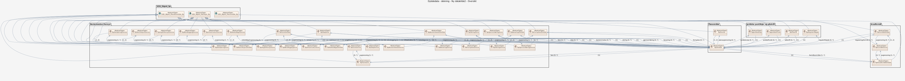
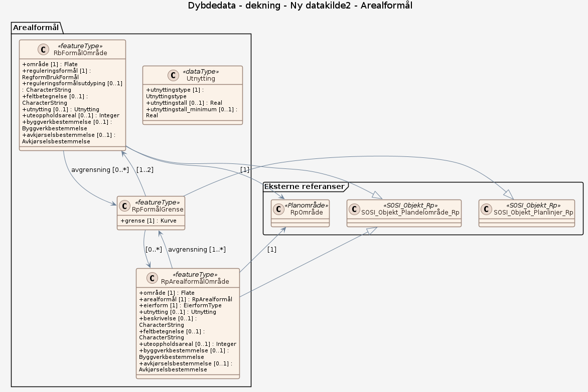
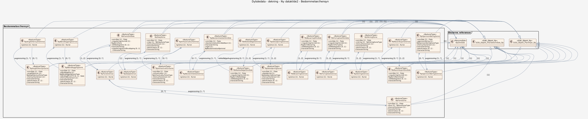
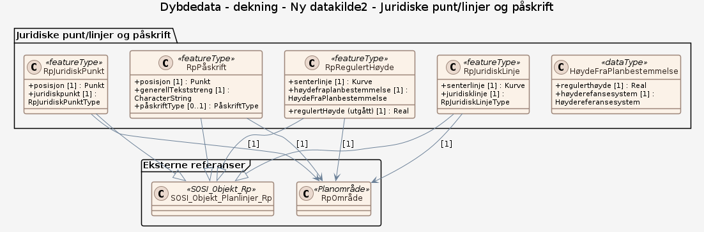
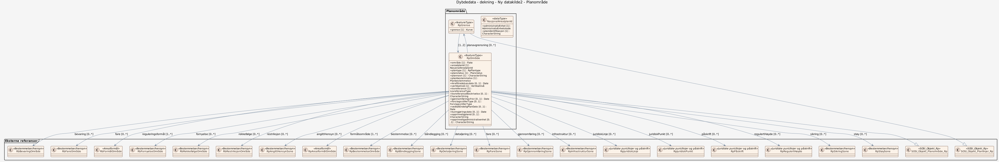
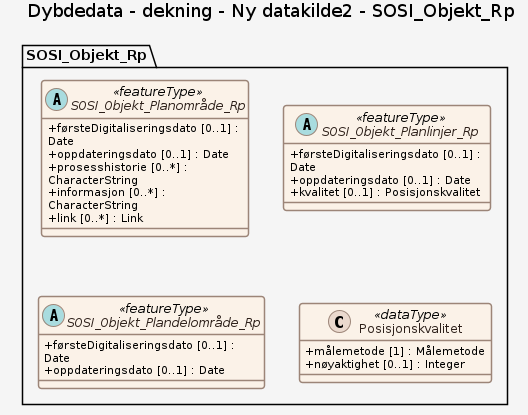

### Datamodell

**Kilde:** [SOSI UML XMI-fil](https://sosi.geonorge.no/svn/SOSI/SOSI%20Del%203/Reguleringsplaner%2020120416.xml)

#### Oversikt

#### Pakke: Arealformål

#### Pakke: Bestemmelser/hensyn

#### Pakke: Juridiske punt/linjer og påskrift

#### Pakke: Planområde

#### Pakke: SOSI_Objekt_Rp

#### Komplett diagram

#### SOSI_Objekt_Planområde_Rp (abstrakt)

abstrakt objekt som bærer en rekke egenskaper som er fagområde-uavhengige og kan benyttes for alle objekttyper  Merknad: Spesielt i produktspesifikasjonsarbeid vil en velge egenskaper og av grensningslinjer fra denne klassen.   -- Definition -- abstract object which carries a number of attributes which are independent of specific disciplines and may be used for all object types

Egenskaper

<table class="feature-attribute-table">
  <thead>
    <tr>
      <th>Egenskap</th>
      <th>Beskrivelse</th>
      <th>Type</th>
      <th>Multiplisitet</th>
    </tr>
  </thead>
  <tbody>
    <tr>
      <td>første<wbr />Digitaliseringsdato</td>
      <td>dato når en representasjon av objektet i digital form første gang ble etablert  Merknad: førsteDigitaliseringsdato kan skille seg fra førsteDatafangstdato ved at den første datafangsten skjedde analogt og gjort om til digital form senere i en produksjonsprosess. Eventuelt at innlegging i databasen skjedde på et senere tidspunkt enn registreringen /observasjonen / målingen av objektet.  -- Definition -- date when a representation of the object in digital form was established for the first time    Note: firstDigitisationDate may differ from firstDataCaptureDate by the first data capture having been analog and converted into digital form later in a production ??</td>
      <td>Date<wbr />Time</td>
      <td>0..1</td>
    </tr>
    <tr>
      <td>oppdateringsdato</td>
      <td>dato for siste endring på objektetdataene  Merknad: Oppdateringsdato kan være forskjellig fra Datafangsdato ved at data som er registrert kan bufres en kortere eller lengre periode før disse legges inn i datasystemet (databasen).  -- Definition -- date of latest modification of object data    Note: Date of updating may differ from date of data capture in that data which is registered may be buffered for a shorter or longer period of time, before being entered into the computer system (the database).</td>
      <td>Date<wbr />Time</td>
      <td>0..1</td>
    </tr>
    <tr>
      <td>prosesshistorie</td>
      <td>beskrivelse av de prosesser som dataene er gått gjennom som kan ha betydning for kvaliteten og bruken av dataene  Merknad: Prosesshistorie vil kunne inneholde informasjon om transformasjoner. Hva slags informasjon som angis er ofte gitt i andre standarder, f.eks kvalitet og kvalitetsikring.  -- Definition -- description of the processes through which the data has gone, and which may be significant for the quality and use of the data    Note: ProcessHistory may contain information on transformations. What kind of information is given is often indicated in other standards ??</td>
      <td>Character<wbr />String</td>
      <td>0..*</td>
    </tr>
    <tr>
      <td>informasjon</td>
      <td>generell opplysning  Merknad: mulighet til å legge inn utfyllende informasjon om objektet  -- Definition -- general information    Note: allows for entry of supplemental information about the object</td>
      <td>Character<wbr />String</td>
      <td>0..*</td>
    </tr>
    <tr>
      <td>link</td>
      <td>referanse  til et informasjonselement, enten lokalt eller globalt</td>
      <td>Link</td>
      <td>0..*</td>
    </tr>
  </tbody>
</table>

#### SOSI_Objekt_Planlinjer_Rp (abstrakt)

abstrakt objekt som bærer en rekke egenskaper som er fagområde-uavhengige og kan benyttes for alle objekttyper  Merknad: Spesielt i produktspesifikasjonsarbeid vil en velge egenskaper og av grensningslinjer fra denne klassen.   -- Definition -- abstract object which carries a number of attributes which are independent of specific disciplines and may be used for all object types

Egenskaper

<table class="feature-attribute-table">
  <thead>
    <tr>
      <th>Egenskap</th>
      <th>Beskrivelse</th>
      <th>Type</th>
      <th>Multiplisitet</th>
    </tr>
  </thead>
  <tbody>
    <tr>
      <td>første<wbr />Digitaliseringsdato</td>
      <td>dato når en representasjon av objektet i digital form første gang ble etablert  Merknad: førsteDigitaliseringsdato kan skille seg fra førsteDatafangstdato ved at den første datafangsten skjedde analogt og gjort om til digital form senere i en produksjonsprosess. Eventuelt at innlegging i databasen skjedde på et senere tidspunkt enn registreringen /observasjonen / målingen av objektet.  -- Definition -- date when a representation of the object in digital form was established for the first time    Note: firstDigitisationDate may differ from firstDataCaptureDate by the first data capture having been analog and converted into digital form later in a production ??</td>
      <td>Date<wbr />Time</td>
      <td>0..1</td>
    </tr>
    <tr>
      <td>oppdateringsdato</td>
      <td>dato for siste endring på objektetdataene  Merknad: Oppdateringsdato kan være forskjellig fra Datafangsdato ved at data som er registrert kan bufres en kortere eller lengre periode før disse legges inn i datasystemet (databasen).  -- Definition -- date of latest modification of object data    Note: Date of updating may differ from date of data capture in that data which is registered may be buffered for a shorter or longer period of time, before being entered into the computer system (the database).</td>
      <td>Date<wbr />Time</td>
      <td>0..1</td>
    </tr>
    <tr>
      <td>kvalitet</td>
      <td>beskrivelse av kvaliteten på stedfestingen  Merknad: Denne er identisk med ..KVALITET i tidligere versjoner av SOSI.  -- Definition -- description of the quality of the localization    Note: This is identical to ..KVALITET (quality) in previous ersions of SOSI.</td>
      <td>Posisjonskvalitet (datatype)</td>
      <td>0..1</td>
    </tr>
    <tr>
      <td>- målemetode</td>
      <td>metode for måling i grunnriss (x,y), og høyde (z) når metoden er den samme som ved måling i grunnriss  -- Definition -- method for measuring in ground outline (x,y), and height (z) when the method is the same as when measuring in ground outline</td>
      <td><a href="#kodeliste-målemetode">Målemetode</a> (kodeliste)</td>
      <td>1</td>
    </tr>
    <tr>
      <td>- nøyaktighet</td>
      <td>punktstandardavviket i grunnriss for punkter samt tverravvik for linjer  Merknad: Oppgitt i cm  -- Definition -- the point standard deviation in ground outline for points as well as lateral deviation of lines    Note: Stated in cm</td>
      <td>Integer</td>
      <td>0..1</td>
    </tr>
  </tbody>
</table>

#### SOSI_Objekt_Plandelområde_Rp (abstrakt)

abstrakt objekt som bærer en rekke egenskaper som er fagområde-uavhengige og kan benyttes for alle objekttyper  Merknad: Spesielt i produktspesifikasjonsarbeid vil en velge egenskaper og av grensningslinjer fra denne klassen.   -- Definition -- abstract object which carries a number of attributes which are independent of specific disciplines and may be used for all object types

Egenskaper

<table class="feature-attribute-table">
  <thead>
    <tr>
      <th>Egenskap</th>
      <th>Beskrivelse</th>
      <th>Type</th>
      <th>Multiplisitet</th>
    </tr>
  </thead>
  <tbody>
    <tr>
      <td>første<wbr />Digitaliseringsdato</td>
      <td>dato når en representasjon av objektet i digital form første gang ble etablert  Merknad: førsteDigitaliseringsdato kan skille seg fra førsteDatafangstdato ved at den første datafangsten skjedde analogt og gjort om til digital form senere i en produksjonsprosess. Eventuelt at innlegging i databasen skjedde på et senere tidspunkt enn registreringen /observasjonen / målingen av objektet.  -- Definition -- date when a representation of the object in digital form was established for the first time    Note: firstDigitisationDate may differ from firstDataCaptureDate by the first data capture having been analog and converted into digital form later in a production ??</td>
      <td>Date<wbr />Time</td>
      <td>0..1</td>
    </tr>
    <tr>
      <td>oppdateringsdato</td>
      <td>dato for siste endring på objektetdataene  Merknad: Oppdateringsdato kan være forskjellig fra Datafangsdato ved at data som er registrert kan bufres en kortere eller lengre periode før disse legges inn i datasystemet (databasen).  -- Definition -- date of latest modification of object data    Note: Date of updating may differ from date of data capture in that data which is registered may be buffered for a shorter or longer period of time, before being entered into the computer system (the database).</td>
      <td>Date<wbr />Time</td>
      <td>0..1</td>
    </tr>
  </tbody>
</table>

#### RpGrense

grense for regulerings- og bebyggelsesplan/områderegulering eller detaljregulering (pbl. 1985 §§ 22 og 24 og 28-2, eller pbl. §§ 12-1, 12-2 og 12-3)

Egenskaper

<table class="feature-attribute-table">
  <thead>
    <tr>
      <th>Egenskap</th>
      <th>Beskrivelse</th>
      <th>Type</th>
      <th>Multiplisitet</th>
    </tr>
  </thead>
  <tbody>
    <tr>
      <td>grense</td>
      <td>forløp som følger overgang mellom ulike fenomener</td>
      <td>Kurve</td>
      <td>1</td>
    </tr>
    <tr class="inherited-from">
      <th colspan="4" scope="rowgroup">Arvet fra SOSI_Objekt_Planlinjer_Rp</th>
    </tr>
    <tr>
      <td>første<wbr />Digitaliseringsdato</td>
      <td>dato når en representasjon av objektet i digital form første gang ble etablert  Merknad: førsteDigitaliseringsdato kan skille seg fra førsteDatafangstdato ved at den første datafangsten skjedde analogt og gjort om til digital form senere i en produksjonsprosess. Eventuelt at innlegging i databasen skjedde på et senere tidspunkt enn registreringen /observasjonen / målingen av objektet.  -- Definition -- date when a representation of the object in digital form was established for the first time    Note: firstDigitisationDate may differ from firstDataCaptureDate by the first data capture having been analog and converted into digital form later in a production ??</td>
      <td>Date<wbr />Time</td>
      <td>0..1</td>
    </tr>
    <tr>
      <td>oppdateringsdato</td>
      <td>dato for siste endring på objektetdataene  Merknad: Oppdateringsdato kan være forskjellig fra Datafangsdato ved at data som er registrert kan bufres en kortere eller lengre periode før disse legges inn i datasystemet (databasen).  -- Definition -- date of latest modification of object data    Note: Date of updating may differ from date of data capture in that data which is registered may be buffered for a shorter or longer period of time, before being entered into the computer system (the database).</td>
      <td>Date<wbr />Time</td>
      <td>0..1</td>
    </tr>
    <tr>
      <td>kvalitet</td>
      <td>beskrivelse av kvaliteten på stedfestingen  Merknad: Denne er identisk med ..KVALITET i tidligere versjoner av SOSI.  -- Definition -- description of the quality of the localization    Note: This is identical to ..KVALITET (quality) in previous ersions of SOSI.</td>
      <td>Posisjonskvalitet (datatype)</td>
      <td>0..1</td>
    </tr>
    <tr>
      <td>- målemetode</td>
      <td>metode for måling i grunnriss (x,y), og høyde (z) når metoden er den samme som ved måling i grunnriss  -- Definition -- method for measuring in ground outline (x,y), and height (z) when the method is the same as when measuring in ground outline</td>
      <td><a href="#kodeliste-målemetode">Målemetode</a> (kodeliste)</td>
      <td>1</td>
    </tr>
    <tr>
      <td>- nøyaktighet</td>
      <td>punktstandardavviket i grunnriss for punkter samt tverravvik for linjer  Merknad: Oppgitt i cm  -- Definition -- the point standard deviation in ground outline for points as well as lateral deviation of lines    Note: Stated in cm</td>
      <td>Integer</td>
      <td>0..1</td>
    </tr>
  </tbody>
</table>

Relasjoner

**Arv**
SOSI_Objekt_Planlinjer_Rp

**Assosiasjoner**
RpOmråde – kardinalitet: 1..2

#### RpOmråde

område for regulerings- og bebyggelsesplan/områderegulering, eller detaljregulering, jf. pbl. 1985 §§ 22 og 24 og 28-2, eller pbl. §§ 12-1, 12-2 og 12-3

Egenskaper

<table class="feature-attribute-table">
  <thead>
    <tr>
      <th>Egenskap</th>
      <th>Beskrivelse</th>
      <th>Type</th>
      <th>Multiplisitet</th>
    </tr>
  </thead>
  <tbody>
    <tr>
      <td>område</td>
      <td>objektets utstrekning</td>
      <td>Flate</td>
      <td>1</td>
    </tr>
    <tr>
      <td>arealplan<wbr />Id</td>
      <td>entydig identifikasjon for en plan innen en kommune eller et fylke (pbl. 1985 § 18, § 19-1, sjette ledd, § 20-1 andre og femte ledd og § 22 og § 28-2/pbl. §§ 6-4, 8-1, 9-1, 11-1 og § 12-1, samt kart- og planforskriften § 9 andre og sjette ledd)</td>
      <td>Nasjonal<wbr />Arealplan<wbr />Id (datatype)</td>
      <td>1</td>
    </tr>
    <tr>
      <td>- administrativ<wbr />Enhet</td>
      <td>entyding identifikasjon av administrativ enhet</td>
      <td>Administrativ<wbr />Enhetskode</td>
      <td>1</td>
    </tr>
    <tr>
      <td>- planidentifikasjon</td>
      <td>entydig identifikasjon for en plan innen en kommune eller et fylke (pbl. 1985 § 18, § 19-1 sjette ledd, § 20-1 andre og femte ledd og § 22 og § 28-2/pbl. §§ 6-4, 8-1, 9-1, 11-1 og § 12-1, samt kart- og planforskriften § 9 andre og sjette ledd)</td>
      <td>Character<wbr />String</td>
      <td>1</td>
    </tr>
    <tr>
      <td>plantype</td>
      <td>type plan (pbl. 1985 § 19-1 sjette ledd, § 20-1 andre og femte ledd og § 22 og § 28-2/pbl. §§ 8-1, 11-5, 12-2 og 12-3)</td>
      <td><a href="#kodeliste-rpplantype">Rp<wbr />Plantype</a> (kodeliste)</td>
      <td>1</td>
    </tr>
    <tr>
      <td>planstatus</td>
      <td>planens behandling (pbl. 1985 §§ 19-4, 20-5, 27-1, 27-2, 28-1 og 28-2) samt planens virkning (pbl. 1985 §§ 19-6, 20-6, 28-2 og 31/pbl. §§ 8-3, 8-4, 9-3, 9-4, §§ 11-12 til 11-15, og §§ 12-8 til 12-12)</td>
      <td><a href="#kodeliste-planstatus">Planstatus</a> (kodeliste)</td>
      <td>1</td>
    </tr>
    <tr>
      <td>plannavn</td>
      <td>planens navn (pbl. 1985 § 19-1 sjette ledd, § 20-1 andre og femte ledd og § 22 og § 28-2/pbl. §§ 6-4, 8-1, 9-1, 11-1 og § 12-1, samt kart- og planforskriften § 9 sjette ledd)</td>
      <td>Character<wbr />String</td>
      <td>1</td>
    </tr>
    <tr>
      <td>planbestemmelse</td>
      <td>angir om plan har bestemmelser, i så fall om de er egen tekst, og om de er påført plankartet (pbl. 1985 § 20-4 andre ledd bokstav a til h og § 26/pbl. §§ 11-9, 11-10 og 11-11, samt § 12-7)</td>
      <td><a href="#kodeliste-planbestemmelse">Planbestemmelse</a> (kodeliste)</td>
      <td>1</td>
    </tr>
    <tr>
      <td>ikrafttredelsesdato</td>
      <td>dato for ikrafttredelse av planer (pbl. 1985 §§ 18, 19-1 sjette ledd, 20-1 andre ledd, 22 og 28-2, samt pbl. §§ 8-4, 8-5, 11-6, 11- 15, 11-16, 12-4, 12-12 og 12-13)</td>
      <td>Date</td>
      <td>0..1</td>
    </tr>
    <tr>
      <td>vertikalnivå</td>
      <td>planens eller innholdets beliggenhet i forhold til jordoverflaten (pbl. § 19-1 sjette ledd, § 20-1 andre og femte ledd og § 22 og § 28-2)</td>
      <td><a href="#kodeliste-vertikalnivå">Vertikalnivå</a> (kodeliste)</td>
      <td>1</td>
    </tr>
    <tr>
      <td>lovreferanse</td>
      <td>kode for hvilken lov planen er vedtatt etter</td>
      <td><a href="#kodeliste-lovreferansetype">Lovreferanse<wbr />Type</a> (kodeliste)</td>
      <td>1</td>
    </tr>
    <tr>
      <td>lovreferanse<wbr />Beskrivelse</td>
      <td>tekstlig beskrivelse av hvilken lov planen er vedtatt med hjemmel i</td>
      <td>Character<wbr />String</td>
      <td>0..1</td>
    </tr>
    <tr>
      <td>gjennomføringsfrist</td>
      <td>frist for gjennomføring av private detaljplaner (pbl. § 12-4 femte ledd)</td>
      <td>Date</td>
      <td>0..1</td>
    </tr>
    <tr>
      <td>forslagsstiller<wbr />Type</td>
      <td>om forslagsstiller er privat eller offentlig planmyndighet</td>
      <td><a href="#kodeliste-forslagsstillertype">Forslagsstiller<wbr />Type</a> (enumerering)</td>
      <td>0..1</td>
    </tr>
    <tr>
      <td>vedtak<wbr />Endelig<wbr />Plan<wbr />Dato</td>
      <td>dato når arealplanen med tilhørende bestemmelser gjennom statlig, regionalt eller kommunalt vedtak etter plan- og bygningsloven har fått rettsvirkning</td>
      <td>Date</td>
      <td>0..1</td>
    </tr>
    <tr>
      <td>kunngjøringsdato</td>
      <td>dato når endelig vedtatt arealplan eller planbestemmelse ble kunngjort, pbl. § 6-3, 8-5 siste ledd, 11-15 tredje ledd og 12-12 siste ledd</td>
      <td>Date</td>
      <td>0..1</td>
    </tr>
    <tr>
      <td>opprinneligplanid</td>
      <td>planidentifikasjon for opprinnelig plan. Brukes kun dersom planen har fått ny NasjonalArealplanid.</td>
      <td>Character<wbr />String</td>
      <td>0..1</td>
    </tr>
    <tr>
      <td>opprinneligadministrativenhet</td>
      <td>administrativEnhet for opprinnelig plan. Brukes kun dersom planen har fått ny NasjonalArealplanid.</td>
      <td>Character<wbr />String</td>
      <td>0..1</td>
    </tr>
    <tr class="inherited-from">
      <th colspan="4" scope="rowgroup">Arvet fra SOSI_Objekt_Planområde_Rp</th>
    </tr>
    <tr>
      <td>første<wbr />Digitaliseringsdato</td>
      <td>dato når en representasjon av objektet i digital form første gang ble etablert  Merknad: førsteDigitaliseringsdato kan skille seg fra førsteDatafangstdato ved at den første datafangsten skjedde analogt og gjort om til digital form senere i en produksjonsprosess. Eventuelt at innlegging i databasen skjedde på et senere tidspunkt enn registreringen /observasjonen / målingen av objektet.  -- Definition -- date when a representation of the object in digital form was established for the first time    Note: firstDigitisationDate may differ from firstDataCaptureDate by the first data capture having been analog and converted into digital form later in a production ??</td>
      <td>Date<wbr />Time</td>
      <td>0..1</td>
    </tr>
    <tr>
      <td>oppdateringsdato</td>
      <td>dato for siste endring på objektetdataene  Merknad: Oppdateringsdato kan være forskjellig fra Datafangsdato ved at data som er registrert kan bufres en kortere eller lengre periode før disse legges inn i datasystemet (databasen).  -- Definition -- date of latest modification of object data    Note: Date of updating may differ from date of data capture in that data which is registered may be buffered for a shorter or longer period of time, before being entered into the computer system (the database).</td>
      <td>Date<wbr />Time</td>
      <td>0..1</td>
    </tr>
    <tr>
      <td>prosesshistorie</td>
      <td>beskrivelse av de prosesser som dataene er gått gjennom som kan ha betydning for kvaliteten og bruken av dataene  Merknad: Prosesshistorie vil kunne inneholde informasjon om transformasjoner. Hva slags informasjon som angis er ofte gitt i andre standarder, f.eks kvalitet og kvalitetsikring.  -- Definition -- description of the processes through which the data has gone, and which may be significant for the quality and use of the data    Note: ProcessHistory may contain information on transformations. What kind of information is given is often indicated in other standards ??</td>
      <td>Character<wbr />String</td>
      <td>0..*</td>
    </tr>
    <tr>
      <td>informasjon</td>
      <td>generell opplysning  Merknad: mulighet til å legge inn utfyllende informasjon om objektet  -- Definition -- general information    Note: allows for entry of supplemental information about the object</td>
      <td>Character<wbr />String</td>
      <td>0..*</td>
    </tr>
    <tr>
      <td>link</td>
      <td>referanse  til et informasjonselement, enten lokalt eller globalt</td>
      <td>Link</td>
      <td>0..*</td>
    </tr>
  </tbody>
</table>

Relasjoner

**Arv**
SOSI_Objekt_Planområde_Rp

**Assosiasjoner**
RpGrense – rolle: planavgrensning – kardinalitet: 0..*
RpGjennomføringSone – rolle: gjennomføring – kardinalitet: 0..*
RpDetaljeringSone – rolle: detaljering – kardinalitet: 0..*
RbFormålOmråde – rolle: reguleringsformål – kardinalitet: 1..*
RpBestemmelseOmråde – rolle: bestemmelse – kardinalitet: 0..*
RpRegulertHøyde – rolle: regulertHøyde – kardinalitet: 0..*
RpFareSone – rolle: fare – kardinalitet: 0..*
RbFornyelseOmråde – rolle: fornyelse – kardinalitet: 0..*
RpSikringSone – rolle: sikring – kardinalitet: 0..*
RpJuridiskPunkt – rolle: juridiskPunkt – kardinalitet: 0..*
RbFareOmråde – rolle: fare – kardinalitet: 0..*
RpPåskrift – rolle: påskrift – kardinalitet: 0..*
RpJuridiskLinje – rolle: juridiskLinje – kardinalitet: 0..*
RbRestriksjonOmråde – rolle: restriksjon – kardinalitet: 0..*
RbBevaringOmråde – rolle: bevaring – kardinalitet: 0..*
RpBåndleggingSone – rolle: båndlegging – kardinalitet: 0..*
RbRekkefølgeOmråde – rolle: rekkefølge – kardinalitet: 0..*
RpAngittHensynSone – rolle: angittHensyn – kardinalitet: 0..*
RpStøySone – rolle: støy – kardinalitet: 0..*
RpArealformålOmråde – rolle: formålsområde – kardinalitet: 1..*
RpInfrastrukturSone – rolle: infrastruktur – kardinalitet: 0..*

#### RbFormålOmråde

område for reguleringsformål i regulerings- og bebyggelsesplan (pbl. 1985 § 25, første ledd)

Egenskaper

<table class="feature-attribute-table">
  <thead>
    <tr>
      <th>Egenskap</th>
      <th>Beskrivelse</th>
      <th>Type</th>
      <th>Multiplisitet</th>
    </tr>
  </thead>
  <tbody>
    <tr>
      <td>område</td>
      <td>objektets utstrekning</td>
      <td>Flate</td>
      <td>1</td>
    </tr>
    <tr>
      <td>reguleringsformål</td>
      <td>type reguleringsformål (pbl. 1985 § 25 første ledd)</td>
      <td><a href="#kodeliste-regformbrukformål">Regform<wbr />Bruk<wbr />Formål</a> (kodeliste)</td>
      <td>1</td>
    </tr>
    <tr>
      <td>reguleringsformålsutdyping</td>
      <td>utdyping av reguleringsformål (pbl. 1985 § 25 første ledd)</td>
      <td>Character<wbr />String</td>
      <td>0..1</td>
    </tr>
    <tr>
      <td>feltbetegnelse</td>
      <td>navn/betegnelse på formålsfelt innen regulerings- og bebyggelsesplan (pbl. 1985 § 25, 1 første ledd)</td>
      <td>Character<wbr />String</td>
      <td>0..1</td>
    </tr>
    <tr>
      <td>utnytting</td>
      <td>grad av utnytting (pbl. § 20-4 andre ledd bokstav b og § 26 første ledd og forskrift TEK kap. III)</td>
      <td>Utnytting (datatype)</td>
      <td>0..1</td>
    </tr>
    <tr>
      <td>- utnyttingstype</td>
      <td>type grad av utnytting (pbl. 1985 §§ 20-4 annet ledd bokstav b, 26 første ledd og forskrift TEK kap. III, pbl. § 12-7 første ledd nr 5 og TEK10 kap. 5)</td>
      <td><a href="#kodeliste-utnyttingstype">Utnyttingstype</a> (kodeliste)</td>
      <td>1</td>
    </tr>
    <tr>
      <td>- utnyttingstall</td>
      <td>tallverdi for grad av utnytting (pbl. 1985 §§ 20-4 annet ledd bokstav b, 26 første ledd og forskrift TEK kap. III, pbl. §12-7 første ledd nr 5 og TEK10 kap. 5 )</td>
      <td>Real</td>
      <td>0..1</td>
    </tr>
    <tr>
      <td>- utnyttingstall_<wbr />minimum</td>
      <td>tallverdi for minste utnyttingsgrad (pbl. §12-7 første ledd nr 5 og TEK10 kap 5 )</td>
      <td>Real</td>
      <td>0..1</td>
    </tr>
    <tr>
      <td>uteoppholdsareal</td>
      <td>minste uteoppholdsareal (pbl. 1985 § 26 andre ledd og forskrift TEK kap. III)</td>
      <td>Integer</td>
      <td>0..1</td>
    </tr>
    <tr>
      <td>byggverkbestemmelse</td>
      <td>planbestemmelse om bygningers plassering, utforming mv. (pbl. 1985 § 20-4 andre ledd bokstav a og § 26 første ledd og § 28-2, samt pbl. 1985 §§ 11-10 nr. 1 og 12-7 nr. 1 og 2)</td>
      <td><a href="#kodeliste-byggverkbestemmelse">Byggverkbestemmelse</a> (kodeliste)</td>
      <td>0..1</td>
    </tr>
    <tr>
      <td>avkjørselsbestemmelse</td>
      <td>planbestemmelse om avkjørsel (pbl. 1985 §§ 25 og 26 første ledd, og pbl. 1985 § 11-10 nr. 4)  Merknad: Angir om avkjørsel til formålsområdet tillates eller ikke tillates, eller om det i planbestemmelser er tillatt avkjørsel via annet formål enn vei (via gangvei, turvei e.l.).  I sistnevnte situasjon knyttes egenskapen til det formålsområdet det er tillatt å passere</td>
      <td><a href="#kodeliste-avkjørselsbestemmelse">Avkjørselsbestemmelse</a> (kodeliste)</td>
      <td>0..1</td>
    </tr>
    <tr class="inherited-from">
      <th colspan="4" scope="rowgroup">Arvet fra SOSI_Objekt_Plandelområde_Rp</th>
    </tr>
    <tr>
      <td>første<wbr />Digitaliseringsdato</td>
      <td>dato når en representasjon av objektet i digital form første gang ble etablert  Merknad: førsteDigitaliseringsdato kan skille seg fra førsteDatafangstdato ved at den første datafangsten skjedde analogt og gjort om til digital form senere i en produksjonsprosess. Eventuelt at innlegging i databasen skjedde på et senere tidspunkt enn registreringen /observasjonen / målingen av objektet.  -- Definition -- date when a representation of the object in digital form was established for the first time    Note: firstDigitisationDate may differ from firstDataCaptureDate by the first data capture having been analog and converted into digital form later in a production ??</td>
      <td>Date<wbr />Time</td>
      <td>0..1</td>
    </tr>
    <tr>
      <td>oppdateringsdato</td>
      <td>dato for siste endring på objektetdataene  Merknad: Oppdateringsdato kan være forskjellig fra Datafangsdato ved at data som er registrert kan bufres en kortere eller lengre periode før disse legges inn i datasystemet (databasen).  -- Definition -- date of latest modification of object data    Note: Date of updating may differ from date of data capture in that data which is registered may be buffered for a shorter or longer period of time, before being entered into the computer system (the database).</td>
      <td>Date<wbr />Time</td>
      <td>0..1</td>
    </tr>
  </tbody>
</table>

Relasjoner

**Arv**
SOSI_Objekt_Plandelområde_Rp

**Assosiasjoner**
RpOmråde – kardinalitet: 1
RpFormålGrense – rolle: avgrensning – kardinalitet: 0..*

#### RpFormålGrense

grense for reguleringsformål i regulerings- og bebyggelsesplan/områderegulering og detaljregulering (pbl. 1985 § 25 første ledd, eller pbl. § 12-5)

Egenskaper

<table class="feature-attribute-table">
  <thead>
    <tr>
      <th>Egenskap</th>
      <th>Beskrivelse</th>
      <th>Type</th>
      <th>Multiplisitet</th>
    </tr>
  </thead>
  <tbody>
    <tr>
      <td>grense</td>
      <td>forløp som følger overgang mellom ulike fenomener</td>
      <td>Kurve</td>
      <td>1</td>
    </tr>
    <tr class="inherited-from">
      <th colspan="4" scope="rowgroup">Arvet fra SOSI_Objekt_Planlinjer_Rp</th>
    </tr>
    <tr>
      <td>første<wbr />Digitaliseringsdato</td>
      <td>dato når en representasjon av objektet i digital form første gang ble etablert  Merknad: førsteDigitaliseringsdato kan skille seg fra førsteDatafangstdato ved at den første datafangsten skjedde analogt og gjort om til digital form senere i en produksjonsprosess. Eventuelt at innlegging i databasen skjedde på et senere tidspunkt enn registreringen /observasjonen / målingen av objektet.  -- Definition -- date when a representation of the object in digital form was established for the first time    Note: firstDigitisationDate may differ from firstDataCaptureDate by the first data capture having been analog and converted into digital form later in a production ??</td>
      <td>Date<wbr />Time</td>
      <td>0..1</td>
    </tr>
    <tr>
      <td>oppdateringsdato</td>
      <td>dato for siste endring på objektetdataene  Merknad: Oppdateringsdato kan være forskjellig fra Datafangsdato ved at data som er registrert kan bufres en kortere eller lengre periode før disse legges inn i datasystemet (databasen).  -- Definition -- date of latest modification of object data    Note: Date of updating may differ from date of data capture in that data which is registered may be buffered for a shorter or longer period of time, before being entered into the computer system (the database).</td>
      <td>Date<wbr />Time</td>
      <td>0..1</td>
    </tr>
    <tr>
      <td>kvalitet</td>
      <td>beskrivelse av kvaliteten på stedfestingen  Merknad: Denne er identisk med ..KVALITET i tidligere versjoner av SOSI.  -- Definition -- description of the quality of the localization    Note: This is identical to ..KVALITET (quality) in previous ersions of SOSI.</td>
      <td>Posisjonskvalitet (datatype)</td>
      <td>0..1</td>
    </tr>
    <tr>
      <td>- målemetode</td>
      <td>metode for måling i grunnriss (x,y), og høyde (z) når metoden er den samme som ved måling i grunnriss  -- Definition -- method for measuring in ground outline (x,y), and height (z) when the method is the same as when measuring in ground outline</td>
      <td><a href="#kodeliste-målemetode">Målemetode</a> (kodeliste)</td>
      <td>1</td>
    </tr>
    <tr>
      <td>- nøyaktighet</td>
      <td>punktstandardavviket i grunnriss for punkter samt tverravvik for linjer  Merknad: Oppgitt i cm  -- Definition -- the point standard deviation in ground outline for points as well as lateral deviation of lines    Note: Stated in cm</td>
      <td>Integer</td>
      <td>0..1</td>
    </tr>
  </tbody>
</table>

Relasjoner

**Arv**
SOSI_Objekt_Planlinjer_Rp

**Assosiasjoner**
RbFormålOmråde – kardinalitet: 1..2
RpArealformålOmråde – kardinalitet: 0..*

#### RpArealformålOmråde

område med arealformål i reguleringsplan (pbl. § 12-5)

Egenskaper

<table class="feature-attribute-table">
  <thead>
    <tr>
      <th>Egenskap</th>
      <th>Beskrivelse</th>
      <th>Type</th>
      <th>Multiplisitet</th>
    </tr>
  </thead>
  <tbody>
    <tr>
      <td>område</td>
      <td>objektets utstrekning</td>
      <td>Flate</td>
      <td>1</td>
    </tr>
    <tr>
      <td>arealformål</td>
      <td>arealformål - formålet må angis nærmere (pbl. § 12-5)</td>
      <td><a href="#kodeliste-rparealformål">Rp<wbr />Arealformål</a> (kodeliste)</td>
      <td>1</td>
    </tr>
    <tr>
      <td>eierform</td>
      <td>planbestemmelse om arealet skal eies av private eller det offentlige, eller være fellesarealer for flere eiendommer (pbl. § 11-10 nr .3 og § 12-7 nr. 14)</td>
      <td><a href="#kodeliste-eierformtype">Eierform<wbr />Type</a> (kodeliste)</td>
      <td>1</td>
    </tr>
    <tr>
      <td>utnytting</td>
      <td>grad av utnytting (pbl. 1985 § 20-4 andre ledd bokstav b og § 26 første ledd og forskrift TEK kap. III/pbl. §§ 11-9 nr. 5 og 12-7 nr. 5, samt TEK10 kap. 5)</td>
      <td>Utnytting (datatype)</td>
      <td>0..1</td>
    </tr>
    <tr>
      <td>- utnyttingstype</td>
      <td>type grad av utnytting (pbl. 1985 §§ 20-4 annet ledd bokstav b, 26 første ledd og forskrift TEK kap. III, pbl. § 12-7 første ledd nr 5 og TEK10 kap. 5)</td>
      <td><a href="#kodeliste-utnyttingstype">Utnyttingstype</a> (kodeliste)</td>
      <td>1</td>
    </tr>
    <tr>
      <td>- utnyttingstall</td>
      <td>tallverdi for grad av utnytting (pbl. 1985 §§ 20-4 annet ledd bokstav b, 26 første ledd og forskrift TEK kap. III, pbl. §12-7 første ledd nr 5 og TEK10 kap. 5 )</td>
      <td>Real</td>
      <td>0..1</td>
    </tr>
    <tr>
      <td>- utnyttingstall_<wbr />minimum</td>
      <td>tallverdi for minste utnyttingsgrad (pbl. §12-7 første ledd nr 5 og TEK10 kap 5 )</td>
      <td>Real</td>
      <td>0..1</td>
    </tr>
    <tr>
      <td>beskrivelse</td>
      <td>beskrivelse kan benyttes der loven gir anledning til detaljering, for eks, "andre anlegg", men der lov/forskrift ikke definerer detaljeringen i form av spesifikke arealformål</td>
      <td>Character<wbr />String</td>
      <td>0..1</td>
    </tr>
    <tr>
      <td>feltbetegnelse</td>
      <td>navn/betegnelse på formålsfelt innen regulerings- og bebyggelsesplan (pbl. 1985 § 25 første ledd/pbl. § 12-5 første ledd/pbl. § 12-7 nr. 4, samt TEK10 § 5-6 og kap. 8)</td>
      <td>Character<wbr />String</td>
      <td>0..1</td>
    </tr>
    <tr>
      <td>uteoppholdsareal</td>
      <td>minste uteoppholdsareal (pbl. § 26, andre ledd og forskrift TEK kap III)</td>
      <td>Integer</td>
      <td>0..1</td>
    </tr>
    <tr>
      <td>byggverkbestemmelse</td>
      <td>planbestemmelse om bygningers plassering, utforming mv. (pbl. 1985 § 20-4, andre ledd bokstav a og § 26, 1. ledd og § 28-2, samt pbl. §§ 11-10 nr. 1 og 12-7 nr. 1 og 2, samt TEK10 kap. 7 og § 8-3)</td>
      <td><a href="#kodeliste-byggverkbestemmelse">Byggverkbestemmelse</a> (kodeliste)</td>
      <td>0..1</td>
    </tr>
    <tr>
      <td>avkjørselsbestemmelse</td>
      <td>planbestemmelse om avkjørsel (pbl. 1985 §§ 25 og 26, 1. ledd, og pbl. § 11-10 nr. 4 og TEK10 § 8-8)  Merknad: Angir om avkjørsel til formålsområde tillates eller ikke tillates, eller om det i plan / bestemmelser er tillatt avkjørsel via annet formål enn vei (via gangvei, turvei e.l.).  I sistnevnte situasjon knyttes egenskapen til det formålsområde det er tillatt å passere</td>
      <td><a href="#kodeliste-avkjørselsbestemmelse">Avkjørselsbestemmelse</a> (kodeliste)</td>
      <td>0..1</td>
    </tr>
    <tr class="inherited-from">
      <th colspan="4" scope="rowgroup">Arvet fra SOSI_Objekt_Plandelområde_Rp</th>
    </tr>
    <tr>
      <td>første<wbr />Digitaliseringsdato</td>
      <td>dato når en representasjon av objektet i digital form første gang ble etablert  Merknad: førsteDigitaliseringsdato kan skille seg fra førsteDatafangstdato ved at den første datafangsten skjedde analogt og gjort om til digital form senere i en produksjonsprosess. Eventuelt at innlegging i databasen skjedde på et senere tidspunkt enn registreringen /observasjonen / målingen av objektet.  -- Definition -- date when a representation of the object in digital form was established for the first time    Note: firstDigitisationDate may differ from firstDataCaptureDate by the first data capture having been analog and converted into digital form later in a production ??</td>
      <td>Date<wbr />Time</td>
      <td>0..1</td>
    </tr>
    <tr>
      <td>oppdateringsdato</td>
      <td>dato for siste endring på objektetdataene  Merknad: Oppdateringsdato kan være forskjellig fra Datafangsdato ved at data som er registrert kan bufres en kortere eller lengre periode før disse legges inn i datasystemet (databasen).  -- Definition -- date of latest modification of object data    Note: Date of updating may differ from date of data capture in that data which is registered may be buffered for a shorter or longer period of time, before being entered into the computer system (the database).</td>
      <td>Date<wbr />Time</td>
      <td>0..1</td>
    </tr>
  </tbody>
</table>

Relasjoner

**Arv**
SOSI_Objekt_Plandelområde_Rp

**Assosiasjoner**
RpOmråde – kardinalitet: 1
RpFormålGrense – rolle: avgrensning – kardinalitet: 1..*

#### RpAngittHensynGrense

grense for hensynssone i reguleringsplan (pbl. § 12-6, jf. § 11-8)

Egenskaper

<table class="feature-attribute-table">
  <thead>
    <tr>
      <th>Egenskap</th>
      <th>Beskrivelse</th>
      <th>Type</th>
      <th>Multiplisitet</th>
    </tr>
  </thead>
  <tbody>
    <tr>
      <td>grense</td>
      <td></td>
      <td>Kurve</td>
      <td>1</td>
    </tr>
    <tr class="inherited-from">
      <th colspan="4" scope="rowgroup">Arvet fra SOSI_Objekt_Planlinjer_Rp</th>
    </tr>
    <tr>
      <td>første<wbr />Digitaliseringsdato</td>
      <td>dato når en representasjon av objektet i digital form første gang ble etablert  Merknad: førsteDigitaliseringsdato kan skille seg fra førsteDatafangstdato ved at den første datafangsten skjedde analogt og gjort om til digital form senere i en produksjonsprosess. Eventuelt at innlegging i databasen skjedde på et senere tidspunkt enn registreringen /observasjonen / målingen av objektet.  -- Definition -- date when a representation of the object in digital form was established for the first time    Note: firstDigitisationDate may differ from firstDataCaptureDate by the first data capture having been analog and converted into digital form later in a production ??</td>
      <td>Date<wbr />Time</td>
      <td>0..1</td>
    </tr>
    <tr>
      <td>oppdateringsdato</td>
      <td>dato for siste endring på objektetdataene  Merknad: Oppdateringsdato kan være forskjellig fra Datafangsdato ved at data som er registrert kan bufres en kortere eller lengre periode før disse legges inn i datasystemet (databasen).  -- Definition -- date of latest modification of object data    Note: Date of updating may differ from date of data capture in that data which is registered may be buffered for a shorter or longer period of time, before being entered into the computer system (the database).</td>
      <td>Date<wbr />Time</td>
      <td>0..1</td>
    </tr>
    <tr>
      <td>kvalitet</td>
      <td>beskrivelse av kvaliteten på stedfestingen  Merknad: Denne er identisk med ..KVALITET i tidligere versjoner av SOSI.  -- Definition -- description of the quality of the localization    Note: This is identical to ..KVALITET (quality) in previous ersions of SOSI.</td>
      <td>Posisjonskvalitet (datatype)</td>
      <td>0..1</td>
    </tr>
    <tr>
      <td>- målemetode</td>
      <td>metode for måling i grunnriss (x,y), og høyde (z) når metoden er den samme som ved måling i grunnriss  -- Definition -- method for measuring in ground outline (x,y), and height (z) when the method is the same as when measuring in ground outline</td>
      <td><a href="#kodeliste-målemetode">Målemetode</a> (kodeliste)</td>
      <td>1</td>
    </tr>
    <tr>
      <td>- nøyaktighet</td>
      <td>punktstandardavviket i grunnriss for punkter samt tverravvik for linjer  Merknad: Oppgitt i cm  -- Definition -- the point standard deviation in ground outline for points as well as lateral deviation of lines    Note: Stated in cm</td>
      <td>Integer</td>
      <td>0..1</td>
    </tr>
  </tbody>
</table>

Relasjoner

**Arv**
SOSI_Objekt_Planlinjer_Rp

**Assosiasjoner**
RpAngittHensynSone – kardinalitet: 0..*

#### RpBåndleggingGrense

grense for hensynssone for båndlegging i reguleringsplan (pbl. § 12-6, jf. § 11-8 tredje ledd bokstav d)

Egenskaper

<table class="feature-attribute-table">
  <thead>
    <tr>
      <th>Egenskap</th>
      <th>Beskrivelse</th>
      <th>Type</th>
      <th>Multiplisitet</th>
    </tr>
  </thead>
  <tbody>
    <tr>
      <td>grense</td>
      <td></td>
      <td>Kurve</td>
      <td>1</td>
    </tr>
    <tr class="inherited-from">
      <th colspan="4" scope="rowgroup">Arvet fra SOSI_Objekt_Planlinjer_Rp</th>
    </tr>
    <tr>
      <td>første<wbr />Digitaliseringsdato</td>
      <td>dato når en representasjon av objektet i digital form første gang ble etablert  Merknad: førsteDigitaliseringsdato kan skille seg fra førsteDatafangstdato ved at den første datafangsten skjedde analogt og gjort om til digital form senere i en produksjonsprosess. Eventuelt at innlegging i databasen skjedde på et senere tidspunkt enn registreringen /observasjonen / målingen av objektet.  -- Definition -- date when a representation of the object in digital form was established for the first time    Note: firstDigitisationDate may differ from firstDataCaptureDate by the first data capture having been analog and converted into digital form later in a production ??</td>
      <td>Date<wbr />Time</td>
      <td>0..1</td>
    </tr>
    <tr>
      <td>oppdateringsdato</td>
      <td>dato for siste endring på objektetdataene  Merknad: Oppdateringsdato kan være forskjellig fra Datafangsdato ved at data som er registrert kan bufres en kortere eller lengre periode før disse legges inn i datasystemet (databasen).  -- Definition -- date of latest modification of object data    Note: Date of updating may differ from date of data capture in that data which is registered may be buffered for a shorter or longer period of time, before being entered into the computer system (the database).</td>
      <td>Date<wbr />Time</td>
      <td>0..1</td>
    </tr>
    <tr>
      <td>kvalitet</td>
      <td>beskrivelse av kvaliteten på stedfestingen  Merknad: Denne er identisk med ..KVALITET i tidligere versjoner av SOSI.  -- Definition -- description of the quality of the localization    Note: This is identical to ..KVALITET (quality) in previous ersions of SOSI.</td>
      <td>Posisjonskvalitet (datatype)</td>
      <td>0..1</td>
    </tr>
    <tr>
      <td>- målemetode</td>
      <td>metode for måling i grunnriss (x,y), og høyde (z) når metoden er den samme som ved måling i grunnriss  -- Definition -- method for measuring in ground outline (x,y), and height (z) when the method is the same as when measuring in ground outline</td>
      <td><a href="#kodeliste-målemetode">Målemetode</a> (kodeliste)</td>
      <td>1</td>
    </tr>
    <tr>
      <td>- nøyaktighet</td>
      <td>punktstandardavviket i grunnriss for punkter samt tverravvik for linjer  Merknad: Oppgitt i cm  -- Definition -- the point standard deviation in ground outline for points as well as lateral deviation of lines    Note: Stated in cm</td>
      <td>Integer</td>
      <td>0..1</td>
    </tr>
  </tbody>
</table>

Relasjoner

**Arv**
SOSI_Objekt_Planlinjer_Rp

**Assosiasjoner**
RpBåndleggingSone – kardinalitet: 0..*

#### RbFareOmråde

område med fare i regulerings- og bebyggelsesplan (pbl. 1985 § 25 første ledd, nr. 5)

Egenskaper

<table class="feature-attribute-table">
  <thead>
    <tr>
      <th>Egenskap</th>
      <th>Beskrivelse</th>
      <th>Type</th>
      <th>Multiplisitet</th>
    </tr>
  </thead>
  <tbody>
    <tr>
      <td>område</td>
      <td>objektets utstrekning</td>
      <td>Flate</td>
      <td>1</td>
    </tr>
    <tr>
      <td>reguleringsformål</td>
      <td>type reguleringsformål (pbl. 1985 § 25 første ledd)</td>
      <td><a href="#kodeliste-regformfare">Regform<wbr />Fare</a> (kodeliste)</td>
      <td>1</td>
    </tr>
    <tr>
      <td>feltbetegnelse</td>
      <td>navn/betegnelse på formålsfelt innen regulerings- og bebyggelsesplan (pbl. 1985 § 25 første ledd)</td>
      <td>Character<wbr />String</td>
      <td>0..1</td>
    </tr>
    <tr>
      <td>reguleringsformålsutdyping</td>
      <td>utdyping av reguleringsformål (pbl. 1985 § 25 første ledd)</td>
      <td>Character<wbr />String</td>
      <td>0..1</td>
    </tr>
    <tr class="inherited-from">
      <th colspan="4" scope="rowgroup">Arvet fra SOSI_Objekt_Plandelområde_Rp</th>
    </tr>
    <tr>
      <td>første<wbr />Digitaliseringsdato</td>
      <td>dato når en representasjon av objektet i digital form første gang ble etablert  Merknad: førsteDigitaliseringsdato kan skille seg fra førsteDatafangstdato ved at den første datafangsten skjedde analogt og gjort om til digital form senere i en produksjonsprosess. Eventuelt at innlegging i databasen skjedde på et senere tidspunkt enn registreringen /observasjonen / målingen av objektet.  -- Definition -- date when a representation of the object in digital form was established for the first time    Note: firstDigitisationDate may differ from firstDataCaptureDate by the first data capture having been analog and converted into digital form later in a production ??</td>
      <td>Date<wbr />Time</td>
      <td>0..1</td>
    </tr>
    <tr>
      <td>oppdateringsdato</td>
      <td>dato for siste endring på objektetdataene  Merknad: Oppdateringsdato kan være forskjellig fra Datafangsdato ved at data som er registrert kan bufres en kortere eller lengre periode før disse legges inn i datasystemet (databasen).  -- Definition -- date of latest modification of object data    Note: Date of updating may differ from date of data capture in that data which is registered may be buffered for a shorter or longer period of time, before being entered into the computer system (the database).</td>
      <td>Date<wbr />Time</td>
      <td>0..1</td>
    </tr>
  </tbody>
</table>

Relasjoner

**Arv**
SOSI_Objekt_Plandelområde_Rp

**Assosiasjoner**
RpOmråde – kardinalitet: 1
RpFareGrense – rolle: avgrensning – kardinalitet: 0..*

#### RpStøySone

område for hensynssone for støyssone i reguleringsplan (pbl. § 12-6, jf. § 11-8 tredje ledd bokstav a)

Egenskaper

<table class="feature-attribute-table">
  <thead>
    <tr>
      <th>Egenskap</th>
      <th>Beskrivelse</th>
      <th>Type</th>
      <th>Multiplisitet</th>
    </tr>
  </thead>
  <tbody>
    <tr>
      <td>område</td>
      <td>objektets utstrekning</td>
      <td>Flate</td>
      <td>1</td>
    </tr>
    <tr>
      <td>støy</td>
      <td>hensynssone - støysone (pbl. § 12-6, jf. § 11-8 tredje ledd bokstav a)</td>
      <td><a href="#kodeliste-rpstøysonetype">Rp<wbr />Støy<wbr />Sone<wbr />Type</a> (kodeliste)</td>
      <td>1</td>
    </tr>
    <tr>
      <td>hensyn<wbr />Sonenavn</td>
      <td>identifikasjon av hensynssone (pbl. § 11-8, jf. § 12-6)</td>
      <td>Character<wbr />String</td>
      <td>1</td>
    </tr>
    <tr>
      <td>beskrivelse</td>
      <td>beskrivelse kan benyttes der loven gir anledning til detaljering, f.eks. "andre anlegg", men der lov/forskrift ikke definerer detaljeringen i form av spesifikke arealformål</td>
      <td>Character<wbr />String</td>
      <td>0..1</td>
    </tr>
    <tr class="inherited-from">
      <th colspan="4" scope="rowgroup">Arvet fra SOSI_Objekt_Plandelområde_Rp</th>
    </tr>
    <tr>
      <td>første<wbr />Digitaliseringsdato</td>
      <td>dato når en representasjon av objektet i digital form første gang ble etablert  Merknad: førsteDigitaliseringsdato kan skille seg fra førsteDatafangstdato ved at den første datafangsten skjedde analogt og gjort om til digital form senere i en produksjonsprosess. Eventuelt at innlegging i databasen skjedde på et senere tidspunkt enn registreringen /observasjonen / målingen av objektet.  -- Definition -- date when a representation of the object in digital form was established for the first time    Note: firstDigitisationDate may differ from firstDataCaptureDate by the first data capture having been analog and converted into digital form later in a production ??</td>
      <td>Date<wbr />Time</td>
      <td>0..1</td>
    </tr>
    <tr>
      <td>oppdateringsdato</td>
      <td>dato for siste endring på objektetdataene  Merknad: Oppdateringsdato kan være forskjellig fra Datafangsdato ved at data som er registrert kan bufres en kortere eller lengre periode før disse legges inn i datasystemet (databasen).  -- Definition -- date of latest modification of object data    Note: Date of updating may differ from date of data capture in that data which is registered may be buffered for a shorter or longer period of time, before being entered into the computer system (the database).</td>
      <td>Date<wbr />Time</td>
      <td>0..1</td>
    </tr>
  </tbody>
</table>

Relasjoner

**Arv**
SOSI_Objekt_Plandelområde_Rp

**Assosiasjoner**
RpOmråde – kardinalitet: 1
RpStøyGrense – rolle: avgrensning – kardinalitet: 1..*

#### RpInfrastrukturGrense

grense for hensynssone med særlige krav til infrasturkturinfrastruktur i reguleringsplan (pbl. § 12-6, jf. § 11-8 tredje ledd bokstav b)

Egenskaper

<table class="feature-attribute-table">
  <thead>
    <tr>
      <th>Egenskap</th>
      <th>Beskrivelse</th>
      <th>Type</th>
      <th>Multiplisitet</th>
    </tr>
  </thead>
  <tbody>
    <tr>
      <td>grense</td>
      <td></td>
      <td>Kurve</td>
      <td>1</td>
    </tr>
    <tr class="inherited-from">
      <th colspan="4" scope="rowgroup">Arvet fra SOSI_Objekt_Planlinjer_Rp</th>
    </tr>
    <tr>
      <td>første<wbr />Digitaliseringsdato</td>
      <td>dato når en representasjon av objektet i digital form første gang ble etablert  Merknad: førsteDigitaliseringsdato kan skille seg fra førsteDatafangstdato ved at den første datafangsten skjedde analogt og gjort om til digital form senere i en produksjonsprosess. Eventuelt at innlegging i databasen skjedde på et senere tidspunkt enn registreringen /observasjonen / målingen av objektet.  -- Definition -- date when a representation of the object in digital form was established for the first time    Note: firstDigitisationDate may differ from firstDataCaptureDate by the first data capture having been analog and converted into digital form later in a production ??</td>
      <td>Date<wbr />Time</td>
      <td>0..1</td>
    </tr>
    <tr>
      <td>oppdateringsdato</td>
      <td>dato for siste endring på objektetdataene  Merknad: Oppdateringsdato kan være forskjellig fra Datafangsdato ved at data som er registrert kan bufres en kortere eller lengre periode før disse legges inn i datasystemet (databasen).  -- Definition -- date of latest modification of object data    Note: Date of updating may differ from date of data capture in that data which is registered may be buffered for a shorter or longer period of time, before being entered into the computer system (the database).</td>
      <td>Date<wbr />Time</td>
      <td>0..1</td>
    </tr>
    <tr>
      <td>kvalitet</td>
      <td>beskrivelse av kvaliteten på stedfestingen  Merknad: Denne er identisk med ..KVALITET i tidligere versjoner av SOSI.  -- Definition -- description of the quality of the localization    Note: This is identical to ..KVALITET (quality) in previous ersions of SOSI.</td>
      <td>Posisjonskvalitet (datatype)</td>
      <td>0..1</td>
    </tr>
    <tr>
      <td>- målemetode</td>
      <td>metode for måling i grunnriss (x,y), og høyde (z) når metoden er den samme som ved måling i grunnriss  -- Definition -- method for measuring in ground outline (x,y), and height (z) when the method is the same as when measuring in ground outline</td>
      <td><a href="#kodeliste-målemetode">Målemetode</a> (kodeliste)</td>
      <td>1</td>
    </tr>
    <tr>
      <td>- nøyaktighet</td>
      <td>punktstandardavviket i grunnriss for punkter samt tverravvik for linjer  Merknad: Oppgitt i cm  -- Definition -- the point standard deviation in ground outline for points as well as lateral deviation of lines    Note: Stated in cm</td>
      <td>Integer</td>
      <td>0..1</td>
    </tr>
  </tbody>
</table>

Relasjoner

**Arv**
SOSI_Objekt_Planlinjer_Rp

**Assosiasjoner**
RpInfrastrukturSone – kardinalitet: 0..*

#### RpBåndleggingSone

hensynssone - båndlegging (pbl. § 12-6, jf. § 11-8 tredje ledd bokstav d)

Egenskaper

<table class="feature-attribute-table">
  <thead>
    <tr>
      <th>Egenskap</th>
      <th>Beskrivelse</th>
      <th>Type</th>
      <th>Multiplisitet</th>
    </tr>
  </thead>
  <tbody>
    <tr>
      <td>område</td>
      <td>objektets utstrekning</td>
      <td>Flate</td>
      <td>1</td>
    </tr>
    <tr>
      <td>båndlegging</td>
      <td>hensynssone - båndlegging (pbl. § 12-6, jf. § 11-8 tredje ledd bokstav d)</td>
      <td><a href="#kodeliste-rpbåndleggingsonetype">Rp<wbr />Båndlegging<wbr />Sone<wbr />Type</a> (kodeliste)</td>
      <td>1</td>
    </tr>
    <tr>
      <td>båndlagt<wbr />Frem<wbr />Til</td>
      <td>planbestemmelsen om midlertidig båndlagt i påvente av vedtak etter pbl., eller særlov, med angivelse av hvilke rådighetsbegrensinger som gjelder inntil det er utarbeidet et nytt forvaltningsgrunnlag for arealet (pbl. § 11-8 tredje ledd bokstav d)</td>
      <td>Date</td>
      <td>0..1</td>
    </tr>
    <tr>
      <td>hensyn<wbr />Sonenavn</td>
      <td>identifikasjon av hensynssone (pbl. § 11-8, jf. § 12-6)</td>
      <td>Character<wbr />String</td>
      <td>1</td>
    </tr>
    <tr>
      <td>beskrivelse</td>
      <td>beskrivelse kan benyttes der loven gir anledning til detaljering, for eks, "andre anlegg", men der lov/forskrift ikke definerer detaljeringen i form av spesifikke arealformål</td>
      <td>Character<wbr />String</td>
      <td>0..1</td>
    </tr>
    <tr class="inherited-from">
      <th colspan="4" scope="rowgroup">Arvet fra SOSI_Objekt_Plandelområde_Rp</th>
    </tr>
    <tr>
      <td>første<wbr />Digitaliseringsdato</td>
      <td>dato når en representasjon av objektet i digital form første gang ble etablert  Merknad: førsteDigitaliseringsdato kan skille seg fra førsteDatafangstdato ved at den første datafangsten skjedde analogt og gjort om til digital form senere i en produksjonsprosess. Eventuelt at innlegging i databasen skjedde på et senere tidspunkt enn registreringen /observasjonen / målingen av objektet.  -- Definition -- date when a representation of the object in digital form was established for the first time    Note: firstDigitisationDate may differ from firstDataCaptureDate by the first data capture having been analog and converted into digital form later in a production ??</td>
      <td>Date<wbr />Time</td>
      <td>0..1</td>
    </tr>
    <tr>
      <td>oppdateringsdato</td>
      <td>dato for siste endring på objektetdataene  Merknad: Oppdateringsdato kan være forskjellig fra Datafangsdato ved at data som er registrert kan bufres en kortere eller lengre periode før disse legges inn i datasystemet (databasen).  -- Definition -- date of latest modification of object data    Note: Date of updating may differ from date of data capture in that data which is registered may be buffered for a shorter or longer period of time, before being entered into the computer system (the database).</td>
      <td>Date<wbr />Time</td>
      <td>0..1</td>
    </tr>
  </tbody>
</table>

Relasjoner

**Arv**
SOSI_Objekt_Plandelområde_Rp

**Assosiasjoner**
RpOmråde – kardinalitet: 1
RpBåndleggingGrense – rolle: avgrensning – kardinalitet: 1..*

#### RpBestemmelseOmråde

område for bestemmelse illustrert på kart (pbl. § 12-7 nr. 1-14)

Egenskaper

<table class="feature-attribute-table">
  <thead>
    <tr>
      <th>Egenskap</th>
      <th>Beskrivelse</th>
      <th>Type</th>
      <th>Multiplisitet</th>
    </tr>
  </thead>
  <tbody>
    <tr>
      <td>område</td>
      <td></td>
      <td>Flate</td>
      <td>1</td>
    </tr>
    <tr>
      <td>bestemmelse<wbr />Område<wbr />Navn</td>
      <td>planbestemmelse knyttet til navngitt område</td>
      <td>Character<wbr />String</td>
      <td>1</td>
    </tr>
    <tr>
      <td>type</td>
      <td>Pbl. § 12-7</td>
      <td><a href="#kodeliste-rpbestemmelsehjemmel">Rp<wbr />Bestemmelse<wbr />Hjemmel</a> (kodeliste)</td>
      <td>1</td>
    </tr>
    <tr class="inherited-from">
      <th colspan="4" scope="rowgroup">Arvet fra SOSI_Objekt_Plandelområde_Rp</th>
    </tr>
    <tr>
      <td>første<wbr />Digitaliseringsdato</td>
      <td>dato når en representasjon av objektet i digital form første gang ble etablert  Merknad: førsteDigitaliseringsdato kan skille seg fra førsteDatafangstdato ved at den første datafangsten skjedde analogt og gjort om til digital form senere i en produksjonsprosess. Eventuelt at innlegging i databasen skjedde på et senere tidspunkt enn registreringen /observasjonen / målingen av objektet.  -- Definition -- date when a representation of the object in digital form was established for the first time    Note: firstDigitisationDate may differ from firstDataCaptureDate by the first data capture having been analog and converted into digital form later in a production ??</td>
      <td>Date<wbr />Time</td>
      <td>0..1</td>
    </tr>
    <tr>
      <td>oppdateringsdato</td>
      <td>dato for siste endring på objektetdataene  Merknad: Oppdateringsdato kan være forskjellig fra Datafangsdato ved at data som er registrert kan bufres en kortere eller lengre periode før disse legges inn i datasystemet (databasen).  -- Definition -- date of latest modification of object data    Note: Date of updating may differ from date of data capture in that data which is registered may be buffered for a shorter or longer period of time, before being entered into the computer system (the database).</td>
      <td>Date<wbr />Time</td>
      <td>0..1</td>
    </tr>
  </tbody>
</table>

Relasjoner

**Arv**
SOSI_Objekt_Plandelområde_Rp

**Assosiasjoner**
RpOmråde – kardinalitet: 1
RpBestemmelseGrense – rolle: avgrensning – kardinalitet: 1..*

#### RbRekkefølgeGrense

grense for formålsrekkefølge i regulerings- og bebyggelsesplan (pbl. 1985 § 25 andre ledd, § 26 og § 28-2)

Egenskaper

<table class="feature-attribute-table">
  <thead>
    <tr>
      <th>Egenskap</th>
      <th>Beskrivelse</th>
      <th>Type</th>
      <th>Multiplisitet</th>
    </tr>
  </thead>
  <tbody>
    <tr>
      <td>grense</td>
      <td>forløp som følger overgang mellom ulike fenomener</td>
      <td>Kurve</td>
      <td>1</td>
    </tr>
    <tr class="inherited-from">
      <th colspan="4" scope="rowgroup">Arvet fra SOSI_Objekt_Planlinjer_Rp</th>
    </tr>
    <tr>
      <td>første<wbr />Digitaliseringsdato</td>
      <td>dato når en representasjon av objektet i digital form første gang ble etablert  Merknad: førsteDigitaliseringsdato kan skille seg fra førsteDatafangstdato ved at den første datafangsten skjedde analogt og gjort om til digital form senere i en produksjonsprosess. Eventuelt at innlegging i databasen skjedde på et senere tidspunkt enn registreringen /observasjonen / målingen av objektet.  -- Definition -- date when a representation of the object in digital form was established for the first time    Note: firstDigitisationDate may differ from firstDataCaptureDate by the first data capture having been analog and converted into digital form later in a production ??</td>
      <td>Date<wbr />Time</td>
      <td>0..1</td>
    </tr>
    <tr>
      <td>oppdateringsdato</td>
      <td>dato for siste endring på objektetdataene  Merknad: Oppdateringsdato kan være forskjellig fra Datafangsdato ved at data som er registrert kan bufres en kortere eller lengre periode før disse legges inn i datasystemet (databasen).  -- Definition -- date of latest modification of object data    Note: Date of updating may differ from date of data capture in that data which is registered may be buffered for a shorter or longer period of time, before being entered into the computer system (the database).</td>
      <td>Date<wbr />Time</td>
      <td>0..1</td>
    </tr>
    <tr>
      <td>kvalitet</td>
      <td>beskrivelse av kvaliteten på stedfestingen  Merknad: Denne er identisk med ..KVALITET i tidligere versjoner av SOSI.  -- Definition -- description of the quality of the localization    Note: This is identical to ..KVALITET (quality) in previous ersions of SOSI.</td>
      <td>Posisjonskvalitet (datatype)</td>
      <td>0..1</td>
    </tr>
    <tr>
      <td>- målemetode</td>
      <td>metode for måling i grunnriss (x,y), og høyde (z) når metoden er den samme som ved måling i grunnriss  -- Definition -- method for measuring in ground outline (x,y), and height (z) when the method is the same as when measuring in ground outline</td>
      <td><a href="#kodeliste-målemetode">Målemetode</a> (kodeliste)</td>
      <td>1</td>
    </tr>
    <tr>
      <td>- nøyaktighet</td>
      <td>punktstandardavviket i grunnriss for punkter samt tverravvik for linjer  Merknad: Oppgitt i cm  -- Definition -- the point standard deviation in ground outline for points as well as lateral deviation of lines    Note: Stated in cm</td>
      <td>Integer</td>
      <td>0..1</td>
    </tr>
  </tbody>
</table>

Relasjoner

**Arv**
SOSI_Objekt_Planlinjer_Rp

**Assosiasjoner**
RbRekkefølgeOmråde – kardinalitet: 1..2

#### RpInfrastrukturSone

område for hensynssone med særlige krav til infrasturkturinfrastruktur i reguleringsplan (pbl. § 12-6, jf. § 11-8 tredje ledd bokstav b)

Egenskaper

<table class="feature-attribute-table">
  <thead>
    <tr>
      <th>Egenskap</th>
      <th>Beskrivelse</th>
      <th>Type</th>
      <th>Multiplisitet</th>
    </tr>
  </thead>
  <tbody>
    <tr>
      <td>område</td>
      <td></td>
      <td>Flate</td>
      <td>1</td>
    </tr>
    <tr>
      <td>infrastruktur</td>
      <td>hensynssone - krav til infrastruktur (pbl. § 12-6, jf. § 11-8 tredje ledd bokstav b)</td>
      <td><a href="#kodeliste-rpinfrastruktursonetype">Rp<wbr />Infrastruktur<wbr />Sone<wbr />Type</a> (kodeliste)</td>
      <td>1</td>
    </tr>
    <tr>
      <td>hensyn<wbr />Sonenavn</td>
      <td>identifikasjon av hensynssone (pbl. § 11-8, jf. § 12-6)</td>
      <td>Character<wbr />String</td>
      <td>1</td>
    </tr>
    <tr>
      <td>beskrivelse</td>
      <td>beskrivelse kan benyttes der loven gir anledning til detaljering, for eks, "andre anlegg", men der lov/forskrift ikke definerer detaljeringen i form av spesifikke arealformål</td>
      <td>Character<wbr />String</td>
      <td>0..1</td>
    </tr>
    <tr class="inherited-from">
      <th colspan="4" scope="rowgroup">Arvet fra SOSI_Objekt_Plandelområde_Rp</th>
    </tr>
    <tr>
      <td>første<wbr />Digitaliseringsdato</td>
      <td>dato når en representasjon av objektet i digital form første gang ble etablert  Merknad: førsteDigitaliseringsdato kan skille seg fra førsteDatafangstdato ved at den første datafangsten skjedde analogt og gjort om til digital form senere i en produksjonsprosess. Eventuelt at innlegging i databasen skjedde på et senere tidspunkt enn registreringen /observasjonen / målingen av objektet.  -- Definition -- date when a representation of the object in digital form was established for the first time    Note: firstDigitisationDate may differ from firstDataCaptureDate by the first data capture having been analog and converted into digital form later in a production ??</td>
      <td>Date<wbr />Time</td>
      <td>0..1</td>
    </tr>
    <tr>
      <td>oppdateringsdato</td>
      <td>dato for siste endring på objektetdataene  Merknad: Oppdateringsdato kan være forskjellig fra Datafangsdato ved at data som er registrert kan bufres en kortere eller lengre periode før disse legges inn i datasystemet (databasen).  -- Definition -- date of latest modification of object data    Note: Date of updating may differ from date of data capture in that data which is registered may be buffered for a shorter or longer period of time, before being entered into the computer system (the database).</td>
      <td>Date<wbr />Time</td>
      <td>0..1</td>
    </tr>
  </tbody>
</table>

Relasjoner

**Arv**
SOSI_Objekt_Plandelområde_Rp

**Assosiasjoner**
RpOmråde – kardinalitet: 1
RpInfrastrukturGrense – rolle: avgrensning – kardinalitet: 1..*

#### RpDetaljeringGrense

grense for videreføring av regulerings- og bebyggelsesplan/detaljregulerings-plan (pbl. § 12-6, jf. § 11-8 tredje ledd bokstav f)

Egenskaper

<table class="feature-attribute-table">
  <thead>
    <tr>
      <th>Egenskap</th>
      <th>Beskrivelse</th>
      <th>Type</th>
      <th>Multiplisitet</th>
    </tr>
  </thead>
  <tbody>
    <tr>
      <td>grense</td>
      <td></td>
      <td>Kurve</td>
      <td>1</td>
    </tr>
    <tr class="inherited-from">
      <th colspan="4" scope="rowgroup">Arvet fra SOSI_Objekt_Planlinjer_Rp</th>
    </tr>
    <tr>
      <td>første<wbr />Digitaliseringsdato</td>
      <td>dato når en representasjon av objektet i digital form første gang ble etablert  Merknad: førsteDigitaliseringsdato kan skille seg fra førsteDatafangstdato ved at den første datafangsten skjedde analogt og gjort om til digital form senere i en produksjonsprosess. Eventuelt at innlegging i databasen skjedde på et senere tidspunkt enn registreringen /observasjonen / målingen av objektet.  -- Definition -- date when a representation of the object in digital form was established for the first time    Note: firstDigitisationDate may differ from firstDataCaptureDate by the first data capture having been analog and converted into digital form later in a production ??</td>
      <td>Date<wbr />Time</td>
      <td>0..1</td>
    </tr>
    <tr>
      <td>oppdateringsdato</td>
      <td>dato for siste endring på objektetdataene  Merknad: Oppdateringsdato kan være forskjellig fra Datafangsdato ved at data som er registrert kan bufres en kortere eller lengre periode før disse legges inn i datasystemet (databasen).  -- Definition -- date of latest modification of object data    Note: Date of updating may differ from date of data capture in that data which is registered may be buffered for a shorter or longer period of time, before being entered into the computer system (the database).</td>
      <td>Date<wbr />Time</td>
      <td>0..1</td>
    </tr>
    <tr>
      <td>kvalitet</td>
      <td>beskrivelse av kvaliteten på stedfestingen  Merknad: Denne er identisk med ..KVALITET i tidligere versjoner av SOSI.  -- Definition -- description of the quality of the localization    Note: This is identical to ..KVALITET (quality) in previous ersions of SOSI.</td>
      <td>Posisjonskvalitet (datatype)</td>
      <td>0..1</td>
    </tr>
    <tr>
      <td>- målemetode</td>
      <td>metode for måling i grunnriss (x,y), og høyde (z) når metoden er den samme som ved måling i grunnriss  -- Definition -- method for measuring in ground outline (x,y), and height (z) when the method is the same as when measuring in ground outline</td>
      <td><a href="#kodeliste-målemetode">Målemetode</a> (kodeliste)</td>
      <td>1</td>
    </tr>
    <tr>
      <td>- nøyaktighet</td>
      <td>punktstandardavviket i grunnriss for punkter samt tverravvik for linjer  Merknad: Oppgitt i cm  -- Definition -- the point standard deviation in ground outline for points as well as lateral deviation of lines    Note: Stated in cm</td>
      <td>Integer</td>
      <td>0..1</td>
    </tr>
  </tbody>
</table>

Relasjoner

**Arv**
SOSI_Objekt_Planlinjer_Rp

**Assosiasjoner**
RpDetaljeringSone – kardinalitet: 1..2

#### RbBevaringOmråde

område for bevaring i regulerings- og bebyggelsesplan (pbl. 1985 § 25 første ledd nr. 6)

Egenskaper

<table class="feature-attribute-table">
  <thead>
    <tr>
      <th>Egenskap</th>
      <th>Beskrivelse</th>
      <th>Type</th>
      <th>Multiplisitet</th>
    </tr>
  </thead>
  <tbody>
    <tr>
      <td>område</td>
      <td>objektets utstrekning</td>
      <td>Flate</td>
      <td>1</td>
    </tr>
    <tr>
      <td>reguleringsformål</td>
      <td>type reguleringsformål (pbl. § 25 første ledd)</td>
      <td><a href="#kodeliste-regformbevaring">Regform<wbr />Bevaring</a> (kodeliste)</td>
      <td>1</td>
    </tr>
    <tr>
      <td>feltbetegnelse</td>
      <td>navn/betegnelse på formålsfelt innen regulerings- og bebyggelsesplan (pbl. 1985 § 25 første ledd)</td>
      <td>Character<wbr />String</td>
      <td>0..1</td>
    </tr>
    <tr class="inherited-from">
      <th colspan="4" scope="rowgroup">Arvet fra SOSI_Objekt_Plandelområde_Rp</th>
    </tr>
    <tr>
      <td>første<wbr />Digitaliseringsdato</td>
      <td>dato når en representasjon av objektet i digital form første gang ble etablert  Merknad: førsteDigitaliseringsdato kan skille seg fra førsteDatafangstdato ved at den første datafangsten skjedde analogt og gjort om til digital form senere i en produksjonsprosess. Eventuelt at innlegging i databasen skjedde på et senere tidspunkt enn registreringen /observasjonen / målingen av objektet.  -- Definition -- date when a representation of the object in digital form was established for the first time    Note: firstDigitisationDate may differ from firstDataCaptureDate by the first data capture having been analog and converted into digital form later in a production ??</td>
      <td>Date<wbr />Time</td>
      <td>0..1</td>
    </tr>
    <tr>
      <td>oppdateringsdato</td>
      <td>dato for siste endring på objektetdataene  Merknad: Oppdateringsdato kan være forskjellig fra Datafangsdato ved at data som er registrert kan bufres en kortere eller lengre periode før disse legges inn i datasystemet (databasen).  -- Definition -- date of latest modification of object data    Note: Date of updating may differ from date of data capture in that data which is registered may be buffered for a shorter or longer period of time, before being entered into the computer system (the database).</td>
      <td>Date<wbr />Time</td>
      <td>0..1</td>
    </tr>
  </tbody>
</table>

Relasjoner

**Arv**
SOSI_Objekt_Plandelområde_Rp

**Assosiasjoner**
RpOmråde – kardinalitet: 1
RbBevaringGrense – rolle: avgrensning – kardinalitet: 0..*

#### RpBestemmelseGrense

grense for bestemmelse illustrert på kart (pbl. § 12-7 nr. 1-14)

Egenskaper

<table class="feature-attribute-table">
  <thead>
    <tr>
      <th>Egenskap</th>
      <th>Beskrivelse</th>
      <th>Type</th>
      <th>Multiplisitet</th>
    </tr>
  </thead>
  <tbody>
    <tr>
      <td>grense</td>
      <td></td>
      <td>Kurve</td>
      <td>1</td>
    </tr>
    <tr class="inherited-from">
      <th colspan="4" scope="rowgroup">Arvet fra SOSI_Objekt_Planlinjer_Rp</th>
    </tr>
    <tr>
      <td>første<wbr />Digitaliseringsdato</td>
      <td>dato når en representasjon av objektet i digital form første gang ble etablert  Merknad: førsteDigitaliseringsdato kan skille seg fra førsteDatafangstdato ved at den første datafangsten skjedde analogt og gjort om til digital form senere i en produksjonsprosess. Eventuelt at innlegging i databasen skjedde på et senere tidspunkt enn registreringen /observasjonen / målingen av objektet.  -- Definition -- date when a representation of the object in digital form was established for the first time    Note: firstDigitisationDate may differ from firstDataCaptureDate by the first data capture having been analog and converted into digital form later in a production ??</td>
      <td>Date<wbr />Time</td>
      <td>0..1</td>
    </tr>
    <tr>
      <td>oppdateringsdato</td>
      <td>dato for siste endring på objektetdataene  Merknad: Oppdateringsdato kan være forskjellig fra Datafangsdato ved at data som er registrert kan bufres en kortere eller lengre periode før disse legges inn i datasystemet (databasen).  -- Definition -- date of latest modification of object data    Note: Date of updating may differ from date of data capture in that data which is registered may be buffered for a shorter or longer period of time, before being entered into the computer system (the database).</td>
      <td>Date<wbr />Time</td>
      <td>0..1</td>
    </tr>
    <tr>
      <td>kvalitet</td>
      <td>beskrivelse av kvaliteten på stedfestingen  Merknad: Denne er identisk med ..KVALITET i tidligere versjoner av SOSI.  -- Definition -- description of the quality of the localization    Note: This is identical to ..KVALITET (quality) in previous ersions of SOSI.</td>
      <td>Posisjonskvalitet (datatype)</td>
      <td>0..1</td>
    </tr>
    <tr>
      <td>- målemetode</td>
      <td>metode for måling i grunnriss (x,y), og høyde (z) når metoden er den samme som ved måling i grunnriss  -- Definition -- method for measuring in ground outline (x,y), and height (z) when the method is the same as when measuring in ground outline</td>
      <td><a href="#kodeliste-målemetode">Målemetode</a> (kodeliste)</td>
      <td>1</td>
    </tr>
    <tr>
      <td>- nøyaktighet</td>
      <td>punktstandardavviket i grunnriss for punkter samt tverravvik for linjer  Merknad: Oppgitt i cm  -- Definition -- the point standard deviation in ground outline for points as well as lateral deviation of lines    Note: Stated in cm</td>
      <td>Integer</td>
      <td>0..1</td>
    </tr>
  </tbody>
</table>

Relasjoner

**Arv**
SOSI_Objekt_Planlinjer_Rp

**Assosiasjoner**
RpBestemmelseOmråde – kardinalitet: 0..*

#### RbFornyelseOmråde

område for fornyelse i regulerings- og bebyggelsesplan (pbl. § 25 første ledd nr. 8)

Egenskaper

<table class="feature-attribute-table">
  <thead>
    <tr>
      <th>Egenskap</th>
      <th>Beskrivelse</th>
      <th>Type</th>
      <th>Multiplisitet</th>
    </tr>
  </thead>
  <tbody>
    <tr>
      <td>område</td>
      <td>objektets utstrekning</td>
      <td>Flate</td>
      <td>1</td>
    </tr>
    <tr>
      <td>reguleringsformål</td>
      <td>type reguleringsformål (pbl. 1985 § 25 første ledd)</td>
      <td><a href="#kodeliste-regformfornyelse">Regform<wbr />Fornyelse</a> (kodeliste)</td>
      <td>1</td>
    </tr>
    <tr>
      <td>feltbetegnelse</td>
      <td>navn/betegnelse på formålsfelt innen regulerings- og bebyggelsesplan (pbl. 1985 § 25 første ledd)</td>
      <td>Character<wbr />String</td>
      <td>0..1</td>
    </tr>
    <tr class="inherited-from">
      <th colspan="4" scope="rowgroup">Arvet fra SOSI_Objekt_Plandelområde_Rp</th>
    </tr>
    <tr>
      <td>første<wbr />Digitaliseringsdato</td>
      <td>dato når en representasjon av objektet i digital form første gang ble etablert  Merknad: førsteDigitaliseringsdato kan skille seg fra førsteDatafangstdato ved at den første datafangsten skjedde analogt og gjort om til digital form senere i en produksjonsprosess. Eventuelt at innlegging i databasen skjedde på et senere tidspunkt enn registreringen /observasjonen / målingen av objektet.  -- Definition -- date when a representation of the object in digital form was established for the first time    Note: firstDigitisationDate may differ from firstDataCaptureDate by the first data capture having been analog and converted into digital form later in a production ??</td>
      <td>Date<wbr />Time</td>
      <td>0..1</td>
    </tr>
    <tr>
      <td>oppdateringsdato</td>
      <td>dato for siste endring på objektetdataene  Merknad: Oppdateringsdato kan være forskjellig fra Datafangsdato ved at data som er registrert kan bufres en kortere eller lengre periode før disse legges inn i datasystemet (databasen).  -- Definition -- date of latest modification of object data    Note: Date of updating may differ from date of data capture in that data which is registered may be buffered for a shorter or longer period of time, before being entered into the computer system (the database).</td>
      <td>Date<wbr />Time</td>
      <td>0..1</td>
    </tr>
  </tbody>
</table>

Relasjoner

**Arv**
SOSI_Objekt_Plandelområde_Rp

**Assosiasjoner**
RpOmråde – kardinalitet: 1
RbFornyelseGrense – rolle: avgrensning – kardinalitet: 0..*

#### RbFornyelseGrense

grense for fornyelse i regulerings- og bebyggelsesplan (pbl. 1985 § 25 første ledd nr. 8)

Egenskaper

<table class="feature-attribute-table">
  <thead>
    <tr>
      <th>Egenskap</th>
      <th>Beskrivelse</th>
      <th>Type</th>
      <th>Multiplisitet</th>
    </tr>
  </thead>
  <tbody>
    <tr>
      <td>grense</td>
      <td>forløp som følger overgang mellom ulike fenomener</td>
      <td>Kurve</td>
      <td>1</td>
    </tr>
    <tr class="inherited-from">
      <th colspan="4" scope="rowgroup">Arvet fra SOSI_Objekt_Planlinjer_Rp</th>
    </tr>
    <tr>
      <td>første<wbr />Digitaliseringsdato</td>
      <td>dato når en representasjon av objektet i digital form første gang ble etablert  Merknad: førsteDigitaliseringsdato kan skille seg fra førsteDatafangstdato ved at den første datafangsten skjedde analogt og gjort om til digital form senere i en produksjonsprosess. Eventuelt at innlegging i databasen skjedde på et senere tidspunkt enn registreringen /observasjonen / målingen av objektet.  -- Definition -- date when a representation of the object in digital form was established for the first time    Note: firstDigitisationDate may differ from firstDataCaptureDate by the first data capture having been analog and converted into digital form later in a production ??</td>
      <td>Date<wbr />Time</td>
      <td>0..1</td>
    </tr>
    <tr>
      <td>oppdateringsdato</td>
      <td>dato for siste endring på objektetdataene  Merknad: Oppdateringsdato kan være forskjellig fra Datafangsdato ved at data som er registrert kan bufres en kortere eller lengre periode før disse legges inn i datasystemet (databasen).  -- Definition -- date of latest modification of object data    Note: Date of updating may differ from date of data capture in that data which is registered may be buffered for a shorter or longer period of time, before being entered into the computer system (the database).</td>
      <td>Date<wbr />Time</td>
      <td>0..1</td>
    </tr>
    <tr>
      <td>kvalitet</td>
      <td>beskrivelse av kvaliteten på stedfestingen  Merknad: Denne er identisk med ..KVALITET i tidligere versjoner av SOSI.  -- Definition -- description of the quality of the localization    Note: This is identical to ..KVALITET (quality) in previous ersions of SOSI.</td>
      <td>Posisjonskvalitet (datatype)</td>
      <td>0..1</td>
    </tr>
    <tr>
      <td>- målemetode</td>
      <td>metode for måling i grunnriss (x,y), og høyde (z) når metoden er den samme som ved måling i grunnriss  -- Definition -- method for measuring in ground outline (x,y), and height (z) when the method is the same as when measuring in ground outline</td>
      <td><a href="#kodeliste-målemetode">Målemetode</a> (kodeliste)</td>
      <td>1</td>
    </tr>
    <tr>
      <td>- nøyaktighet</td>
      <td>punktstandardavviket i grunnriss for punkter samt tverravvik for linjer  Merknad: Oppgitt i cm  -- Definition -- the point standard deviation in ground outline for points as well as lateral deviation of lines    Note: Stated in cm</td>
      <td>Integer</td>
      <td>0..1</td>
    </tr>
  </tbody>
</table>

Relasjoner

**Arv**
SOSI_Objekt_Planlinjer_Rp

**Assosiasjoner**
RbFornyelseOmråde – kardinalitet: 1..2

#### RpDetaljeringSone

videreføring av reguleringsplan (pbl. § 11-8 tredje ledd bokstav f, jf. § 12-6)

Egenskaper

<table class="feature-attribute-table">
  <thead>
    <tr>
      <th>Egenskap</th>
      <th>Beskrivelse</th>
      <th>Type</th>
      <th>Multiplisitet</th>
    </tr>
  </thead>
  <tbody>
    <tr>
      <td>område</td>
      <td></td>
      <td>Flate</td>
      <td>1</td>
    </tr>
    <tr>
      <td>detaljering</td>
      <td>hensynssone - videreføring av gjeldende reguleringsplan (pbl. § 12-6, jf. §11-8 bokstav f)</td>
      <td><a href="#kodeliste-rpdetaljeringsonetype">Rp<wbr />Detaljering<wbr />Sone<wbr />Type</a> (kodeliste)</td>
      <td>1</td>
    </tr>
    <tr>
      <td>hensyn<wbr />Sonenavn</td>
      <td>identifikasjon av hensynssone (pbl. § 11-8, jf. § 12-6)</td>
      <td>Character<wbr />String</td>
      <td>1</td>
    </tr>
    <tr>
      <td>beskrivelse</td>
      <td>beskrivelse kan benyttes der loven gir anledning til detaljering, for eks, "andre anlegg", men der lov/forskrift ikke definerer detaljeringen i form av spesifikke arealformål</td>
      <td>Character<wbr />String</td>
      <td>0..1</td>
    </tr>
    <tr class="inherited-from">
      <th colspan="4" scope="rowgroup">Arvet fra SOSI_Objekt_Plandelområde_Rp</th>
    </tr>
    <tr>
      <td>første<wbr />Digitaliseringsdato</td>
      <td>dato når en representasjon av objektet i digital form første gang ble etablert  Merknad: førsteDigitaliseringsdato kan skille seg fra førsteDatafangstdato ved at den første datafangsten skjedde analogt og gjort om til digital form senere i en produksjonsprosess. Eventuelt at innlegging i databasen skjedde på et senere tidspunkt enn registreringen /observasjonen / målingen av objektet.  -- Definition -- date when a representation of the object in digital form was established for the first time    Note: firstDigitisationDate may differ from firstDataCaptureDate by the first data capture having been analog and converted into digital form later in a production ??</td>
      <td>Date<wbr />Time</td>
      <td>0..1</td>
    </tr>
    <tr>
      <td>oppdateringsdato</td>
      <td>dato for siste endring på objektetdataene  Merknad: Oppdateringsdato kan være forskjellig fra Datafangsdato ved at data som er registrert kan bufres en kortere eller lengre periode før disse legges inn i datasystemet (databasen).  -- Definition -- date of latest modification of object data    Note: Date of updating may differ from date of data capture in that data which is registered may be buffered for a shorter or longer period of time, before being entered into the computer system (the database).</td>
      <td>Date<wbr />Time</td>
      <td>0..1</td>
    </tr>
  </tbody>
</table>

Relasjoner

**Arv**
SOSI_Objekt_Plandelområde_Rp

**Assosiasjoner**
RpOmråde – kardinalitet: 1
RpDetaljeringGrense – rolle: avgrensning – kardinalitet: 1..*

#### RpSikringSone

område for hensynssone for sikringssone i reguleringsplan (pbl. § 12-6, jf. § 11-8 tredje ledd bokstav a)

Egenskaper

<table class="feature-attribute-table">
  <thead>
    <tr>
      <th>Egenskap</th>
      <th>Beskrivelse</th>
      <th>Type</th>
      <th>Multiplisitet</th>
    </tr>
  </thead>
  <tbody>
    <tr>
      <td>område</td>
      <td></td>
      <td>Flate</td>
      <td>1</td>
    </tr>
    <tr>
      <td>sikring</td>
      <td>hensynssone - sikringssone (pbl. § 12-6, jf. § 11-8 tredje ledd bokstav a)</td>
      <td><a href="#kodeliste-rpsikringsonetype">Rp<wbr />Sikring<wbr />Sone<wbr />Type</a> (kodeliste)</td>
      <td>1</td>
    </tr>
    <tr>
      <td>hensyn<wbr />Sonenavn</td>
      <td>identifikasjon av hensynssone (pbl. § 11-8, jf. § 12-6)</td>
      <td>Character<wbr />String</td>
      <td>1</td>
    </tr>
    <tr>
      <td>beskrivelse</td>
      <td>beskrivelse kan benyttes der loven gir anledning til detaljering, for eks, "andre anlegg", men der lov/forskrift ikke definerer detaljeringen i form av spesifikke arealformål</td>
      <td>Character<wbr />String</td>
      <td>0..1</td>
    </tr>
    <tr class="inherited-from">
      <th colspan="4" scope="rowgroup">Arvet fra SOSI_Objekt_Plandelområde_Rp</th>
    </tr>
    <tr>
      <td>første<wbr />Digitaliseringsdato</td>
      <td>dato når en representasjon av objektet i digital form første gang ble etablert  Merknad: førsteDigitaliseringsdato kan skille seg fra førsteDatafangstdato ved at den første datafangsten skjedde analogt og gjort om til digital form senere i en produksjonsprosess. Eventuelt at innlegging i databasen skjedde på et senere tidspunkt enn registreringen /observasjonen / målingen av objektet.  -- Definition -- date when a representation of the object in digital form was established for the first time    Note: firstDigitisationDate may differ from firstDataCaptureDate by the first data capture having been analog and converted into digital form later in a production ??</td>
      <td>Date<wbr />Time</td>
      <td>0..1</td>
    </tr>
    <tr>
      <td>oppdateringsdato</td>
      <td>dato for siste endring på objektetdataene  Merknad: Oppdateringsdato kan være forskjellig fra Datafangsdato ved at data som er registrert kan bufres en kortere eller lengre periode før disse legges inn i datasystemet (databasen).  -- Definition -- date of latest modification of object data    Note: Date of updating may differ from date of data capture in that data which is registered may be buffered for a shorter or longer period of time, before being entered into the computer system (the database).</td>
      <td>Date<wbr />Time</td>
      <td>0..1</td>
    </tr>
  </tbody>
</table>

Relasjoner

**Arv**
SOSI_Objekt_Plandelområde_Rp

**Assosiasjoner**
RpOmråde – kardinalitet: 1
RpSikringGrense – rolle: avgrensning – kardinalitet: 1..*

#### RbBevaringGrense

grense for bevaring i regulerings- og bebyggelsesplan (pbl. 1985 § 25 første ledd, nr. 6)

Egenskaper

<table class="feature-attribute-table">
  <thead>
    <tr>
      <th>Egenskap</th>
      <th>Beskrivelse</th>
      <th>Type</th>
      <th>Multiplisitet</th>
    </tr>
  </thead>
  <tbody>
    <tr>
      <td>grense</td>
      <td>forløp som følger overgang mellom ulike fenomener</td>
      <td>Kurve</td>
      <td>1</td>
    </tr>
    <tr class="inherited-from">
      <th colspan="4" scope="rowgroup">Arvet fra SOSI_Objekt_Planlinjer_Rp</th>
    </tr>
    <tr>
      <td>første<wbr />Digitaliseringsdato</td>
      <td>dato når en representasjon av objektet i digital form første gang ble etablert  Merknad: førsteDigitaliseringsdato kan skille seg fra førsteDatafangstdato ved at den første datafangsten skjedde analogt og gjort om til digital form senere i en produksjonsprosess. Eventuelt at innlegging i databasen skjedde på et senere tidspunkt enn registreringen /observasjonen / målingen av objektet.  -- Definition -- date when a representation of the object in digital form was established for the first time    Note: firstDigitisationDate may differ from firstDataCaptureDate by the first data capture having been analog and converted into digital form later in a production ??</td>
      <td>Date<wbr />Time</td>
      <td>0..1</td>
    </tr>
    <tr>
      <td>oppdateringsdato</td>
      <td>dato for siste endring på objektetdataene  Merknad: Oppdateringsdato kan være forskjellig fra Datafangsdato ved at data som er registrert kan bufres en kortere eller lengre periode før disse legges inn i datasystemet (databasen).  -- Definition -- date of latest modification of object data    Note: Date of updating may differ from date of data capture in that data which is registered may be buffered for a shorter or longer period of time, before being entered into the computer system (the database).</td>
      <td>Date<wbr />Time</td>
      <td>0..1</td>
    </tr>
    <tr>
      <td>kvalitet</td>
      <td>beskrivelse av kvaliteten på stedfestingen  Merknad: Denne er identisk med ..KVALITET i tidligere versjoner av SOSI.  -- Definition -- description of the quality of the localization    Note: This is identical to ..KVALITET (quality) in previous ersions of SOSI.</td>
      <td>Posisjonskvalitet (datatype)</td>
      <td>0..1</td>
    </tr>
    <tr>
      <td>- målemetode</td>
      <td>metode for måling i grunnriss (x,y), og høyde (z) når metoden er den samme som ved måling i grunnriss  -- Definition -- method for measuring in ground outline (x,y), and height (z) when the method is the same as when measuring in ground outline</td>
      <td><a href="#kodeliste-målemetode">Målemetode</a> (kodeliste)</td>
      <td>1</td>
    </tr>
    <tr>
      <td>- nøyaktighet</td>
      <td>punktstandardavviket i grunnriss for punkter samt tverravvik for linjer  Merknad: Oppgitt i cm  -- Definition -- the point standard deviation in ground outline for points as well as lateral deviation of lines    Note: Stated in cm</td>
      <td>Integer</td>
      <td>0..1</td>
    </tr>
  </tbody>
</table>

Relasjoner

**Arv**
SOSI_Objekt_Planlinjer_Rp

**Assosiasjoner**
RbBevaringOmråde – kardinalitet: 1..2

#### RpFareSone

område for hensynssone faresone (pbl. § 12-6, jf. § 11-8 tredje ledd bokstav a)

Egenskaper

<table class="feature-attribute-table">
  <thead>
    <tr>
      <th>Egenskap</th>
      <th>Beskrivelse</th>
      <th>Type</th>
      <th>Multiplisitet</th>
    </tr>
  </thead>
  <tbody>
    <tr>
      <td>område</td>
      <td></td>
      <td>Flate</td>
      <td>1</td>
    </tr>
    <tr>
      <td>fare</td>
      <td>hensynssone - fare (pbl. § 12-6, jf. § 11-8 tredje ledd bokstav a)</td>
      <td><a href="#kodeliste-rpfaresonetype">Rp<wbr />Fare<wbr />Sone<wbr />Type</a> (kodeliste)</td>
      <td>1</td>
    </tr>
    <tr>
      <td>hensyn<wbr />Sonenavn</td>
      <td>identifikasjon av hensynssone (pbl. § 11-8, jf. § 12-6)</td>
      <td>Character<wbr />String</td>
      <td>1</td>
    </tr>
    <tr>
      <td>beskrivelse</td>
      <td></td>
      <td>Character<wbr />String</td>
      <td>0..1</td>
    </tr>
    <tr class="inherited-from">
      <th colspan="4" scope="rowgroup">Arvet fra SOSI_Objekt_Plandelområde_Rp</th>
    </tr>
    <tr>
      <td>første<wbr />Digitaliseringsdato</td>
      <td>dato når en representasjon av objektet i digital form første gang ble etablert  Merknad: førsteDigitaliseringsdato kan skille seg fra førsteDatafangstdato ved at den første datafangsten skjedde analogt og gjort om til digital form senere i en produksjonsprosess. Eventuelt at innlegging i databasen skjedde på et senere tidspunkt enn registreringen /observasjonen / målingen av objektet.  -- Definition -- date when a representation of the object in digital form was established for the first time    Note: firstDigitisationDate may differ from firstDataCaptureDate by the first data capture having been analog and converted into digital form later in a production ??</td>
      <td>Date<wbr />Time</td>
      <td>0..1</td>
    </tr>
    <tr>
      <td>oppdateringsdato</td>
      <td>dato for siste endring på objektetdataene  Merknad: Oppdateringsdato kan være forskjellig fra Datafangsdato ved at data som er registrert kan bufres en kortere eller lengre periode før disse legges inn i datasystemet (databasen).  -- Definition -- date of latest modification of object data    Note: Date of updating may differ from date of data capture in that data which is registered may be buffered for a shorter or longer period of time, before being entered into the computer system (the database).</td>
      <td>Date<wbr />Time</td>
      <td>0..1</td>
    </tr>
  </tbody>
</table>

Relasjoner

**Arv**
SOSI_Objekt_Plandelområde_Rp

**Assosiasjoner**
RpOmråde – kardinalitet: 1
RpFareGrense – rolle: avgrensning – kardinalitet: 1..*

#### RbRestriksjonGrense

grense for restriksjon i regulerings- og bebyggelsesplan (pbl. 1985 § 25 første ledd nr. 6, § 26 og § 28-2)

Egenskaper

<table class="feature-attribute-table">
  <thead>
    <tr>
      <th>Egenskap</th>
      <th>Beskrivelse</th>
      <th>Type</th>
      <th>Multiplisitet</th>
    </tr>
  </thead>
  <tbody>
    <tr>
      <td>grense</td>
      <td>forløp som følger overgang mellom ulike fenomener</td>
      <td>Kurve</td>
      <td>1</td>
    </tr>
    <tr class="inherited-from">
      <th colspan="4" scope="rowgroup">Arvet fra SOSI_Objekt_Planlinjer_Rp</th>
    </tr>
    <tr>
      <td>første<wbr />Digitaliseringsdato</td>
      <td>dato når en representasjon av objektet i digital form første gang ble etablert  Merknad: førsteDigitaliseringsdato kan skille seg fra førsteDatafangstdato ved at den første datafangsten skjedde analogt og gjort om til digital form senere i en produksjonsprosess. Eventuelt at innlegging i databasen skjedde på et senere tidspunkt enn registreringen /observasjonen / målingen av objektet.  -- Definition -- date when a representation of the object in digital form was established for the first time    Note: firstDigitisationDate may differ from firstDataCaptureDate by the first data capture having been analog and converted into digital form later in a production ??</td>
      <td>Date<wbr />Time</td>
      <td>0..1</td>
    </tr>
    <tr>
      <td>oppdateringsdato</td>
      <td>dato for siste endring på objektetdataene  Merknad: Oppdateringsdato kan være forskjellig fra Datafangsdato ved at data som er registrert kan bufres en kortere eller lengre periode før disse legges inn i datasystemet (databasen).  -- Definition -- date of latest modification of object data    Note: Date of updating may differ from date of data capture in that data which is registered may be buffered for a shorter or longer period of time, before being entered into the computer system (the database).</td>
      <td>Date<wbr />Time</td>
      <td>0..1</td>
    </tr>
    <tr>
      <td>kvalitet</td>
      <td>beskrivelse av kvaliteten på stedfestingen  Merknad: Denne er identisk med ..KVALITET i tidligere versjoner av SOSI.  -- Definition -- description of the quality of the localization    Note: This is identical to ..KVALITET (quality) in previous ersions of SOSI.</td>
      <td>Posisjonskvalitet (datatype)</td>
      <td>0..1</td>
    </tr>
    <tr>
      <td>- målemetode</td>
      <td>metode for måling i grunnriss (x,y), og høyde (z) når metoden er den samme som ved måling i grunnriss  -- Definition -- method for measuring in ground outline (x,y), and height (z) when the method is the same as when measuring in ground outline</td>
      <td><a href="#kodeliste-målemetode">Målemetode</a> (kodeliste)</td>
      <td>1</td>
    </tr>
    <tr>
      <td>- nøyaktighet</td>
      <td>punktstandardavviket i grunnriss for punkter samt tverravvik for linjer  Merknad: Oppgitt i cm  -- Definition -- the point standard deviation in ground outline for points as well as lateral deviation of lines    Note: Stated in cm</td>
      <td>Integer</td>
      <td>0..1</td>
    </tr>
  </tbody>
</table>

Relasjoner

**Arv**
SOSI_Objekt_Planlinjer_Rp

**Assosiasjoner**
RbRestriksjonOmråde – kardinalitet: 1..2

#### RpGjennomføringSone

område for hensynssone for gjennomføringssone i reguleringsplan (pbl. § 12-6, jf. § 11-8 tredje ledd bokstav e)

Egenskaper

<table class="feature-attribute-table">
  <thead>
    <tr>
      <th>Egenskap</th>
      <th>Beskrivelse</th>
      <th>Type</th>
      <th>Multiplisitet</th>
    </tr>
  </thead>
  <tbody>
    <tr>
      <td>område</td>
      <td></td>
      <td>Flate</td>
      <td>1</td>
    </tr>
    <tr>
      <td>gjennomføring</td>
      <td>hensynssone med bestemmelse om at flere eiendommer skal undergis felles planlegging med bruk av særskilte gjennomførings-virkemidler (pbl. § 12-6, jf. § 11-8 tredje ledd bokstav e andre ledd)</td>
      <td><a href="#kodeliste-rpgjennomføringsonetype">Rp<wbr />Gjennomføring<wbr />Sone<wbr />Type</a> (kodeliste)</td>
      <td>1</td>
    </tr>
    <tr>
      <td>hensyn<wbr />Sonenavn</td>
      <td>identifikasjon av hensynssone (pbl. § 11-8, jf. § 12-6)</td>
      <td>Character<wbr />String</td>
      <td>1</td>
    </tr>
    <tr>
      <td>beskrivelse</td>
      <td>beskrivelse kan benyttes der loven gir anledning til detaljering, for eks, "andre anlegg", men der lov/forskrift ikke definerer detaljeringen i form av spesifikke arealformål</td>
      <td>Character<wbr />String</td>
      <td>0..1</td>
    </tr>
    <tr class="inherited-from">
      <th colspan="4" scope="rowgroup">Arvet fra SOSI_Objekt_Plandelområde_Rp</th>
    </tr>
    <tr>
      <td>første<wbr />Digitaliseringsdato</td>
      <td>dato når en representasjon av objektet i digital form første gang ble etablert  Merknad: førsteDigitaliseringsdato kan skille seg fra førsteDatafangstdato ved at den første datafangsten skjedde analogt og gjort om til digital form senere i en produksjonsprosess. Eventuelt at innlegging i databasen skjedde på et senere tidspunkt enn registreringen /observasjonen / målingen av objektet.  -- Definition -- date when a representation of the object in digital form was established for the first time    Note: firstDigitisationDate may differ from firstDataCaptureDate by the first data capture having been analog and converted into digital form later in a production ??</td>
      <td>Date<wbr />Time</td>
      <td>0..1</td>
    </tr>
    <tr>
      <td>oppdateringsdato</td>
      <td>dato for siste endring på objektetdataene  Merknad: Oppdateringsdato kan være forskjellig fra Datafangsdato ved at data som er registrert kan bufres en kortere eller lengre periode før disse legges inn i datasystemet (databasen).  -- Definition -- date of latest modification of object data    Note: Date of updating may differ from date of data capture in that data which is registered may be buffered for a shorter or longer period of time, before being entered into the computer system (the database).</td>
      <td>Date<wbr />Time</td>
      <td>0..1</td>
    </tr>
  </tbody>
</table>

Relasjoner

**Arv**
SOSI_Objekt_Plandelområde_Rp

**Assosiasjoner**
RpOmråde – kardinalitet: 1
RpGjennomføringGrense – rolle: avgrensning – kardinalitet: 1..*

#### RpGjennomføringGrense

grense for hensynssone for gjennomføringssone i reguleringsplan (pbl. § 12-6, jf. § 11-8 tredje ledd bokstav e)

Egenskaper

<table class="feature-attribute-table">
  <thead>
    <tr>
      <th>Egenskap</th>
      <th>Beskrivelse</th>
      <th>Type</th>
      <th>Multiplisitet</th>
    </tr>
  </thead>
  <tbody>
    <tr>
      <td>grense</td>
      <td>forløp som følger overgang mellom ulike fenomener</td>
      <td>Kurve</td>
      <td>1</td>
    </tr>
    <tr class="inherited-from">
      <th colspan="4" scope="rowgroup">Arvet fra SOSI_Objekt_Planlinjer_Rp</th>
    </tr>
    <tr>
      <td>første<wbr />Digitaliseringsdato</td>
      <td>dato når en representasjon av objektet i digital form første gang ble etablert  Merknad: førsteDigitaliseringsdato kan skille seg fra førsteDatafangstdato ved at den første datafangsten skjedde analogt og gjort om til digital form senere i en produksjonsprosess. Eventuelt at innlegging i databasen skjedde på et senere tidspunkt enn registreringen /observasjonen / målingen av objektet.  -- Definition -- date when a representation of the object in digital form was established for the first time    Note: firstDigitisationDate may differ from firstDataCaptureDate by the first data capture having been analog and converted into digital form later in a production ??</td>
      <td>Date<wbr />Time</td>
      <td>0..1</td>
    </tr>
    <tr>
      <td>oppdateringsdato</td>
      <td>dato for siste endring på objektetdataene  Merknad: Oppdateringsdato kan være forskjellig fra Datafangsdato ved at data som er registrert kan bufres en kortere eller lengre periode før disse legges inn i datasystemet (databasen).  -- Definition -- date of latest modification of object data    Note: Date of updating may differ from date of data capture in that data which is registered may be buffered for a shorter or longer period of time, before being entered into the computer system (the database).</td>
      <td>Date<wbr />Time</td>
      <td>0..1</td>
    </tr>
    <tr>
      <td>kvalitet</td>
      <td>beskrivelse av kvaliteten på stedfestingen  Merknad: Denne er identisk med ..KVALITET i tidligere versjoner av SOSI.  -- Definition -- description of the quality of the localization    Note: This is identical to ..KVALITET (quality) in previous ersions of SOSI.</td>
      <td>Posisjonskvalitet (datatype)</td>
      <td>0..1</td>
    </tr>
    <tr>
      <td>- målemetode</td>
      <td>metode for måling i grunnriss (x,y), og høyde (z) når metoden er den samme som ved måling i grunnriss  -- Definition -- method for measuring in ground outline (x,y), and height (z) when the method is the same as when measuring in ground outline</td>
      <td><a href="#kodeliste-målemetode">Målemetode</a> (kodeliste)</td>
      <td>1</td>
    </tr>
    <tr>
      <td>- nøyaktighet</td>
      <td>punktstandardavviket i grunnriss for punkter samt tverravvik for linjer  Merknad: Oppgitt i cm  -- Definition -- the point standard deviation in ground outline for points as well as lateral deviation of lines    Note: Stated in cm</td>
      <td>Integer</td>
      <td>0..1</td>
    </tr>
  </tbody>
</table>

Relasjoner

**Arv**
SOSI_Objekt_Planlinjer_Rp

**Assosiasjoner**
RpGjennomføringSone – kardinalitet: 0..*

#### RpAngittHensynSone

områder med hensynssone i reguleringsplan (pbl. § 12-6, jf. § 11-8)

Egenskaper

<table class="feature-attribute-table">
  <thead>
    <tr>
      <th>Egenskap</th>
      <th>Beskrivelse</th>
      <th>Type</th>
      <th>Multiplisitet</th>
    </tr>
  </thead>
  <tbody>
    <tr>
      <td>område</td>
      <td></td>
      <td>Flate</td>
      <td>1</td>
    </tr>
    <tr>
      <td>angitt<wbr />Hensyn</td>
      <td>hensynssone  - særlig hensyn med angivelse av interesse (pbl. §12-6, jf. § 11-8 tredje ledd bokstav c)</td>
      <td><a href="#kodeliste-rpangitthensynsonetype">Rp<wbr />Angitt<wbr />Hensyn<wbr />Sone<wbr />Type</a> (kodeliste)</td>
      <td>1</td>
    </tr>
    <tr>
      <td>hensyn<wbr />Sonenavn</td>
      <td>identifikasjon av hensynssone (pbl. § 11-8, jf. § 12-6)</td>
      <td>Character<wbr />String</td>
      <td>1</td>
    </tr>
    <tr>
      <td>beskrivelse</td>
      <td>beskrivelse kan benyttes der loven gir anledning til detaljering, for eks, "andre anlegg", men der lov/forskrift ikke definerer detaljeringen i form av spesifikke arealformål</td>
      <td>Character<wbr />String</td>
      <td>0..1</td>
    </tr>
    <tr class="inherited-from">
      <th colspan="4" scope="rowgroup">Arvet fra SOSI_Objekt_Plandelområde_Rp</th>
    </tr>
    <tr>
      <td>første<wbr />Digitaliseringsdato</td>
      <td>dato når en representasjon av objektet i digital form første gang ble etablert  Merknad: førsteDigitaliseringsdato kan skille seg fra førsteDatafangstdato ved at den første datafangsten skjedde analogt og gjort om til digital form senere i en produksjonsprosess. Eventuelt at innlegging i databasen skjedde på et senere tidspunkt enn registreringen /observasjonen / målingen av objektet.  -- Definition -- date when a representation of the object in digital form was established for the first time    Note: firstDigitisationDate may differ from firstDataCaptureDate by the first data capture having been analog and converted into digital form later in a production ??</td>
      <td>Date<wbr />Time</td>
      <td>0..1</td>
    </tr>
    <tr>
      <td>oppdateringsdato</td>
      <td>dato for siste endring på objektetdataene  Merknad: Oppdateringsdato kan være forskjellig fra Datafangsdato ved at data som er registrert kan bufres en kortere eller lengre periode før disse legges inn i datasystemet (databasen).  -- Definition -- date of latest modification of object data    Note: Date of updating may differ from date of data capture in that data which is registered may be buffered for a shorter or longer period of time, before being entered into the computer system (the database).</td>
      <td>Date<wbr />Time</td>
      <td>0..1</td>
    </tr>
  </tbody>
</table>

Relasjoner

**Arv**
SOSI_Objekt_Plandelområde_Rp

**Assosiasjoner**
RpOmråde – kardinalitet: 1
RpAngittHensynGrense – rolle: avgrensning – kardinalitet: 1..*

#### RpSikringGrense

grense for hensynssone for sikringssone i reguleringsplan (pbl. § 12-6, jf. § 11-8 tredje ledd bokstav a)

Egenskaper

<table class="feature-attribute-table">
  <thead>
    <tr>
      <th>Egenskap</th>
      <th>Beskrivelse</th>
      <th>Type</th>
      <th>Multiplisitet</th>
    </tr>
  </thead>
  <tbody>
    <tr>
      <td>grense</td>
      <td></td>
      <td>Kurve</td>
      <td>1</td>
    </tr>
    <tr class="inherited-from">
      <th colspan="4" scope="rowgroup">Arvet fra SOSI_Objekt_Planlinjer_Rp</th>
    </tr>
    <tr>
      <td>første<wbr />Digitaliseringsdato</td>
      <td>dato når en representasjon av objektet i digital form første gang ble etablert  Merknad: førsteDigitaliseringsdato kan skille seg fra førsteDatafangstdato ved at den første datafangsten skjedde analogt og gjort om til digital form senere i en produksjonsprosess. Eventuelt at innlegging i databasen skjedde på et senere tidspunkt enn registreringen /observasjonen / målingen av objektet.  -- Definition -- date when a representation of the object in digital form was established for the first time    Note: firstDigitisationDate may differ from firstDataCaptureDate by the first data capture having been analog and converted into digital form later in a production ??</td>
      <td>Date<wbr />Time</td>
      <td>0..1</td>
    </tr>
    <tr>
      <td>oppdateringsdato</td>
      <td>dato for siste endring på objektetdataene  Merknad: Oppdateringsdato kan være forskjellig fra Datafangsdato ved at data som er registrert kan bufres en kortere eller lengre periode før disse legges inn i datasystemet (databasen).  -- Definition -- date of latest modification of object data    Note: Date of updating may differ from date of data capture in that data which is registered may be buffered for a shorter or longer period of time, before being entered into the computer system (the database).</td>
      <td>Date<wbr />Time</td>
      <td>0..1</td>
    </tr>
    <tr>
      <td>kvalitet</td>
      <td>beskrivelse av kvaliteten på stedfestingen  Merknad: Denne er identisk med ..KVALITET i tidligere versjoner av SOSI.  -- Definition -- description of the quality of the localization    Note: This is identical to ..KVALITET (quality) in previous ersions of SOSI.</td>
      <td>Posisjonskvalitet (datatype)</td>
      <td>0..1</td>
    </tr>
    <tr>
      <td>- målemetode</td>
      <td>metode for måling i grunnriss (x,y), og høyde (z) når metoden er den samme som ved måling i grunnriss  -- Definition -- method for measuring in ground outline (x,y), and height (z) when the method is the same as when measuring in ground outline</td>
      <td><a href="#kodeliste-målemetode">Målemetode</a> (kodeliste)</td>
      <td>1</td>
    </tr>
    <tr>
      <td>- nøyaktighet</td>
      <td>punktstandardavviket i grunnriss for punkter samt tverravvik for linjer  Merknad: Oppgitt i cm  -- Definition -- the point standard deviation in ground outline for points as well as lateral deviation of lines    Note: Stated in cm</td>
      <td>Integer</td>
      <td>0..1</td>
    </tr>
  </tbody>
</table>

Relasjoner

**Arv**
SOSI_Objekt_Planlinjer_Rp

**Assosiasjoner**
RpSikringSone – kardinalitet: 1..2

#### RbRekkefølgeOmråde

område med formålsrekkefølge i regulerings- og bebyggelsesplan (pbl. 1985 § 25 andre ledd, § 26 og § 28-2)

Egenskaper

<table class="feature-attribute-table">
  <thead>
    <tr>
      <th>Egenskap</th>
      <th>Beskrivelse</th>
      <th>Type</th>
      <th>Multiplisitet</th>
    </tr>
  </thead>
  <tbody>
    <tr>
      <td>område</td>
      <td>objektets utstrekning</td>
      <td>Flate</td>
      <td>1</td>
    </tr>
    <tr>
      <td>reguleringsformål</td>
      <td>type reguleringsformål (pbl. § 25 første ledd)</td>
      <td><a href="#kodeliste-regformrekkefølge">Regform<wbr />Rekkefølge</a> (kodeliste)</td>
      <td>1</td>
    </tr>
    <tr>
      <td>feltbetegnelse</td>
      <td>navn/betegnelse på formålsfelt innen regulerings- og bebyggelsesplan (pbl. 1985 § 25 første ledd)</td>
      <td>Character<wbr />String</td>
      <td>0..1</td>
    </tr>
    <tr class="inherited-from">
      <th colspan="4" scope="rowgroup">Arvet fra SOSI_Objekt_Plandelområde_Rp</th>
    </tr>
    <tr>
      <td>første<wbr />Digitaliseringsdato</td>
      <td>dato når en representasjon av objektet i digital form første gang ble etablert  Merknad: førsteDigitaliseringsdato kan skille seg fra førsteDatafangstdato ved at den første datafangsten skjedde analogt og gjort om til digital form senere i en produksjonsprosess. Eventuelt at innlegging i databasen skjedde på et senere tidspunkt enn registreringen /observasjonen / målingen av objektet.  -- Definition -- date when a representation of the object in digital form was established for the first time    Note: firstDigitisationDate may differ from firstDataCaptureDate by the first data capture having been analog and converted into digital form later in a production ??</td>
      <td>Date<wbr />Time</td>
      <td>0..1</td>
    </tr>
    <tr>
      <td>oppdateringsdato</td>
      <td>dato for siste endring på objektetdataene  Merknad: Oppdateringsdato kan være forskjellig fra Datafangsdato ved at data som er registrert kan bufres en kortere eller lengre periode før disse legges inn i datasystemet (databasen).  -- Definition -- date of latest modification of object data    Note: Date of updating may differ from date of data capture in that data which is registered may be buffered for a shorter or longer period of time, before being entered into the computer system (the database).</td>
      <td>Date<wbr />Time</td>
      <td>0..1</td>
    </tr>
  </tbody>
</table>

Relasjoner

**Arv**
SOSI_Objekt_Plandelområde_Rp

**Assosiasjoner**
RpOmråde – kardinalitet: 1
RbRekkefølgeGrense – rolle: rekkefølgeAvgrensning – kardinalitet: 0..*

#### RpFareGrense

grense for fare i regulerings- og bebyggelsesplan/områderegulering og detaljregulering (pbl. 1985 § 25 første ledd nr. 5, eller pbl. § 12-5)

Egenskaper

<table class="feature-attribute-table">
  <thead>
    <tr>
      <th>Egenskap</th>
      <th>Beskrivelse</th>
      <th>Type</th>
      <th>Multiplisitet</th>
    </tr>
  </thead>
  <tbody>
    <tr>
      <td>grense</td>
      <td>forløp som følger overgang mellom ulike fenomener</td>
      <td>Kurve</td>
      <td>1</td>
    </tr>
    <tr class="inherited-from">
      <th colspan="4" scope="rowgroup">Arvet fra SOSI_Objekt_Planlinjer_Rp</th>
    </tr>
    <tr>
      <td>første<wbr />Digitaliseringsdato</td>
      <td>dato når en representasjon av objektet i digital form første gang ble etablert  Merknad: førsteDigitaliseringsdato kan skille seg fra førsteDatafangstdato ved at den første datafangsten skjedde analogt og gjort om til digital form senere i en produksjonsprosess. Eventuelt at innlegging i databasen skjedde på et senere tidspunkt enn registreringen /observasjonen / målingen av objektet.  -- Definition -- date when a representation of the object in digital form was established for the first time    Note: firstDigitisationDate may differ from firstDataCaptureDate by the first data capture having been analog and converted into digital form later in a production ??</td>
      <td>Date<wbr />Time</td>
      <td>0..1</td>
    </tr>
    <tr>
      <td>oppdateringsdato</td>
      <td>dato for siste endring på objektetdataene  Merknad: Oppdateringsdato kan være forskjellig fra Datafangsdato ved at data som er registrert kan bufres en kortere eller lengre periode før disse legges inn i datasystemet (databasen).  -- Definition -- date of latest modification of object data    Note: Date of updating may differ from date of data capture in that data which is registered may be buffered for a shorter or longer period of time, before being entered into the computer system (the database).</td>
      <td>Date<wbr />Time</td>
      <td>0..1</td>
    </tr>
    <tr>
      <td>kvalitet</td>
      <td>beskrivelse av kvaliteten på stedfestingen  Merknad: Denne er identisk med ..KVALITET i tidligere versjoner av SOSI.  -- Definition -- description of the quality of the localization    Note: This is identical to ..KVALITET (quality) in previous ersions of SOSI.</td>
      <td>Posisjonskvalitet (datatype)</td>
      <td>0..1</td>
    </tr>
    <tr>
      <td>- målemetode</td>
      <td>metode for måling i grunnriss (x,y), og høyde (z) når metoden er den samme som ved måling i grunnriss  -- Definition -- method for measuring in ground outline (x,y), and height (z) when the method is the same as when measuring in ground outline</td>
      <td><a href="#kodeliste-målemetode">Målemetode</a> (kodeliste)</td>
      <td>1</td>
    </tr>
    <tr>
      <td>- nøyaktighet</td>
      <td>punktstandardavviket i grunnriss for punkter samt tverravvik for linjer  Merknad: Oppgitt i cm  -- Definition -- the point standard deviation in ground outline for points as well as lateral deviation of lines    Note: Stated in cm</td>
      <td>Integer</td>
      <td>0..1</td>
    </tr>
  </tbody>
</table>

Relasjoner

**Arv**
SOSI_Objekt_Planlinjer_Rp

**Assosiasjoner**
RbFareOmråde – kardinalitet: 1..2
RpFareSone – kardinalitet: 0..*

#### RbRestriksjonOmråde

område med restriksjon i regulerings- og bebyggelsesplan (pbl. 1985 § 25 første ledd nr. 6, § 26 og § 28-2)

Egenskaper

<table class="feature-attribute-table">
  <thead>
    <tr>
      <th>Egenskap</th>
      <th>Beskrivelse</th>
      <th>Type</th>
      <th>Multiplisitet</th>
    </tr>
  </thead>
  <tbody>
    <tr>
      <td>område</td>
      <td>objektets utstrekning</td>
      <td>Flate</td>
      <td>1</td>
    </tr>
    <tr>
      <td>reguleringsformål</td>
      <td>type reguleringsformål (pbl. § 25 første ledd)</td>
      <td><a href="#kodeliste-regformrestriksjon">Regform<wbr />Restriksjon</a> (kodeliste)</td>
      <td>1</td>
    </tr>
    <tr>
      <td>feltbetegnelse</td>
      <td>navn/betegnelse på formålsfelt innen regulerings- og bebyggelsesplan (pbl. 1985 § 25 første ledd)</td>
      <td>Character<wbr />String</td>
      <td>0..1</td>
    </tr>
    <tr class="inherited-from">
      <th colspan="4" scope="rowgroup">Arvet fra SOSI_Objekt_Plandelområde_Rp</th>
    </tr>
    <tr>
      <td>første<wbr />Digitaliseringsdato</td>
      <td>dato når en representasjon av objektet i digital form første gang ble etablert  Merknad: førsteDigitaliseringsdato kan skille seg fra førsteDatafangstdato ved at den første datafangsten skjedde analogt og gjort om til digital form senere i en produksjonsprosess. Eventuelt at innlegging i databasen skjedde på et senere tidspunkt enn registreringen /observasjonen / målingen av objektet.  -- Definition -- date when a representation of the object in digital form was established for the first time    Note: firstDigitisationDate may differ from firstDataCaptureDate by the first data capture having been analog and converted into digital form later in a production ??</td>
      <td>Date<wbr />Time</td>
      <td>0..1</td>
    </tr>
    <tr>
      <td>oppdateringsdato</td>
      <td>dato for siste endring på objektetdataene  Merknad: Oppdateringsdato kan være forskjellig fra Datafangsdato ved at data som er registrert kan bufres en kortere eller lengre periode før disse legges inn i datasystemet (databasen).  -- Definition -- date of latest modification of object data    Note: Date of updating may differ from date of data capture in that data which is registered may be buffered for a shorter or longer period of time, before being entered into the computer system (the database).</td>
      <td>Date<wbr />Time</td>
      <td>0..1</td>
    </tr>
  </tbody>
</table>

Relasjoner

**Arv**
SOSI_Objekt_Plandelområde_Rp

**Assosiasjoner**
RpOmråde – kardinalitet: 1
RbRestriksjonGrense – rolle: avgrensning – kardinalitet: 0..*

#### RpStøyGrense

grense for hensynssone for støyssone i reguleringsplan (pbl. § 12-6, jf. § 11-8 tredje ledd bokstav a)

Egenskaper

<table class="feature-attribute-table">
  <thead>
    <tr>
      <th>Egenskap</th>
      <th>Beskrivelse</th>
      <th>Type</th>
      <th>Multiplisitet</th>
    </tr>
  </thead>
  <tbody>
    <tr>
      <td>grense</td>
      <td></td>
      <td>Kurve</td>
      <td>1</td>
    </tr>
    <tr class="inherited-from">
      <th colspan="4" scope="rowgroup">Arvet fra SOSI_Objekt_Planlinjer_Rp</th>
    </tr>
    <tr>
      <td>første<wbr />Digitaliseringsdato</td>
      <td>dato når en representasjon av objektet i digital form første gang ble etablert  Merknad: førsteDigitaliseringsdato kan skille seg fra førsteDatafangstdato ved at den første datafangsten skjedde analogt og gjort om til digital form senere i en produksjonsprosess. Eventuelt at innlegging i databasen skjedde på et senere tidspunkt enn registreringen /observasjonen / målingen av objektet.  -- Definition -- date when a representation of the object in digital form was established for the first time    Note: firstDigitisationDate may differ from firstDataCaptureDate by the first data capture having been analog and converted into digital form later in a production ??</td>
      <td>Date<wbr />Time</td>
      <td>0..1</td>
    </tr>
    <tr>
      <td>oppdateringsdato</td>
      <td>dato for siste endring på objektetdataene  Merknad: Oppdateringsdato kan være forskjellig fra Datafangsdato ved at data som er registrert kan bufres en kortere eller lengre periode før disse legges inn i datasystemet (databasen).  -- Definition -- date of latest modification of object data    Note: Date of updating may differ from date of data capture in that data which is registered may be buffered for a shorter or longer period of time, before being entered into the computer system (the database).</td>
      <td>Date<wbr />Time</td>
      <td>0..1</td>
    </tr>
    <tr>
      <td>kvalitet</td>
      <td>beskrivelse av kvaliteten på stedfestingen  Merknad: Denne er identisk med ..KVALITET i tidligere versjoner av SOSI.  -- Definition -- description of the quality of the localization    Note: This is identical to ..KVALITET (quality) in previous ersions of SOSI.</td>
      <td>Posisjonskvalitet (datatype)</td>
      <td>0..1</td>
    </tr>
    <tr>
      <td>- målemetode</td>
      <td>metode for måling i grunnriss (x,y), og høyde (z) når metoden er den samme som ved måling i grunnriss  -- Definition -- method for measuring in ground outline (x,y), and height (z) when the method is the same as when measuring in ground outline</td>
      <td><a href="#kodeliste-målemetode">Målemetode</a> (kodeliste)</td>
      <td>1</td>
    </tr>
    <tr>
      <td>- nøyaktighet</td>
      <td>punktstandardavviket i grunnriss for punkter samt tverravvik for linjer  Merknad: Oppgitt i cm  -- Definition -- the point standard deviation in ground outline for points as well as lateral deviation of lines    Note: Stated in cm</td>
      <td>Integer</td>
      <td>0..1</td>
    </tr>
  </tbody>
</table>

Relasjoner

**Arv**
SOSI_Objekt_Planlinjer_Rp

**Assosiasjoner**
RpStøySone – kardinalitet: 1

#### RpPåskrift

supplerende tekst til regulerings- og bebyggelsesplan/områderegulering og detaljregulering (pbl. 1985 §§ 25 og 26 og 28-2, eller pbl. §§ 12-2, 12-3, 12-5 og 12-7)

Egenskaper

<table class="feature-attribute-table">
  <thead>
    <tr>
      <th>Egenskap</th>
      <th>Beskrivelse</th>
      <th>Type</th>
      <th>Multiplisitet</th>
    </tr>
  </thead>
  <tbody>
    <tr>
      <td>posisjon</td>
      <td>sted som objektet eksisterer på</td>
      <td>Punkt</td>
      <td>1</td>
    </tr>
    <tr>
      <td>generell<wbr />Tekststreng</td>
      <td>STRENG er definert til lengde på maks. 70 tegn, noe som for kartformål er tilstrekkelig. SOSI kan imidlertid håndtere lengre tekster, men da må en definere og benytte brukerdefinerte navn.</td>
      <td>Character<wbr />String</td>
      <td>1</td>
    </tr>
    <tr>
      <td>påskrift<wbr />Type</td>
      <td>kode for å angi hva påskrift/nødvendig tekst i plankartet omhandler</td>
      <td><a href="#kodeliste-påskrifttype">Påskrift<wbr />Type</a> (kodeliste)</td>
      <td>0..1</td>
    </tr>
    <tr class="inherited-from">
      <th colspan="4" scope="rowgroup">Arvet fra SOSI_Objekt_Planlinjer_Rp</th>
    </tr>
    <tr>
      <td>første<wbr />Digitaliseringsdato</td>
      <td>dato når en representasjon av objektet i digital form første gang ble etablert  Merknad: førsteDigitaliseringsdato kan skille seg fra førsteDatafangstdato ved at den første datafangsten skjedde analogt og gjort om til digital form senere i en produksjonsprosess. Eventuelt at innlegging i databasen skjedde på et senere tidspunkt enn registreringen /observasjonen / målingen av objektet.  -- Definition -- date when a representation of the object in digital form was established for the first time    Note: firstDigitisationDate may differ from firstDataCaptureDate by the first data capture having been analog and converted into digital form later in a production ??</td>
      <td>Date<wbr />Time</td>
      <td>0..1</td>
    </tr>
    <tr>
      <td>oppdateringsdato</td>
      <td>dato for siste endring på objektetdataene  Merknad: Oppdateringsdato kan være forskjellig fra Datafangsdato ved at data som er registrert kan bufres en kortere eller lengre periode før disse legges inn i datasystemet (databasen).  -- Definition -- date of latest modification of object data    Note: Date of updating may differ from date of data capture in that data which is registered may be buffered for a shorter or longer period of time, before being entered into the computer system (the database).</td>
      <td>Date<wbr />Time</td>
      <td>0..1</td>
    </tr>
    <tr>
      <td>kvalitet</td>
      <td>beskrivelse av kvaliteten på stedfestingen  Merknad: Denne er identisk med ..KVALITET i tidligere versjoner av SOSI.  -- Definition -- description of the quality of the localization    Note: This is identical to ..KVALITET (quality) in previous ersions of SOSI.</td>
      <td>Posisjonskvalitet (datatype)</td>
      <td>0..1</td>
    </tr>
    <tr>
      <td>- målemetode</td>
      <td>metode for måling i grunnriss (x,y), og høyde (z) når metoden er den samme som ved måling i grunnriss  -- Definition -- method for measuring in ground outline (x,y), and height (z) when the method is the same as when measuring in ground outline</td>
      <td><a href="#kodeliste-målemetode">Målemetode</a> (kodeliste)</td>
      <td>1</td>
    </tr>
    <tr>
      <td>- nøyaktighet</td>
      <td>punktstandardavviket i grunnriss for punkter samt tverravvik for linjer  Merknad: Oppgitt i cm  -- Definition -- the point standard deviation in ground outline for points as well as lateral deviation of lines    Note: Stated in cm</td>
      <td>Integer</td>
      <td>0..1</td>
    </tr>
  </tbody>
</table>

Relasjoner

**Arv**
SOSI_Objekt_Planlinjer_Rp

**Assosiasjoner**
RpOmråde – kardinalitet: 1

#### RpRegulertHøyde

linje for bestemmelse om regulert høyde (bestemmelse om utforming illustrert på kart, pbl. § 12-7 nr. 1)

Egenskaper

<table class="feature-attribute-table">
  <thead>
    <tr>
      <th>Egenskap</th>
      <th>Beskrivelse</th>
      <th>Type</th>
      <th>Multiplisitet</th>
    </tr>
  </thead>
  <tbody>
    <tr>
      <td>senterlinje</td>
      <td></td>
      <td>Kurve</td>
      <td>1</td>
    </tr>
    <tr>
      <td>regulert<wbr />Høyde (utgått)</td>
      <td>tall for kotehøyde ved bestemmelse om regulert høyde (bestemmelse om utforming illustrert på kart, pbl. § 12-7 nr. 1)   Merknad: utgått og erstatta av datatypen høydefraplanbestemmelse iht. vedtak i SOSI Ag9 20. september 2011 sak 5</td>
      <td>Real</td>
      <td>1</td>
    </tr>
    <tr>
      <td>høydefraplanbestemmelse</td>
      <td></td>
      <td>Høyde<wbr />Fra<wbr />Planbestemmelse (datatype)</td>
      <td>1</td>
    </tr>
    <tr>
      <td>- regulerthøyde</td>
      <td>tall for kotehøyde ved bestemmelse om regulert høyde (bestemmelse om utforming illustrert på kart, pbl. § 12-7 nr. 1</td>
      <td>Real</td>
      <td>1</td>
    </tr>
    <tr>
      <td>- høyderefansesystem</td>
      <td>Benyttet høydereferansesystem</td>
      <td><a href="#kodeliste-høydereferansesystem">Høydereferansesystem</a> (kodeliste)</td>
      <td>1</td>
    </tr>
    <tr class="inherited-from">
      <th colspan="4" scope="rowgroup">Arvet fra SOSI_Objekt_Planlinjer_Rp</th>
    </tr>
    <tr>
      <td>første<wbr />Digitaliseringsdato</td>
      <td>dato når en representasjon av objektet i digital form første gang ble etablert  Merknad: førsteDigitaliseringsdato kan skille seg fra førsteDatafangstdato ved at den første datafangsten skjedde analogt og gjort om til digital form senere i en produksjonsprosess. Eventuelt at innlegging i databasen skjedde på et senere tidspunkt enn registreringen /observasjonen / målingen av objektet.  -- Definition -- date when a representation of the object in digital form was established for the first time    Note: firstDigitisationDate may differ from firstDataCaptureDate by the first data capture having been analog and converted into digital form later in a production ??</td>
      <td>Date<wbr />Time</td>
      <td>0..1</td>
    </tr>
    <tr>
      <td>oppdateringsdato</td>
      <td>dato for siste endring på objektetdataene  Merknad: Oppdateringsdato kan være forskjellig fra Datafangsdato ved at data som er registrert kan bufres en kortere eller lengre periode før disse legges inn i datasystemet (databasen).  -- Definition -- date of latest modification of object data    Note: Date of updating may differ from date of data capture in that data which is registered may be buffered for a shorter or longer period of time, before being entered into the computer system (the database).</td>
      <td>Date<wbr />Time</td>
      <td>0..1</td>
    </tr>
    <tr>
      <td>kvalitet</td>
      <td>beskrivelse av kvaliteten på stedfestingen  Merknad: Denne er identisk med ..KVALITET i tidligere versjoner av SOSI.  -- Definition -- description of the quality of the localization    Note: This is identical to ..KVALITET (quality) in previous ersions of SOSI.</td>
      <td>Posisjonskvalitet (datatype)</td>
      <td>0..1</td>
    </tr>
    <tr>
      <td>- målemetode</td>
      <td>metode for måling i grunnriss (x,y), og høyde (z) når metoden er den samme som ved måling i grunnriss  -- Definition -- method for measuring in ground outline (x,y), and height (z) when the method is the same as when measuring in ground outline</td>
      <td><a href="#kodeliste-målemetode">Målemetode</a> (kodeliste)</td>
      <td>1</td>
    </tr>
    <tr>
      <td>- nøyaktighet</td>
      <td>punktstandardavviket i grunnriss for punkter samt tverravvik for linjer  Merknad: Oppgitt i cm  -- Definition -- the point standard deviation in ground outline for points as well as lateral deviation of lines    Note: Stated in cm</td>
      <td>Integer</td>
      <td>0..1</td>
    </tr>
  </tbody>
</table>

Relasjoner

**Arv**
SOSI_Objekt_Planlinjer_Rp

**Assosiasjoner**
RpOmråde – kardinalitet: 1

#### RpJuridiskPunkt

punkt for juridisk bindende tilleggsinformasjon (pbl. 1985 §§ 25 og 26 og 28-2, eller pbl. §§ 12-2, 12-3, 12-5, og 12-7)

Egenskaper

<table class="feature-attribute-table">
  <thead>
    <tr>
      <th>Egenskap</th>
      <th>Beskrivelse</th>
      <th>Type</th>
      <th>Multiplisitet</th>
    </tr>
  </thead>
  <tbody>
    <tr>
      <td>posisjon</td>
      <td>sted som objektet eksisterer på</td>
      <td>Punkt</td>
      <td>1</td>
    </tr>
    <tr>
      <td>juridiskpunkt</td>
      <td>punkt i regulerings- /bebyggelsesplan/områderegulering/detaljregulering, jf. pbl. 1985 §§ 25 og 28-2 andre ledd, samt pbl. kap. 12</td>
      <td><a href="#kodeliste-rpjuridiskpunkttype">Rp<wbr />Juridisk<wbr />Punkt<wbr />Type</a> (kodeliste)</td>
      <td>1</td>
    </tr>
    <tr class="inherited-from">
      <th colspan="4" scope="rowgroup">Arvet fra SOSI_Objekt_Planlinjer_Rp</th>
    </tr>
    <tr>
      <td>første<wbr />Digitaliseringsdato</td>
      <td>dato når en representasjon av objektet i digital form første gang ble etablert  Merknad: førsteDigitaliseringsdato kan skille seg fra førsteDatafangstdato ved at den første datafangsten skjedde analogt og gjort om til digital form senere i en produksjonsprosess. Eventuelt at innlegging i databasen skjedde på et senere tidspunkt enn registreringen /observasjonen / målingen av objektet.  -- Definition -- date when a representation of the object in digital form was established for the first time    Note: firstDigitisationDate may differ from firstDataCaptureDate by the first data capture having been analog and converted into digital form later in a production ??</td>
      <td>Date<wbr />Time</td>
      <td>0..1</td>
    </tr>
    <tr>
      <td>oppdateringsdato</td>
      <td>dato for siste endring på objektetdataene  Merknad: Oppdateringsdato kan være forskjellig fra Datafangsdato ved at data som er registrert kan bufres en kortere eller lengre periode før disse legges inn i datasystemet (databasen).  -- Definition -- date of latest modification of object data    Note: Date of updating may differ from date of data capture in that data which is registered may be buffered for a shorter or longer period of time, before being entered into the computer system (the database).</td>
      <td>Date<wbr />Time</td>
      <td>0..1</td>
    </tr>
    <tr>
      <td>kvalitet</td>
      <td>beskrivelse av kvaliteten på stedfestingen  Merknad: Denne er identisk med ..KVALITET i tidligere versjoner av SOSI.  -- Definition -- description of the quality of the localization    Note: This is identical to ..KVALITET (quality) in previous ersions of SOSI.</td>
      <td>Posisjonskvalitet (datatype)</td>
      <td>0..1</td>
    </tr>
    <tr>
      <td>- målemetode</td>
      <td>metode for måling i grunnriss (x,y), og høyde (z) når metoden er den samme som ved måling i grunnriss  -- Definition -- method for measuring in ground outline (x,y), and height (z) when the method is the same as when measuring in ground outline</td>
      <td><a href="#kodeliste-målemetode">Målemetode</a> (kodeliste)</td>
      <td>1</td>
    </tr>
    <tr>
      <td>- nøyaktighet</td>
      <td>punktstandardavviket i grunnriss for punkter samt tverravvik for linjer  Merknad: Oppgitt i cm  -- Definition -- the point standard deviation in ground outline for points as well as lateral deviation of lines    Note: Stated in cm</td>
      <td>Integer</td>
      <td>0..1</td>
    </tr>
  </tbody>
</table>

Relasjoner

**Arv**
SOSI_Objekt_Planlinjer_Rp

**Assosiasjoner**
RpOmråde – kardinalitet: 1

#### RpJuridiskLinje

linje for juridisk bindende tilleggsinformasjon (pbl. 1985 §§ 25 og 26 og 28-2, eller pbl. §§ 12-2, 12-3, 12-5 og 12-7)

Egenskaper

<table class="feature-attribute-table">
  <thead>
    <tr>
      <th>Egenskap</th>
      <th>Beskrivelse</th>
      <th>Type</th>
      <th>Multiplisitet</th>
    </tr>
  </thead>
  <tbody>
    <tr>
      <td>senterlinje</td>
      <td>forløp som følger overgang mellom ulike fenomener</td>
      <td>Kurve</td>
      <td>1</td>
    </tr>
    <tr>
      <td>juridisklinje</td>
      <td>linje i regulerings- /bebyggelesesplan/områderegulering/detaljregulering, jf. pbl. 1985 §§ 25 og 28-2 andre ledd, samt pbl. kap. 12</td>
      <td><a href="#kodeliste-rpjuridisklinjetype">Rp<wbr />Juridisk<wbr />Linje<wbr />Type</a> (kodeliste)</td>
      <td>1</td>
    </tr>
    <tr class="inherited-from">
      <th colspan="4" scope="rowgroup">Arvet fra SOSI_Objekt_Planlinjer_Rp</th>
    </tr>
    <tr>
      <td>første<wbr />Digitaliseringsdato</td>
      <td>dato når en representasjon av objektet i digital form første gang ble etablert  Merknad: førsteDigitaliseringsdato kan skille seg fra førsteDatafangstdato ved at den første datafangsten skjedde analogt og gjort om til digital form senere i en produksjonsprosess. Eventuelt at innlegging i databasen skjedde på et senere tidspunkt enn registreringen /observasjonen / målingen av objektet.  -- Definition -- date when a representation of the object in digital form was established for the first time    Note: firstDigitisationDate may differ from firstDataCaptureDate by the first data capture having been analog and converted into digital form later in a production ??</td>
      <td>Date<wbr />Time</td>
      <td>0..1</td>
    </tr>
    <tr>
      <td>oppdateringsdato</td>
      <td>dato for siste endring på objektetdataene  Merknad: Oppdateringsdato kan være forskjellig fra Datafangsdato ved at data som er registrert kan bufres en kortere eller lengre periode før disse legges inn i datasystemet (databasen).  -- Definition -- date of latest modification of object data    Note: Date of updating may differ from date of data capture in that data which is registered may be buffered for a shorter or longer period of time, before being entered into the computer system (the database).</td>
      <td>Date<wbr />Time</td>
      <td>0..1</td>
    </tr>
    <tr>
      <td>kvalitet</td>
      <td>beskrivelse av kvaliteten på stedfestingen  Merknad: Denne er identisk med ..KVALITET i tidligere versjoner av SOSI.  -- Definition -- description of the quality of the localization    Note: This is identical to ..KVALITET (quality) in previous ersions of SOSI.</td>
      <td>Posisjonskvalitet (datatype)</td>
      <td>0..1</td>
    </tr>
    <tr>
      <td>- målemetode</td>
      <td>metode for måling i grunnriss (x,y), og høyde (z) når metoden er den samme som ved måling i grunnriss  -- Definition -- method for measuring in ground outline (x,y), and height (z) when the method is the same as when measuring in ground outline</td>
      <td><a href="#kodeliste-målemetode">Målemetode</a> (kodeliste)</td>
      <td>1</td>
    </tr>
    <tr>
      <td>- nøyaktighet</td>
      <td>punktstandardavviket i grunnriss for punkter samt tverravvik for linjer  Merknad: Oppgitt i cm  -- Definition -- the point standard deviation in ground outline for points as well as lateral deviation of lines    Note: Stated in cm</td>
      <td>Integer</td>
      <td>0..1</td>
    </tr>
  </tbody>
</table>

Relasjoner

**Arv**
SOSI_Objekt_Planlinjer_Rp

**Assosiasjoner**
RpOmråde – kardinalitet: 1

### Kodelister

#### «CodeList» Målemetode

**Definisjon:** metode som ligger til grunn for registrering av posisjon

-- Definition - -
method on which registration of position is based

Koder

<table class="code-list-table">
  <thead>
    <tr>
      <th>Kodenavn:</th>
      <th>Definisjon:</th>
      <th>Kodeverdi:</th>
    </tr>
  </thead>
  <tbody>
    <tr>
      <td>Terrengmålt</td>
      <td></td>
      <td></td>
    </tr>
    <tr>
      <td>Totalstasjon</td>
      <td></td>
      <td></td>
    </tr>
    <tr>
      <td>Teodolitt med elektronisk avstandsmåler</td>
      <td></td>
      <td></td>
    </tr>
    <tr>
      <td>Teodolitt med målebånd</td>
      <td></td>
      <td></td>
    </tr>
    <tr>
      <td>Ortogonalmetoden</td>
      <td></td>
      <td></td>
    </tr>
    <tr>
      <td>Utmål</td>
      <td>Punkt beregnet på bakgrunn av andre punkter, slik som to avstander eller avstand + retning

-- Definition --
Point calculated on the basis of other items, such as two distances or distance + direction.</td>
      <td></td>
    </tr>
    <tr>
      <td>Tatt fra plan</td>
      <td></td>
      <td></td>
    </tr>
    <tr>
      <td>Annet  (denne har ingen mening, bør fjernes?)</td>
      <td>Annet</td>
      <td></td>
    </tr>
    <tr>
      <td>Stereoinstrument</td>
      <td></td>
      <td></td>
    </tr>
    <tr>
      <td>Aerotriangulert</td>
      <td>(Pkt. beregnet v/ aerotriangulering)

-- Definition --
Point calculated by aerotriangulation</td>
      <td></td>
    </tr>
    <tr>
      <td>Analytisk plotter</td>
      <td></td>
      <td></td>
    </tr>
    <tr>
      <td>Autograf - vanlig registrering</td>
      <td></td>
      <td></td>
    </tr>
    <tr>
      <td>Digitalt stereoinstrument</td>
      <td></td>
      <td></td>
    </tr>
    <tr>
      <td>Scannet fra kart</td>
      <td></td>
      <td></td>
    </tr>
    <tr>
      <td>Scannet fra blyantoriginal</td>
      <td></td>
      <td></td>
    </tr>
    <tr>
      <td>Scannet fra rissefolie</td>
      <td></td>
      <td></td>
    </tr>
    <tr>
      <td>Scannet fra transparent folie - god kvalitet</td>
      <td></td>
      <td></td>
    </tr>
    <tr>
      <td>Scannet fra transparent folie - mindre god kvalitet</td>
      <td></td>
      <td></td>
    </tr>
    <tr>
      <td>Scannet fra papirkopi</td>
      <td></td>
      <td></td>
    </tr>
    <tr>
      <td>Flybåren laserscanner</td>
      <td></td>
      <td></td>
    </tr>
    <tr>
      <td>Digitalisert på dig.bord fra ortofoto/flybilde</td>
      <td></td>
      <td></td>
    </tr>
    <tr>
      <td>Digitalisert fra ortofoto - film</td>
      <td></td>
      <td></td>
    </tr>
    <tr>
      <td>Digitalisert fra ortofoto - fotokopi</td>
      <td></td>
      <td></td>
    </tr>
    <tr>
      <td>Digitalisert fra flybilde - monodigitalisert fra film</td>
      <td></td>
      <td></td>
    </tr>
    <tr>
      <td>Digitalisert fra flybilde - monodigitalisert fra fotokopi</td>
      <td></td>
      <td></td>
    </tr>
    <tr>
      <td>Digitalisert fra ortofoto</td>
      <td></td>
      <td></td>
    </tr>
    <tr>
      <td>Digitalisert på skjerm fra satellittbilde</td>
      <td></td>
      <td></td>
    </tr>
    <tr>
      <td>Digitalisert på dig.bord fra strek-kart</td>
      <td></td>
      <td></td>
    </tr>
    <tr>
      <td>Digitalisert på dig.bord fra blyantoriginal</td>
      <td></td>
      <td></td>
    </tr>
    <tr>
      <td>Digitalisert på dig.bord fra rissefolie</td>
      <td></td>
      <td></td>
    </tr>
    <tr>
      <td>Digitalisert på dig.bord fra transparent film - god kvalitet</td>
      <td></td>
      <td></td>
    </tr>
    <tr>
      <td>Digitalisert på dig.bord fra transparent film - mindre god kvalitet</td>
      <td></td>
      <td></td>
    </tr>
    <tr>
      <td>Digitalisert på dig.bord fra papirkopi</td>
      <td></td>
      <td></td>
    </tr>
    <tr>
      <td>Dig. på skjerm fra scannet samkopi</td>
      <td>(Raster)</td>
      <td></td>
    </tr>
    <tr>
      <td>Genererte data (interpolasjon)</td>
      <td></td>
      <td></td>
    </tr>
    <tr>
      <td>Generert i terrengmodell</td>
      <td></td>
      <td></td>
    </tr>
    <tr>
      <td>Vektet middel</td>
      <td></td>
      <td></td>
    </tr>
    <tr>
      <td>Generert sirkelgeometri</td>
      <td></td>
      <td></td>
    </tr>
    <tr>
      <td>Generalisert</td>
      <td></td>
      <td></td>
    </tr>
    <tr>
      <td>Generert sentralpunkt</td>
      <td></td>
      <td></td>
    </tr>
    <tr>
      <td>Sammenknytningspunkt/randpunkt</td>
      <td></td>
      <td></td>
    </tr>
    <tr>
      <td>Koordinater hentet fra GAB</td>
      <td></td>
      <td></td>
    </tr>
    <tr>
      <td>Koordinater hentet fra JREG</td>
      <td></td>
      <td></td>
    </tr>
    <tr>
      <td>Beregnet</td>
      <td></td>
      <td></td>
    </tr>
    <tr>
      <td>Spesielle metoder</td>
      <td></td>
      <td></td>
    </tr>
    <tr>
      <td>Målt med stikkstang</td>
      <td></td>
      <td></td>
    </tr>
    <tr>
      <td>Målt med waterstang</td>
      <td></td>
      <td></td>
    </tr>
    <tr>
      <td>Målt med målehjul</td>
      <td></td>
      <td></td>
    </tr>
    <tr>
      <td>Målt med stigningsmåler</td>
      <td></td>
      <td></td>
    </tr>
    <tr>
      <td>Fastsatt ved dom eller kongelig resolusjon</td>
      <td></td>
      <td></td>
    </tr>
    <tr>
      <td>Annet (spesifiseres i filhode) ( bør vel fjernes, blir borte ved overføring mellom systemer)</td>
      <td>Annet (spesifiseres i filhode)</td>
      <td></td>
    </tr>
    <tr>
      <td>Frihåndstegning</td>
      <td></td>
      <td></td>
    </tr>
    <tr>
      <td>Digitalisert fra krokering på kart</td>
      <td></td>
      <td></td>
    </tr>
    <tr>
      <td>Direkte innlagt på skjerm</td>
      <td></td>
      <td></td>
    </tr>
    <tr>
      <td>Treghetsstedfesting</td>
      <td></td>
      <td></td>
    </tr>
    <tr>
      <td>GPS Kodemåling, relative målinger</td>
      <td>Tidligere GPS-Differensiell, pseudorange

-- Definition --
Previous GPS differential, pseudorange</td>
      <td></td>
    </tr>
    <tr>
      <td>GPS Kodemåling, enkeltmålinger</td>
      <td>Tidligere GPS, Absolutt, pseudorange

-- Definition --
Previous GPS, absolute, pseudorange</td>
      <td></td>
    </tr>
    <tr>
      <td>GPS Fasemåling, statisk måling</td>
      <td>Tidligere GPS, Differensiell

-- Definition --
Previous GPS, differential</td>
      <td></td>
    </tr>
    <tr>
      <td>GPS Fasemåling, andre metoder</td>
      <td>(utenom RTK). Tidligere GPS-Absolutt, fase

-- Definition --
(not including RTK). Previous Absolute GPS, phase</td>
      <td></td>
    </tr>
    <tr>
      <td>Kombinasjon av GPS/Treghet</td>
      <td></td>
      <td></td>
    </tr>
    <tr>
      <td>GPS Fasemåling RTK</td>
      <td>(Realtids kinematisk måling). Tidligere GPS kinematisk (Real time kinematic)

-- Definition --
(Real time kinematic measurement). Previous GPS kinematic (Real time kinematic)</td>
      <td></td>
    </tr>
    <tr>
      <td>GPS Fasemåling, float-løsning</td>
      <td></td>
      <td></td>
    </tr>
    <tr>
      <td>Ukjent målemetode</td>
      <td></td>
      <td></td>
    </tr>
  </tbody>
</table>

#### «CodeList» RpPlantype

**Definisjon:** type plan (pbl. 1985 § 19-1, sjette ledd, § 20-1 andre og femte ledd og § 22 og § 28-2/pbl. §§ 8-1, 11-5, 12-2 og 12-3)

Koder

<table class="code-list-table">
  <thead>
    <tr>
      <th>Kodenavn:</th>
      <th>Definisjon:</th>
      <th>Kodeverdi:</th>
    </tr>
  </thead>
  <tbody>
    <tr>
      <td>Eldre reguleringsplan</td>
      <td></td>
      <td></td>
    </tr>
    <tr>
      <td>Mindre reguleringsendring</td>
      <td></td>
      <td></td>
    </tr>
    <tr>
      <td>Bebyggelsesplan ihht. Reguleringsplan</td>
      <td>Bebyggelsesplan i henhold til reguleringsplan</td>
      <td></td>
    </tr>
    <tr>
      <td>Bebyggelsesplan ihht kommunepl. arealdel</td>
      <td>Bebyggelsesplan i henhold til kommuneplanens arealdel</td>
      <td></td>
    </tr>
    <tr>
      <td>Områderegulering</td>
      <td></td>
      <td></td>
    </tr>
    <tr>
      <td>Detaljregulering</td>
      <td></td>
      <td></td>
    </tr>
  </tbody>
</table>

#### «CodeList» Planstatus

**Definisjon:** planens behandling (pbl. 1985 §§ 19-4, 20-5, 27-1, 27-2, 28-1 og 28-2) samt planens virkning (pbl. 1985 §§ 19-6, 20-6, 28-2 og 31/pbl. §§ 8-3, 8-4, 9-3, 9-4, §§ 11-12 til 11-15, og §§ 12-8 til 12-12)

Koder

<table class="code-list-table">
  <thead>
    <tr>
      <th>Kodenavn:</th>
      <th>Definisjon:</th>
      <th>Kodeverdi:</th>
    </tr>
  </thead>
  <tbody>
    <tr>
      <td>Planlegging igangsatt</td>
      <td></td>
      <td></td>
    </tr>
    <tr>
      <td>Planforslag</td>
      <td></td>
      <td></td>
    </tr>
    <tr>
      <td>Endelig vedtatt arealplan</td>
      <td></td>
      <td></td>
    </tr>
    <tr>
      <td>Opphevet</td>
      <td></td>
      <td></td>
    </tr>
    <tr>
      <td>Utgått/erstattet</td>
      <td></td>
      <td></td>
    </tr>
    <tr>
      <td>Vedtatt plan med utsatt rettsvirkning</td>
      <td></td>
      <td></td>
    </tr>
    <tr>
      <td>Overstyrt</td>
      <td></td>
      <td></td>
    </tr>
  </tbody>
</table>

#### «CodeList» Planbestemmelse

**Definisjon:** angir om plan har bestemmelser, i så fall om de er egen tekst, og om de er påført plankartet (pbl. 1985 § 20-4 andre ledd bokstav a til h og § 26/pbl. §§ 11-9, 11-10 og 11-11, samt § 12-7)

Koder

<table class="code-list-table">
  <thead>
    <tr>
      <th>Kodenavn:</th>
      <th>Definisjon:</th>
      <th>Kodeverdi:</th>
    </tr>
  </thead>
  <tbody>
    <tr>
      <td>Planbestemmelser fremgår kun av kartet</td>
      <td>Planbestemmelser fremgår kun av kartet (bygghøyder mv.)</td>
      <td></td>
    </tr>
    <tr>
      <td>Planbestemmelser både kart og tekst</td>
      <td>Planbestemmelser både på kart og som egen tekst</td>
      <td></td>
    </tr>
  </tbody>
</table>

#### «CodeList» Vertikalnivå

**Definisjon:** planens eller innholdets beliggenhet i forhold til jordoverflaten (pbl. § 19-1 sjette ledd, § 20-1 andre og femte ledd og § 22 og § 28-2)

Koder

<table class="code-list-table">
  <thead>
    <tr>
      <th>Kodenavn:</th>
      <th>Definisjon:</th>
      <th>Kodeverdi:</th>
    </tr>
  </thead>
  <tbody>
    <tr>
      <td>Under grunnen (tunnel)</td>
      <td></td>
      <td></td>
    </tr>
    <tr>
      <td>På grunnen/vannoverflate</td>
      <td></td>
      <td></td>
    </tr>
    <tr>
      <td>Over grunnen (bru)</td>
      <td></td>
      <td></td>
    </tr>
    <tr>
      <td>På bunnen (vann/sjø)</td>
      <td></td>
      <td></td>
    </tr>
    <tr>
      <td>I vannsøylen</td>
      <td></td>
      <td></td>
    </tr>
  </tbody>
</table>

#### «CodeList» LovreferanseType

**Definisjon:** kode for hvilken lov planen er vedtatt etter

Koder

<table class="code-list-table">
  <thead>
    <tr>
      <th>Kodenavn:</th>
      <th>Definisjon:</th>
      <th>Kodeverdi:</th>
    </tr>
  </thead>
  <tbody>
    <tr>
      <td>Før BL 1924</td>
      <td>Før bygningsloven av 1924</td>
      <td></td>
    </tr>
    <tr>
      <td>BL 1924</td>
      <td>Bygningsloven av 1924</td>
      <td></td>
    </tr>
    <tr>
      <td>BL 1965</td>
      <td>Bygningsloven av 1965</td>
      <td></td>
    </tr>
    <tr>
      <td>PBL 1985</td>
      <td>Plan- og bygningsloven av 1985</td>
      <td></td>
    </tr>
    <tr>
      <td>PBL 1985 eller før</td>
      <td>Plan- og bygningsloven av 1985 eller før</td>
      <td></td>
    </tr>
    <tr>
      <td>PBL 2008</td>
      <td>Plan- og bygningsloven av 2008</td>
      <td></td>
    </tr>
  </tbody>
</table>

#### «Enumeration» ForslagsstillerType

**Definisjon:** om forslagsstiller er privat eller offentlig planmyndighet

Koder

<table class="code-list-table">
  <thead>
    <tr>
      <th>Kodenavn:</th>
      <th>Definisjon:</th>
      <th>Kodeverdi:</th>
    </tr>
  </thead>
  <tbody>
    <tr>
      <td>offentlig</td>
      <td></td>
      <td></td>
    </tr>
    <tr>
      <td>privat</td>
      <td></td>
      <td></td>
    </tr>
  </tbody>
</table>

#### «CodeList» RegformBrukFormål

**Definisjon:** type reguleringsformål (pbl. 1985 § 25 første ledd)

Koder

<table class="code-list-table">
  <thead>
    <tr>
      <th>Kodenavn:</th>
      <th>Definisjon:</th>
      <th>Kodeverdi:</th>
    </tr>
  </thead>
  <tbody>
    <tr>
      <td>Byggeområde</td>
      <td>Byggeområde  (pbl. 1985 § 25 første ledd, nr. 1), (For generalisering)</td>
      <td></td>
    </tr>
    <tr>
      <td>Boliger</td>
      <td>Område for boliger med tilhørende anlegg</td>
      <td></td>
    </tr>
    <tr>
      <td>Frittliggende småhusbebyggelse</td>
      <td></td>
      <td></td>
    </tr>
    <tr>
      <td>Konsentrert småhusbebyggelse</td>
      <td></td>
      <td></td>
    </tr>
    <tr>
      <td>Blokkbebyggelse</td>
      <td></td>
      <td></td>
    </tr>
    <tr>
      <td>Garasje</td>
      <td>Garasjer i boligområder</td>
      <td></td>
    </tr>
    <tr>
      <td>Forretning</td>
      <td>Områder for forretning</td>
      <td></td>
    </tr>
    <tr>
      <td>Kontor</td>
      <td>Områder for kontor</td>
      <td></td>
    </tr>
    <tr>
      <td>Industri</td>
      <td>Områder for industri</td>
      <td></td>
    </tr>
    <tr>
      <td>Fritidsbebyggelse</td>
      <td>Områder for fritidsbebyggelse</td>
      <td></td>
    </tr>
    <tr>
      <td>Offentlig bebyggelse</td>
      <td>Område for offentlige bygninger (stat, fylke, kommune), (for generalisering)</td>
      <td></td>
    </tr>
    <tr>
      <td>Offentlig bygg - barnehage</td>
      <td></td>
      <td></td>
    </tr>
    <tr>
      <td>Offentlig bygg - undervisning</td>
      <td></td>
      <td></td>
    </tr>
    <tr>
      <td>Offentlig bygg - institusjon</td>
      <td></td>
      <td></td>
    </tr>
    <tr>
      <td>Offentlig bygg - kirke</td>
      <td></td>
      <td></td>
    </tr>
    <tr>
      <td>Offentlig bygg - forsamlingslokale</td>
      <td></td>
      <td></td>
    </tr>
    <tr>
      <td>Offentlig bygg - administrativt bygg</td>
      <td></td>
      <td></td>
    </tr>
    <tr>
      <td>Almennyttig formål</td>
      <td>Område for særskilt angitt Allmennyttig formål. (eieren angis såvidt mulig), (For generalisering)</td>
      <td></td>
    </tr>
    <tr>
      <td>Almennyttig formål - barnehage</td>
      <td></td>
      <td></td>
    </tr>
    <tr>
      <td>Almennyttig formål - undervisning</td>
      <td></td>
      <td></td>
    </tr>
    <tr>
      <td>Almennyttig formål - institusjon</td>
      <td></td>
      <td></td>
    </tr>
    <tr>
      <td>Almennyttig formål - kirke</td>
      <td></td>
      <td></td>
    </tr>
    <tr>
      <td>Almennyttig formål - forsamlingslokale</td>
      <td></td>
      <td></td>
    </tr>
    <tr>
      <td>Almennyttig formål - administrativt bygg</td>
      <td></td>
      <td></td>
    </tr>
    <tr>
      <td>Herberge og bevertningssted</td>
      <td>Område for herberger og bevertningssteder (For generalisering)</td>
      <td></td>
    </tr>
    <tr>
      <td>Hotell</td>
      <td>Hotell med tilhørende anlegg</td>
      <td></td>
    </tr>
    <tr>
      <td>Bevertning</td>
      <td></td>
      <td></td>
    </tr>
    <tr>
      <td>Garasjeanlegg/bensinstasjon</td>
      <td>Område for garasjeanlegg/bensinstasjoner (For generalisering)</td>
      <td></td>
    </tr>
    <tr>
      <td>Garasjeanlegg</td>
      <td></td>
      <td></td>
    </tr>
    <tr>
      <td>Bensinstasjon</td>
      <td>Område for garasjeanlegg og bensinstasjoner (For generalisering)</td>
      <td></td>
    </tr>
    <tr>
      <td>Annet byggeområde</td>
      <td>Annet byggeområde. Bruken må spesifiseres i bestemmelsene og må være innenfor rammen av pbl. § 25 første ledd nr. 1.

Merknad:
detaljering må angis som reguleringsfomålsutdyping</td>
      <td></td>
    </tr>
    <tr>
      <td>Landbruksområde</td>
      <td>Landbruksområde  (pbl. 1985 § 25 første ledd, nr. 2), (For generalisering)</td>
      <td></td>
    </tr>
    <tr>
      <td>Jord- og skogbruk</td>
      <td>Område for jord- og skogbruk</td>
      <td></td>
    </tr>
    <tr>
      <td>Landbruksområde reindrift</td>
      <td>Område for reindrift</td>
      <td></td>
    </tr>
    <tr>
      <td>Gartneri</td>
      <td>Område for gartneri</td>
      <td></td>
    </tr>
    <tr>
      <td>Parsellhage</td>
      <td>Område for parsellhager</td>
      <td></td>
    </tr>
    <tr>
      <td>Annet landbruksområde</td>
      <td>Annet landbruksområde. Bruken må spesifiseres i bestemmelsene og må være innenfor rammen av pbl. 1985 § 25.

Merknad:
detaljering må angis som reguleringsfomålsutdyping</td>
      <td></td>
    </tr>
    <tr>
      <td>Offentlig trafikkområde</td>
      <td>Offentlige trafikkområder  (pbl. 1985 § 25 første ledd, nr. 3), (For generalisering)</td>
      <td></td>
    </tr>
    <tr>
      <td>Kjørevei</td>
      <td></td>
      <td></td>
    </tr>
    <tr>
      <td>Gate m/fortau</td>
      <td></td>
      <td></td>
    </tr>
    <tr>
      <td>Annen veigrunn</td>
      <td></td>
      <td></td>
    </tr>
    <tr>
      <td>Gang-/sykkelvei</td>
      <td></td>
      <td></td>
    </tr>
    <tr>
      <td>Sykkelvei</td>
      <td></td>
      <td></td>
    </tr>
    <tr>
      <td>Gangvei</td>
      <td></td>
      <td></td>
    </tr>
    <tr>
      <td>Gatetun</td>
      <td></td>
      <td></td>
    </tr>
    <tr>
      <td>Torg</td>
      <td></td>
      <td></td>
    </tr>
    <tr>
      <td>Rasteplass</td>
      <td></td>
      <td></td>
    </tr>
    <tr>
      <td>Parkeringsplass</td>
      <td></td>
      <td></td>
    </tr>
    <tr>
      <td>Kollektivanlegg</td>
      <td></td>
      <td></td>
    </tr>
    <tr>
      <td>Bussterminal</td>
      <td></td>
      <td></td>
    </tr>
    <tr>
      <td>Bussholdeplass</td>
      <td></td>
      <td></td>
    </tr>
    <tr>
      <td>Drosjeholdeplass</td>
      <td></td>
      <td></td>
    </tr>
    <tr>
      <td>Jernbane</td>
      <td></td>
      <td></td>
    </tr>
    <tr>
      <td>Sporvei/forstadsbane</td>
      <td></td>
      <td></td>
    </tr>
    <tr>
      <td>Flyplass med administrasjonsbygg</td>
      <td>Flyplass med administrasjonsbygninger</td>
      <td></td>
    </tr>
    <tr>
      <td>Flyplass/taxebane</td>
      <td></td>
      <td></td>
    </tr>
    <tr>
      <td>Hangarer, verksteder, admin. bygg</td>
      <td>Hangarer, verksteder, administrasjonsbygg</td>
      <td></td>
    </tr>
    <tr>
      <td>Havneområde</td>
      <td>Havneområde  (anlegg på land)</td>
      <td></td>
    </tr>
    <tr>
      <td>Kai</td>
      <td></td>
      <td></td>
    </tr>
    <tr>
      <td>Småbåtanlegg</td>
      <td>Småbåtanlegg, (anlegg på land)</td>
      <td></td>
    </tr>
    <tr>
      <td>Trafikkområde i sjø og vassdrag</td>
      <td></td>
      <td></td>
    </tr>
    <tr>
      <td>Skipsled</td>
      <td></td>
      <td></td>
    </tr>
    <tr>
      <td>Havneområde i sjø</td>
      <td></td>
      <td></td>
    </tr>
    <tr>
      <td>Annet trafikkområde i sjø/vassdrag</td>
      <td>Annet trafikkområde i sjø/vassdrag. Bruken må spesifiseres i bestemmelsene og må være innenfor rammen av pbl. 1985 § 25 første ledd nr. 3.

Merknad:
detaljering må angis som reguleringsfomålsutdyping</td>
      <td></td>
    </tr>
    <tr>
      <td>Annet trafikkområde</td>
      <td>Annet trafikkområde (på land). Bruken må spesifiseres i bestemmelsene og må være innenfor rammen av pbl. 1985 § 25 første ledd nr. 3.

Merknad:
detaljering må angis som reguleringsfomålsutdyping</td>
      <td></td>
    </tr>
    <tr>
      <td>Offentlig friområde</td>
      <td>Offentlig friområde  (pbl. 1985 § 25 første ledd, nr. 4), (For generalisering)</td>
      <td></td>
    </tr>
    <tr>
      <td>Park</td>
      <td></td>
      <td></td>
    </tr>
    <tr>
      <td>Turvei</td>
      <td></td>
      <td></td>
    </tr>
    <tr>
      <td>Skiløype</td>
      <td></td>
      <td></td>
    </tr>
    <tr>
      <td>Anlegg for lek</td>
      <td></td>
      <td></td>
    </tr>
    <tr>
      <td>Anlegg for idrett og sport</td>
      <td></td>
      <td></td>
    </tr>
    <tr>
      <td>Leirplass</td>
      <td></td>
      <td></td>
    </tr>
    <tr>
      <td>Annet friområde</td>
      <td>Annet friområde. Bruken må spesifiseres i bestemmelsene og må være innenfor rammen av pbl. 1985 § 25 første ledd nr. 4.

Merknad:
detaljering må angis som reguleringsfomålsutdyping</td>
      <td></td>
    </tr>
    <tr>
      <td>Friområde i sjø og vassdrag</td>
      <td>Friområde i sjø og vassdrag (for generalisering)</td>
      <td></td>
    </tr>
    <tr>
      <td>Badeområde</td>
      <td></td>
      <td></td>
    </tr>
    <tr>
      <td>Småbåthavn</td>
      <td></td>
      <td></td>
    </tr>
    <tr>
      <td>Regattabane</td>
      <td></td>
      <td></td>
    </tr>
    <tr>
      <td>Annet friområde i sjø/vassdrag</td>
      <td>Må være innenfor rammen av pbl. 1985 § 25 første ledd nr.4</td>
      <td></td>
    </tr>
    <tr>
      <td>Spesialområde</td>
      <td>Spesialområde (pbl. 1985 § 25 første ledd, nr. 6), (For generalisering)</td>
      <td></td>
    </tr>
    <tr>
      <td>Privat veie</td>
      <td></td>
      <td></td>
    </tr>
    <tr>
      <td>Parkbelte i industriområde</td>
      <td></td>
      <td></td>
    </tr>
    <tr>
      <td>Campingplass</td>
      <td></td>
      <td></td>
    </tr>
    <tr>
      <td>Friluftsområde</td>
      <td>Friluftsområde på land (også turvei / skiløype)</td>
      <td></td>
    </tr>
    <tr>
      <td>Friluftsområde i sjø/vassdrag</td>
      <td></td>
      <td></td>
    </tr>
    <tr>
      <td>Idrettsanl., ikke offentlig tilgjengelig</td>
      <td>Idrettsanlegg som ikke er offentlig tilgjengelig</td>
      <td></td>
    </tr>
    <tr>
      <td>Golfbane</td>
      <td></td>
      <td></td>
    </tr>
    <tr>
      <td>Grav- og urnelund</td>
      <td></td>
      <td></td>
    </tr>
    <tr>
      <td>Privat småbåtanlegg</td>
      <td>Privat småbåtanlegg (anlegg på land)</td>
      <td></td>
    </tr>
    <tr>
      <td>Privat småbåthavn</td>
      <td>Privat småbåthavn (anlegg på sjø)</td>
      <td></td>
    </tr>
    <tr>
      <td>Anlegg i grunnen</td>
      <td>Område for anlegg i grunnen</td>
      <td></td>
    </tr>
    <tr>
      <td>Kommunalteknisk virksomhet</td>
      <td>vOmråde for anlegg og drift av kommunalteknisk virksomhet</td>
      <td></td>
    </tr>
    <tr>
      <td>Drikkevannsmagasin</td>
      <td></td>
      <td></td>
    </tr>
    <tr>
      <td>Vann- og avløpsanlegg</td>
      <td></td>
      <td></td>
    </tr>
    <tr>
      <td>Fjernvarmeanlegg</td>
      <td>Område for bygging og drift av  fjernvarmeanlegg</td>
      <td></td>
    </tr>
    <tr>
      <td>Anlegg for telekommunikasjon</td>
      <td></td>
      <td></td>
    </tr>
    <tr>
      <td>Anlegg for forsvaret</td>
      <td>Øvingsområde med tilhørende.anlegg for forsvaret/sivilforsvaret</td>
      <td></td>
    </tr>
    <tr>
      <td>Anlegg for radionavigasjon</td>
      <td>Område og anlegg for drift av radionavigasjonshjelpemidler utenfor flyplass</td>
      <td></td>
    </tr>
    <tr>
      <td>Fiskebruk</td>
      <td></td>
      <td></td>
    </tr>
    <tr>
      <td>Andre anlegg i vassdrag/sjø</td>
      <td>Annet område for anlegg i vassdrag eller i sjøen. Må være innenfor rammen av pbl. 1985 § 25 første ledd nr.6 (NB: detaljering må angis som reguleringsformålutdyping (REGFORMUTDYP))</td>
      <td></td>
    </tr>
    <tr>
      <td>Naturvernområde</td>
      <td></td>
      <td></td>
    </tr>
    <tr>
      <td>Naturvernområde i sjø/vassdrag</td>
      <td></td>
      <td></td>
    </tr>
    <tr>
      <td>Klimavernsone</td>
      <td></td>
      <td></td>
    </tr>
    <tr>
      <td>Steinbrudd og masseuttak</td>
      <td>Områder for steinbrudd og masseuttak</td>
      <td></td>
    </tr>
    <tr>
      <td>Vesentlige terrenginngrep</td>
      <td>Andre områder for vesentlige terrenginngrep</td>
      <td></td>
    </tr>
    <tr>
      <td>Spesialområde reindrift</td>
      <td></td>
      <td></td>
    </tr>
    <tr>
      <td>Pelsdyranlegg</td>
      <td></td>
      <td></td>
    </tr>
    <tr>
      <td>Handlesgartneri</td>
      <td></td>
      <td></td>
    </tr>
    <tr>
      <td>Særskilt anlegg</td>
      <td>Område for særskilte anlegg (for generalisering)</td>
      <td></td>
    </tr>
    <tr>
      <td>Taubane</td>
      <td></td>
      <td></td>
    </tr>
    <tr>
      <td>Fornøyelsespark</td>
      <td></td>
      <td></td>
    </tr>
    <tr>
      <td>Vindkraft</td>
      <td>Område for vindkraft</td>
      <td></td>
    </tr>
    <tr>
      <td>Annet spesialområde</td>
      <td>Annet spesialområde. Bruken må spesifiseres i bestemmelsene og må være innenfor rammen av pbl. 1985 § 25 første ledd nr. 6.

Merknad:
detaljering må angis som reguleringsfomålsutdyping.</td>
      <td></td>
    </tr>
    <tr>
      <td>Fellesområde</td>
      <td>Fellesområde  (pbl. 1985 § 25 første ledd nr. 7), (For generalisering)</td>
      <td></td>
    </tr>
    <tr>
      <td>Felles avkjørsel</td>
      <td></td>
      <td></td>
    </tr>
    <tr>
      <td>Felles gangareal</td>
      <td></td>
      <td></td>
    </tr>
    <tr>
      <td>Felles parkeringsplass</td>
      <td></td>
      <td></td>
    </tr>
    <tr>
      <td>Felles lekeareal</td>
      <td>Felles lekeareal for barn</td>
      <td></td>
    </tr>
    <tr>
      <td>Felles gårdsplass</td>
      <td></td>
      <td></td>
    </tr>
    <tr>
      <td>Felles garasjeanlegg</td>
      <td>Fellesareal for garasjer</td>
      <td></td>
    </tr>
    <tr>
      <td>Felles grøntareal</td>
      <td></td>
      <td></td>
    </tr>
    <tr>
      <td>Annet fellesareal</td>
      <td>Annet fellesareal for flere eiendommer</td>
      <td></td>
    </tr>
    <tr>
      <td>Kombinert formål</td>
      <td>Kombinert formål (pbl. 1985 § 25 andre ledd), (For generalisering). Må være innen rammen av pbl. 1985 § 25 andre ledd</td>
      <td></td>
    </tr>
    <tr>
      <td>Bolig/Forretning</td>
      <td>Kombinert formål: Bolig/Forretning</td>
      <td></td>
    </tr>
    <tr>
      <td>Bolig/Forretning/Kontor</td>
      <td>Kombinert formål: Bolig/Forretning/Kontor</td>
      <td></td>
    </tr>
    <tr>
      <td>Bolig/Kontor</td>
      <td>Kombinert formål: Bolig/Kontor</td>
      <td></td>
    </tr>
    <tr>
      <td>Bolig/Offentlig</td>
      <td>Kombinert formål: Bolig/Offentlig</td>
      <td></td>
    </tr>
    <tr>
      <td>Forretning/Kontor</td>
      <td>Kombinert formål: Forretning/Kontor</td>
      <td></td>
    </tr>
    <tr>
      <td>Forretning/Kontor/Industri</td>
      <td>Kombinert formål: Forretning/Kontor/Industri</td>
      <td></td>
    </tr>
    <tr>
      <td>Forretning/Industri</td>
      <td>Kombinert formål: Forretning/Industri</td>
      <td></td>
    </tr>
    <tr>
      <td>Forretning/Kontor/Offentlig</td>
      <td>Kombinert formål: Forretning/Kontor/Offentlig</td>
      <td></td>
    </tr>
    <tr>
      <td>Forretning/Offentlig</td>
      <td>Kombinert formål: Forretning/Offentlig</td>
      <td></td>
    </tr>
    <tr>
      <td>Kontor/Industri</td>
      <td></td>
      <td></td>
    </tr>
    <tr>
      <td>Kontor/Offentlig</td>
      <td>Kombinert formål: Kontor/Offentlig</td>
      <td></td>
    </tr>
    <tr>
      <td>Kontor/Bensinstasjon</td>
      <td>Kombinert formål: Kontor/Bensinstasjon</td>
      <td></td>
    </tr>
    <tr>
      <td>Offentlig/Almennyttig</td>
      <td>Kombinert formål: Offentlig/Allmennyttig</td>
      <td></td>
    </tr>
    <tr>
      <td>Bevertning/Bensinstasjon</td>
      <td>Kombinert formål: Veiserviceanlegg (Bevertning/Bensinstasjon)</td>
      <td></td>
    </tr>
    <tr>
      <td>Annet kombinert formål</td>
      <td>Annet kombinert formål. Må være innen rammen av pbl. 1985 § 25 andre ledd.

Merknad:
detaljering må angis som reguleringsfomålsutdyping</td>
      <td></td>
    </tr>
    <tr>
      <td>Unyansert formål</td>
      <td>Unyansert formål (kun for eldre planer)

Merknad:
detaljering må angis som reguleringsfomålsutdyping</td>
      <td></td>
    </tr>
  </tbody>
</table>

#### «CodeList» Utnyttingstype

**Definisjon:** type grad av utnytting (pbl. 1985 §§ 20-4 annet ledd bokstav b, 26 første ledd og forskrift TEK kap. III, pbl. §12-7 første ledd nr 5 og TEK10 kap. 5)

Koder

<table class="code-list-table">
  <thead>
    <tr>
      <th>Kodenavn:</th>
      <th>Definisjon:</th>
      <th>Kodeverdi:</th>
    </tr>
  </thead>
  <tbody>
    <tr>
      <td>BYA-87</td>
      <td>Tillatt bebygd areal i prosent etter byggeforskrift 1987</td>
      <td></td>
    </tr>
    <tr>
      <td>BRA-69</td>
      <td>Tillatt bruksareal i kvm (byggeforskrift 69 og tidligere)</td>
      <td></td>
    </tr>
    <tr>
      <td>TU</td>
      <td>Tillatt tomteutnyttelse i prosent</td>
      <td></td>
    </tr>
    <tr>
      <td>U</td>
      <td>Tillatt grad av utnytting (byggeforskrift 1985 og tidligere)</td>
      <td></td>
    </tr>
    <tr>
      <td>F</td>
      <td>Tillatt flateutnyttelse i prosent</td>
      <td></td>
    </tr>
    <tr>
      <td>BGA</td>
      <td>Brutto gulvareal (BGA i kvm)</td>
      <td></td>
    </tr>
    <tr>
      <td>BFA</td>
      <td>Bebygd flate (BFA i kvm)</td>
      <td></td>
    </tr>
    <tr>
      <td>Ikke tillatt å bebygge</td>
      <td></td>
      <td></td>
    </tr>
    <tr>
      <td>Ikke tillatt med ytterligere bebyggelse</td>
      <td></td>
      <td></td>
    </tr>
    <tr>
      <td>%-BYA-97</td>
      <td>Tillatt bebygd areal i prosent etter byggeforskrift 1997</td>
      <td></td>
    </tr>
    <tr>
      <td>T-BRA</td>
      <td>Tillatt bruksareal i kvm etter byggeforskrift 1997</td>
      <td></td>
    </tr>
    <tr>
      <td>%-TU</td>
      <td>Prosent tomteutnyttelse etter byggeforskrift 1997</td>
      <td></td>
    </tr>
    <tr>
      <td>BYA</td>
      <td>Bebygd areal i kvm etter TEK 2007/TEK10</td>
      <td></td>
    </tr>
    <tr>
      <td>%-BYA</td>
      <td>Bebygd areal i prosent etter TEK 2007/TEK10</td>
      <td></td>
    </tr>
    <tr>
      <td>BRA</td>
      <td>Bruksareal i kvm etter TEK 2007/TEK10</td>
      <td></td>
    </tr>
    <tr>
      <td>%-BRA</td>
      <td>Prosent bruksareal etter TEK 2007/TEK10</td>
      <td></td>
    </tr>
  </tbody>
</table>

#### «CodeList» Byggverkbestemmelse

**Definisjon:** planbestemmelse om bygningers plassering, utforming mv. (pbl. 1985 § 20-4 andre ledd bokstav a og § 26 første ledd og § 28-2, samt pbl. §§ 11-10 nr. 1 og 12-7 nr. 1 og 2)

Koder

<table class="code-list-table">
  <thead>
    <tr>
      <th>Kodenavn:</th>
      <th>Definisjon:</th>
      <th>Kodeverdi:</th>
    </tr>
  </thead>
  <tbody>
    <tr>
      <td>Fastsatt plassering</td>
      <td></td>
      <td></td>
    </tr>
    <tr>
      <td>Fastsatt høyde</td>
      <td></td>
      <td></td>
    </tr>
    <tr>
      <td>Fastsatt plassering/høyde</td>
      <td></td>
      <td></td>
    </tr>
    <tr>
      <td>Fastsatt møneretning</td>
      <td></td>
      <td></td>
    </tr>
    <tr>
      <td>Fastsatt plassering/møneretning</td>
      <td></td>
      <td></td>
    </tr>
    <tr>
      <td>Fastsatt plassering/høyde/møneretning</td>
      <td></td>
      <td></td>
    </tr>
    <tr>
      <td>Fastsatt utforming</td>
      <td></td>
      <td></td>
    </tr>
  </tbody>
</table>

#### «CodeList» Avkjørselsbestemmelse

**Definisjon:** planbestemmelse om avkjørsel (pbl. §§ 25 og 26 første ledd)

Merknad:
Angir om avkjørsel til formålsområde tillates eller ikke tillates, eller om det i plan / bestemmelser er tillatt avkjørsel via annet formål enn vei (via gangvei, turvei e.l.).  I sistnevnte situasjon knyttes egenskapen til det formålsområde det er tillatt

Koder

<table class="code-list-table">
  <thead>
    <tr>
      <th>Kodenavn:</th>
      <th>Definisjon:</th>
      <th>Kodeverdi:</th>
    </tr>
  </thead>
  <tbody>
    <tr>
      <td>Avkjørsel tillatt</td>
      <td></td>
      <td></td>
    </tr>
    <tr>
      <td>Avkjørsel ikke tillatt</td>
      <td></td>
      <td></td>
    </tr>
  </tbody>
</table>

#### «CodeList» RpArealformål

**Definisjon:** arealformål - formålet må angis nærmere (pbl. § 12-5)

Koder

<table class="code-list-table">
  <thead>
    <tr>
      <th>Kodenavn:</th>
      <th>Definisjon:</th>
      <th>Kodeverdi:</th>
    </tr>
  </thead>
  <tbody>
    <tr>
      <td>Bebyggelse og anlegg - generalisert (utgått)</td>
      <td>Ikke tillatt brukt på planer vedtatt iht. SOSI 4.5</td>
      <td></td>
    </tr>
    <tr>
      <td>Bebyggelse og anlegg</td>
      <td></td>
      <td></td>
    </tr>
    <tr>
      <td>Boligbebyggelse</td>
      <td></td>
      <td></td>
    </tr>
    <tr>
      <td>Boligbebyggelse-frittliggende småhusbebyggelse</td>
      <td></td>
      <td></td>
    </tr>
    <tr>
      <td>Boligbebyggelse-konsentrert småhusbebyggelse</td>
      <td></td>
      <td></td>
    </tr>
    <tr>
      <td>Boligbebyggelse-blokkbebyggelse</td>
      <td></td>
      <td></td>
    </tr>
    <tr>
      <td>Garasjeanlegg for bolig-/fritidsbebyggelse</td>
      <td></td>
      <td></td>
    </tr>
    <tr>
      <td>Fritidsbebyggelse</td>
      <td></td>
      <td></td>
    </tr>
    <tr>
      <td>Fritidsbebyggelse-frittliggende</td>
      <td></td>
      <td></td>
    </tr>
    <tr>
      <td>Fritidsbebyggelse-konsentrert</td>
      <td></td>
      <td></td>
    </tr>
    <tr>
      <td>Fritidsbebyggelse-blokk</td>
      <td></td>
      <td></td>
    </tr>
    <tr>
      <td>Kolonihage</td>
      <td></td>
      <td></td>
    </tr>
    <tr>
      <td>Sentrumsformål</td>
      <td></td>
      <td></td>
    </tr>
    <tr>
      <td>Kjøpesenter</td>
      <td></td>
      <td></td>
    </tr>
    <tr>
      <td>Forretninger</td>
      <td></td>
      <td></td>
    </tr>
    <tr>
      <td>Offentlig eller privat tjenesteyting</td>
      <td></td>
      <td></td>
    </tr>
    <tr>
      <td>Barnehage</td>
      <td></td>
      <td></td>
    </tr>
    <tr>
      <td>Undervisning</td>
      <td></td>
      <td></td>
    </tr>
    <tr>
      <td>institusjon</td>
      <td></td>
      <td></td>
    </tr>
    <tr>
      <td>Kirke/annen religionsutøvelse</td>
      <td></td>
      <td></td>
    </tr>
    <tr>
      <td>Forsamlingslokale</td>
      <td></td>
      <td></td>
    </tr>
    <tr>
      <td>Administrasjon</td>
      <td></td>
      <td></td>
    </tr>
    <tr>
      <td>Annen offentlig eller privat tjenesteyting</td>
      <td></td>
      <td></td>
    </tr>
    <tr>
      <td>Fritids- og turistformål</td>
      <td></td>
      <td></td>
    </tr>
    <tr>
      <td>Utleiehytter</td>
      <td></td>
      <td></td>
    </tr>
    <tr>
      <td>Fornøyelsespark</td>
      <td></td>
      <td></td>
    </tr>
    <tr>
      <td>Campingplass</td>
      <td></td>
      <td></td>
    </tr>
    <tr>
      <td>Leirplass</td>
      <td></td>
      <td></td>
    </tr>
    <tr>
      <td>Råstoffutvinning</td>
      <td></td>
      <td></td>
    </tr>
    <tr>
      <td>Steinbrudd og masseuttak</td>
      <td></td>
      <td></td>
    </tr>
    <tr>
      <td>Næringsbebyggelse</td>
      <td></td>
      <td></td>
    </tr>
    <tr>
      <td>Kontor</td>
      <td></td>
      <td></td>
    </tr>
    <tr>
      <td>Hotell/overnatting</td>
      <td></td>
      <td></td>
    </tr>
    <tr>
      <td>Bevertning</td>
      <td></td>
      <td></td>
    </tr>
    <tr>
      <td>Industri</td>
      <td></td>
      <td></td>
    </tr>
    <tr>
      <td>Lager</td>
      <td></td>
      <td></td>
    </tr>
    <tr>
      <td>Bensinstasjon/vegserviceanlegg</td>
      <td></td>
      <td></td>
    </tr>
    <tr>
      <td>Annen næring</td>
      <td></td>
      <td></td>
    </tr>
    <tr>
      <td>Idrettsanlegg</td>
      <td></td>
      <td></td>
    </tr>
    <tr>
      <td>Skianlegg</td>
      <td></td>
      <td></td>
    </tr>
    <tr>
      <td>Skiløypetrasé</td>
      <td></td>
      <td></td>
    </tr>
    <tr>
      <td>Idrettsstadion</td>
      <td></td>
      <td></td>
    </tr>
    <tr>
      <td>Nærmiljøanlegg</td>
      <td></td>
      <td></td>
    </tr>
    <tr>
      <td>Golfbane</td>
      <td></td>
      <td></td>
    </tr>
    <tr>
      <td>Motorsportanlegg</td>
      <td></td>
      <td></td>
    </tr>
    <tr>
      <td>Skytebane</td>
      <td></td>
      <td></td>
    </tr>
    <tr>
      <td>Andre idrettsanlegg</td>
      <td></td>
      <td></td>
    </tr>
    <tr>
      <td>Andre typer bebyggelse og anlegg</td>
      <td></td>
      <td></td>
    </tr>
    <tr>
      <td>Godsterminal</td>
      <td></td>
      <td></td>
    </tr>
    <tr>
      <td>Godslager</td>
      <td></td>
      <td></td>
    </tr>
    <tr>
      <td>Energianlegg</td>
      <td></td>
      <td></td>
    </tr>
    <tr>
      <td>Fjernvarmeanlegg</td>
      <td></td>
      <td></td>
    </tr>
    <tr>
      <td>Vindkraftanlegg</td>
      <td></td>
      <td></td>
    </tr>
    <tr>
      <td>Vann- og avløpanlegg</td>
      <td></td>
      <td></td>
    </tr>
    <tr>
      <td>Vannforsyningsanlegg</td>
      <td></td>
      <td></td>
    </tr>
    <tr>
      <td>Avløpsanlegg</td>
      <td></td>
      <td></td>
    </tr>
    <tr>
      <td>Renovasjonsanlegg</td>
      <td></td>
      <td></td>
    </tr>
    <tr>
      <td>Øvrige kommunaltekniske anlegg</td>
      <td></td>
      <td></td>
    </tr>
    <tr>
      <td>Telekommunikasjonsanlegg</td>
      <td></td>
      <td></td>
    </tr>
    <tr>
      <td>Småbåtanlegg i sjø og vassdrag</td>
      <td>(NB! Ny 1. januar 2011 som erstatter tidligere 6730)</td>
      <td></td>
    </tr>
    <tr>
      <td>Småbåtanlegg i sjø og vassdrag med tilhørende strandsone</td>
      <td>(NB! Ny 01. januar 2011 som erstatter tidligere 6740)</td>
      <td></td>
    </tr>
    <tr>
      <td>Uthus/naust/badehus</td>
      <td>(NB! Ny som erstatter tidligere 6750)</td>
      <td></td>
    </tr>
    <tr>
      <td>Annen særskilt angitt bebyggelse og anlegg</td>
      <td></td>
      <td></td>
    </tr>
    <tr>
      <td>Uteoppholdsareal</td>
      <td></td>
      <td></td>
    </tr>
    <tr>
      <td>Lekeplass</td>
      <td></td>
      <td></td>
    </tr>
    <tr>
      <td>Gårdsplass</td>
      <td></td>
      <td></td>
    </tr>
    <tr>
      <td>Parsellhage</td>
      <td></td>
      <td></td>
    </tr>
    <tr>
      <td>Annet uteoppholdsareal</td>
      <td></td>
      <td></td>
    </tr>
    <tr>
      <td>Grav-og urnelund</td>
      <td></td>
      <td></td>
    </tr>
    <tr>
      <td>Krematorium</td>
      <td></td>
      <td></td>
    </tr>
    <tr>
      <td>Nødvendige bygg og anlegg for grav- og urnelund</td>
      <td></td>
      <td></td>
    </tr>
    <tr>
      <td>Kombinert bebyggelse og anleggsformål</td>
      <td></td>
      <td></td>
    </tr>
    <tr>
      <td>Bolig/forretning</td>
      <td></td>
      <td></td>
    </tr>
    <tr>
      <td>Bolig/Forretning/kontor</td>
      <td></td>
      <td></td>
    </tr>
    <tr>
      <td>Bolig/Tjenesteyting</td>
      <td></td>
      <td></td>
    </tr>
    <tr>
      <td>Bolig/Kontor</td>
      <td></td>
      <td></td>
    </tr>
    <tr>
      <td>Forretning/kontor</td>
      <td></td>
      <td></td>
    </tr>
    <tr>
      <td>Forretning/kontor/industri</td>
      <td></td>
      <td></td>
    </tr>
    <tr>
      <td>Forretning/industri</td>
      <td></td>
      <td></td>
    </tr>
    <tr>
      <td>Forretning/kontor/tjenesteyting</td>
      <td></td>
      <td></td>
    </tr>
    <tr>
      <td>Forretning/tjenesteyting</td>
      <td></td>
      <td></td>
    </tr>
    <tr>
      <td>Næring/kontor (utgått)</td>
      <td>NB! Utgått-. Skal ikke benyttes på planer vedtatt etter 1. janaur 2011</td>
      <td></td>
    </tr>
    <tr>
      <td>Næring/kontor/industri (utgått)</td>
      <td>NB! Utgått-. Skal ikke benyttes på planer vedtatt etter 1. januar 2011</td>
      <td></td>
    </tr>
    <tr>
      <td>Næring/industri (utgått)</td>
      <td>NB! Utgått-. Skal ikke benyttes på planer vedtatt etter 1. januar2011</td>
      <td></td>
    </tr>
    <tr>
      <td>Næring/kontor/tjenesteyting (utgått)</td>
      <td>NB! Utgått-. Skal ikke benyttes på planer vedtatt etter 1. janiuar 2011</td>
      <td></td>
    </tr>
    <tr>
      <td>Næring/tjenesteyting</td>
      <td></td>
      <td></td>
    </tr>
    <tr>
      <td>Kontor/lager</td>
      <td></td>
      <td></td>
    </tr>
    <tr>
      <td>Industri/lager</td>
      <td></td>
      <td></td>
    </tr>
    <tr>
      <td>Kontor/industri</td>
      <td></td>
      <td></td>
    </tr>
    <tr>
      <td>Kontor/tjenesteyting</td>
      <td></td>
      <td></td>
    </tr>
    <tr>
      <td>Angitt bebyggelse og anleggsformål kombinert med andre angitte hovedformål</td>
      <td></td>
      <td></td>
    </tr>
    <tr>
      <td>Samferdselsanlegg og teknisk infrastruktur (arealer) - generalisert (utgått)</td>
      <td>Ikke tillatt brukt på planer vedtatt iht. SOSI 4.5</td>
      <td></td>
    </tr>
    <tr>
      <td>Samferdselsanlegg og teknisk infrastruktur (arealer)</td>
      <td></td>
      <td></td>
    </tr>
    <tr>
      <td>Veg</td>
      <td></td>
      <td></td>
    </tr>
    <tr>
      <td>Kjøreveg</td>
      <td></td>
      <td></td>
    </tr>
    <tr>
      <td>Fortau</td>
      <td></td>
      <td></td>
    </tr>
    <tr>
      <td>Torg</td>
      <td></td>
      <td></td>
    </tr>
    <tr>
      <td>Gatetun</td>
      <td></td>
      <td></td>
    </tr>
    <tr>
      <td>Gang-/sykkelveg</td>
      <td></td>
      <td></td>
    </tr>
    <tr>
      <td>Gangveg/gangareal/gågate</td>
      <td></td>
      <td></td>
    </tr>
    <tr>
      <td>Sykkelveg/-felt</td>
      <td></td>
      <td></td>
    </tr>
    <tr>
      <td>Annen veggrunn - tekniske anlegg</td>
      <td></td>
      <td></td>
    </tr>
    <tr>
      <td>Annen veggrunn - grøntareal</td>
      <td></td>
      <td></td>
    </tr>
    <tr>
      <td>Bane (nærmere angitt baneformål)</td>
      <td></td>
      <td></td>
    </tr>
    <tr>
      <td>Trasé for jernbane</td>
      <td></td>
      <td></td>
    </tr>
    <tr>
      <td>Trasé for sporveg/forstadsbane</td>
      <td></td>
      <td></td>
    </tr>
    <tr>
      <td>Trasé for taubane</td>
      <td></td>
      <td></td>
    </tr>
    <tr>
      <td>Stasjons-/terminalbygg</td>
      <td></td>
      <td></td>
    </tr>
    <tr>
      <td>Holdeplass/plattform</td>
      <td></td>
      <td></td>
    </tr>
    <tr>
      <td>Leskur/plattformtak</td>
      <td></td>
      <td></td>
    </tr>
    <tr>
      <td>Tekniske bygg/konstruksjoner</td>
      <td></td>
      <td></td>
    </tr>
    <tr>
      <td>Annen banegrunn - tekniske anlegg</td>
      <td></td>
      <td></td>
    </tr>
    <tr>
      <td>Annen banegrunn - grøntareal</td>
      <td></td>
      <td></td>
    </tr>
    <tr>
      <td>Lufthavn generelt</td>
      <td></td>
      <td></td>
    </tr>
    <tr>
      <td>Lufthavn - landings-/taxebane</td>
      <td></td>
      <td></td>
    </tr>
    <tr>
      <td>Lufthavn - terminalbygg</td>
      <td></td>
      <td></td>
    </tr>
    <tr>
      <td>Lufthavn- hangarer/administrasjonsbygg</td>
      <td></td>
      <td></td>
    </tr>
    <tr>
      <td>Landingsplass for helikopter o.a.</td>
      <td></td>
      <td></td>
    </tr>
    <tr>
      <td>Havn</td>
      <td></td>
      <td></td>
    </tr>
    <tr>
      <td>Kai</td>
      <td></td>
      <td></td>
    </tr>
    <tr>
      <td>Havneterminaler</td>
      <td></td>
      <td></td>
    </tr>
    <tr>
      <td>Havnelager</td>
      <td></td>
      <td></td>
    </tr>
    <tr>
      <td>Hovednett for sykkel</td>
      <td></td>
      <td></td>
    </tr>
    <tr>
      <td>Kollektivnett</td>
      <td></td>
      <td></td>
    </tr>
    <tr>
      <td>Trase for nærmere angitt kollektivtransport</td>
      <td></td>
      <td></td>
    </tr>
    <tr>
      <td>Kollektivknutepunkt</td>
      <td></td>
      <td></td>
    </tr>
    <tr>
      <td>Kollektivanlegg</td>
      <td></td>
      <td></td>
    </tr>
    <tr>
      <td>Kollektivterminal</td>
      <td></td>
      <td></td>
    </tr>
    <tr>
      <td>Kollektivholdeplass</td>
      <td></td>
      <td></td>
    </tr>
    <tr>
      <td>Pendler-/innfartsparkering</td>
      <td></td>
      <td></td>
    </tr>
    <tr>
      <td>Parkering</td>
      <td></td>
      <td></td>
    </tr>
    <tr>
      <td>Rasteplass</td>
      <td></td>
      <td></td>
    </tr>
    <tr>
      <td>Parkeringsplasser</td>
      <td></td>
      <td></td>
    </tr>
    <tr>
      <td>Parkeringshus/-anlegg</td>
      <td></td>
      <td></td>
    </tr>
    <tr>
      <td>Trase for teknisk infrastruktur</td>
      <td></td>
      <td></td>
    </tr>
    <tr>
      <td>Energinett</td>
      <td></td>
      <td></td>
    </tr>
    <tr>
      <td>Fjernvarmenett</td>
      <td></td>
      <td></td>
    </tr>
    <tr>
      <td>Vann- og avløpsnett</td>
      <td></td>
      <td></td>
    </tr>
    <tr>
      <td>Vannforsyningsnett</td>
      <td></td>
      <td></td>
    </tr>
    <tr>
      <td>Avløpsnett</td>
      <td></td>
      <td></td>
    </tr>
    <tr>
      <td>Overvannsnett</td>
      <td></td>
      <td></td>
    </tr>
    <tr>
      <td>Avfallssug</td>
      <td></td>
      <td></td>
    </tr>
    <tr>
      <td>Telekommunikasjonsnett</td>
      <td></td>
      <td></td>
    </tr>
    <tr>
      <td>Andre tekniske infrastrukturtraseer</td>
      <td></td>
      <td></td>
    </tr>
    <tr>
      <td>Kombinerte tekniske infrastrukturtraseer</td>
      <td></td>
      <td></td>
    </tr>
    <tr>
      <td>Kombinerte formål for samferdselsanlegg og/eller teknisk infrastrukturtraseer</td>
      <td></td>
      <td></td>
    </tr>
    <tr>
      <td>Angitte samferdselsanlegg og/eller teknisk infrastrukturtraseer kombinert med andre angitte hovedformål</td>
      <td></td>
      <td></td>
    </tr>
    <tr>
      <td>Grønnstruktur - generalisert (utgått)</td>
      <td>Ikke tillatt brukt på planer vedtatt iht. SOSI 4.5</td>
      <td></td>
    </tr>
    <tr>
      <td>Grønnstruktur</td>
      <td></td>
      <td></td>
    </tr>
    <tr>
      <td>Naturområde - grønnstruktur</td>
      <td></td>
      <td></td>
    </tr>
    <tr>
      <td>Turdrag</td>
      <td></td>
      <td></td>
    </tr>
    <tr>
      <td>Turvei</td>
      <td></td>
      <td></td>
    </tr>
    <tr>
      <td>Friområde</td>
      <td></td>
      <td></td>
    </tr>
    <tr>
      <td>Badeplass/-område</td>
      <td></td>
      <td></td>
    </tr>
    <tr>
      <td>Park</td>
      <td></td>
      <td></td>
    </tr>
    <tr>
      <td>Vegetasjonsskjerm</td>
      <td></td>
      <td></td>
    </tr>
    <tr>
      <td>Kombinerte grøntstrukturformål</td>
      <td></td>
      <td></td>
    </tr>
    <tr>
      <td>Angitt grøntstruktur kombinert med andre angitte hovedformål</td>
      <td></td>
      <td></td>
    </tr>
    <tr>
      <td>Forsvaret - generalisert (utgått)</td>
      <td>Ikke tillatt brukt på planer vedtatt iht. SOSI 4.5</td>
      <td></td>
    </tr>
    <tr>
      <td>Forsvaret</td>
      <td></td>
      <td></td>
    </tr>
    <tr>
      <td>Ulike typer militære formål</td>
      <td></td>
      <td></td>
    </tr>
    <tr>
      <td>Skytefelt/øvingsområde</td>
      <td></td>
      <td></td>
    </tr>
    <tr>
      <td>Forlegning/leir</td>
      <td></td>
      <td></td>
    </tr>
    <tr>
      <td>Kombinerte militærformål</td>
      <td></td>
      <td></td>
    </tr>
    <tr>
      <td>Angitt militært formål kombinert med andre angitte hovedformål</td>
      <td></td>
      <td></td>
    </tr>
    <tr>
      <td>Landbruks-, natur- og friluftsformål samt reindrift (LNFR) - generalisert (utgått)</td>
      <td>Ikke tillatt brukt på planer vedtatt iht. SOSI 4.5</td>
      <td></td>
    </tr>
    <tr>
      <td>Landbruks-, natur- og friluftsformål samt reindrift (LNFR) (utgått)</td>
      <td>NB! Utgått. Skal ikke brukes på planer vedtatt etter 1. januar 2011, jf. justering i kart- og planforskriften</td>
      <td></td>
    </tr>
    <tr>
      <td>LNFR areal for nødvendige tiltak for landbruk og reindrift og gårdstilknyttet næringsvirksomhet basert på gårdens ressursgrunnlag</td>
      <td>&lt;u&gt;(Lagt inn på nytt etter justering av forskrift 1. januar 2011)&lt;/u&gt;</td>
      <td></td>
    </tr>
    <tr>
      <td>Landbruksformål</td>
      <td></td>
      <td></td>
    </tr>
    <tr>
      <td>Jordbruk</td>
      <td></td>
      <td></td>
    </tr>
    <tr>
      <td>Skogbruk</td>
      <td></td>
      <td></td>
    </tr>
    <tr>
      <td>Seterområde</td>
      <td></td>
      <td></td>
    </tr>
    <tr>
      <td>Gartneri</td>
      <td></td>
      <td></td>
    </tr>
    <tr>
      <td>Pelsdyranlegg</td>
      <td></td>
      <td></td>
    </tr>
    <tr>
      <td>Naturformål av LNFR</td>
      <td></td>
      <td></td>
    </tr>
    <tr>
      <td>Friluftsformål</td>
      <td></td>
      <td></td>
    </tr>
    <tr>
      <td>Reindriftformål</td>
      <td></td>
      <td></td>
    </tr>
    <tr>
      <td>LNFR areal for spredt bolig- fritids- eller næringsbebyggelse, mv</td>
      <td></td>
      <td></td>
    </tr>
    <tr>
      <td>Spredt boligbebyggelse</td>
      <td></td>
      <td></td>
    </tr>
    <tr>
      <td>Spredt  fritidsbebyggelse</td>
      <td></td>
      <td></td>
    </tr>
    <tr>
      <td>Spredt  næringsbebyggelse</td>
      <td></td>
      <td></td>
    </tr>
    <tr>
      <td>Naturvern</td>
      <td></td>
      <td></td>
    </tr>
    <tr>
      <td>Jordvern</td>
      <td></td>
      <td></td>
    </tr>
    <tr>
      <td>Særlige landskapshensyn</td>
      <td></td>
      <td></td>
    </tr>
    <tr>
      <td>Vern av kulturmiljø eller kulturminne</td>
      <td></td>
      <td></td>
    </tr>
    <tr>
      <td>LNFR formål kombinert med andre angitte hovedformål</td>
      <td></td>
      <td></td>
    </tr>
    <tr>
      <td>Bruk og vern av sjø og vassdrag med tilhørende strandsone - generalisert (utgått)</td>
      <td>Ikke tillatt brukt på planer vedtatt iht. SOSI 4.5</td>
      <td></td>
    </tr>
    <tr>
      <td>Bruk og vern av sjø og vassdrag med tilhørende strandsone</td>
      <td></td>
      <td></td>
    </tr>
    <tr>
      <td>Ferdsel</td>
      <td></td>
      <td></td>
    </tr>
    <tr>
      <td>Farleder</td>
      <td></td>
      <td></td>
    </tr>
    <tr>
      <td>Skipsled</td>
      <td>Utgått. Ikke tillatt brukt i nye planer vedtatt etter SOSI Plan 4.5. "Farled" / 6200 benyttes i stedet.</td>
      <td></td>
    </tr>
    <tr>
      <td>Havneområde i sjø</td>
      <td></td>
      <td></td>
    </tr>
    <tr>
      <td>Småbåthavn</td>
      <td></td>
      <td></td>
    </tr>
    <tr>
      <td>Bøyehavn</td>
      <td></td>
      <td></td>
    </tr>
    <tr>
      <td>Fiske</td>
      <td></td>
      <td></td>
    </tr>
    <tr>
      <td>Fiskebruk</td>
      <td></td>
      <td></td>
    </tr>
    <tr>
      <td>Kaste- og låssettingsplasser</td>
      <td></td>
      <td></td>
    </tr>
    <tr>
      <td>Oppvekstområde for yngel</td>
      <td></td>
      <td></td>
    </tr>
    <tr>
      <td>Akvakultur</td>
      <td></td>
      <td></td>
    </tr>
    <tr>
      <td>Akvakulturanlegg i sjø og vassdrag</td>
      <td></td>
      <td></td>
    </tr>
    <tr>
      <td>Akvakulturanlegg i sjø og vassdrag med tilhørende strandsone</td>
      <td>19. desember 2011: Tidligere navn "Akvakulturanlegg i sjø og vassdrag med tilhørende landanlegg" erstattet for å være i samsvar med pbl. § 11-7 andre ledd nr. 6, jf. Ag9-vedtak 4. november 2011</td>
      <td></td>
    </tr>
    <tr>
      <td>Drikkevann</td>
      <td></td>
      <td></td>
    </tr>
    <tr>
      <td>Naturområde</td>
      <td></td>
      <td></td>
    </tr>
    <tr>
      <td>Naturområde i sjø og vassdrag</td>
      <td></td>
      <td></td>
    </tr>
    <tr>
      <td>Naturområde i sjø og vassdrag med tilhørende strandsone</td>
      <td></td>
      <td></td>
    </tr>
    <tr>
      <td>Friluftsområde</td>
      <td></td>
      <td></td>
    </tr>
    <tr>
      <td>Friluftsområde i sjø og vassdrag</td>
      <td></td>
      <td></td>
    </tr>
    <tr>
      <td>Friluftsområde i sjø og vassdrag med tilhørende strandsone</td>
      <td></td>
      <td></td>
    </tr>
    <tr>
      <td>Småbåtanlegg i sjø og vassdrag (utgått)</td>
      <td>NB! Utgått pr 1. januar 2011, erstattet av kodeverdi 1589.</td>
      <td></td>
    </tr>
    <tr>
      <td>småbåtanlegg i sjø og vassdrag med tilhørende strandsone (utgått)</td>
      <td>NB! Utgått pr 1. januar 2011, erstattet av kodeverdi 1588.</td>
      <td></td>
    </tr>
    <tr>
      <td>Uthus/naust/badehus (utgått)</td>
      <td>NB! Utgått pr 1. januar 2011, erstattet av kodeverdi 1589.</td>
      <td></td>
    </tr>
    <tr>
      <td>Idrett/vannsport</td>
      <td></td>
      <td></td>
    </tr>
    <tr>
      <td>Badeområde</td>
      <td></td>
      <td></td>
    </tr>
    <tr>
      <td>Kombinerte formål i sjø og vassdrag med eller uten tilhørende strandsone</td>
      <td></td>
      <td></td>
    </tr>
    <tr>
      <td>Angitt formål i sjø og vassdrag med eller uten tilhørende strandsone kombinert med andre angitte hovedformål</td>
      <td></td>
      <td></td>
    </tr>
  </tbody>
</table>

#### «CodeList» EierformType

**Definisjon:** planbestemmelse om arealet skal brukes av det offentlige, eller være fellesarealer for flere eiendommer (pbl. § 11-10 nr. 3 og § 12-7 nr. 14)

Koder

<table class="code-list-table">
  <thead>
    <tr>
      <th>Kodenavn:</th>
      <th>Definisjon:</th>
      <th>Kodeverdi:</th>
    </tr>
  </thead>
  <tbody>
    <tr>
      <td>offentlig formål</td>
      <td></td>
      <td></td>
    </tr>
    <tr>
      <td>felles</td>
      <td></td>
      <td></td>
    </tr>
    <tr>
      <td>annen eierform</td>
      <td></td>
      <td></td>
    </tr>
  </tbody>
</table>

#### «CodeList» RegformFare

**Definisjon:** type reguleringsformål (pbl. 1985 § 25 første ledd)

Koder

<table class="code-list-table">
  <thead>
    <tr>
      <th>Kodenavn:</th>
      <th>Definisjon:</th>
      <th>Kodeverdi:</th>
    </tr>
  </thead>
  <tbody>
    <tr>
      <td>Fareområde</td>
      <td>Fareområde  (pbl. 1985 § 25, første ledd, nr. 5),  (For generalisering)</td>
      <td></td>
    </tr>
    <tr>
      <td>Høyspenningsanlegg</td>
      <td></td>
      <td></td>
    </tr>
    <tr>
      <td>Skytebane</td>
      <td></td>
      <td></td>
    </tr>
    <tr>
      <td>Ildsfarlig opplag ol</td>
      <td>Ildsfarlig opplag og andre innretninger som kan være farlige for allmenheten</td>
      <td></td>
    </tr>
    <tr>
      <td>Rasfare</td>
      <td>Område med rasfare</td>
      <td></td>
    </tr>
    <tr>
      <td>Flomfare</td>
      <td>Område med flomfare</td>
      <td></td>
    </tr>
    <tr>
      <td>Særskilt angitt fare</td>
      <td>område med særskilt angitt fare

Merknad:
detaljering må angis som reguleringsformålsutdyping</td>
      <td></td>
    </tr>
  </tbody>
</table>

#### «CodeList» RpStøySoneType

**Definisjon:** hensynssone - støysone (pbl. § 12-6, jf. § 11-8 tredje ledd bokstav a)

Koder

<table class="code-list-table">
  <thead>
    <tr>
      <th>Kodenavn:</th>
      <th>Definisjon:</th>
      <th>Kodeverdi:</th>
    </tr>
  </thead>
  <tbody>
    <tr>
      <td>Rød sone iht. T-1442</td>
      <td></td>
      <td></td>
    </tr>
    <tr>
      <td>Gul sone iht. T-1442</td>
      <td></td>
      <td></td>
    </tr>
    <tr>
      <td>Grønn sone iht. T-1442</td>
      <td></td>
      <td></td>
    </tr>
    <tr>
      <td>Andre støysoner</td>
      <td></td>
      <td></td>
    </tr>
  </tbody>
</table>

#### «CodeList» RpBåndleggingSoneType

Koder

<table class="code-list-table">
  <thead>
    <tr>
      <th>Kodenavn:</th>
      <th>Definisjon:</th>
      <th>Kodeverdi:</th>
    </tr>
  </thead>
  <tbody>
    <tr>
      <td>Båndlegging - generalisert (utgått)</td>
      <td>Ikke tillatt brukt på planer vedtatt iht. SOSI 4.5</td>
      <td></td>
    </tr>
    <tr>
      <td>Båndlegging for regulering etter pbl.</td>
      <td></td>
      <td></td>
    </tr>
    <tr>
      <td>Båndlegging etter lov om naturvern</td>
      <td></td>
      <td></td>
    </tr>
    <tr>
      <td>Båndlegging etter lov om kulturminner</td>
      <td></td>
      <td></td>
    </tr>
    <tr>
      <td>Båndlegging etter lov om naturområder i Oslo og nærliggende kommuner (markalova)</td>
      <td>Ny iht. vedtak i SOSI Ag9 4. november 2011 sak 14.</td>
      <td></td>
    </tr>
    <tr>
      <td>Båndlegging etter andre lover</td>
      <td></td>
      <td></td>
    </tr>
    <tr>
      <td>Båndlegging i forhold til avkjøringsklasser etter vegloven</td>
      <td></td>
      <td></td>
    </tr>
    <tr>
      <td>Båndlegging i henhold til reguleringsbestemmelser § 12-7 (utgått)</td>
      <td>Ikke tillatt brukt på planer vedtatt iht. SOSI 4.5.
Er feilaktig kommet med i kodelistene i SOSI, ikke vært med i kart- og planforskriften.</td>
      <td></td>
    </tr>
  </tbody>
</table>

#### «CodeList» RpBestemmelseHjemmel

**Definisjon:** Pbl. § 12-7

Koder

<table class="code-list-table">
  <thead>
    <tr>
      <th>Kodenavn:</th>
      <th>Definisjon:</th>
      <th>Kodeverdi:</th>
    </tr>
  </thead>
  <tbody>
    <tr>
      <td>utforming</td>
      <td>Pbl. § 12-7 nr. 1 om utforming, herunder estetiske krav, og bruk av arealer, bygninger og anlegg i planområdet</td>
      <td></td>
    </tr>
    <tr>
      <td>vilkår for bruk av arealer, bygninger og anlegg</td>
      <td>Pbl. § 12-7 nr. 2 om vilkår for bruk av arealer, bygninger og anlegg i planområdet, eller forbud mot former for bruk, herunder byggegrenser, for å fremme eller sikre formålet med planen, avveie interesser og ivareta ulike hensyn i eller av hensyn til forhol</td>
      <td></td>
    </tr>
    <tr>
      <td>grenseverdier/krav til forurensning og miljøkvalite</td>
      <td>Pbl. § 12-7 nr. 3 om grenseverdier for tillatt forurensning og andre krav til miljøkvalitet i planområdet, samt tiltak og krav til ny og pågående virksomhet i eller av hensyn til forhold utenfor planområdet for å forebygge eller begrense forurensning)</td>
      <td></td>
    </tr>
    <tr>
      <td>funksjons- og kvalitetskrav til bygninger, anlegg og utearealer</td>
      <td>Pbl. § 12-7 nr. 4 om funksjons- og kvalitetskrav til bygninger, anlegg og utearealer, herunder krav for å sikre hensynet til helse, miljø, sikkerhet, universell utforming og barns særlige behov for leke- og uteoppholdsareal</td>
      <td></td>
    </tr>
    <tr>
      <td>antall boliger, boligstørrelse, tilgjengelighet, mm</td>
      <td>Pbl. § 12-7 nr. 5 om antallet boliger i et område, største og minste boligstørrelse, og nærmere krav til tilgjengelighet og boligens utforming der det er hensiktsmessig for spesielle behov</td>
      <td></td>
    </tr>
    <tr>
      <td>sikre verneverdier i bygninger, andre kulturminner og kulturmiljøer</td>
      <td>Pbl § 12-7 nr. 6 om bestemmelser for å sikre verneverdier i bygninger, andre kulturminner, og kulturmiljøer, herunder vern av fasade, materialbruk og interiør, samt sikre naturtyper og annen verdifull natur</td>
      <td></td>
    </tr>
    <tr>
      <td>trafikkregulerende tiltak og parkeringsbestemmelser</td>
      <td>Pbl. § 12-7 nr. 7 om trafikkregulerende tiltak og parkeringsbestemmelser for bil og sykkelparkering, herunder øvre og nedre grense for parkeringsdekning</td>
      <td></td>
    </tr>
    <tr>
      <td>krav om tilrettelegging for vannbåren varme</td>
      <td>Pbl. § 12-7 nr. 8 om krav om tilrettelegging for forsyning av vannbåren varme til ny bebyggelse, jf. § 27-5</td>
      <td></td>
    </tr>
    <tr>
      <td>retningslinjer for særlige drifts- og skjøtselstiltak</td>
      <td>Pbl. § 12-7 nr. 9 om retningslinjer for særlige drifts- og skjøtselstiltak innenfor arealformålene nr. 3, 5 og 6 i § 12-5</td>
      <td></td>
    </tr>
    <tr>
      <td>krav om særskilt rekkefølge for gjennomføring av tiltak</td>
      <td>Pbl. § 12-7 nr. 10 om krav om særskilt rekkefølge for gjennomføring av tiltak etter planen, og at utbygging av et område ikke kan finne sted før tekniske anlegg og samfunnstjenester som energiforsyning, transport og vegnett, helse- og sosialtjenester, barne</td>
      <td></td>
    </tr>
    <tr>
      <td>krav om detaljregulering</td>
      <td>Pbl. § 12-7 nr. 11 om krav om detaljregulering for deler av planområdet eller bestemte typer av tiltak, og retningslinjer for slik plan</td>
      <td></td>
    </tr>
    <tr>
      <td>krav om nærmere undersøkelser, overvåking og klargjøring av virkninger</td>
      <td>Pbl. § 12-7 nr. 12 om krav om nærmere undersøkelser før gjennomføring av planen, samt undersøkelser med sikte på å overvåke og klargjøre virkninger for miljø, helse, sikkerhet, tilgjengelighet for alle, og andre samfunnsinteresser, ved gjennomføring av plan</td>
      <td></td>
    </tr>
    <tr>
      <td>krav om fordeling av arealverdier og kostnader</td>
      <td>Pbl. § 12-7 nr. 13 om krav om fordeling av arealverdier og kostnader ved ulike felles tiltak innenfor planområdet i henhold til jordskifteloven § 2 bokstav h, jf. § 5 andre ledd</td>
      <td></td>
    </tr>
    <tr>
      <td>hvilke arealer som skal være til offentlige formål eller fellesareal</td>
      <td>Pbl. § 12-7 nr. 14 om hvilke arealer som skal være til offentlige formål eller fellesareal</td>
      <td></td>
    </tr>
    <tr>
      <td>anlegg- og riggområde</td>
      <td>Midlertidig bygge- og anleggsområde. Hjemmel til bruk av areal til ulike formål over tid er pbl. § 12-7 nr. 1 om bruk av arealer. I planens bestemmelser må det klart angis hvilken hendelse eller hvilket tidspunkt som gjør at anlegg og riggområdet opphører.</td>
      <td></td>
    </tr>
  </tbody>
</table>

#### «CodeList» RpInfrastrukturSoneType

**Definisjon:** hensynssone - krav til infrastruktur (pbl. § 12-6, jf. § 11-8 tredje ledd bokstav b)

Koder

<table class="code-list-table">
  <thead>
    <tr>
      <th>Kodenavn:</th>
      <th>Definisjon:</th>
      <th>Kodeverdi:</th>
    </tr>
  </thead>
  <tbody>
    <tr>
      <td>Krav vedrørende infrastruktur</td>
      <td></td>
      <td></td>
    </tr>
    <tr>
      <td>Rekkefølgekrav infrastruktur</td>
      <td></td>
      <td></td>
    </tr>
    <tr>
      <td>Rekkefølgekrav samfunnservice</td>
      <td></td>
      <td></td>
    </tr>
    <tr>
      <td>Rekkefølgekrav grønnstruktur</td>
      <td></td>
      <td></td>
    </tr>
  </tbody>
</table>

#### «CodeList» RegformBevaring

**Definisjon:** type reguleringsformål (pbl. 1985 § 25, første ledd)

Koder

<table class="code-list-table">
  <thead>
    <tr>
      <th>Kodenavn:</th>
      <th>Definisjon:</th>
      <th>Kodeverdi:</th>
    </tr>
  </thead>
  <tbody>
    <tr>
      <td>Bevaringsområde</td>
      <td>Bevaring av bygninger og anlegg</td>
      <td></td>
    </tr>
    <tr>
      <td>Bevaring av bygninger</td>
      <td></td>
      <td></td>
    </tr>
    <tr>
      <td>Bevaring av anlegg</td>
      <td></td>
      <td></td>
    </tr>
    <tr>
      <td>Bevaring av landskap og vegetasjon</td>
      <td></td>
      <td></td>
    </tr>
  </tbody>
</table>

#### «CodeList» RegformFornyelse

**Definisjon:** type reguleringsformål (pbl. 1985 § 25 første ledd)

Koder

<table class="code-list-table">
  <thead>
    <tr>
      <th>Kodenavn:</th>
      <th>Definisjon:</th>
      <th>Kodeverdi:</th>
    </tr>
  </thead>
  <tbody>
    <tr>
      <td>Fornyelsesområde</td>
      <td>Fornyelsesområde  (pbl. 1985 § 25 første ledd, nr. 8), (For generalisering)</td>
      <td></td>
    </tr>
  </tbody>
</table>

#### «CodeList» RpDetaljeringSoneType

**Definisjon:** hensynssone - videreføring av gjeldende reguleringsplan (pbl. § 12-6, jf. § 11-8 tredje ledd bokstav f)

Koder

<table class="code-list-table">
  <thead>
    <tr>
      <th>Kodenavn:</th>
      <th>Definisjon:</th>
      <th>Kodeverdi:</th>
    </tr>
  </thead>
  <tbody>
    <tr>
      <td>Reguleringsplan skal fortsatt gjelde - generalisert (utgått)</td>
      <td>Ikke gyldig f.o.m. SOSI 4.5 desember 2011</td>
      <td></td>
    </tr>
    <tr>
      <td>Reguleringsplan skal fortsatt gjelde</td>
      <td></td>
      <td></td>
    </tr>
  </tbody>
</table>

#### «CodeList» RpSikringSoneType

**Definisjon:** hensynssone - sikringssone (pbl. § 12-6, jf. § 11-8 tredje ledd bokstav a)

Koder

<table class="code-list-table">
  <thead>
    <tr>
      <th>Kodenavn:</th>
      <th>Definisjon:</th>
      <th>Kodeverdi:</th>
    </tr>
  </thead>
  <tbody>
    <tr>
      <td>Nedslagsfelt drikkevann</td>
      <td></td>
      <td></td>
    </tr>
    <tr>
      <td>Område for grunnvannsforsyning</td>
      <td></td>
      <td></td>
    </tr>
    <tr>
      <td>Byggeforbud rundt veg, bane og flyplass</td>
      <td></td>
      <td></td>
    </tr>
    <tr>
      <td>Frisikt</td>
      <td></td>
      <td></td>
    </tr>
    <tr>
      <td>Andre sikringssoner</td>
      <td></td>
      <td></td>
    </tr>
  </tbody>
</table>

#### «CodeList» RpFareSoneType

**Definisjon:** hensynssone - fare (pbl. § 12-6, jf. § 11-8, 3.ledd bokstav a)

Koder

<table class="code-list-table">
  <thead>
    <tr>
      <th>Kodenavn:</th>
      <th>Definisjon:</th>
      <th>Kodeverdi:</th>
    </tr>
  </thead>
  <tbody>
    <tr>
      <td>Ras- og skredfare</td>
      <td></td>
      <td></td>
    </tr>
    <tr>
      <td>Flomfare</td>
      <td></td>
      <td></td>
    </tr>
    <tr>
      <td>Radon</td>
      <td></td>
      <td></td>
    </tr>
    <tr>
      <td>Brann-/eksplosjonsfare</td>
      <td></td>
      <td></td>
    </tr>
    <tr>
      <td>Skytebane</td>
      <td></td>
      <td></td>
    </tr>
    <tr>
      <td>Høyspenningsanlegg (inkl høyspentkabler)</td>
      <td></td>
      <td></td>
    </tr>
    <tr>
      <td>Sone for militær virksomhet</td>
      <td></td>
      <td></td>
    </tr>
    <tr>
      <td>Annen fare</td>
      <td></td>
      <td></td>
    </tr>
  </tbody>
</table>

#### «CodeList» RpGjennomføringSoneType

**Definisjon:** hensynssone med bestemmelse om at flere eiendommer skal undergis felles planlegging med bruk av særskilte gjennomførings-virkemidler (pbl. § 12-6, jf. § 11-8 tredje ledd bokstav e andre ledd)

Koder

<table class="code-list-table">
  <thead>
    <tr>
      <th>Kodenavn:</th>
      <th>Definisjon:</th>
      <th>Kodeverdi:</th>
    </tr>
  </thead>
  <tbody>
    <tr>
      <td>Krav om felles planlegging, omforming og fornyelse - generalisert (utgått)</td>
      <td>Ikke gyldig f.o.m SOSI 4.5 desember 2011</td>
      <td></td>
    </tr>
    <tr>
      <td>Krav om felles planlegging</td>
      <td></td>
      <td></td>
    </tr>
    <tr>
      <td>Omforminig</td>
      <td></td>
      <td></td>
    </tr>
    <tr>
      <td>Fornyelse</td>
      <td></td>
      <td></td>
    </tr>
  </tbody>
</table>

#### «CodeList» RpAngittHensynSoneType

**Definisjon:** hensynssone  - særlig hensyn med angivelse av interesse (pbl. §12-6, jf. § 11-8 tredje ledd bokstav c)

Koder

<table class="code-list-table">
  <thead>
    <tr>
      <th>Kodenavn:</th>
      <th>Definisjon:</th>
      <th>Kodeverdi:</th>
    </tr>
  </thead>
  <tbody>
    <tr>
      <td>Hensyn landbruk</td>
      <td></td>
      <td></td>
    </tr>
    <tr>
      <td>Hensyn reindrift</td>
      <td></td>
      <td></td>
    </tr>
    <tr>
      <td>Hensyn friluftsliv</td>
      <td></td>
      <td></td>
    </tr>
    <tr>
      <td>Hensyn grønnstruktur</td>
      <td></td>
      <td></td>
    </tr>
    <tr>
      <td>Hensyn landskap</td>
      <td></td>
      <td></td>
    </tr>
    <tr>
      <td>Bevaring naturmiljø</td>
      <td></td>
      <td></td>
    </tr>
    <tr>
      <td>Bevaring kulturmiljø</td>
      <td></td>
      <td></td>
    </tr>
    <tr>
      <td>Randområder til nasjonalpark/landskapsvernområde</td>
      <td></td>
      <td></td>
    </tr>
  </tbody>
</table>

#### «CodeList» RegformRekkefølge

**Definisjon:** type reguleringsformål (pbl. 1985 § 25 første ledd)

Koder

<table class="code-list-table">
  <thead>
    <tr>
      <th>Kodenavn:</th>
      <th>Definisjon:</th>
      <th>Kodeverdi:</th>
    </tr>
  </thead>
  <tbody>
    <tr>
      <td>Formålsrekkefølge</td>
      <td></td>
      <td></td>
    </tr>
    <tr>
      <td>Midlertidig trafikkområde</td>
      <td></td>
      <td></td>
    </tr>
  </tbody>
</table>

#### «CodeList» RegformRestriksjon

**Definisjon:** type reguleringsformål (pbl. 1985 § 25 første ledd)

Koder

<table class="code-list-table">
  <thead>
    <tr>
      <th>Kodenavn:</th>
      <th>Definisjon:</th>
      <th>Kodeverdi:</th>
    </tr>
  </thead>
  <tbody>
    <tr>
      <td>Frisiktsone</td>
      <td>Frisiktsone ved vei</td>
      <td></td>
    </tr>
    <tr>
      <td>Restriksjonsområde flyplass</td>
      <td>Restriksjonsområde rundt flyplass</td>
      <td></td>
    </tr>
    <tr>
      <td>Grunnvannsmagasin</td>
      <td></td>
      <td></td>
    </tr>
    <tr>
      <td>Nedslagsfelt for drikkevann</td>
      <td></td>
      <td></td>
    </tr>
  </tbody>
</table>

#### «CodeList» PåskriftType

**Definisjon:** kode for å angi hva påskrift/nødvendig tekst i plankartet omhandler

Koder

<table class="code-list-table">
  <thead>
    <tr>
      <th>Kodenavn:</th>
      <th>Definisjon:</th>
      <th>Kodeverdi:</th>
    </tr>
  </thead>
  <tbody>
    <tr>
      <td>Arealformål</td>
      <td></td>
      <td></td>
    </tr>
    <tr>
      <td>Feltnavn</td>
      <td></td>
      <td></td>
    </tr>
    <tr>
      <td>Areal</td>
      <td></td>
      <td></td>
    </tr>
    <tr>
      <td>PlanId</td>
      <td></td>
      <td></td>
    </tr>
    <tr>
      <td>Utnytting</td>
      <td></td>
      <td></td>
    </tr>
    <tr>
      <td>Målsetting</td>
      <td></td>
      <td></td>
    </tr>
    <tr>
      <td>Radius</td>
      <td></td>
      <td></td>
    </tr>
    <tr>
      <td>Kotehøyde</td>
      <td></td>
      <td></td>
    </tr>
    <tr>
      <td>Plantilbehør</td>
      <td></td>
      <td></td>
    </tr>
  </tbody>
</table>

#### «CodeList» Høydereferansesystem

**Definisjon:** Identisk med SOSI høydeReferanse / HØYDE-REF

Koder

<table class="code-list-table">
  <thead>
    <tr>
      <th>Kodenavn:</th>
      <th>Definisjon:</th>
      <th>Kodeverdi:</th>
    </tr>
  </thead>
  <tbody>
    <tr>
      <td>Ellipsoide jf. KOORDSYS</td>
      <td></td>
      <td></td>
    </tr>
    <tr>
      <td>Lokal referanseflate</td>
      <td></td>
      <td></td>
    </tr>
    <tr>
      <td>Geoide bestemt av NKG i 1989</td>
      <td>NKG: The Nordic Geodetic Commission - founded in 1953 - is an association of geodesists from Denmark, Finland, Iceland, Norway and Sweden. Its purpose is to give the members possibilities of fruitful gatherings and mutual exchange of professional views and experiences. The NKG is recognized and supported by a number of Nordic  organizations, such as the Director Generals of the Nordic Mapping Authorities. (Kilde: <a href="http://217.152.180.26/nkg/">http://217.152.180.26/nkg/</a>)</td>
      <td></td>
    </tr>
    <tr>
      <td>Norsk Null av 1954</td>
      <td>Denne er identisk med NN1954</td>
      <td></td>
    </tr>
    <tr>
      <td>Norsk-Norsk Null av 1957</td>
      <td>For nyere data er denne gått ut av bruk. Er erstattet av NN54.</td>
      <td></td>
    </tr>
    <tr>
      <td>Norsk Null av 2000</td>
      <td>Nytt felles nordisk vertikalt datum, basert på Normaal Amsterdals Peil.</td>
      <td></td>
    </tr>
  </tbody>
</table>

#### «CodeList» RpJuridiskPunktType

**Definisjon:** punkt i regulerings- /bebyggelsesplan/områderegulering/detaljregulering, jf. pbl. 1985 §§ 25 og 28-2 andre ledd, samt pbl. kap. 12

Koder

<table class="code-list-table">
  <thead>
    <tr>
      <th>Kodenavn:</th>
      <th>Definisjon:</th>
      <th>Kodeverdi:</th>
    </tr>
  </thead>
  <tbody>
    <tr>
      <td>Veistengning/fysisk kjøresperre</td>
      <td></td>
      <td></td>
    </tr>
    <tr>
      <td>Stenging av avkjørsel</td>
      <td></td>
      <td></td>
    </tr>
    <tr>
      <td>Avkjørsel - både inn og utkjøring</td>
      <td></td>
      <td></td>
    </tr>
    <tr>
      <td>Avkjørsel - kun innkjøring</td>
      <td></td>
      <td></td>
    </tr>
    <tr>
      <td>Avkjørsel - kun utkjøring</td>
      <td></td>
      <td></td>
    </tr>
    <tr>
      <td>Brukar</td>
      <td></td>
      <td></td>
    </tr>
    <tr>
      <td>Tunnelåpning</td>
      <td></td>
      <td></td>
    </tr>
    <tr>
      <td>Punktfeste</td>
      <td></td>
      <td></td>
    </tr>
    <tr>
      <td>Eksisterende tre som skal bevares</td>
      <td></td>
      <td></td>
    </tr>
    <tr>
      <td>Regulert nytt tre</td>
      <td></td>
      <td></td>
    </tr>
    <tr>
      <td>Regulert møneretning</td>
      <td></td>
      <td></td>
    </tr>
  </tbody>
</table>

#### «CodeList» RpJuridiskLinjeType

**Definisjon:** linje i regulerings- /bebyggelesesplan/områderegulering/detaljregulering, jf. pbl. 1985 §§ 25 og 28-2 andre ledd, samt pbl. kap. 12

Koder

<table class="code-list-table">
  <thead>
    <tr>
      <th>Kodenavn:</th>
      <th>Definisjon:</th>
      <th>Kodeverdi:</th>
    </tr>
  </thead>
  <tbody>
    <tr>
      <td>Regulert tomtegrense</td>
      <td></td>
      <td></td>
    </tr>
    <tr>
      <td>Eiendomsgrense som skal oppheves</td>
      <td></td>
      <td></td>
    </tr>
    <tr>
      <td>Bygg, kulturminner, mm. som skal bevares</td>
      <td>Bygg som skal bevares (kun bevaringsområder)</td>
      <td></td>
    </tr>
    <tr>
      <td>Byggegrense</td>
      <td>grense mellom arealer som kan bebygges og ikke kan bebygges.

Merknad: definisjon justert iht. vedtak i SOSI Ag9 20. september 2011 sak 7</td>
      <td></td>
    </tr>
    <tr>
      <td>Byggelinje</td>
      <td>eksakt plassering av bygningen (påbudt plassering i eldre planer)

Merknad: definisjon justert iht. vedtak i SOSI Ag9 20. september 2011 sak 7</td>
      <td></td>
    </tr>
    <tr>
      <td>Planlagt bebyggelse</td>
      <td>Omriss av planlagt bebyggelse</td>
      <td></td>
    </tr>
    <tr>
      <td>Bebyggelse som inngår i planen</td>
      <td>Omriss av eksisterende bebyggelse som inngår i planen</td>
      <td></td>
    </tr>
    <tr>
      <td>Bebyggelse som forutsettes fjernet</td>
      <td>Omriss av bebyggelse som forutsettes fjernet</td>
      <td></td>
    </tr>
    <tr>
      <td>Regulert senterlinje</td>
      <td></td>
      <td></td>
    </tr>
    <tr>
      <td>Frisiktlinje</td>
      <td></td>
      <td></td>
    </tr>
    <tr>
      <td>Regulert kant kjørebane</td>
      <td>Regulert kant kjørebane (benyttes kun der planen fastsetter juridisk bindende plassering, endring må behandles som mindre vesentlig endring)</td>
      <td></td>
    </tr>
    <tr>
      <td>Regulert kjørefelt</td>
      <td>Regulert kjørefelt (benyttes kun der planen fastsetter juridisk bindende plassering, endring må behandles som mindre vesentlig endring)</td>
      <td></td>
    </tr>
    <tr>
      <td>Regulert parkeringsfelt</td>
      <td>Regulert parkeringsfelt (benyttes kun der planen fastsetter juridisk bindende plassering, endring må behandles som mindre vesentlig endring)</td>
      <td></td>
    </tr>
    <tr>
      <td>Regulert fotgjengerfelt</td>
      <td>Regulert fotgjengerfelt (benyttes kun der planen fastsetter juridisk bindende plassering, endring må behandles som mindre vesentlig endring)</td>
      <td></td>
    </tr>
    <tr>
      <td>Regulert støyskjerm</td>
      <td>Regulert støyskjerm (benyttes kun der planen fastsetter juridisk bindende plassering, endring må behandles som mindre vesentlig endring)</td>
      <td></td>
    </tr>
    <tr>
      <td>Regulert støttemur</td>
      <td></td>
      <td></td>
    </tr>
    <tr>
      <td>Sikringsgjerde</td>
      <td></td>
      <td></td>
    </tr>
    <tr>
      <td>Bru</td>
      <td>Bru (benyttes kun der planen fastsetter juridisk bindende plassering, endring må behandles som mindre vesentlig endring)</td>
      <td></td>
    </tr>
    <tr>
      <td>Tunnel</td>
      <td>Tunnel (benyttes kun der planen fastsetter juridisk bindende plassering, endring må behandles som mindre vesentlig endring)</td>
      <td></td>
    </tr>
    <tr>
      <td>Måle- og avstandslinje</td>
      <td></td>
      <td></td>
    </tr>
    <tr>
      <td>Strandlinje sjø</td>
      <td></td>
      <td></td>
    </tr>
    <tr>
      <td>Strandlinje vassdrag</td>
      <td></td>
      <td></td>
    </tr>
    <tr>
      <td>Midtlinje vassdrag</td>
      <td></td>
      <td></td>
    </tr>
    <tr>
      <td>Markagrense</td>
      <td>Gjelder kun lov om naturområder i Oslo og nærliggende kommuner (markalova).</td>
      <td></td>
    </tr>
  </tbody>
</table>
