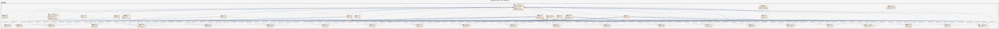

### Datamodell

**Kilde:** [SOSI UML XMI-fil](https://sosi.geonorge.no/svn/SOSI/SOSI%20Del%203/Statens%20kartverk/Sj%c3%b8kartDybdedata-20241010.xml)

#### FiktivDelelinje

linje for å dele opp store flateobjekter  Merknad: En del produktspesifikasjoner benytter spesifikke fiktive delelinjer.

Egenskaper

<table class="feature-attribute-table">
  <thead>
    <tr>
      <th>Egenskap</th>
      <th>Beskrivelse</th>
      <th>Type</th>
      <th>Multiplisitet</th>
    </tr>
  </thead>
  <tbody>
    <tr>
      <td>grense</td>
      <td>forløp som følger overgang mellom ulike fenomener</td>
      <td>Kurve</td>
      <td>1</td>
    </tr>
    <tr class="inherited-from">
      <th colspan="4" scope="rowgroup">Arvet fra FellesegenskaperFiktivDelelinje</th>
    </tr>
    <tr>
      <td>identifikasjon</td>
      <td>unik identifikasjon av et objekt</td>
      <td>Identifikasjon (datatype)</td>
      <td>1</td>
    </tr>
    <tr>
      <td>- lokal<wbr />Id</td>
      <td>lokal identifikator, tildelt av dataleverendør/dataforvalter. Den lokale identifikatoren er unik innenfor navnerommet, ingen andre objekter har samme identifikator.  NOTE: Det er data leverendørens ansvar å sørge for at denne lokale identifikatoren er unik innenfor navnerommet.</td>
      <td>Character<wbr />String</td>
      <td>1</td>
    </tr>
    <tr>
      <td>- navnerom</td>
      <td>navnerom som unikt identifiserer datakilden til objektet, starter med to bokstavs kode jfr ISO 3166. Benytter understreking  ("_") dersom data produsenten ikke er assosiert med bare et land.  NOTE 1 : Verdien for nanverom vil eies av den dataprodusent som har ansvar for de unike identifikatorene og vil registreres i "INSPIRE external  Object Identifier Namespaces Register"  Eksempel: NO for Norge.</td>
      <td>Character<wbr />String</td>
      <td>1</td>
    </tr>
    <tr>
      <td>- versjon<wbr />Id</td>
      <td>identifikasjon av en spesiell versjon av et geografisk objekt (instans), maksimum lengde på 25 karakterers. Dersom spesifikasjonen av et geografisk objekt med en identifikasjon inkludererer livsløpssyklusinformasjon, benyttes denne versjonId for å skille mellom ulike versjoner av samme objekt. versjonId er en unik  identifikasjon av versjonen.  NOTE Maksimum lengde er valgt for å tillate tidsregistrering i henhold til  ISO 8601, slik som  "2007-02-12T12:12:12+05:30" som versjonId.</td>
      <td>Character<wbr />String</td>
      <td>1</td>
    </tr>
    <tr>
      <td>første<wbr />Datafangstdato</td>
      <td>dato når data ble registrert/observert/målt første gang, som utgangspunkt for første digitalisering  Merknad: førsteDatafangstdato brukes hvis det er av interesse å forvalte informasjon om når en ble klar over objektet. Dette kan for eksempel gjelde datoen for første flybilde som var utgangspunkt for registrering i en database.</td>
      <td>Date<wbr />Time</td>
      <td>0..1</td>
    </tr>
    <tr>
      <td>oppdateringsdato</td>
      <td>dato for siste endring på objektetdataene  Merknad: Oppdateringsdato kan være forskjellig fra Datafangsdato ved at data som er registrert kan bufres en kortere eller lengre periode før disse legges inn i datasystemet (databasen).  -Definition- Date and time at which this version of the spatial object was inserted or changed in the spatial data set.</td>
      <td>Date<wbr />Time</td>
      <td>0..1</td>
    </tr>
    <tr>
      <td>datauttaksdato</td>
      <td>dato for uttak fra en database  Merknad: Skiller seg fra Kopidato ved at en ikke skiller på om det er uttak fra en originaldatabase eller en kopidatabase.</td>
      <td>Date<wbr />Time</td>
      <td>1</td>
    </tr>
    <tr>
      <td>kvalitet</td>
      <td>beskrivelse av kvaliteten på stedfestingen  Merknad: Denne er identisk med ..KVALITET i tidligere versjoner av SOSI.</td>
      <td>Posisjonskvalitet (datatype)</td>
      <td>0..1</td>
    </tr>
    <tr>
      <td>- målemetode</td>
      <td>metode for måling i grunnriss (x,y), og høyde (z) når metoden er den samme som ved måling i grunnriss</td>
      <td><a href="#kodeliste-målemetode">Målemetode</a> (kodeliste)</td>
      <td>1</td>
    </tr>
    <tr>
      <td>- nøyaktighet</td>
      <td>punktstandardavviket i grunnriss for punkter samt tverravvik for linjer  Merknad: Oppgitt i cm</td>
      <td>Integer</td>
      <td>0..1</td>
    </tr>
  </tbody>
</table>

Relasjoner

**Arv**
FellesegenskaperFiktivDelelinje

#### Slipp

bane som mindre og middelstore fartøyer kan hales opp ved landsetting, bedding Merknad: I S57 defineres slipp som: 'The prepared, and usually reinforced, inclined surface on which keel- and bilge-blocks are laid for supporting a vessel under construction. (IHO Dictionary, S-32, 4th Edition). Slipp brukes normalt som en linje (symboliseres som to parallelle linjer) på tvers av kystkonturen, som angir banen. Linjene stiples utenfor kystkonturen for å indikere at de er under vann. I stor målestokk kan kystkonturen der banen ligger også angis som slipp.   -- Definition -- slipway where small and medium-sized vessels can be hauled up, slip

Egenskaper

<table class="feature-attribute-table">
  <thead>
    <tr>
      <th>Egenskap</th>
      <th>Beskrivelse</th>
      <th>Type</th>
      <th>Multiplisitet</th>
    </tr>
  </thead>
  <tbody>
    <tr>
      <td>grense</td>
      <td>forløp som følger overgang mellom ulike fenomener  -- Definition -- course follwing the transition between different real world phenomena</td>
      <td>Kurve</td>
      <td>1</td>
    </tr>
    <tr class="inherited-from">
      <th colspan="4" scope="rowgroup">Arvet fra FellesegenskaperDybdedata</th>
    </tr>
    <tr>
      <td>identifikasjon</td>
      <td>unik identifikasjon av et objekt</td>
      <td>Identifikasjon (datatype)</td>
      <td>1</td>
    </tr>
    <tr>
      <td>- lokal<wbr />Id</td>
      <td>lokal identifikator, tildelt av dataleverendør/dataforvalter. Den lokale identifikatoren er unik innenfor navnerommet, ingen andre objekter har samme identifikator.  NOTE: Det er data leverendørens ansvar å sørge for at denne lokale identifikatoren er unik innenfor navnerommet.</td>
      <td>Character<wbr />String</td>
      <td>1</td>
    </tr>
    <tr>
      <td>- navnerom</td>
      <td>navnerom som unikt identifiserer datakilden til objektet, starter med to bokstavs kode jfr ISO 3166. Benytter understreking  ("_") dersom data produsenten ikke er assosiert med bare et land.  NOTE 1 : Verdien for nanverom vil eies av den dataprodusent som har ansvar for de unike identifikatorene og vil registreres i "INSPIRE external  Object Identifier Namespaces Register"  Eksempel: NO for Norge.</td>
      <td>Character<wbr />String</td>
      <td>1</td>
    </tr>
    <tr>
      <td>- versjon<wbr />Id</td>
      <td>identifikasjon av en spesiell versjon av et geografisk objekt (instans), maksimum lengde på 25 karakterers. Dersom spesifikasjonen av et geografisk objekt med en identifikasjon inkludererer livsløpssyklusinformasjon, benyttes denne versjonId for å skille mellom ulike versjoner av samme objekt. versjonId er en unik  identifikasjon av versjonen.  NOTE Maksimum lengde er valgt for å tillate tidsregistrering i henhold til  ISO 8601, slik som  "2007-02-12T12:12:12+05:30" som versjonId.</td>
      <td>Character<wbr />String</td>
      <td>1</td>
    </tr>
    <tr>
      <td>første<wbr />Datafangstdato</td>
      <td>dato når data ble registrert/observert/målt første gang, som utgangspunkt for første digitalisering  Merknad: førsteDatafangstdato brukes hvis det er av interesse å forvalte informasjon om når en ble klar over objektet. Dette kan for eksempel gjelde datoen for første flybilde som var utgangspunkt for registrering i en database.</td>
      <td>Date<wbr />Time</td>
      <td>0..1</td>
    </tr>
    <tr>
      <td>oppdateringsdato</td>
      <td>dato for siste endring på objektetdataene  Merknad: Oppdateringsdato kan være forskjellig fra Datafangsdato ved at data som er registrert kan bufres en kortere eller lengre periode før disse legges inn i datasystemet (databasen).  -Definition- Date and time at which this version of the spatial object was inserted or changed in the spatial data set.</td>
      <td>Date<wbr />Time</td>
      <td>1</td>
    </tr>
    <tr>
      <td>datauttaksdato</td>
      <td>dato for uttak fra en database  Merknad: Skiller seg fra Kopidato ved at en ikke skiller på om det er uttak fra en originaldatabase eller en kopidatabase.</td>
      <td>Date<wbr />Time</td>
      <td>1</td>
    </tr>
    <tr>
      <td>kvalitet</td>
      <td>beskrivelse av kvaliteten på stedfestingen  Merknad: Denne er identisk med ..KVALITET i tidligere versjoner av SOSI.</td>
      <td>Posisjonskvalitet (datatype)</td>
      <td>0..1</td>
    </tr>
    <tr>
      <td>- målemetode</td>
      <td>metode for måling i grunnriss (x,y), og høyde (z) når metoden er den samme som ved måling i grunnriss</td>
      <td><a href="#kodeliste-målemetode">Målemetode</a> (kodeliste)</td>
      <td>1</td>
    </tr>
    <tr>
      <td>- nøyaktighet</td>
      <td>punktstandardavviket i grunnriss for punkter samt tverravvik for linjer  Merknad: Oppgitt i cm</td>
      <td>Integer</td>
      <td>0..1</td>
    </tr>
  </tbody>
</table>

Relasjoner

**Arv**
FellesegenskaperDybdedata

#### Datakvalitetgrense

generell avgrensningslinje for Datakvalitet.

Egenskaper

<table class="feature-attribute-table">
  <thead>
    <tr>
      <th>Egenskap</th>
      <th>Beskrivelse</th>
      <th>Type</th>
      <th>Multiplisitet</th>
    </tr>
  </thead>
  <tbody>
    <tr>
      <td>grense</td>
      <td>forløp som følger overgang mellom ulike fenomener</td>
      <td>Kurve</td>
      <td>1</td>
    </tr>
    <tr class="inherited-from">
      <th colspan="4" scope="rowgroup">Arvet fra FellesegenskaperFiktivDelelinje</th>
    </tr>
    <tr>
      <td>identifikasjon</td>
      <td>unik identifikasjon av et objekt</td>
      <td>Identifikasjon (datatype)</td>
      <td>1</td>
    </tr>
    <tr>
      <td>- lokal<wbr />Id</td>
      <td>lokal identifikator, tildelt av dataleverendør/dataforvalter. Den lokale identifikatoren er unik innenfor navnerommet, ingen andre objekter har samme identifikator.  NOTE: Det er data leverendørens ansvar å sørge for at denne lokale identifikatoren er unik innenfor navnerommet.</td>
      <td>Character<wbr />String</td>
      <td>1</td>
    </tr>
    <tr>
      <td>- navnerom</td>
      <td>navnerom som unikt identifiserer datakilden til objektet, starter med to bokstavs kode jfr ISO 3166. Benytter understreking  ("_") dersom data produsenten ikke er assosiert med bare et land.  NOTE 1 : Verdien for nanverom vil eies av den dataprodusent som har ansvar for de unike identifikatorene og vil registreres i "INSPIRE external  Object Identifier Namespaces Register"  Eksempel: NO for Norge.</td>
      <td>Character<wbr />String</td>
      <td>1</td>
    </tr>
    <tr>
      <td>- versjon<wbr />Id</td>
      <td>identifikasjon av en spesiell versjon av et geografisk objekt (instans), maksimum lengde på 25 karakterers. Dersom spesifikasjonen av et geografisk objekt med en identifikasjon inkludererer livsløpssyklusinformasjon, benyttes denne versjonId for å skille mellom ulike versjoner av samme objekt. versjonId er en unik  identifikasjon av versjonen.  NOTE Maksimum lengde er valgt for å tillate tidsregistrering i henhold til  ISO 8601, slik som  "2007-02-12T12:12:12+05:30" som versjonId.</td>
      <td>Character<wbr />String</td>
      <td>1</td>
    </tr>
    <tr>
      <td>første<wbr />Datafangstdato</td>
      <td>dato når data ble registrert/observert/målt første gang, som utgangspunkt for første digitalisering  Merknad: førsteDatafangstdato brukes hvis det er av interesse å forvalte informasjon om når en ble klar over objektet. Dette kan for eksempel gjelde datoen for første flybilde som var utgangspunkt for registrering i en database.</td>
      <td>Date<wbr />Time</td>
      <td>0..1</td>
    </tr>
    <tr>
      <td>oppdateringsdato</td>
      <td>dato for siste endring på objektetdataene  Merknad: Oppdateringsdato kan være forskjellig fra Datafangsdato ved at data som er registrert kan bufres en kortere eller lengre periode før disse legges inn i datasystemet (databasen).  -Definition- Date and time at which this version of the spatial object was inserted or changed in the spatial data set.</td>
      <td>Date<wbr />Time</td>
      <td>0..1</td>
    </tr>
    <tr>
      <td>datauttaksdato</td>
      <td>dato for uttak fra en database  Merknad: Skiller seg fra Kopidato ved at en ikke skiller på om det er uttak fra en originaldatabase eller en kopidatabase.</td>
      <td>Date<wbr />Time</td>
      <td>1</td>
    </tr>
    <tr>
      <td>kvalitet</td>
      <td>beskrivelse av kvaliteten på stedfestingen  Merknad: Denne er identisk med ..KVALITET i tidligere versjoner av SOSI.</td>
      <td>Posisjonskvalitet (datatype)</td>
      <td>0..1</td>
    </tr>
    <tr>
      <td>- målemetode</td>
      <td>metode for måling i grunnriss (x,y), og høyde (z) når metoden er den samme som ved måling i grunnriss</td>
      <td><a href="#kodeliste-målemetode">Målemetode</a> (kodeliste)</td>
      <td>1</td>
    </tr>
    <tr>
      <td>- nøyaktighet</td>
      <td>punktstandardavviket i grunnriss for punkter samt tverravvik for linjer  Merknad: Oppgitt i cm</td>
      <td>Integer</td>
      <td>0..1</td>
    </tr>
  </tbody>
</table>

Relasjoner

**Arv**
FellesegenskaperFiktivDelelinje

#### Utstikker

flytelignende småbåtutstikkere som benyttes for plassering av båt, av/påstigning i båt. Gjerne utformet med flere tverrgående utstikkere knyttet til en samleutstikker   -- Definition -- float-like small boat piers which are used for mooring boats and embarking/disembarking. Often designed with a number of transverse finger quays connected to a main pier

Egenskaper

<table class="feature-attribute-table">
  <thead>
    <tr>
      <th>Egenskap</th>
      <th>Beskrivelse</th>
      <th>Type</th>
      <th>Multiplisitet</th>
    </tr>
  </thead>
  <tbody>
    <tr>
      <td>senterlinje</td>
      <td>forløp som følger objektets sentrale del  -- Definition -- cource follwed by the central part of the object</td>
      <td>Kurve</td>
      <td>1</td>
    </tr>
    <tr class="inherited-from">
      <th colspan="4" scope="rowgroup">Arvet fra FellesegenskaperDybdedata</th>
    </tr>
    <tr>
      <td>identifikasjon</td>
      <td>unik identifikasjon av et objekt</td>
      <td>Identifikasjon (datatype)</td>
      <td>1</td>
    </tr>
    <tr>
      <td>- lokal<wbr />Id</td>
      <td>lokal identifikator, tildelt av dataleverendør/dataforvalter. Den lokale identifikatoren er unik innenfor navnerommet, ingen andre objekter har samme identifikator.  NOTE: Det er data leverendørens ansvar å sørge for at denne lokale identifikatoren er unik innenfor navnerommet.</td>
      <td>Character<wbr />String</td>
      <td>1</td>
    </tr>
    <tr>
      <td>- navnerom</td>
      <td>navnerom som unikt identifiserer datakilden til objektet, starter med to bokstavs kode jfr ISO 3166. Benytter understreking  ("_") dersom data produsenten ikke er assosiert med bare et land.  NOTE 1 : Verdien for nanverom vil eies av den dataprodusent som har ansvar for de unike identifikatorene og vil registreres i "INSPIRE external  Object Identifier Namespaces Register"  Eksempel: NO for Norge.</td>
      <td>Character<wbr />String</td>
      <td>1</td>
    </tr>
    <tr>
      <td>- versjon<wbr />Id</td>
      <td>identifikasjon av en spesiell versjon av et geografisk objekt (instans), maksimum lengde på 25 karakterers. Dersom spesifikasjonen av et geografisk objekt med en identifikasjon inkludererer livsløpssyklusinformasjon, benyttes denne versjonId for å skille mellom ulike versjoner av samme objekt. versjonId er en unik  identifikasjon av versjonen.  NOTE Maksimum lengde er valgt for å tillate tidsregistrering i henhold til  ISO 8601, slik som  "2007-02-12T12:12:12+05:30" som versjonId.</td>
      <td>Character<wbr />String</td>
      <td>1</td>
    </tr>
    <tr>
      <td>første<wbr />Datafangstdato</td>
      <td>dato når data ble registrert/observert/målt første gang, som utgangspunkt for første digitalisering  Merknad: førsteDatafangstdato brukes hvis det er av interesse å forvalte informasjon om når en ble klar over objektet. Dette kan for eksempel gjelde datoen for første flybilde som var utgangspunkt for registrering i en database.</td>
      <td>Date<wbr />Time</td>
      <td>0..1</td>
    </tr>
    <tr>
      <td>oppdateringsdato</td>
      <td>dato for siste endring på objektetdataene  Merknad: Oppdateringsdato kan være forskjellig fra Datafangsdato ved at data som er registrert kan bufres en kortere eller lengre periode før disse legges inn i datasystemet (databasen).  -Definition- Date and time at which this version of the spatial object was inserted or changed in the spatial data set.</td>
      <td>Date<wbr />Time</td>
      <td>1</td>
    </tr>
    <tr>
      <td>datauttaksdato</td>
      <td>dato for uttak fra en database  Merknad: Skiller seg fra Kopidato ved at en ikke skiller på om det er uttak fra en originaldatabase eller en kopidatabase.</td>
      <td>Date<wbr />Time</td>
      <td>1</td>
    </tr>
    <tr>
      <td>kvalitet</td>
      <td>beskrivelse av kvaliteten på stedfestingen  Merknad: Denne er identisk med ..KVALITET i tidligere versjoner av SOSI.</td>
      <td>Posisjonskvalitet (datatype)</td>
      <td>0..1</td>
    </tr>
    <tr>
      <td>- målemetode</td>
      <td>metode for måling i grunnriss (x,y), og høyde (z) når metoden er den samme som ved måling i grunnriss</td>
      <td><a href="#kodeliste-målemetode">Målemetode</a> (kodeliste)</td>
      <td>1</td>
    </tr>
    <tr>
      <td>- nøyaktighet</td>
      <td>punktstandardavviket i grunnriss for punkter samt tverravvik for linjer  Merknad: Oppgitt i cm</td>
      <td>Integer</td>
      <td>0..1</td>
    </tr>
  </tbody>
</table>

Relasjoner

**Arv**
FellesegenskaperDybdedata

#### Flytedokk

flytene kunstig basseng avstengt med sluseport- der vannet kan pumpes ut slik at skip inne til overhaling blir stående tørt   -- Definition -- floating, artificial basin closed off by sluice gates - where the water can be pumped out so that ships which are in for overhauling stand high and dry

Egenskaper

<table class="feature-attribute-table">
  <thead>
    <tr>
      <th>Egenskap</th>
      <th>Beskrivelse</th>
      <th>Type</th>
      <th>Multiplisitet</th>
    </tr>
  </thead>
  <tbody>
    <tr>
      <td>område</td>
      <td>objektets utstrekning  -- Definition -- area over which an object extends</td>
      <td>Flate</td>
      <td>1</td>
    </tr>
    <tr class="inherited-from">
      <th colspan="4" scope="rowgroup">Arvet fra FellesegenskaperDybdedata</th>
    </tr>
    <tr>
      <td>identifikasjon</td>
      <td>unik identifikasjon av et objekt</td>
      <td>Identifikasjon (datatype)</td>
      <td>1</td>
    </tr>
    <tr>
      <td>- lokal<wbr />Id</td>
      <td>lokal identifikator, tildelt av dataleverendør/dataforvalter. Den lokale identifikatoren er unik innenfor navnerommet, ingen andre objekter har samme identifikator.  NOTE: Det er data leverendørens ansvar å sørge for at denne lokale identifikatoren er unik innenfor navnerommet.</td>
      <td>Character<wbr />String</td>
      <td>1</td>
    </tr>
    <tr>
      <td>- navnerom</td>
      <td>navnerom som unikt identifiserer datakilden til objektet, starter med to bokstavs kode jfr ISO 3166. Benytter understreking  ("_") dersom data produsenten ikke er assosiert med bare et land.  NOTE 1 : Verdien for nanverom vil eies av den dataprodusent som har ansvar for de unike identifikatorene og vil registreres i "INSPIRE external  Object Identifier Namespaces Register"  Eksempel: NO for Norge.</td>
      <td>Character<wbr />String</td>
      <td>1</td>
    </tr>
    <tr>
      <td>- versjon<wbr />Id</td>
      <td>identifikasjon av en spesiell versjon av et geografisk objekt (instans), maksimum lengde på 25 karakterers. Dersom spesifikasjonen av et geografisk objekt med en identifikasjon inkludererer livsløpssyklusinformasjon, benyttes denne versjonId for å skille mellom ulike versjoner av samme objekt. versjonId er en unik  identifikasjon av versjonen.  NOTE Maksimum lengde er valgt for å tillate tidsregistrering i henhold til  ISO 8601, slik som  "2007-02-12T12:12:12+05:30" som versjonId.</td>
      <td>Character<wbr />String</td>
      <td>1</td>
    </tr>
    <tr>
      <td>første<wbr />Datafangstdato</td>
      <td>dato når data ble registrert/observert/målt første gang, som utgangspunkt for første digitalisering  Merknad: førsteDatafangstdato brukes hvis det er av interesse å forvalte informasjon om når en ble klar over objektet. Dette kan for eksempel gjelde datoen for første flybilde som var utgangspunkt for registrering i en database.</td>
      <td>Date<wbr />Time</td>
      <td>0..1</td>
    </tr>
    <tr>
      <td>oppdateringsdato</td>
      <td>dato for siste endring på objektetdataene  Merknad: Oppdateringsdato kan være forskjellig fra Datafangsdato ved at data som er registrert kan bufres en kortere eller lengre periode før disse legges inn i datasystemet (databasen).  -Definition- Date and time at which this version of the spatial object was inserted or changed in the spatial data set.</td>
      <td>Date<wbr />Time</td>
      <td>1</td>
    </tr>
    <tr>
      <td>datauttaksdato</td>
      <td>dato for uttak fra en database  Merknad: Skiller seg fra Kopidato ved at en ikke skiller på om det er uttak fra en originaldatabase eller en kopidatabase.</td>
      <td>Date<wbr />Time</td>
      <td>1</td>
    </tr>
    <tr>
      <td>kvalitet</td>
      <td>beskrivelse av kvaliteten på stedfestingen  Merknad: Denne er identisk med ..KVALITET i tidligere versjoner av SOSI.</td>
      <td>Posisjonskvalitet (datatype)</td>
      <td>0..1</td>
    </tr>
    <tr>
      <td>- målemetode</td>
      <td>metode for måling i grunnriss (x,y), og høyde (z) når metoden er den samme som ved måling i grunnriss</td>
      <td><a href="#kodeliste-målemetode">Målemetode</a> (kodeliste)</td>
      <td>1</td>
    </tr>
    <tr>
      <td>- nøyaktighet</td>
      <td>punktstandardavviket i grunnriss for punkter samt tverravvik for linjer  Merknad: Oppgitt i cm</td>
      <td>Integer</td>
      <td>0..1</td>
    </tr>
  </tbody>
</table>

Relasjoner

**Arv**
FellesegenskaperDybdedata

**Assosiasjoner**
FiktivDelelinje – rolle: avgrensning – kardinalitet: 0..*
Dataavgrensning – rolle: avgrensning – kardinalitet: 0..*
HavElvSperre – rolle: avgrensning – kardinalitet: 0..*
FlytedokkKant – rolle: avgrensning – kardinalitet: 0..*
Kystkontur – rolle: avgrensning – kardinalitet: 0..*

#### FellesegenskaperFiktivDelelinje (abstrakt)

abstrakt objekt som bærer en rekke egenskaper som er fagområde-uavhengige og kan benyttes for alle objekttyper  Merknad: Spesielt i produktspesifikasjonsarbeid vil en velge egenskaper og av grensningslinjer fra denne klassen.

Egenskaper

<table class="feature-attribute-table">
  <thead>
    <tr>
      <th>Egenskap</th>
      <th>Beskrivelse</th>
      <th>Type</th>
      <th>Multiplisitet</th>
    </tr>
  </thead>
  <tbody>
    <tr>
      <td>identifikasjon</td>
      <td>unik identifikasjon av et objekt</td>
      <td>Identifikasjon (datatype)</td>
      <td>1</td>
    </tr>
    <tr>
      <td>- lokal<wbr />Id</td>
      <td>lokal identifikator, tildelt av dataleverendør/dataforvalter. Den lokale identifikatoren er unik innenfor navnerommet, ingen andre objekter har samme identifikator.  NOTE: Det er data leverendørens ansvar å sørge for at denne lokale identifikatoren er unik innenfor navnerommet.</td>
      <td>Character<wbr />String</td>
      <td>1</td>
    </tr>
    <tr>
      <td>- navnerom</td>
      <td>navnerom som unikt identifiserer datakilden til objektet, starter med to bokstavs kode jfr ISO 3166. Benytter understreking  ("_") dersom data produsenten ikke er assosiert med bare et land.  NOTE 1 : Verdien for nanverom vil eies av den dataprodusent som har ansvar for de unike identifikatorene og vil registreres i "INSPIRE external  Object Identifier Namespaces Register"  Eksempel: NO for Norge.</td>
      <td>Character<wbr />String</td>
      <td>1</td>
    </tr>
    <tr>
      <td>- versjon<wbr />Id</td>
      <td>identifikasjon av en spesiell versjon av et geografisk objekt (instans), maksimum lengde på 25 karakterers. Dersom spesifikasjonen av et geografisk objekt med en identifikasjon inkludererer livsløpssyklusinformasjon, benyttes denne versjonId for å skille mellom ulike versjoner av samme objekt. versjonId er en unik  identifikasjon av versjonen.  NOTE Maksimum lengde er valgt for å tillate tidsregistrering i henhold til  ISO 8601, slik som  "2007-02-12T12:12:12+05:30" som versjonId.</td>
      <td>Character<wbr />String</td>
      <td>1</td>
    </tr>
    <tr>
      <td>første<wbr />Datafangstdato</td>
      <td>dato når data ble registrert/observert/målt første gang, som utgangspunkt for første digitalisering  Merknad: førsteDatafangstdato brukes hvis det er av interesse å forvalte informasjon om når en ble klar over objektet. Dette kan for eksempel gjelde datoen for første flybilde som var utgangspunkt for registrering i en database.</td>
      <td>Date<wbr />Time</td>
      <td>0..1</td>
    </tr>
    <tr>
      <td>oppdateringsdato</td>
      <td>dato for siste endring på objektetdataene  Merknad: Oppdateringsdato kan være forskjellig fra Datafangsdato ved at data som er registrert kan bufres en kortere eller lengre periode før disse legges inn i datasystemet (databasen).  -Definition- Date and time at which this version of the spatial object was inserted or changed in the spatial data set.</td>
      <td>Date<wbr />Time</td>
      <td>0..1</td>
    </tr>
    <tr>
      <td>datauttaksdato</td>
      <td>dato for uttak fra en database  Merknad: Skiller seg fra Kopidato ved at en ikke skiller på om det er uttak fra en originaldatabase eller en kopidatabase.</td>
      <td>Date<wbr />Time</td>
      <td>1</td>
    </tr>
    <tr>
      <td>kvalitet</td>
      <td>beskrivelse av kvaliteten på stedfestingen  Merknad: Denne er identisk med ..KVALITET i tidligere versjoner av SOSI.</td>
      <td>Posisjonskvalitet (datatype)</td>
      <td>0..1</td>
    </tr>
    <tr>
      <td>- målemetode</td>
      <td>metode for måling i grunnriss (x,y), og høyde (z) når metoden er den samme som ved måling i grunnriss</td>
      <td><a href="#kodeliste-målemetode">Målemetode</a> (kodeliste)</td>
      <td>1</td>
    </tr>
    <tr>
      <td>- nøyaktighet</td>
      <td>punktstandardavviket i grunnriss for punkter samt tverravvik for linjer  Merknad: Oppgitt i cm</td>
      <td>Integer</td>
      <td>0..1</td>
    </tr>
  </tbody>
</table>

#### Tørrdokk

kunstig basseng på land avstengt med sluseport- der vannet kan pumpes ut slik at skip inne til overhaling blir stående tørt   -- Definition -- artificial basin on land closed off by sluice gates - where the water can be pumped out so that ships which are in for overhauling stand high and dry

Egenskaper

<table class="feature-attribute-table">
  <thead>
    <tr>
      <th>Egenskap</th>
      <th>Beskrivelse</th>
      <th>Type</th>
      <th>Multiplisitet</th>
    </tr>
  </thead>
  <tbody>
    <tr>
      <td>område</td>
      <td>objektets utstrekning  -- Definition -- area over which an object extends</td>
      <td>Flate</td>
      <td>1</td>
    </tr>
    <tr class="inherited-from">
      <th colspan="4" scope="rowgroup">Arvet fra FellesegenskaperDybdedata</th>
    </tr>
    <tr>
      <td>identifikasjon</td>
      <td>unik identifikasjon av et objekt</td>
      <td>Identifikasjon (datatype)</td>
      <td>1</td>
    </tr>
    <tr>
      <td>- lokal<wbr />Id</td>
      <td>lokal identifikator, tildelt av dataleverendør/dataforvalter. Den lokale identifikatoren er unik innenfor navnerommet, ingen andre objekter har samme identifikator.  NOTE: Det er data leverendørens ansvar å sørge for at denne lokale identifikatoren er unik innenfor navnerommet.</td>
      <td>Character<wbr />String</td>
      <td>1</td>
    </tr>
    <tr>
      <td>- navnerom</td>
      <td>navnerom som unikt identifiserer datakilden til objektet, starter med to bokstavs kode jfr ISO 3166. Benytter understreking  ("_") dersom data produsenten ikke er assosiert med bare et land.  NOTE 1 : Verdien for nanverom vil eies av den dataprodusent som har ansvar for de unike identifikatorene og vil registreres i "INSPIRE external  Object Identifier Namespaces Register"  Eksempel: NO for Norge.</td>
      <td>Character<wbr />String</td>
      <td>1</td>
    </tr>
    <tr>
      <td>- versjon<wbr />Id</td>
      <td>identifikasjon av en spesiell versjon av et geografisk objekt (instans), maksimum lengde på 25 karakterers. Dersom spesifikasjonen av et geografisk objekt med en identifikasjon inkludererer livsløpssyklusinformasjon, benyttes denne versjonId for å skille mellom ulike versjoner av samme objekt. versjonId er en unik  identifikasjon av versjonen.  NOTE Maksimum lengde er valgt for å tillate tidsregistrering i henhold til  ISO 8601, slik som  "2007-02-12T12:12:12+05:30" som versjonId.</td>
      <td>Character<wbr />String</td>
      <td>1</td>
    </tr>
    <tr>
      <td>første<wbr />Datafangstdato</td>
      <td>dato når data ble registrert/observert/målt første gang, som utgangspunkt for første digitalisering  Merknad: førsteDatafangstdato brukes hvis det er av interesse å forvalte informasjon om når en ble klar over objektet. Dette kan for eksempel gjelde datoen for første flybilde som var utgangspunkt for registrering i en database.</td>
      <td>Date<wbr />Time</td>
      <td>0..1</td>
    </tr>
    <tr>
      <td>oppdateringsdato</td>
      <td>dato for siste endring på objektetdataene  Merknad: Oppdateringsdato kan være forskjellig fra Datafangsdato ved at data som er registrert kan bufres en kortere eller lengre periode før disse legges inn i datasystemet (databasen).  -Definition- Date and time at which this version of the spatial object was inserted or changed in the spatial data set.</td>
      <td>Date<wbr />Time</td>
      <td>1</td>
    </tr>
    <tr>
      <td>datauttaksdato</td>
      <td>dato for uttak fra en database  Merknad: Skiller seg fra Kopidato ved at en ikke skiller på om det er uttak fra en originaldatabase eller en kopidatabase.</td>
      <td>Date<wbr />Time</td>
      <td>1</td>
    </tr>
    <tr>
      <td>kvalitet</td>
      <td>beskrivelse av kvaliteten på stedfestingen  Merknad: Denne er identisk med ..KVALITET i tidligere versjoner av SOSI.</td>
      <td>Posisjonskvalitet (datatype)</td>
      <td>0..1</td>
    </tr>
    <tr>
      <td>- målemetode</td>
      <td>metode for måling i grunnriss (x,y), og høyde (z) når metoden er den samme som ved måling i grunnriss</td>
      <td><a href="#kodeliste-målemetode">Målemetode</a> (kodeliste)</td>
      <td>1</td>
    </tr>
    <tr>
      <td>- nøyaktighet</td>
      <td>punktstandardavviket i grunnriss for punkter samt tverravvik for linjer  Merknad: Oppgitt i cm</td>
      <td>Integer</td>
      <td>0..1</td>
    </tr>
  </tbody>
</table>

Relasjoner

**Arv**
FellesegenskaperDybdedata

**Assosiasjoner**
FiktivDelelinje – rolle: avgrensning – kardinalitet: 0..*
HavElvSperre – rolle: avgrensning – kardinalitet: 0..*
Kystkontur – rolle: avgrensning – kardinalitet: 0..*
Dataavgrensning – rolle: avgrensning – kardinalitet: 0..*
TørrdokkKant – rolle: avgrensning – kardinalitet: 0..*

#### Datakvalitet

kvalitetsangivelsen på dybdeinformasjonen. Denne er vurdert ut ifra posisjonsnøyaktighet, nøyaktighet i dybdemålingene og dekningsgrad av havbunnen.

Egenskaper

<table class="feature-attribute-table">
  <thead>
    <tr>
      <th>Egenskap</th>
      <th>Beskrivelse</th>
      <th>Type</th>
      <th>Multiplisitet</th>
    </tr>
  </thead>
  <tbody>
    <tr>
      <td>område</td>
      <td>objektets utstrekning  -- Definition -- area over which an object extends</td>
      <td>Flate</td>
      <td>1</td>
    </tr>
    <tr>
      <td>catzoc</td>
      <td>egenskap for kode som angir kvaliteten på dybdeinformasjonen.</td>
      <td><a href="#kodeliste-catzoc">Catzoc</a> (kodeliste)</td>
      <td>1</td>
    </tr>
    <tr class="inherited-from">
      <th colspan="4" scope="rowgroup">Arvet fra FellesegenskaperDybdedata</th>
    </tr>
    <tr>
      <td>identifikasjon</td>
      <td>unik identifikasjon av et objekt</td>
      <td>Identifikasjon (datatype)</td>
      <td>1</td>
    </tr>
    <tr>
      <td>- lokal<wbr />Id</td>
      <td>lokal identifikator, tildelt av dataleverendør/dataforvalter. Den lokale identifikatoren er unik innenfor navnerommet, ingen andre objekter har samme identifikator.  NOTE: Det er data leverendørens ansvar å sørge for at denne lokale identifikatoren er unik innenfor navnerommet.</td>
      <td>Character<wbr />String</td>
      <td>1</td>
    </tr>
    <tr>
      <td>- navnerom</td>
      <td>navnerom som unikt identifiserer datakilden til objektet, starter med to bokstavs kode jfr ISO 3166. Benytter understreking  ("_") dersom data produsenten ikke er assosiert med bare et land.  NOTE 1 : Verdien for nanverom vil eies av den dataprodusent som har ansvar for de unike identifikatorene og vil registreres i "INSPIRE external  Object Identifier Namespaces Register"  Eksempel: NO for Norge.</td>
      <td>Character<wbr />String</td>
      <td>1</td>
    </tr>
    <tr>
      <td>- versjon<wbr />Id</td>
      <td>identifikasjon av en spesiell versjon av et geografisk objekt (instans), maksimum lengde på 25 karakterers. Dersom spesifikasjonen av et geografisk objekt med en identifikasjon inkludererer livsløpssyklusinformasjon, benyttes denne versjonId for å skille mellom ulike versjoner av samme objekt. versjonId er en unik  identifikasjon av versjonen.  NOTE Maksimum lengde er valgt for å tillate tidsregistrering i henhold til  ISO 8601, slik som  "2007-02-12T12:12:12+05:30" som versjonId.</td>
      <td>Character<wbr />String</td>
      <td>1</td>
    </tr>
    <tr>
      <td>første<wbr />Datafangstdato</td>
      <td>dato når data ble registrert/observert/målt første gang, som utgangspunkt for første digitalisering  Merknad: førsteDatafangstdato brukes hvis det er av interesse å forvalte informasjon om når en ble klar over objektet. Dette kan for eksempel gjelde datoen for første flybilde som var utgangspunkt for registrering i en database.</td>
      <td>Date<wbr />Time</td>
      <td>0..1</td>
    </tr>
    <tr>
      <td>oppdateringsdato</td>
      <td>dato for siste endring på objektetdataene  Merknad: Oppdateringsdato kan være forskjellig fra Datafangsdato ved at data som er registrert kan bufres en kortere eller lengre periode før disse legges inn i datasystemet (databasen).  -Definition- Date and time at which this version of the spatial object was inserted or changed in the spatial data set.</td>
      <td>Date<wbr />Time</td>
      <td>1</td>
    </tr>
    <tr>
      <td>datauttaksdato</td>
      <td>dato for uttak fra en database  Merknad: Skiller seg fra Kopidato ved at en ikke skiller på om det er uttak fra en originaldatabase eller en kopidatabase.</td>
      <td>Date<wbr />Time</td>
      <td>1</td>
    </tr>
    <tr>
      <td>kvalitet</td>
      <td>beskrivelse av kvaliteten på stedfestingen  Merknad: Denne er identisk med ..KVALITET i tidligere versjoner av SOSI.</td>
      <td>Posisjonskvalitet (datatype)</td>
      <td>0..1</td>
    </tr>
    <tr>
      <td>- målemetode</td>
      <td>metode for måling i grunnriss (x,y), og høyde (z) når metoden er den samme som ved måling i grunnriss</td>
      <td><a href="#kodeliste-målemetode">Målemetode</a> (kodeliste)</td>
      <td>1</td>
    </tr>
    <tr>
      <td>- nøyaktighet</td>
      <td>punktstandardavviket i grunnriss for punkter samt tverravvik for linjer  Merknad: Oppgitt i cm</td>
      <td>Integer</td>
      <td>0..1</td>
    </tr>
  </tbody>
</table>

Relasjoner

**Arv**
FellesegenskaperDybdedata

**Assosiasjoner**
Datakvalitetgrense – rolle: avgrensning – kardinalitet: 0..*

#### Tørrfall

tørrfall kalles den del av sjøbunnen som strekker seg fra 0.5 meter under sjøkartnull og opp til kystkonturen  Merknad: Tørrfallsområdet avgrenses av kystkontur og tørrfallslinjen, som er nivålinjen 0.5 m under sjøkartnull. Tilsvarer DEPARE i S-57   -- Definition -- that part of the seafloor which extends from 0.5 metres below chart zero up to the coastline Note: The area is delimited by the coastline and the zero meter contour, which is the line at the 0.5 m level below chart zero. Corresponds to DEPARE in S-57

Egenskaper

<table class="feature-attribute-table">
  <thead>
    <tr>
      <th>Egenskap</th>
      <th>Beskrivelse</th>
      <th>Type</th>
      <th>Multiplisitet</th>
    </tr>
  </thead>
  <tbody>
    <tr>
      <td>område</td>
      <td>objektets utstrekning  -- Definition -- area over which an object extends</td>
      <td>Flate</td>
      <td>1</td>
    </tr>
    <tr class="inherited-from">
      <th colspan="4" scope="rowgroup">Arvet fra FellesegenskaperDybdedata</th>
    </tr>
    <tr>
      <td>identifikasjon</td>
      <td>unik identifikasjon av et objekt</td>
      <td>Identifikasjon (datatype)</td>
      <td>1</td>
    </tr>
    <tr>
      <td>- lokal<wbr />Id</td>
      <td>lokal identifikator, tildelt av dataleverendør/dataforvalter. Den lokale identifikatoren er unik innenfor navnerommet, ingen andre objekter har samme identifikator.  NOTE: Det er data leverendørens ansvar å sørge for at denne lokale identifikatoren er unik innenfor navnerommet.</td>
      <td>Character<wbr />String</td>
      <td>1</td>
    </tr>
    <tr>
      <td>- navnerom</td>
      <td>navnerom som unikt identifiserer datakilden til objektet, starter med to bokstavs kode jfr ISO 3166. Benytter understreking  ("_") dersom data produsenten ikke er assosiert med bare et land.  NOTE 1 : Verdien for nanverom vil eies av den dataprodusent som har ansvar for de unike identifikatorene og vil registreres i "INSPIRE external  Object Identifier Namespaces Register"  Eksempel: NO for Norge.</td>
      <td>Character<wbr />String</td>
      <td>1</td>
    </tr>
    <tr>
      <td>- versjon<wbr />Id</td>
      <td>identifikasjon av en spesiell versjon av et geografisk objekt (instans), maksimum lengde på 25 karakterers. Dersom spesifikasjonen av et geografisk objekt med en identifikasjon inkludererer livsløpssyklusinformasjon, benyttes denne versjonId for å skille mellom ulike versjoner av samme objekt. versjonId er en unik  identifikasjon av versjonen.  NOTE Maksimum lengde er valgt for å tillate tidsregistrering i henhold til  ISO 8601, slik som  "2007-02-12T12:12:12+05:30" som versjonId.</td>
      <td>Character<wbr />String</td>
      <td>1</td>
    </tr>
    <tr>
      <td>første<wbr />Datafangstdato</td>
      <td>dato når data ble registrert/observert/målt første gang, som utgangspunkt for første digitalisering  Merknad: førsteDatafangstdato brukes hvis det er av interesse å forvalte informasjon om når en ble klar over objektet. Dette kan for eksempel gjelde datoen for første flybilde som var utgangspunkt for registrering i en database.</td>
      <td>Date<wbr />Time</td>
      <td>0..1</td>
    </tr>
    <tr>
      <td>oppdateringsdato</td>
      <td>dato for siste endring på objektetdataene  Merknad: Oppdateringsdato kan være forskjellig fra Datafangsdato ved at data som er registrert kan bufres en kortere eller lengre periode før disse legges inn i datasystemet (databasen).  -Definition- Date and time at which this version of the spatial object was inserted or changed in the spatial data set.</td>
      <td>Date<wbr />Time</td>
      <td>1</td>
    </tr>
    <tr>
      <td>datauttaksdato</td>
      <td>dato for uttak fra en database  Merknad: Skiller seg fra Kopidato ved at en ikke skiller på om det er uttak fra en originaldatabase eller en kopidatabase.</td>
      <td>Date<wbr />Time</td>
      <td>1</td>
    </tr>
    <tr>
      <td>kvalitet</td>
      <td>beskrivelse av kvaliteten på stedfestingen  Merknad: Denne er identisk med ..KVALITET i tidligere versjoner av SOSI.</td>
      <td>Posisjonskvalitet (datatype)</td>
      <td>0..1</td>
    </tr>
    <tr>
      <td>- målemetode</td>
      <td>metode for måling i grunnriss (x,y), og høyde (z) når metoden er den samme som ved måling i grunnriss</td>
      <td><a href="#kodeliste-målemetode">Målemetode</a> (kodeliste)</td>
      <td>1</td>
    </tr>
    <tr>
      <td>- nøyaktighet</td>
      <td>punktstandardavviket i grunnriss for punkter samt tverravvik for linjer  Merknad: Oppgitt i cm</td>
      <td>Integer</td>
      <td>0..1</td>
    </tr>
  </tbody>
</table>

Relasjoner

**Arv**
FellesegenskaperDybdedata

**Assosiasjoner**
FiktivDelelinje – rolle: avgrensning – kardinalitet: 0..*
Slipp – rolle: avgrensning – kardinalitet: 0..*
Utstikker – rolle: avgrensning – kardinalitet: 0..*
BygningsmessigAnleggVann – rolle: avgrensning – kardinalitet: 0..*
Tørrfallsgrense – rolle: avgrensning – kardinalitet: 1..*
KaiBrygge – rolle: avgrensning – kardinalitet: 0..*
HavElvSperre – rolle: avgrensning – kardinalitet: 0..*
Molo – rolle: avgrensning – kardinalitet: 0..*
Dataavgrensning – rolle: avgrensning – kardinalitet: 0..*
Strømbryter – rolle: avgrensning – kardinalitet: 0..*
Kystkontur – rolle: avgrensning – kardinalitet: 0..*
Dike – rolle: avgrensning – kardinalitet: 0..*
Rampe – rolle: avgrensning – kardinalitet: 0..*
Bølgebryter – rolle: avgrensning – kardinalitet: 0..*
Spuntvegger – rolle: avgrensning – kardinalitet: 0..*
TørrdokkKant – rolle: avgrensning – kardinalitet: 0..*
Fareområdegrense – rolle: avgrensning – kardinalitet: 0..*
PirKant – rolle: avgrensning – kardinalitet: 0..*
MudretOmrådegrense – rolle: avgrensning – kardinalitet: 0..*

#### Dybdepunkt

punkt i vann (ferskvann/saltvann) med verdi (z-verdi) som angir dybden på et sted i forhold til angitt referansenivå   -- Definition -- a point in water (freshwater/saltwater) with a value (z value) which indicates the depth at a specific point in relation to the designated  reference level

Egenskaper

<table class="feature-attribute-table">
  <thead>
    <tr>
      <th>Egenskap</th>
      <th>Beskrivelse</th>
      <th>Type</th>
      <th>Multiplisitet</th>
    </tr>
  </thead>
  <tbody>
    <tr>
      <td>posisjon</td>
      <td>sted som objektet eksisterer på  -- Definition -- location where the object exists</td>
      <td>Punkt</td>
      <td>1</td>
    </tr>
    <tr>
      <td>dybde</td>
      <td>loddrett avstand fra et gitt referansenivå ned til bunnen eller annet objekt  -- Definition -- vertical distance from a given reference level down to the bottom or another object??</td>
      <td>Real</td>
      <td>1</td>
    </tr>
    <tr>
      <td>dybdetype</td>
      <td>type dybdepunkt  -- Definition -- type of depth point</td>
      <td><a href="#kodeliste-dybdetype">Dybdetype</a> (kodeliste)</td>
      <td>0..1</td>
    </tr>
    <tr class="inherited-from">
      <th colspan="4" scope="rowgroup">Arvet fra FellesegenskaperDybdedata</th>
    </tr>
    <tr>
      <td>identifikasjon</td>
      <td>unik identifikasjon av et objekt</td>
      <td>Identifikasjon (datatype)</td>
      <td>1</td>
    </tr>
    <tr>
      <td>- lokal<wbr />Id</td>
      <td>lokal identifikator, tildelt av dataleverendør/dataforvalter. Den lokale identifikatoren er unik innenfor navnerommet, ingen andre objekter har samme identifikator.  NOTE: Det er data leverendørens ansvar å sørge for at denne lokale identifikatoren er unik innenfor navnerommet.</td>
      <td>Character<wbr />String</td>
      <td>1</td>
    </tr>
    <tr>
      <td>- navnerom</td>
      <td>navnerom som unikt identifiserer datakilden til objektet, starter med to bokstavs kode jfr ISO 3166. Benytter understreking  ("_") dersom data produsenten ikke er assosiert med bare et land.  NOTE 1 : Verdien for nanverom vil eies av den dataprodusent som har ansvar for de unike identifikatorene og vil registreres i "INSPIRE external  Object Identifier Namespaces Register"  Eksempel: NO for Norge.</td>
      <td>Character<wbr />String</td>
      <td>1</td>
    </tr>
    <tr>
      <td>- versjon<wbr />Id</td>
      <td>identifikasjon av en spesiell versjon av et geografisk objekt (instans), maksimum lengde på 25 karakterers. Dersom spesifikasjonen av et geografisk objekt med en identifikasjon inkludererer livsløpssyklusinformasjon, benyttes denne versjonId for å skille mellom ulike versjoner av samme objekt. versjonId er en unik  identifikasjon av versjonen.  NOTE Maksimum lengde er valgt for å tillate tidsregistrering i henhold til  ISO 8601, slik som  "2007-02-12T12:12:12+05:30" som versjonId.</td>
      <td>Character<wbr />String</td>
      <td>1</td>
    </tr>
    <tr>
      <td>første<wbr />Datafangstdato</td>
      <td>dato når data ble registrert/observert/målt første gang, som utgangspunkt for første digitalisering  Merknad: førsteDatafangstdato brukes hvis det er av interesse å forvalte informasjon om når en ble klar over objektet. Dette kan for eksempel gjelde datoen for første flybilde som var utgangspunkt for registrering i en database.</td>
      <td>Date<wbr />Time</td>
      <td>0..1</td>
    </tr>
    <tr>
      <td>oppdateringsdato</td>
      <td>dato for siste endring på objektetdataene  Merknad: Oppdateringsdato kan være forskjellig fra Datafangsdato ved at data som er registrert kan bufres en kortere eller lengre periode før disse legges inn i datasystemet (databasen).  -Definition- Date and time at which this version of the spatial object was inserted or changed in the spatial data set.</td>
      <td>Date<wbr />Time</td>
      <td>1</td>
    </tr>
    <tr>
      <td>datauttaksdato</td>
      <td>dato for uttak fra en database  Merknad: Skiller seg fra Kopidato ved at en ikke skiller på om det er uttak fra en originaldatabase eller en kopidatabase.</td>
      <td>Date<wbr />Time</td>
      <td>1</td>
    </tr>
    <tr>
      <td>kvalitet</td>
      <td>beskrivelse av kvaliteten på stedfestingen  Merknad: Denne er identisk med ..KVALITET i tidligere versjoner av SOSI.</td>
      <td>Posisjonskvalitet (datatype)</td>
      <td>0..1</td>
    </tr>
    <tr>
      <td>- målemetode</td>
      <td>metode for måling i grunnriss (x,y), og høyde (z) når metoden er den samme som ved måling i grunnriss</td>
      <td><a href="#kodeliste-målemetode">Målemetode</a> (kodeliste)</td>
      <td>1</td>
    </tr>
    <tr>
      <td>- nøyaktighet</td>
      <td>punktstandardavviket i grunnriss for punkter samt tverravvik for linjer  Merknad: Oppgitt i cm</td>
      <td>Integer</td>
      <td>0..1</td>
    </tr>
  </tbody>
</table>

Relasjoner

**Arv**
FellesegenskaperDybdedata

#### Rampe

fast skrånende struktur som kan brukes som landingsplass for fartøy ved varierende vannstand Merknad: Dette er fritt oversatt etter S57: 'A sloping structure that can either be used as a landing place at variable water levels, for small vessels, landing ships, or a ferry boat, or for hauling a cradle carrying a vessel. (IHO Dictionary, S-32, 4th Edition)'.   -- Definition -- permanent sloping structure which can be used as a landing place for vessels at variable water levels

Egenskaper

<table class="feature-attribute-table">
  <thead>
    <tr>
      <th>Egenskap</th>
      <th>Beskrivelse</th>
      <th>Type</th>
      <th>Multiplisitet</th>
    </tr>
  </thead>
  <tbody>
    <tr>
      <td>grense</td>
      <td>forløp som følger overgang mellom ulike fenomener  -- Definition -- course follwing the transition between different real world phenomena</td>
      <td>Kurve</td>
      <td>1</td>
    </tr>
    <tr class="inherited-from">
      <th colspan="4" scope="rowgroup">Arvet fra FellesegenskaperDybdedata</th>
    </tr>
    <tr>
      <td>identifikasjon</td>
      <td>unik identifikasjon av et objekt</td>
      <td>Identifikasjon (datatype)</td>
      <td>1</td>
    </tr>
    <tr>
      <td>- lokal<wbr />Id</td>
      <td>lokal identifikator, tildelt av dataleverendør/dataforvalter. Den lokale identifikatoren er unik innenfor navnerommet, ingen andre objekter har samme identifikator.  NOTE: Det er data leverendørens ansvar å sørge for at denne lokale identifikatoren er unik innenfor navnerommet.</td>
      <td>Character<wbr />String</td>
      <td>1</td>
    </tr>
    <tr>
      <td>- navnerom</td>
      <td>navnerom som unikt identifiserer datakilden til objektet, starter med to bokstavs kode jfr ISO 3166. Benytter understreking  ("_") dersom data produsenten ikke er assosiert med bare et land.  NOTE 1 : Verdien for nanverom vil eies av den dataprodusent som har ansvar for de unike identifikatorene og vil registreres i "INSPIRE external  Object Identifier Namespaces Register"  Eksempel: NO for Norge.</td>
      <td>Character<wbr />String</td>
      <td>1</td>
    </tr>
    <tr>
      <td>- versjon<wbr />Id</td>
      <td>identifikasjon av en spesiell versjon av et geografisk objekt (instans), maksimum lengde på 25 karakterers. Dersom spesifikasjonen av et geografisk objekt med en identifikasjon inkludererer livsløpssyklusinformasjon, benyttes denne versjonId for å skille mellom ulike versjoner av samme objekt. versjonId er en unik  identifikasjon av versjonen.  NOTE Maksimum lengde er valgt for å tillate tidsregistrering i henhold til  ISO 8601, slik som  "2007-02-12T12:12:12+05:30" som versjonId.</td>
      <td>Character<wbr />String</td>
      <td>1</td>
    </tr>
    <tr>
      <td>første<wbr />Datafangstdato</td>
      <td>dato når data ble registrert/observert/målt første gang, som utgangspunkt for første digitalisering  Merknad: førsteDatafangstdato brukes hvis det er av interesse å forvalte informasjon om når en ble klar over objektet. Dette kan for eksempel gjelde datoen for første flybilde som var utgangspunkt for registrering i en database.</td>
      <td>Date<wbr />Time</td>
      <td>0..1</td>
    </tr>
    <tr>
      <td>oppdateringsdato</td>
      <td>dato for siste endring på objektetdataene  Merknad: Oppdateringsdato kan være forskjellig fra Datafangsdato ved at data som er registrert kan bufres en kortere eller lengre periode før disse legges inn i datasystemet (databasen).  -Definition- Date and time at which this version of the spatial object was inserted or changed in the spatial data set.</td>
      <td>Date<wbr />Time</td>
      <td>1</td>
    </tr>
    <tr>
      <td>datauttaksdato</td>
      <td>dato for uttak fra en database  Merknad: Skiller seg fra Kopidato ved at en ikke skiller på om det er uttak fra en originaldatabase eller en kopidatabase.</td>
      <td>Date<wbr />Time</td>
      <td>1</td>
    </tr>
    <tr>
      <td>kvalitet</td>
      <td>beskrivelse av kvaliteten på stedfestingen  Merknad: Denne er identisk med ..KVALITET i tidligere versjoner av SOSI.</td>
      <td>Posisjonskvalitet (datatype)</td>
      <td>0..1</td>
    </tr>
    <tr>
      <td>- målemetode</td>
      <td>metode for måling i grunnriss (x,y), og høyde (z) når metoden er den samme som ved måling i grunnriss</td>
      <td><a href="#kodeliste-målemetode">Målemetode</a> (kodeliste)</td>
      <td>1</td>
    </tr>
    <tr>
      <td>- nøyaktighet</td>
      <td>punktstandardavviket i grunnriss for punkter samt tverravvik for linjer  Merknad: Oppgitt i cm</td>
      <td>Integer</td>
      <td>0..1</td>
    </tr>
  </tbody>
</table>

Relasjoner

**Arv**
FellesegenskaperDybdedata

#### Fareområde

generell fare, slaggrunn (eldre begrep for område nær land der sjøen slår, altså der det kan forekomme slag mot grunnen).  Merknad: Tilsvarer OBSTRN i S-57   -- Definition -- general hazard, wave breaking slope (old term for area near land where the waves break, i.e. where the force of the sea may strike against the seafloor). Note: Corresponds to OBSTRN in S-57

Egenskaper

<table class="feature-attribute-table">
  <thead>
    <tr>
      <th>Egenskap</th>
      <th>Beskrivelse</th>
      <th>Type</th>
      <th>Multiplisitet</th>
    </tr>
  </thead>
  <tbody>
    <tr>
      <td>område</td>
      <td>objektets utstrekning  -- Definition -- area over which an object extends</td>
      <td>Flate</td>
      <td>1</td>
    </tr>
    <tr class="inherited-from">
      <th colspan="4" scope="rowgroup">Arvet fra FellesegenskaperDybdedata</th>
    </tr>
    <tr>
      <td>identifikasjon</td>
      <td>unik identifikasjon av et objekt</td>
      <td>Identifikasjon (datatype)</td>
      <td>1</td>
    </tr>
    <tr>
      <td>- lokal<wbr />Id</td>
      <td>lokal identifikator, tildelt av dataleverendør/dataforvalter. Den lokale identifikatoren er unik innenfor navnerommet, ingen andre objekter har samme identifikator.  NOTE: Det er data leverendørens ansvar å sørge for at denne lokale identifikatoren er unik innenfor navnerommet.</td>
      <td>Character<wbr />String</td>
      <td>1</td>
    </tr>
    <tr>
      <td>- navnerom</td>
      <td>navnerom som unikt identifiserer datakilden til objektet, starter med to bokstavs kode jfr ISO 3166. Benytter understreking  ("_") dersom data produsenten ikke er assosiert med bare et land.  NOTE 1 : Verdien for nanverom vil eies av den dataprodusent som har ansvar for de unike identifikatorene og vil registreres i "INSPIRE external  Object Identifier Namespaces Register"  Eksempel: NO for Norge.</td>
      <td>Character<wbr />String</td>
      <td>1</td>
    </tr>
    <tr>
      <td>- versjon<wbr />Id</td>
      <td>identifikasjon av en spesiell versjon av et geografisk objekt (instans), maksimum lengde på 25 karakterers. Dersom spesifikasjonen av et geografisk objekt med en identifikasjon inkludererer livsløpssyklusinformasjon, benyttes denne versjonId for å skille mellom ulike versjoner av samme objekt. versjonId er en unik  identifikasjon av versjonen.  NOTE Maksimum lengde er valgt for å tillate tidsregistrering i henhold til  ISO 8601, slik som  "2007-02-12T12:12:12+05:30" som versjonId.</td>
      <td>Character<wbr />String</td>
      <td>1</td>
    </tr>
    <tr>
      <td>første<wbr />Datafangstdato</td>
      <td>dato når data ble registrert/observert/målt første gang, som utgangspunkt for første digitalisering  Merknad: førsteDatafangstdato brukes hvis det er av interesse å forvalte informasjon om når en ble klar over objektet. Dette kan for eksempel gjelde datoen for første flybilde som var utgangspunkt for registrering i en database.</td>
      <td>Date<wbr />Time</td>
      <td>0..1</td>
    </tr>
    <tr>
      <td>oppdateringsdato</td>
      <td>dato for siste endring på objektetdataene  Merknad: Oppdateringsdato kan være forskjellig fra Datafangsdato ved at data som er registrert kan bufres en kortere eller lengre periode før disse legges inn i datasystemet (databasen).  -Definition- Date and time at which this version of the spatial object was inserted or changed in the spatial data set.</td>
      <td>Date<wbr />Time</td>
      <td>1</td>
    </tr>
    <tr>
      <td>datauttaksdato</td>
      <td>dato for uttak fra en database  Merknad: Skiller seg fra Kopidato ved at en ikke skiller på om det er uttak fra en originaldatabase eller en kopidatabase.</td>
      <td>Date<wbr />Time</td>
      <td>1</td>
    </tr>
    <tr>
      <td>kvalitet</td>
      <td>beskrivelse av kvaliteten på stedfestingen  Merknad: Denne er identisk med ..KVALITET i tidligere versjoner av SOSI.</td>
      <td>Posisjonskvalitet (datatype)</td>
      <td>0..1</td>
    </tr>
    <tr>
      <td>- målemetode</td>
      <td>metode for måling i grunnriss (x,y), og høyde (z) når metoden er den samme som ved måling i grunnriss</td>
      <td><a href="#kodeliste-målemetode">Målemetode</a> (kodeliste)</td>
      <td>1</td>
    </tr>
    <tr>
      <td>- nøyaktighet</td>
      <td>punktstandardavviket i grunnriss for punkter samt tverravvik for linjer  Merknad: Oppgitt i cm</td>
      <td>Integer</td>
      <td>0..1</td>
    </tr>
  </tbody>
</table>

Relasjoner

**Arv**
FellesegenskaperDybdedata

**Assosiasjoner**
FiktivDelelinje – rolle: avgrensning – kardinalitet: 0..*
Utstikker – rolle: avgrensning – kardinalitet: 0..*
Rampe – rolle: avgrensning – kardinalitet: 0..*
KaiBrygge – rolle: avgrensning – kardinalitet: 0..*
Dybdekurve – rolle: avgrensning – kardinalitet: 0..*
PirKant – rolle: avgrensning – kardinalitet: 0..*
HavElvSperre – rolle: avgrensning – kardinalitet: 0..*
Kystkontur – rolle: avgrensning – kardinalitet: 0..*
Fareområdegrense – rolle: avgrensning – kardinalitet: 0..*
Strømbryter – rolle: avgrensning – kardinalitet: 0..*
Molo – rolle: avgrensning – kardinalitet: 0..*
Dataavgrensning – rolle: avgrensning – kardinalitet: 0..*

#### FlytedokkKant

avgrensning av flytedokk   -- Definition -- delimitation of floating dock

Egenskaper

<table class="feature-attribute-table">
  <thead>
    <tr>
      <th>Egenskap</th>
      <th>Beskrivelse</th>
      <th>Type</th>
      <th>Multiplisitet</th>
    </tr>
  </thead>
  <tbody>
    <tr>
      <td>grense</td>
      <td>forløp som følger overgang mellom ulike fenomener  -- Definition -- course follwing the transition between different real world phenomena</td>
      <td>Kurve</td>
      <td>1</td>
    </tr>
    <tr class="inherited-from">
      <th colspan="4" scope="rowgroup">Arvet fra FellesegenskaperDybdedata</th>
    </tr>
    <tr>
      <td>identifikasjon</td>
      <td>unik identifikasjon av et objekt</td>
      <td>Identifikasjon (datatype)</td>
      <td>1</td>
    </tr>
    <tr>
      <td>- lokal<wbr />Id</td>
      <td>lokal identifikator, tildelt av dataleverendør/dataforvalter. Den lokale identifikatoren er unik innenfor navnerommet, ingen andre objekter har samme identifikator.  NOTE: Det er data leverendørens ansvar å sørge for at denne lokale identifikatoren er unik innenfor navnerommet.</td>
      <td>Character<wbr />String</td>
      <td>1</td>
    </tr>
    <tr>
      <td>- navnerom</td>
      <td>navnerom som unikt identifiserer datakilden til objektet, starter med to bokstavs kode jfr ISO 3166. Benytter understreking  ("_") dersom data produsenten ikke er assosiert med bare et land.  NOTE 1 : Verdien for nanverom vil eies av den dataprodusent som har ansvar for de unike identifikatorene og vil registreres i "INSPIRE external  Object Identifier Namespaces Register"  Eksempel: NO for Norge.</td>
      <td>Character<wbr />String</td>
      <td>1</td>
    </tr>
    <tr>
      <td>- versjon<wbr />Id</td>
      <td>identifikasjon av en spesiell versjon av et geografisk objekt (instans), maksimum lengde på 25 karakterers. Dersom spesifikasjonen av et geografisk objekt med en identifikasjon inkludererer livsløpssyklusinformasjon, benyttes denne versjonId for å skille mellom ulike versjoner av samme objekt. versjonId er en unik  identifikasjon av versjonen.  NOTE Maksimum lengde er valgt for å tillate tidsregistrering i henhold til  ISO 8601, slik som  "2007-02-12T12:12:12+05:30" som versjonId.</td>
      <td>Character<wbr />String</td>
      <td>1</td>
    </tr>
    <tr>
      <td>første<wbr />Datafangstdato</td>
      <td>dato når data ble registrert/observert/målt første gang, som utgangspunkt for første digitalisering  Merknad: førsteDatafangstdato brukes hvis det er av interesse å forvalte informasjon om når en ble klar over objektet. Dette kan for eksempel gjelde datoen for første flybilde som var utgangspunkt for registrering i en database.</td>
      <td>Date<wbr />Time</td>
      <td>0..1</td>
    </tr>
    <tr>
      <td>oppdateringsdato</td>
      <td>dato for siste endring på objektetdataene  Merknad: Oppdateringsdato kan være forskjellig fra Datafangsdato ved at data som er registrert kan bufres en kortere eller lengre periode før disse legges inn i datasystemet (databasen).  -Definition- Date and time at which this version of the spatial object was inserted or changed in the spatial data set.</td>
      <td>Date<wbr />Time</td>
      <td>1</td>
    </tr>
    <tr>
      <td>datauttaksdato</td>
      <td>dato for uttak fra en database  Merknad: Skiller seg fra Kopidato ved at en ikke skiller på om det er uttak fra en originaldatabase eller en kopidatabase.</td>
      <td>Date<wbr />Time</td>
      <td>1</td>
    </tr>
    <tr>
      <td>kvalitet</td>
      <td>beskrivelse av kvaliteten på stedfestingen  Merknad: Denne er identisk med ..KVALITET i tidligere versjoner av SOSI.</td>
      <td>Posisjonskvalitet (datatype)</td>
      <td>0..1</td>
    </tr>
    <tr>
      <td>- målemetode</td>
      <td>metode for måling i grunnriss (x,y), og høyde (z) når metoden er den samme som ved måling i grunnriss</td>
      <td><a href="#kodeliste-målemetode">Målemetode</a> (kodeliste)</td>
      <td>1</td>
    </tr>
    <tr>
      <td>- nøyaktighet</td>
      <td>punktstandardavviket i grunnriss for punkter samt tverravvik for linjer  Merknad: Oppgitt i cm</td>
      <td>Integer</td>
      <td>0..1</td>
    </tr>
  </tbody>
</table>

Relasjoner

**Arv**
FellesegenskaperDybdedata

#### Spuntvegger

forstøtningsmur eller lede-molo som skal dirigere eller begrense strøm i elv eller tidevann   -- Definition -- retaining wall or breakwater guide which guides or reduce currents in rivers or tidal waters

Egenskaper

<table class="feature-attribute-table">
  <thead>
    <tr>
      <th>Egenskap</th>
      <th>Beskrivelse</th>
      <th>Type</th>
      <th>Multiplisitet</th>
    </tr>
  </thead>
  <tbody>
    <tr>
      <td>senterlinje</td>
      <td>forløp som følger objektets sentrale del  -- Definition -- cource follwed by the central part of the object</td>
      <td>Kurve</td>
      <td>1</td>
    </tr>
    <tr class="inherited-from">
      <th colspan="4" scope="rowgroup">Arvet fra FellesegenskaperDybdedata</th>
    </tr>
    <tr>
      <td>identifikasjon</td>
      <td>unik identifikasjon av et objekt</td>
      <td>Identifikasjon (datatype)</td>
      <td>1</td>
    </tr>
    <tr>
      <td>- lokal<wbr />Id</td>
      <td>lokal identifikator, tildelt av dataleverendør/dataforvalter. Den lokale identifikatoren er unik innenfor navnerommet, ingen andre objekter har samme identifikator.  NOTE: Det er data leverendørens ansvar å sørge for at denne lokale identifikatoren er unik innenfor navnerommet.</td>
      <td>Character<wbr />String</td>
      <td>1</td>
    </tr>
    <tr>
      <td>- navnerom</td>
      <td>navnerom som unikt identifiserer datakilden til objektet, starter med to bokstavs kode jfr ISO 3166. Benytter understreking  ("_") dersom data produsenten ikke er assosiert med bare et land.  NOTE 1 : Verdien for nanverom vil eies av den dataprodusent som har ansvar for de unike identifikatorene og vil registreres i "INSPIRE external  Object Identifier Namespaces Register"  Eksempel: NO for Norge.</td>
      <td>Character<wbr />String</td>
      <td>1</td>
    </tr>
    <tr>
      <td>- versjon<wbr />Id</td>
      <td>identifikasjon av en spesiell versjon av et geografisk objekt (instans), maksimum lengde på 25 karakterers. Dersom spesifikasjonen av et geografisk objekt med en identifikasjon inkludererer livsløpssyklusinformasjon, benyttes denne versjonId for å skille mellom ulike versjoner av samme objekt. versjonId er en unik  identifikasjon av versjonen.  NOTE Maksimum lengde er valgt for å tillate tidsregistrering i henhold til  ISO 8601, slik som  "2007-02-12T12:12:12+05:30" som versjonId.</td>
      <td>Character<wbr />String</td>
      <td>1</td>
    </tr>
    <tr>
      <td>første<wbr />Datafangstdato</td>
      <td>dato når data ble registrert/observert/målt første gang, som utgangspunkt for første digitalisering  Merknad: førsteDatafangstdato brukes hvis det er av interesse å forvalte informasjon om når en ble klar over objektet. Dette kan for eksempel gjelde datoen for første flybilde som var utgangspunkt for registrering i en database.</td>
      <td>Date<wbr />Time</td>
      <td>0..1</td>
    </tr>
    <tr>
      <td>oppdateringsdato</td>
      <td>dato for siste endring på objektetdataene  Merknad: Oppdateringsdato kan være forskjellig fra Datafangsdato ved at data som er registrert kan bufres en kortere eller lengre periode før disse legges inn i datasystemet (databasen).  -Definition- Date and time at which this version of the spatial object was inserted or changed in the spatial data set.</td>
      <td>Date<wbr />Time</td>
      <td>1</td>
    </tr>
    <tr>
      <td>datauttaksdato</td>
      <td>dato for uttak fra en database  Merknad: Skiller seg fra Kopidato ved at en ikke skiller på om det er uttak fra en originaldatabase eller en kopidatabase.</td>
      <td>Date<wbr />Time</td>
      <td>1</td>
    </tr>
    <tr>
      <td>kvalitet</td>
      <td>beskrivelse av kvaliteten på stedfestingen  Merknad: Denne er identisk med ..KVALITET i tidligere versjoner av SOSI.</td>
      <td>Posisjonskvalitet (datatype)</td>
      <td>0..1</td>
    </tr>
    <tr>
      <td>- målemetode</td>
      <td>metode for måling i grunnriss (x,y), og høyde (z) når metoden er den samme som ved måling i grunnriss</td>
      <td><a href="#kodeliste-målemetode">Målemetode</a> (kodeliste)</td>
      <td>1</td>
    </tr>
    <tr>
      <td>- nøyaktighet</td>
      <td>punktstandardavviket i grunnriss for punkter samt tverravvik for linjer  Merknad: Oppgitt i cm</td>
      <td>Integer</td>
      <td>0..1</td>
    </tr>
  </tbody>
</table>

Relasjoner

**Arv**
FellesegenskaperDybdedata

#### MudretOmråde

oppmudret anlegg eller område med regelmessig opprettholdt dybde  Merknad: Tilsvarer DRGARE i S-57   -- Definition -- dredged facility or area with a continuously maintained depth Note: Corresponds to DRGARE in S-57

Egenskaper

<table class="feature-attribute-table">
  <thead>
    <tr>
      <th>Egenskap</th>
      <th>Beskrivelse</th>
      <th>Type</th>
      <th>Multiplisitet</th>
    </tr>
  </thead>
  <tbody>
    <tr>
      <td>område</td>
      <td>objektets utstrekning  -- Definition -- area over which an object extends</td>
      <td>Flate</td>
      <td>1</td>
    </tr>
    <tr>
      <td>minimumsdybde</td>
      <td>minste dybde innen et område  -- Definition -- the minimum (shoalest) value of a depth range.  Note:  S-57 DRVAL1</td>
      <td>Real</td>
      <td>1</td>
    </tr>
    <tr>
      <td>maksimumsdybde</td>
      <td>største dybde innen et område  -- Definition -- the maximum (deepest) value of a depth range.  Note:  S-57 DRVAL2</td>
      <td>Real</td>
      <td>1</td>
    </tr>
    <tr class="inherited-from">
      <th colspan="4" scope="rowgroup">Arvet fra FellesegenskaperDybdedata</th>
    </tr>
    <tr>
      <td>identifikasjon</td>
      <td>unik identifikasjon av et objekt</td>
      <td>Identifikasjon (datatype)</td>
      <td>1</td>
    </tr>
    <tr>
      <td>- lokal<wbr />Id</td>
      <td>lokal identifikator, tildelt av dataleverendør/dataforvalter. Den lokale identifikatoren er unik innenfor navnerommet, ingen andre objekter har samme identifikator.  NOTE: Det er data leverendørens ansvar å sørge for at denne lokale identifikatoren er unik innenfor navnerommet.</td>
      <td>Character<wbr />String</td>
      <td>1</td>
    </tr>
    <tr>
      <td>- navnerom</td>
      <td>navnerom som unikt identifiserer datakilden til objektet, starter med to bokstavs kode jfr ISO 3166. Benytter understreking  ("_") dersom data produsenten ikke er assosiert med bare et land.  NOTE 1 : Verdien for nanverom vil eies av den dataprodusent som har ansvar for de unike identifikatorene og vil registreres i "INSPIRE external  Object Identifier Namespaces Register"  Eksempel: NO for Norge.</td>
      <td>Character<wbr />String</td>
      <td>1</td>
    </tr>
    <tr>
      <td>- versjon<wbr />Id</td>
      <td>identifikasjon av en spesiell versjon av et geografisk objekt (instans), maksimum lengde på 25 karakterers. Dersom spesifikasjonen av et geografisk objekt med en identifikasjon inkludererer livsløpssyklusinformasjon, benyttes denne versjonId for å skille mellom ulike versjoner av samme objekt. versjonId er en unik  identifikasjon av versjonen.  NOTE Maksimum lengde er valgt for å tillate tidsregistrering i henhold til  ISO 8601, slik som  "2007-02-12T12:12:12+05:30" som versjonId.</td>
      <td>Character<wbr />String</td>
      <td>1</td>
    </tr>
    <tr>
      <td>første<wbr />Datafangstdato</td>
      <td>dato når data ble registrert/observert/målt første gang, som utgangspunkt for første digitalisering  Merknad: førsteDatafangstdato brukes hvis det er av interesse å forvalte informasjon om når en ble klar over objektet. Dette kan for eksempel gjelde datoen for første flybilde som var utgangspunkt for registrering i en database.</td>
      <td>Date<wbr />Time</td>
      <td>0..1</td>
    </tr>
    <tr>
      <td>oppdateringsdato</td>
      <td>dato for siste endring på objektetdataene  Merknad: Oppdateringsdato kan være forskjellig fra Datafangsdato ved at data som er registrert kan bufres en kortere eller lengre periode før disse legges inn i datasystemet (databasen).  -Definition- Date and time at which this version of the spatial object was inserted or changed in the spatial data set.</td>
      <td>Date<wbr />Time</td>
      <td>1</td>
    </tr>
    <tr>
      <td>datauttaksdato</td>
      <td>dato for uttak fra en database  Merknad: Skiller seg fra Kopidato ved at en ikke skiller på om det er uttak fra en originaldatabase eller en kopidatabase.</td>
      <td>Date<wbr />Time</td>
      <td>1</td>
    </tr>
    <tr>
      <td>kvalitet</td>
      <td>beskrivelse av kvaliteten på stedfestingen  Merknad: Denne er identisk med ..KVALITET i tidligere versjoner av SOSI.</td>
      <td>Posisjonskvalitet (datatype)</td>
      <td>0..1</td>
    </tr>
    <tr>
      <td>- målemetode</td>
      <td>metode for måling i grunnriss (x,y), og høyde (z) når metoden er den samme som ved måling i grunnriss</td>
      <td><a href="#kodeliste-målemetode">Målemetode</a> (kodeliste)</td>
      <td>1</td>
    </tr>
    <tr>
      <td>- nøyaktighet</td>
      <td>punktstandardavviket i grunnriss for punkter samt tverravvik for linjer  Merknad: Oppgitt i cm</td>
      <td>Integer</td>
      <td>0..1</td>
    </tr>
  </tbody>
</table>

Relasjoner

**Arv**
FellesegenskaperDybdedata

**Assosiasjoner**
FiktivDelelinje – rolle: avgrensning – kardinalitet: 0..*
Slipp – rolle: avgrensning – kardinalitet: 0..*
Utstikker – rolle: avgrensning – kardinalitet: 0..*
Rampe – rolle: avgrensning – kardinalitet: 0..*
Spuntvegger – rolle: avgrensning – kardinalitet: 0..*
BygningsmessigAnleggVann – rolle: avgrensning – kardinalitet: 0..*
Fareområdegrense – rolle: avgrensning – kardinalitet: 0..*
PirKant – rolle: avgrensning – kardinalitet: 0..*
MudretOmrådegrense – rolle: avgrensning – kardinalitet: 0..*
Kystkontur – rolle: avgrensning – kardinalitet: 0..*
Bølgebryter – rolle: avgrensning – kardinalitet: 0..*
Tørrfallsgrense – rolle: avgrensning – kardinalitet: 0..*
HavElvSperre – rolle: avgrensning – kardinalitet: 0..*
TørrdokkKant – rolle: avgrensning – kardinalitet: 0..*
Strømbryter – rolle: avgrensning – kardinalitet: 0..*
IkkeKartlagtSjømåltGrense – rolle: avgrensning – kardinalitet: 0..*
KaiBrygge – rolle: avgrensning – kardinalitet: 0..*
Dataavgrensning – rolle: avgrensning – kardinalitet: 0..*
Dike – rolle: avgrensning – kardinalitet: 0..*
Molo – rolle: avgrensning – kardinalitet: 0..*

#### Skjær

generalisert punktobjekt for små øyer eller landareal   -- Definition -- generalised point object for small islands or land area

Egenskaper

<table class="feature-attribute-table">
  <thead>
    <tr>
      <th>Egenskap</th>
      <th>Beskrivelse</th>
      <th>Type</th>
      <th>Multiplisitet</th>
    </tr>
  </thead>
  <tbody>
    <tr>
      <td>posisjon</td>
      <td>sted som objektet eksisterer på  -- Definition -- location where the object exists</td>
      <td>Punkt</td>
      <td>1</td>
    </tr>
    <tr class="inherited-from">
      <th colspan="4" scope="rowgroup">Arvet fra FellesegenskaperDybdedata</th>
    </tr>
    <tr>
      <td>identifikasjon</td>
      <td>unik identifikasjon av et objekt</td>
      <td>Identifikasjon (datatype)</td>
      <td>1</td>
    </tr>
    <tr>
      <td>- lokal<wbr />Id</td>
      <td>lokal identifikator, tildelt av dataleverendør/dataforvalter. Den lokale identifikatoren er unik innenfor navnerommet, ingen andre objekter har samme identifikator.  NOTE: Det er data leverendørens ansvar å sørge for at denne lokale identifikatoren er unik innenfor navnerommet.</td>
      <td>Character<wbr />String</td>
      <td>1</td>
    </tr>
    <tr>
      <td>- navnerom</td>
      <td>navnerom som unikt identifiserer datakilden til objektet, starter med to bokstavs kode jfr ISO 3166. Benytter understreking  ("_") dersom data produsenten ikke er assosiert med bare et land.  NOTE 1 : Verdien for nanverom vil eies av den dataprodusent som har ansvar for de unike identifikatorene og vil registreres i "INSPIRE external  Object Identifier Namespaces Register"  Eksempel: NO for Norge.</td>
      <td>Character<wbr />String</td>
      <td>1</td>
    </tr>
    <tr>
      <td>- versjon<wbr />Id</td>
      <td>identifikasjon av en spesiell versjon av et geografisk objekt (instans), maksimum lengde på 25 karakterers. Dersom spesifikasjonen av et geografisk objekt med en identifikasjon inkludererer livsløpssyklusinformasjon, benyttes denne versjonId for å skille mellom ulike versjoner av samme objekt. versjonId er en unik  identifikasjon av versjonen.  NOTE Maksimum lengde er valgt for å tillate tidsregistrering i henhold til  ISO 8601, slik som  "2007-02-12T12:12:12+05:30" som versjonId.</td>
      <td>Character<wbr />String</td>
      <td>1</td>
    </tr>
    <tr>
      <td>første<wbr />Datafangstdato</td>
      <td>dato når data ble registrert/observert/målt første gang, som utgangspunkt for første digitalisering  Merknad: førsteDatafangstdato brukes hvis det er av interesse å forvalte informasjon om når en ble klar over objektet. Dette kan for eksempel gjelde datoen for første flybilde som var utgangspunkt for registrering i en database.</td>
      <td>Date<wbr />Time</td>
      <td>0..1</td>
    </tr>
    <tr>
      <td>oppdateringsdato</td>
      <td>dato for siste endring på objektetdataene  Merknad: Oppdateringsdato kan være forskjellig fra Datafangsdato ved at data som er registrert kan bufres en kortere eller lengre periode før disse legges inn i datasystemet (databasen).  -Definition- Date and time at which this version of the spatial object was inserted or changed in the spatial data set.</td>
      <td>Date<wbr />Time</td>
      <td>1</td>
    </tr>
    <tr>
      <td>datauttaksdato</td>
      <td>dato for uttak fra en database  Merknad: Skiller seg fra Kopidato ved at en ikke skiller på om det er uttak fra en originaldatabase eller en kopidatabase.</td>
      <td>Date<wbr />Time</td>
      <td>1</td>
    </tr>
    <tr>
      <td>kvalitet</td>
      <td>beskrivelse av kvaliteten på stedfestingen  Merknad: Denne er identisk med ..KVALITET i tidligere versjoner av SOSI.</td>
      <td>Posisjonskvalitet (datatype)</td>
      <td>0..1</td>
    </tr>
    <tr>
      <td>- målemetode</td>
      <td>metode for måling i grunnriss (x,y), og høyde (z) når metoden er den samme som ved måling i grunnriss</td>
      <td><a href="#kodeliste-målemetode">Målemetode</a> (kodeliste)</td>
      <td>1</td>
    </tr>
    <tr>
      <td>- nøyaktighet</td>
      <td>punktstandardavviket i grunnriss for punkter samt tverravvik for linjer  Merknad: Oppgitt i cm</td>
      <td>Integer</td>
      <td>0..1</td>
    </tr>
  </tbody>
</table>

Relasjoner

**Arv**
FellesegenskaperDybdedata

#### IkkeKartlagtSjømåltGrense

grense mot ikke kartlagt eller sjømålt område   -- Definition -- boundary against an uncharted/non-surveyed  area

Egenskaper

<table class="feature-attribute-table">
  <thead>
    <tr>
      <th>Egenskap</th>
      <th>Beskrivelse</th>
      <th>Type</th>
      <th>Multiplisitet</th>
    </tr>
  </thead>
  <tbody>
    <tr>
      <td>grense</td>
      <td>forløp som følger overgang mellom ulike fenomener  -- Definition -- course follwing the transition between different real world phenomena</td>
      <td>Kurve</td>
      <td>1</td>
    </tr>
    <tr class="inherited-from">
      <th colspan="4" scope="rowgroup">Arvet fra FellesegenskaperDybdedata</th>
    </tr>
    <tr>
      <td>identifikasjon</td>
      <td>unik identifikasjon av et objekt</td>
      <td>Identifikasjon (datatype)</td>
      <td>1</td>
    </tr>
    <tr>
      <td>- lokal<wbr />Id</td>
      <td>lokal identifikator, tildelt av dataleverendør/dataforvalter. Den lokale identifikatoren er unik innenfor navnerommet, ingen andre objekter har samme identifikator.  NOTE: Det er data leverendørens ansvar å sørge for at denne lokale identifikatoren er unik innenfor navnerommet.</td>
      <td>Character<wbr />String</td>
      <td>1</td>
    </tr>
    <tr>
      <td>- navnerom</td>
      <td>navnerom som unikt identifiserer datakilden til objektet, starter med to bokstavs kode jfr ISO 3166. Benytter understreking  ("_") dersom data produsenten ikke er assosiert med bare et land.  NOTE 1 : Verdien for nanverom vil eies av den dataprodusent som har ansvar for de unike identifikatorene og vil registreres i "INSPIRE external  Object Identifier Namespaces Register"  Eksempel: NO for Norge.</td>
      <td>Character<wbr />String</td>
      <td>1</td>
    </tr>
    <tr>
      <td>- versjon<wbr />Id</td>
      <td>identifikasjon av en spesiell versjon av et geografisk objekt (instans), maksimum lengde på 25 karakterers. Dersom spesifikasjonen av et geografisk objekt med en identifikasjon inkludererer livsløpssyklusinformasjon, benyttes denne versjonId for å skille mellom ulike versjoner av samme objekt. versjonId er en unik  identifikasjon av versjonen.  NOTE Maksimum lengde er valgt for å tillate tidsregistrering i henhold til  ISO 8601, slik som  "2007-02-12T12:12:12+05:30" som versjonId.</td>
      <td>Character<wbr />String</td>
      <td>1</td>
    </tr>
    <tr>
      <td>første<wbr />Datafangstdato</td>
      <td>dato når data ble registrert/observert/målt første gang, som utgangspunkt for første digitalisering  Merknad: førsteDatafangstdato brukes hvis det er av interesse å forvalte informasjon om når en ble klar over objektet. Dette kan for eksempel gjelde datoen for første flybilde som var utgangspunkt for registrering i en database.</td>
      <td>Date<wbr />Time</td>
      <td>0..1</td>
    </tr>
    <tr>
      <td>oppdateringsdato</td>
      <td>dato for siste endring på objektetdataene  Merknad: Oppdateringsdato kan være forskjellig fra Datafangsdato ved at data som er registrert kan bufres en kortere eller lengre periode før disse legges inn i datasystemet (databasen).  -Definition- Date and time at which this version of the spatial object was inserted or changed in the spatial data set.</td>
      <td>Date<wbr />Time</td>
      <td>1</td>
    </tr>
    <tr>
      <td>datauttaksdato</td>
      <td>dato for uttak fra en database  Merknad: Skiller seg fra Kopidato ved at en ikke skiller på om det er uttak fra en originaldatabase eller en kopidatabase.</td>
      <td>Date<wbr />Time</td>
      <td>1</td>
    </tr>
    <tr>
      <td>kvalitet</td>
      <td>beskrivelse av kvaliteten på stedfestingen  Merknad: Denne er identisk med ..KVALITET i tidligere versjoner av SOSI.</td>
      <td>Posisjonskvalitet (datatype)</td>
      <td>0..1</td>
    </tr>
    <tr>
      <td>- målemetode</td>
      <td>metode for måling i grunnriss (x,y), og høyde (z) når metoden er den samme som ved måling i grunnriss</td>
      <td><a href="#kodeliste-målemetode">Målemetode</a> (kodeliste)</td>
      <td>1</td>
    </tr>
    <tr>
      <td>- nøyaktighet</td>
      <td>punktstandardavviket i grunnriss for punkter samt tverravvik for linjer  Merknad: Oppgitt i cm</td>
      <td>Integer</td>
      <td>0..1</td>
    </tr>
  </tbody>
</table>

Relasjoner

**Arv**
FellesegenskaperDybdedata

#### BygningsmessigAnleggVann

beskrivende linje for  bygningsmessige anlegg ved sjø og vassdrag, uspesifisert   -- Definition -- descriptive line for building-related facility by the sea or a watercourse, unspecified

Egenskaper

<table class="feature-attribute-table">
  <thead>
    <tr>
      <th>Egenskap</th>
      <th>Beskrivelse</th>
      <th>Type</th>
      <th>Multiplisitet</th>
    </tr>
  </thead>
  <tbody>
    <tr>
      <td>senterlinje</td>
      <td>forløp som følger overgang mellom ulike fenomener  -- Definition -- cource follwed by the central part of the object</td>
      <td>Kurve</td>
      <td>1</td>
    </tr>
    <tr class="inherited-from">
      <th colspan="4" scope="rowgroup">Arvet fra FellesegenskaperDybdedata</th>
    </tr>
    <tr>
      <td>identifikasjon</td>
      <td>unik identifikasjon av et objekt</td>
      <td>Identifikasjon (datatype)</td>
      <td>1</td>
    </tr>
    <tr>
      <td>- lokal<wbr />Id</td>
      <td>lokal identifikator, tildelt av dataleverendør/dataforvalter. Den lokale identifikatoren er unik innenfor navnerommet, ingen andre objekter har samme identifikator.  NOTE: Det er data leverendørens ansvar å sørge for at denne lokale identifikatoren er unik innenfor navnerommet.</td>
      <td>Character<wbr />String</td>
      <td>1</td>
    </tr>
    <tr>
      <td>- navnerom</td>
      <td>navnerom som unikt identifiserer datakilden til objektet, starter med to bokstavs kode jfr ISO 3166. Benytter understreking  ("_") dersom data produsenten ikke er assosiert med bare et land.  NOTE 1 : Verdien for nanverom vil eies av den dataprodusent som har ansvar for de unike identifikatorene og vil registreres i "INSPIRE external  Object Identifier Namespaces Register"  Eksempel: NO for Norge.</td>
      <td>Character<wbr />String</td>
      <td>1</td>
    </tr>
    <tr>
      <td>- versjon<wbr />Id</td>
      <td>identifikasjon av en spesiell versjon av et geografisk objekt (instans), maksimum lengde på 25 karakterers. Dersom spesifikasjonen av et geografisk objekt med en identifikasjon inkludererer livsløpssyklusinformasjon, benyttes denne versjonId for å skille mellom ulike versjoner av samme objekt. versjonId er en unik  identifikasjon av versjonen.  NOTE Maksimum lengde er valgt for å tillate tidsregistrering i henhold til  ISO 8601, slik som  "2007-02-12T12:12:12+05:30" som versjonId.</td>
      <td>Character<wbr />String</td>
      <td>1</td>
    </tr>
    <tr>
      <td>første<wbr />Datafangstdato</td>
      <td>dato når data ble registrert/observert/målt første gang, som utgangspunkt for første digitalisering  Merknad: førsteDatafangstdato brukes hvis det er av interesse å forvalte informasjon om når en ble klar over objektet. Dette kan for eksempel gjelde datoen for første flybilde som var utgangspunkt for registrering i en database.</td>
      <td>Date<wbr />Time</td>
      <td>0..1</td>
    </tr>
    <tr>
      <td>oppdateringsdato</td>
      <td>dato for siste endring på objektetdataene  Merknad: Oppdateringsdato kan være forskjellig fra Datafangsdato ved at data som er registrert kan bufres en kortere eller lengre periode før disse legges inn i datasystemet (databasen).  -Definition- Date and time at which this version of the spatial object was inserted or changed in the spatial data set.</td>
      <td>Date<wbr />Time</td>
      <td>1</td>
    </tr>
    <tr>
      <td>datauttaksdato</td>
      <td>dato for uttak fra en database  Merknad: Skiller seg fra Kopidato ved at en ikke skiller på om det er uttak fra en originaldatabase eller en kopidatabase.</td>
      <td>Date<wbr />Time</td>
      <td>1</td>
    </tr>
    <tr>
      <td>kvalitet</td>
      <td>beskrivelse av kvaliteten på stedfestingen  Merknad: Denne er identisk med ..KVALITET i tidligere versjoner av SOSI.</td>
      <td>Posisjonskvalitet (datatype)</td>
      <td>0..1</td>
    </tr>
    <tr>
      <td>- målemetode</td>
      <td>metode for måling i grunnriss (x,y), og høyde (z) når metoden er den samme som ved måling i grunnriss</td>
      <td><a href="#kodeliste-målemetode">Målemetode</a> (kodeliste)</td>
      <td>1</td>
    </tr>
    <tr>
      <td>- nøyaktighet</td>
      <td>punktstandardavviket i grunnriss for punkter samt tverravvik for linjer  Merknad: Oppgitt i cm</td>
      <td>Integer</td>
      <td>0..1</td>
    </tr>
  </tbody>
</table>

Relasjoner

**Arv**
FellesegenskaperDybdedata

#### Bølgebryter

konstruksjon som beskytter et kystområde-,havn/havnebasseng eller ankringsområde mot bølger Merknad: Forskjell fra molo, ikke brukbar til fortøyning av båter.   -- Definition -- construction protecting a coastal area, a harbour/harbour basin or anchorages against waves

Egenskaper

<table class="feature-attribute-table">
  <thead>
    <tr>
      <th>Egenskap</th>
      <th>Beskrivelse</th>
      <th>Type</th>
      <th>Multiplisitet</th>
    </tr>
  </thead>
  <tbody>
    <tr>
      <td>senterlinje</td>
      <td>forløp som følger objektets sentrale del  -- Definition -- cource follwed by the central part of the object</td>
      <td>Kurve</td>
      <td>1</td>
    </tr>
    <tr class="inherited-from">
      <th colspan="4" scope="rowgroup">Arvet fra FellesegenskaperDybdedata</th>
    </tr>
    <tr>
      <td>identifikasjon</td>
      <td>unik identifikasjon av et objekt</td>
      <td>Identifikasjon (datatype)</td>
      <td>1</td>
    </tr>
    <tr>
      <td>- lokal<wbr />Id</td>
      <td>lokal identifikator, tildelt av dataleverendør/dataforvalter. Den lokale identifikatoren er unik innenfor navnerommet, ingen andre objekter har samme identifikator.  NOTE: Det er data leverendørens ansvar å sørge for at denne lokale identifikatoren er unik innenfor navnerommet.</td>
      <td>Character<wbr />String</td>
      <td>1</td>
    </tr>
    <tr>
      <td>- navnerom</td>
      <td>navnerom som unikt identifiserer datakilden til objektet, starter med to bokstavs kode jfr ISO 3166. Benytter understreking  ("_") dersom data produsenten ikke er assosiert med bare et land.  NOTE 1 : Verdien for nanverom vil eies av den dataprodusent som har ansvar for de unike identifikatorene og vil registreres i "INSPIRE external  Object Identifier Namespaces Register"  Eksempel: NO for Norge.</td>
      <td>Character<wbr />String</td>
      <td>1</td>
    </tr>
    <tr>
      <td>- versjon<wbr />Id</td>
      <td>identifikasjon av en spesiell versjon av et geografisk objekt (instans), maksimum lengde på 25 karakterers. Dersom spesifikasjonen av et geografisk objekt med en identifikasjon inkludererer livsløpssyklusinformasjon, benyttes denne versjonId for å skille mellom ulike versjoner av samme objekt. versjonId er en unik  identifikasjon av versjonen.  NOTE Maksimum lengde er valgt for å tillate tidsregistrering i henhold til  ISO 8601, slik som  "2007-02-12T12:12:12+05:30" som versjonId.</td>
      <td>Character<wbr />String</td>
      <td>1</td>
    </tr>
    <tr>
      <td>første<wbr />Datafangstdato</td>
      <td>dato når data ble registrert/observert/målt første gang, som utgangspunkt for første digitalisering  Merknad: førsteDatafangstdato brukes hvis det er av interesse å forvalte informasjon om når en ble klar over objektet. Dette kan for eksempel gjelde datoen for første flybilde som var utgangspunkt for registrering i en database.</td>
      <td>Date<wbr />Time</td>
      <td>0..1</td>
    </tr>
    <tr>
      <td>oppdateringsdato</td>
      <td>dato for siste endring på objektetdataene  Merknad: Oppdateringsdato kan være forskjellig fra Datafangsdato ved at data som er registrert kan bufres en kortere eller lengre periode før disse legges inn i datasystemet (databasen).  -Definition- Date and time at which this version of the spatial object was inserted or changed in the spatial data set.</td>
      <td>Date<wbr />Time</td>
      <td>1</td>
    </tr>
    <tr>
      <td>datauttaksdato</td>
      <td>dato for uttak fra en database  Merknad: Skiller seg fra Kopidato ved at en ikke skiller på om det er uttak fra en originaldatabase eller en kopidatabase.</td>
      <td>Date<wbr />Time</td>
      <td>1</td>
    </tr>
    <tr>
      <td>kvalitet</td>
      <td>beskrivelse av kvaliteten på stedfestingen  Merknad: Denne er identisk med ..KVALITET i tidligere versjoner av SOSI.</td>
      <td>Posisjonskvalitet (datatype)</td>
      <td>0..1</td>
    </tr>
    <tr>
      <td>- målemetode</td>
      <td>metode for måling i grunnriss (x,y), og høyde (z) når metoden er den samme som ved måling i grunnriss</td>
      <td><a href="#kodeliste-målemetode">Målemetode</a> (kodeliste)</td>
      <td>1</td>
    </tr>
    <tr>
      <td>- nøyaktighet</td>
      <td>punktstandardavviket i grunnriss for punkter samt tverravvik for linjer  Merknad: Oppgitt i cm</td>
      <td>Integer</td>
      <td>0..1</td>
    </tr>
  </tbody>
</table>

Relasjoner

**Arv**
FellesegenskaperDybdedata

#### IkkeKartlagtSjømåltOmr

ikke kartlagt eller sjømålt område   -- Definition -- area which is uncharted or which has not been surveyed

Egenskaper

<table class="feature-attribute-table">
  <thead>
    <tr>
      <th>Egenskap</th>
      <th>Beskrivelse</th>
      <th>Type</th>
      <th>Multiplisitet</th>
    </tr>
  </thead>
  <tbody>
    <tr>
      <td>område</td>
      <td>objektets utstrekning  -- Definition -- area over which an object extends</td>
      <td>Flate</td>
      <td>1</td>
    </tr>
    <tr class="inherited-from">
      <th colspan="4" scope="rowgroup">Arvet fra FellesegenskaperDybdedata</th>
    </tr>
    <tr>
      <td>identifikasjon</td>
      <td>unik identifikasjon av et objekt</td>
      <td>Identifikasjon (datatype)</td>
      <td>1</td>
    </tr>
    <tr>
      <td>- lokal<wbr />Id</td>
      <td>lokal identifikator, tildelt av dataleverendør/dataforvalter. Den lokale identifikatoren er unik innenfor navnerommet, ingen andre objekter har samme identifikator.  NOTE: Det er data leverendørens ansvar å sørge for at denne lokale identifikatoren er unik innenfor navnerommet.</td>
      <td>Character<wbr />String</td>
      <td>1</td>
    </tr>
    <tr>
      <td>- navnerom</td>
      <td>navnerom som unikt identifiserer datakilden til objektet, starter med to bokstavs kode jfr ISO 3166. Benytter understreking  ("_") dersom data produsenten ikke er assosiert med bare et land.  NOTE 1 : Verdien for nanverom vil eies av den dataprodusent som har ansvar for de unike identifikatorene og vil registreres i "INSPIRE external  Object Identifier Namespaces Register"  Eksempel: NO for Norge.</td>
      <td>Character<wbr />String</td>
      <td>1</td>
    </tr>
    <tr>
      <td>- versjon<wbr />Id</td>
      <td>identifikasjon av en spesiell versjon av et geografisk objekt (instans), maksimum lengde på 25 karakterers. Dersom spesifikasjonen av et geografisk objekt med en identifikasjon inkludererer livsløpssyklusinformasjon, benyttes denne versjonId for å skille mellom ulike versjoner av samme objekt. versjonId er en unik  identifikasjon av versjonen.  NOTE Maksimum lengde er valgt for å tillate tidsregistrering i henhold til  ISO 8601, slik som  "2007-02-12T12:12:12+05:30" som versjonId.</td>
      <td>Character<wbr />String</td>
      <td>1</td>
    </tr>
    <tr>
      <td>første<wbr />Datafangstdato</td>
      <td>dato når data ble registrert/observert/målt første gang, som utgangspunkt for første digitalisering  Merknad: førsteDatafangstdato brukes hvis det er av interesse å forvalte informasjon om når en ble klar over objektet. Dette kan for eksempel gjelde datoen for første flybilde som var utgangspunkt for registrering i en database.</td>
      <td>Date<wbr />Time</td>
      <td>0..1</td>
    </tr>
    <tr>
      <td>oppdateringsdato</td>
      <td>dato for siste endring på objektetdataene  Merknad: Oppdateringsdato kan være forskjellig fra Datafangsdato ved at data som er registrert kan bufres en kortere eller lengre periode før disse legges inn i datasystemet (databasen).  -Definition- Date and time at which this version of the spatial object was inserted or changed in the spatial data set.</td>
      <td>Date<wbr />Time</td>
      <td>1</td>
    </tr>
    <tr>
      <td>datauttaksdato</td>
      <td>dato for uttak fra en database  Merknad: Skiller seg fra Kopidato ved at en ikke skiller på om det er uttak fra en originaldatabase eller en kopidatabase.</td>
      <td>Date<wbr />Time</td>
      <td>1</td>
    </tr>
    <tr>
      <td>kvalitet</td>
      <td>beskrivelse av kvaliteten på stedfestingen  Merknad: Denne er identisk med ..KVALITET i tidligere versjoner av SOSI.</td>
      <td>Posisjonskvalitet (datatype)</td>
      <td>0..1</td>
    </tr>
    <tr>
      <td>- målemetode</td>
      <td>metode for måling i grunnriss (x,y), og høyde (z) når metoden er den samme som ved måling i grunnriss</td>
      <td><a href="#kodeliste-målemetode">Målemetode</a> (kodeliste)</td>
      <td>1</td>
    </tr>
    <tr>
      <td>- nøyaktighet</td>
      <td>punktstandardavviket i grunnriss for punkter samt tverravvik for linjer  Merknad: Oppgitt i cm</td>
      <td>Integer</td>
      <td>0..1</td>
    </tr>
  </tbody>
</table>

Relasjoner

**Arv**
FellesegenskaperDybdedata

**Assosiasjoner**
FiktivDelelinje – rolle: avgrensning – kardinalitet: 0..*
Slipp – rolle: avgrensning – kardinalitet: 0..*
Utstikker – rolle: avgrensning – kardinalitet: 0..*
Rampe – rolle: avgrensning – kardinalitet: 0..*
FlytedokkKant – rolle: avgrensning – kardinalitet: 0..*
Spuntvegger – rolle: avgrensning – kardinalitet: 0..*
IkkeKartlagtSjømåltGrense – rolle: avgrensning – kardinalitet: 0..*
BygningsmessigAnleggVann – rolle: avgrensning – kardinalitet: 0..*
Bølgebryter – rolle: avgrensning – kardinalitet: 0..*
MudretOmrådegrense – rolle: avgrensning – kardinalitet: 0..*
Strømbryter – rolle: avgrensning – kardinalitet: 0..*
Kystkontur – rolle: avgrensning – kardinalitet: 0..*
KaiBrygge – rolle: avgrensning – kardinalitet: 0..*
Dataavgrensning – rolle: avgrensning – kardinalitet: 0..*
Tørrfallsgrense – rolle: avgrensning – kardinalitet: 0..*
Dybdekurve – rolle: avgrensning – kardinalitet: 0..*
Dike – rolle: avgrensning – kardinalitet: 0..*
HavElvSperre – rolle: avgrensning – kardinalitet: 0..*
PirKant – rolle: avgrensning – kardinalitet: 0..*
Molo – rolle: avgrensning – kardinalitet: 0..*
TørrdokkKant – rolle: avgrensning – kardinalitet: 0..*
Fareområdegrense – rolle: avgrensning – kardinalitet: 0..*

#### Dybdeareal

sjøområde der alle dybdene er innenfor et angitt dybdeintervall  Merknad: Tilsvarer DEPARE i S-57   -- Definition -- sea area where all of the depths are within a designated depth interval Note: Corresponds to DEPARE in S-57

Egenskaper

<table class="feature-attribute-table">
  <thead>
    <tr>
      <th>Egenskap</th>
      <th>Beskrivelse</th>
      <th>Type</th>
      <th>Multiplisitet</th>
    </tr>
  </thead>
  <tbody>
    <tr>
      <td>område</td>
      <td>objektets utstrekning  -- Definition -- area over which an object extends</td>
      <td>Flate</td>
      <td>1</td>
    </tr>
    <tr>
      <td>minimumsdybde</td>
      <td>minste dybde innen et område  -- Definition -- the minimum (shoalest) value of a depth range.  Note:  S-57 DRVAL1</td>
      <td>Real</td>
      <td>1</td>
    </tr>
    <tr>
      <td>maksimumsdybde</td>
      <td>største dybde innen et område  -- Definition -- the maximum (deepest) value of a depth range.  Note:  S-57 DRVAL2</td>
      <td>Real</td>
      <td>1</td>
    </tr>
    <tr class="inherited-from">
      <th colspan="4" scope="rowgroup">Arvet fra FellesegenskaperDybdedata</th>
    </tr>
    <tr>
      <td>identifikasjon</td>
      <td>unik identifikasjon av et objekt</td>
      <td>Identifikasjon (datatype)</td>
      <td>1</td>
    </tr>
    <tr>
      <td>- lokal<wbr />Id</td>
      <td>lokal identifikator, tildelt av dataleverendør/dataforvalter. Den lokale identifikatoren er unik innenfor navnerommet, ingen andre objekter har samme identifikator.  NOTE: Det er data leverendørens ansvar å sørge for at denne lokale identifikatoren er unik innenfor navnerommet.</td>
      <td>Character<wbr />String</td>
      <td>1</td>
    </tr>
    <tr>
      <td>- navnerom</td>
      <td>navnerom som unikt identifiserer datakilden til objektet, starter med to bokstavs kode jfr ISO 3166. Benytter understreking  ("_") dersom data produsenten ikke er assosiert med bare et land.  NOTE 1 : Verdien for nanverom vil eies av den dataprodusent som har ansvar for de unike identifikatorene og vil registreres i "INSPIRE external  Object Identifier Namespaces Register"  Eksempel: NO for Norge.</td>
      <td>Character<wbr />String</td>
      <td>1</td>
    </tr>
    <tr>
      <td>- versjon<wbr />Id</td>
      <td>identifikasjon av en spesiell versjon av et geografisk objekt (instans), maksimum lengde på 25 karakterers. Dersom spesifikasjonen av et geografisk objekt med en identifikasjon inkludererer livsløpssyklusinformasjon, benyttes denne versjonId for å skille mellom ulike versjoner av samme objekt. versjonId er en unik  identifikasjon av versjonen.  NOTE Maksimum lengde er valgt for å tillate tidsregistrering i henhold til  ISO 8601, slik som  "2007-02-12T12:12:12+05:30" som versjonId.</td>
      <td>Character<wbr />String</td>
      <td>1</td>
    </tr>
    <tr>
      <td>første<wbr />Datafangstdato</td>
      <td>dato når data ble registrert/observert/målt første gang, som utgangspunkt for første digitalisering  Merknad: førsteDatafangstdato brukes hvis det er av interesse å forvalte informasjon om når en ble klar over objektet. Dette kan for eksempel gjelde datoen for første flybilde som var utgangspunkt for registrering i en database.</td>
      <td>Date<wbr />Time</td>
      <td>0..1</td>
    </tr>
    <tr>
      <td>oppdateringsdato</td>
      <td>dato for siste endring på objektetdataene  Merknad: Oppdateringsdato kan være forskjellig fra Datafangsdato ved at data som er registrert kan bufres en kortere eller lengre periode før disse legges inn i datasystemet (databasen).  -Definition- Date and time at which this version of the spatial object was inserted or changed in the spatial data set.</td>
      <td>Date<wbr />Time</td>
      <td>1</td>
    </tr>
    <tr>
      <td>datauttaksdato</td>
      <td>dato for uttak fra en database  Merknad: Skiller seg fra Kopidato ved at en ikke skiller på om det er uttak fra en originaldatabase eller en kopidatabase.</td>
      <td>Date<wbr />Time</td>
      <td>1</td>
    </tr>
    <tr>
      <td>kvalitet</td>
      <td>beskrivelse av kvaliteten på stedfestingen  Merknad: Denne er identisk med ..KVALITET i tidligere versjoner av SOSI.</td>
      <td>Posisjonskvalitet (datatype)</td>
      <td>0..1</td>
    </tr>
    <tr>
      <td>- målemetode</td>
      <td>metode for måling i grunnriss (x,y), og høyde (z) når metoden er den samme som ved måling i grunnriss</td>
      <td><a href="#kodeliste-målemetode">Målemetode</a> (kodeliste)</td>
      <td>1</td>
    </tr>
    <tr>
      <td>- nøyaktighet</td>
      <td>punktstandardavviket i grunnriss for punkter samt tverravvik for linjer  Merknad: Oppgitt i cm</td>
      <td>Integer</td>
      <td>0..1</td>
    </tr>
  </tbody>
</table>

Relasjoner

**Arv**
FellesegenskaperDybdedata

**Assosiasjoner**
FiktivDelelinje – rolle: avgrensning – kardinalitet: 0..*
Slipp – rolle: avgrensning – kardinalitet: 0..*
Utstikker – rolle: avgrensning – kardinalitet: 0..*
Rampe – rolle: avgrensning – kardinalitet: 0..*
FlytedokkKant – rolle: avgrensning – kardinalitet: 0..*
Spuntvegger – rolle: avgrensning – kardinalitet: 0..*
IkkeKartlagtSjømåltGrense – rolle: avgrensning – kardinalitet: 0..*
BygningsmessigAnleggVann – rolle: avgrensning – kardinalitet: 0..*
Bølgebryter – rolle: avgrensning – kardinalitet: 0..*
Dataavgrensning – rolle: avgrensning – kardinalitet: 0..*
PirKant – rolle: avgrensning – kardinalitet: 0..*
Strømbryter – rolle: avgrensning – kardinalitet: 0..*
MudretOmrådegrense – rolle: avgrensning – kardinalitet: 0..*
Fareområdegrense – rolle: avgrensning – kardinalitet: 0..*
TørrdokkKant – rolle: avgrensning – kardinalitet: 0..*
Molo – rolle: avgrensning – kardinalitet: 0..*
Dybdekurve – rolle: avgrensning – kardinalitet: 0..*
Kystkontur – rolle: avgrensning – kardinalitet: 0..*
Tørrfallsgrense – rolle: avgrensning – kardinalitet: 0..*
HavElvSperre – rolle: avgrensning – kardinalitet: 0..*
KaiBrygge – rolle: avgrensning – kardinalitet: 0..*
Dike – rolle: avgrensning – kardinalitet: 0..*

#### Landareal

området på "land"-siden av kystkonturen, begrenset av kyst, kai og data-avgrensningslinjer  Merknad: Tilsvarer LNDARE i S-57   -- Definition -- the area on the "land" side of the coastline, quay and data delineation lines Note: Corresponds to LNDARE in S-57

Egenskaper

<table class="feature-attribute-table">
  <thead>
    <tr>
      <th>Egenskap</th>
      <th>Beskrivelse</th>
      <th>Type</th>
      <th>Multiplisitet</th>
    </tr>
  </thead>
  <tbody>
    <tr>
      <td>område</td>
      <td>objektets utstrekning  -- Definition -- area over which an object extends</td>
      <td>Flate</td>
      <td>1</td>
    </tr>
    <tr class="inherited-from">
      <th colspan="4" scope="rowgroup">Arvet fra FellesegenskaperDybdedata</th>
    </tr>
    <tr>
      <td>identifikasjon</td>
      <td>unik identifikasjon av et objekt</td>
      <td>Identifikasjon (datatype)</td>
      <td>1</td>
    </tr>
    <tr>
      <td>- lokal<wbr />Id</td>
      <td>lokal identifikator, tildelt av dataleverendør/dataforvalter. Den lokale identifikatoren er unik innenfor navnerommet, ingen andre objekter har samme identifikator.  NOTE: Det er data leverendørens ansvar å sørge for at denne lokale identifikatoren er unik innenfor navnerommet.</td>
      <td>Character<wbr />String</td>
      <td>1</td>
    </tr>
    <tr>
      <td>- navnerom</td>
      <td>navnerom som unikt identifiserer datakilden til objektet, starter med to bokstavs kode jfr ISO 3166. Benytter understreking  ("_") dersom data produsenten ikke er assosiert med bare et land.  NOTE 1 : Verdien for nanverom vil eies av den dataprodusent som har ansvar for de unike identifikatorene og vil registreres i "INSPIRE external  Object Identifier Namespaces Register"  Eksempel: NO for Norge.</td>
      <td>Character<wbr />String</td>
      <td>1</td>
    </tr>
    <tr>
      <td>- versjon<wbr />Id</td>
      <td>identifikasjon av en spesiell versjon av et geografisk objekt (instans), maksimum lengde på 25 karakterers. Dersom spesifikasjonen av et geografisk objekt med en identifikasjon inkludererer livsløpssyklusinformasjon, benyttes denne versjonId for å skille mellom ulike versjoner av samme objekt. versjonId er en unik  identifikasjon av versjonen.  NOTE Maksimum lengde er valgt for å tillate tidsregistrering i henhold til  ISO 8601, slik som  "2007-02-12T12:12:12+05:30" som versjonId.</td>
      <td>Character<wbr />String</td>
      <td>1</td>
    </tr>
    <tr>
      <td>første<wbr />Datafangstdato</td>
      <td>dato når data ble registrert/observert/målt første gang, som utgangspunkt for første digitalisering  Merknad: førsteDatafangstdato brukes hvis det er av interesse å forvalte informasjon om når en ble klar over objektet. Dette kan for eksempel gjelde datoen for første flybilde som var utgangspunkt for registrering i en database.</td>
      <td>Date<wbr />Time</td>
      <td>0..1</td>
    </tr>
    <tr>
      <td>oppdateringsdato</td>
      <td>dato for siste endring på objektetdataene  Merknad: Oppdateringsdato kan være forskjellig fra Datafangsdato ved at data som er registrert kan bufres en kortere eller lengre periode før disse legges inn i datasystemet (databasen).  -Definition- Date and time at which this version of the spatial object was inserted or changed in the spatial data set.</td>
      <td>Date<wbr />Time</td>
      <td>1</td>
    </tr>
    <tr>
      <td>datauttaksdato</td>
      <td>dato for uttak fra en database  Merknad: Skiller seg fra Kopidato ved at en ikke skiller på om det er uttak fra en originaldatabase eller en kopidatabase.</td>
      <td>Date<wbr />Time</td>
      <td>1</td>
    </tr>
    <tr>
      <td>kvalitet</td>
      <td>beskrivelse av kvaliteten på stedfestingen  Merknad: Denne er identisk med ..KVALITET i tidligere versjoner av SOSI.</td>
      <td>Posisjonskvalitet (datatype)</td>
      <td>0..1</td>
    </tr>
    <tr>
      <td>- målemetode</td>
      <td>metode for måling i grunnriss (x,y), og høyde (z) når metoden er den samme som ved måling i grunnriss</td>
      <td><a href="#kodeliste-målemetode">Målemetode</a> (kodeliste)</td>
      <td>1</td>
    </tr>
    <tr>
      <td>- nøyaktighet</td>
      <td>punktstandardavviket i grunnriss for punkter samt tverravvik for linjer  Merknad: Oppgitt i cm</td>
      <td>Integer</td>
      <td>0..1</td>
    </tr>
  </tbody>
</table>

Relasjoner

**Arv**
FellesegenskaperDybdedata

**Assosiasjoner**
FiktivDelelinje – rolle: avgrensning – kardinalitet: 0..*
Slipp – rolle: avgrensning – kardinalitet: 0..*
Utstikker – rolle: avgrensning – kardinalitet: 0..*
Rampe – rolle: avgrensning – kardinalitet: 0..*
Spuntvegger – rolle: avgrensning – kardinalitet: 0..*
IkkeKartlagtSjømåltGrense – rolle: avgrensning – kardinalitet: 0..*
BygningsmessigAnleggVann – rolle: avgrensning – kardinalitet: 0..*
Bølgebryter – rolle: avgrensning – kardinalitet: 0..*
Fareområdegrense – rolle: avgrensning – kardinalitet: 0..*
Dike – rolle: avgrensning – kardinalitet: 0..*
Molo – rolle: avgrensning – kardinalitet: 0..*
MudretOmrådegrense – rolle: avgrensning – kardinalitet: 0..*
Kystkontur – rolle: avgrensning – kardinalitet: 0..*
TørrdokkKant – rolle: avgrensning – kardinalitet: 0..*
KaiBrygge – rolle: avgrensning – kardinalitet: 0..*
Tørrfallsgrense – rolle: avgrensning – kardinalitet: 0..*
Dataavgrensning – rolle: avgrensning – kardinalitet: 0..*
Strømbryter – rolle: avgrensning – kardinalitet: 0..*
PirKant – rolle: avgrensning – kardinalitet: 0..*

#### HavElvSperre

en fiktiv linje som definerer grensa mellom sjø og elv, i samme nivå som kystKontur (middel høyvann)  Merknad: Denne er identisk med samme linje nevnt under kapitlet Innsjøer og vassdrag).   -- Definition -- a fictitious line which defines the border between sea and river at the same level as coastline (mean high water) Note: This is identical to the same line referred to in the chapter on Lakes and watercourses).

Egenskaper

<table class="feature-attribute-table">
  <thead>
    <tr>
      <th>Egenskap</th>
      <th>Beskrivelse</th>
      <th>Type</th>
      <th>Multiplisitet</th>
    </tr>
  </thead>
  <tbody>
    <tr>
      <td>grense</td>
      <td>forløp som følger overgang mellom ulike fenomener  -- Definition -- course follwing the transition between different real world phenomena</td>
      <td>Kurve</td>
      <td>1</td>
    </tr>
    <tr class="inherited-from">
      <th colspan="4" scope="rowgroup">Arvet fra FellesegenskaperDybdedata</th>
    </tr>
    <tr>
      <td>identifikasjon</td>
      <td>unik identifikasjon av et objekt</td>
      <td>Identifikasjon (datatype)</td>
      <td>1</td>
    </tr>
    <tr>
      <td>- lokal<wbr />Id</td>
      <td>lokal identifikator, tildelt av dataleverendør/dataforvalter. Den lokale identifikatoren er unik innenfor navnerommet, ingen andre objekter har samme identifikator.  NOTE: Det er data leverendørens ansvar å sørge for at denne lokale identifikatoren er unik innenfor navnerommet.</td>
      <td>Character<wbr />String</td>
      <td>1</td>
    </tr>
    <tr>
      <td>- navnerom</td>
      <td>navnerom som unikt identifiserer datakilden til objektet, starter med to bokstavs kode jfr ISO 3166. Benytter understreking  ("_") dersom data produsenten ikke er assosiert med bare et land.  NOTE 1 : Verdien for nanverom vil eies av den dataprodusent som har ansvar for de unike identifikatorene og vil registreres i "INSPIRE external  Object Identifier Namespaces Register"  Eksempel: NO for Norge.</td>
      <td>Character<wbr />String</td>
      <td>1</td>
    </tr>
    <tr>
      <td>- versjon<wbr />Id</td>
      <td>identifikasjon av en spesiell versjon av et geografisk objekt (instans), maksimum lengde på 25 karakterers. Dersom spesifikasjonen av et geografisk objekt med en identifikasjon inkludererer livsløpssyklusinformasjon, benyttes denne versjonId for å skille mellom ulike versjoner av samme objekt. versjonId er en unik  identifikasjon av versjonen.  NOTE Maksimum lengde er valgt for å tillate tidsregistrering i henhold til  ISO 8601, slik som  "2007-02-12T12:12:12+05:30" som versjonId.</td>
      <td>Character<wbr />String</td>
      <td>1</td>
    </tr>
    <tr>
      <td>første<wbr />Datafangstdato</td>
      <td>dato når data ble registrert/observert/målt første gang, som utgangspunkt for første digitalisering  Merknad: førsteDatafangstdato brukes hvis det er av interesse å forvalte informasjon om når en ble klar over objektet. Dette kan for eksempel gjelde datoen for første flybilde som var utgangspunkt for registrering i en database.</td>
      <td>Date<wbr />Time</td>
      <td>0..1</td>
    </tr>
    <tr>
      <td>oppdateringsdato</td>
      <td>dato for siste endring på objektetdataene  Merknad: Oppdateringsdato kan være forskjellig fra Datafangsdato ved at data som er registrert kan bufres en kortere eller lengre periode før disse legges inn i datasystemet (databasen).  -Definition- Date and time at which this version of the spatial object was inserted or changed in the spatial data set.</td>
      <td>Date<wbr />Time</td>
      <td>1</td>
    </tr>
    <tr>
      <td>datauttaksdato</td>
      <td>dato for uttak fra en database  Merknad: Skiller seg fra Kopidato ved at en ikke skiller på om det er uttak fra en originaldatabase eller en kopidatabase.</td>
      <td>Date<wbr />Time</td>
      <td>1</td>
    </tr>
    <tr>
      <td>kvalitet</td>
      <td>beskrivelse av kvaliteten på stedfestingen  Merknad: Denne er identisk med ..KVALITET i tidligere versjoner av SOSI.</td>
      <td>Posisjonskvalitet (datatype)</td>
      <td>0..1</td>
    </tr>
    <tr>
      <td>- målemetode</td>
      <td>metode for måling i grunnriss (x,y), og høyde (z) når metoden er den samme som ved måling i grunnriss</td>
      <td><a href="#kodeliste-målemetode">Målemetode</a> (kodeliste)</td>
      <td>1</td>
    </tr>
    <tr>
      <td>- nøyaktighet</td>
      <td>punktstandardavviket i grunnriss for punkter samt tverravvik for linjer  Merknad: Oppgitt i cm</td>
      <td>Integer</td>
      <td>0..1</td>
    </tr>
  </tbody>
</table>

Relasjoner

**Arv**
FellesegenskaperDybdedata

#### Tørrfallsgrense

grense for tørrfallsområde, kurve med dybdeverdi 0.5 m under K0, sjøkartets nullnivå  Merknad: Tilsvarer DEPCNT i S-57 med standard dybdeverdi på 0,5   -- Definition -- boundary for intertidal area, curve with depth value of 0.5 m below K0, the zero level of the nautical chart  Note: Corresponds to DEPCNT in S-57 -57 with standard depth value of 0.5 (m)

Egenskaper

<table class="feature-attribute-table">
  <thead>
    <tr>
      <th>Egenskap</th>
      <th>Beskrivelse</th>
      <th>Type</th>
      <th>Multiplisitet</th>
    </tr>
  </thead>
  <tbody>
    <tr>
      <td>grense</td>
      <td>forløp som følger overgang mellom ulike fenomener  -- Definition -- course follwing the transition between different real world phenomena</td>
      <td>Kurve</td>
      <td>1</td>
    </tr>
    <tr>
      <td>dybde</td>
      <td>loddrett avstand fra et gitt referansenivå ned til bunnen eller annet objekt [H]  -- Definition -- the depth of an object.  Note:  S-57 uses a 3-D encoding of the depth on the geometry.     Compatible with DYBDE from the SOSI 4.0 chapter about General Types?</td>
      <td>Dybde</td>
      <td>1</td>
    </tr>
    <tr class="inherited-from">
      <th colspan="4" scope="rowgroup">Arvet fra FellesegenskaperDybdedata</th>
    </tr>
    <tr>
      <td>identifikasjon</td>
      <td>unik identifikasjon av et objekt</td>
      <td>Identifikasjon (datatype)</td>
      <td>1</td>
    </tr>
    <tr>
      <td>- lokal<wbr />Id</td>
      <td>lokal identifikator, tildelt av dataleverendør/dataforvalter. Den lokale identifikatoren er unik innenfor navnerommet, ingen andre objekter har samme identifikator.  NOTE: Det er data leverendørens ansvar å sørge for at denne lokale identifikatoren er unik innenfor navnerommet.</td>
      <td>Character<wbr />String</td>
      <td>1</td>
    </tr>
    <tr>
      <td>- navnerom</td>
      <td>navnerom som unikt identifiserer datakilden til objektet, starter med to bokstavs kode jfr ISO 3166. Benytter understreking  ("_") dersom data produsenten ikke er assosiert med bare et land.  NOTE 1 : Verdien for nanverom vil eies av den dataprodusent som har ansvar for de unike identifikatorene og vil registreres i "INSPIRE external  Object Identifier Namespaces Register"  Eksempel: NO for Norge.</td>
      <td>Character<wbr />String</td>
      <td>1</td>
    </tr>
    <tr>
      <td>- versjon<wbr />Id</td>
      <td>identifikasjon av en spesiell versjon av et geografisk objekt (instans), maksimum lengde på 25 karakterers. Dersom spesifikasjonen av et geografisk objekt med en identifikasjon inkludererer livsløpssyklusinformasjon, benyttes denne versjonId for å skille mellom ulike versjoner av samme objekt. versjonId er en unik  identifikasjon av versjonen.  NOTE Maksimum lengde er valgt for å tillate tidsregistrering i henhold til  ISO 8601, slik som  "2007-02-12T12:12:12+05:30" som versjonId.</td>
      <td>Character<wbr />String</td>
      <td>1</td>
    </tr>
    <tr>
      <td>første<wbr />Datafangstdato</td>
      <td>dato når data ble registrert/observert/målt første gang, som utgangspunkt for første digitalisering  Merknad: førsteDatafangstdato brukes hvis det er av interesse å forvalte informasjon om når en ble klar over objektet. Dette kan for eksempel gjelde datoen for første flybilde som var utgangspunkt for registrering i en database.</td>
      <td>Date<wbr />Time</td>
      <td>0..1</td>
    </tr>
    <tr>
      <td>oppdateringsdato</td>
      <td>dato for siste endring på objektetdataene  Merknad: Oppdateringsdato kan være forskjellig fra Datafangsdato ved at data som er registrert kan bufres en kortere eller lengre periode før disse legges inn i datasystemet (databasen).  -Definition- Date and time at which this version of the spatial object was inserted or changed in the spatial data set.</td>
      <td>Date<wbr />Time</td>
      <td>1</td>
    </tr>
    <tr>
      <td>datauttaksdato</td>
      <td>dato for uttak fra en database  Merknad: Skiller seg fra Kopidato ved at en ikke skiller på om det er uttak fra en originaldatabase eller en kopidatabase.</td>
      <td>Date<wbr />Time</td>
      <td>1</td>
    </tr>
    <tr>
      <td>kvalitet</td>
      <td>beskrivelse av kvaliteten på stedfestingen  Merknad: Denne er identisk med ..KVALITET i tidligere versjoner av SOSI.</td>
      <td>Posisjonskvalitet (datatype)</td>
      <td>0..1</td>
    </tr>
    <tr>
      <td>- målemetode</td>
      <td>metode for måling i grunnriss (x,y), og høyde (z) når metoden er den samme som ved måling i grunnriss</td>
      <td><a href="#kodeliste-målemetode">Målemetode</a> (kodeliste)</td>
      <td>1</td>
    </tr>
    <tr>
      <td>- nøyaktighet</td>
      <td>punktstandardavviket i grunnriss for punkter samt tverravvik for linjer  Merknad: Oppgitt i cm</td>
      <td>Integer</td>
      <td>0..1</td>
    </tr>
  </tbody>
</table>

Relasjoner

**Arv**
FellesegenskaperDybdedata

#### Fareområdegrense

grense for generell fare eller slaggrunn (eldre begrep for område nær land der sjøen slår, altså der det kan forekomme slag mot grunnen)   -- Definition -- boundary for general hazard or wave breaking slope (old term for area near land where the waves break, i.e. where the force of the sea may strike against the seafloor)

Egenskaper

<table class="feature-attribute-table">
  <thead>
    <tr>
      <th>Egenskap</th>
      <th>Beskrivelse</th>
      <th>Type</th>
      <th>Multiplisitet</th>
    </tr>
  </thead>
  <tbody>
    <tr>
      <td>grense</td>
      <td>forløp som følger overgang mellom ulike fenomener  -- Definition -- course follwing the transition between different real world phenomena</td>
      <td>Kurve</td>
      <td>1</td>
    </tr>
    <tr class="inherited-from">
      <th colspan="4" scope="rowgroup">Arvet fra FellesegenskaperDybdedata</th>
    </tr>
    <tr>
      <td>identifikasjon</td>
      <td>unik identifikasjon av et objekt</td>
      <td>Identifikasjon (datatype)</td>
      <td>1</td>
    </tr>
    <tr>
      <td>- lokal<wbr />Id</td>
      <td>lokal identifikator, tildelt av dataleverendør/dataforvalter. Den lokale identifikatoren er unik innenfor navnerommet, ingen andre objekter har samme identifikator.  NOTE: Det er data leverendørens ansvar å sørge for at denne lokale identifikatoren er unik innenfor navnerommet.</td>
      <td>Character<wbr />String</td>
      <td>1</td>
    </tr>
    <tr>
      <td>- navnerom</td>
      <td>navnerom som unikt identifiserer datakilden til objektet, starter med to bokstavs kode jfr ISO 3166. Benytter understreking  ("_") dersom data produsenten ikke er assosiert med bare et land.  NOTE 1 : Verdien for nanverom vil eies av den dataprodusent som har ansvar for de unike identifikatorene og vil registreres i "INSPIRE external  Object Identifier Namespaces Register"  Eksempel: NO for Norge.</td>
      <td>Character<wbr />String</td>
      <td>1</td>
    </tr>
    <tr>
      <td>- versjon<wbr />Id</td>
      <td>identifikasjon av en spesiell versjon av et geografisk objekt (instans), maksimum lengde på 25 karakterers. Dersom spesifikasjonen av et geografisk objekt med en identifikasjon inkludererer livsløpssyklusinformasjon, benyttes denne versjonId for å skille mellom ulike versjoner av samme objekt. versjonId er en unik  identifikasjon av versjonen.  NOTE Maksimum lengde er valgt for å tillate tidsregistrering i henhold til  ISO 8601, slik som  "2007-02-12T12:12:12+05:30" som versjonId.</td>
      <td>Character<wbr />String</td>
      <td>1</td>
    </tr>
    <tr>
      <td>første<wbr />Datafangstdato</td>
      <td>dato når data ble registrert/observert/målt første gang, som utgangspunkt for første digitalisering  Merknad: førsteDatafangstdato brukes hvis det er av interesse å forvalte informasjon om når en ble klar over objektet. Dette kan for eksempel gjelde datoen for første flybilde som var utgangspunkt for registrering i en database.</td>
      <td>Date<wbr />Time</td>
      <td>0..1</td>
    </tr>
    <tr>
      <td>oppdateringsdato</td>
      <td>dato for siste endring på objektetdataene  Merknad: Oppdateringsdato kan være forskjellig fra Datafangsdato ved at data som er registrert kan bufres en kortere eller lengre periode før disse legges inn i datasystemet (databasen).  -Definition- Date and time at which this version of the spatial object was inserted or changed in the spatial data set.</td>
      <td>Date<wbr />Time</td>
      <td>1</td>
    </tr>
    <tr>
      <td>datauttaksdato</td>
      <td>dato for uttak fra en database  Merknad: Skiller seg fra Kopidato ved at en ikke skiller på om det er uttak fra en originaldatabase eller en kopidatabase.</td>
      <td>Date<wbr />Time</td>
      <td>1</td>
    </tr>
    <tr>
      <td>kvalitet</td>
      <td>beskrivelse av kvaliteten på stedfestingen  Merknad: Denne er identisk med ..KVALITET i tidligere versjoner av SOSI.</td>
      <td>Posisjonskvalitet (datatype)</td>
      <td>0..1</td>
    </tr>
    <tr>
      <td>- målemetode</td>
      <td>metode for måling i grunnriss (x,y), og høyde (z) når metoden er den samme som ved måling i grunnriss</td>
      <td><a href="#kodeliste-målemetode">Målemetode</a> (kodeliste)</td>
      <td>1</td>
    </tr>
    <tr>
      <td>- nøyaktighet</td>
      <td>punktstandardavviket i grunnriss for punkter samt tverravvik for linjer  Merknad: Oppgitt i cm</td>
      <td>Integer</td>
      <td>0..1</td>
    </tr>
  </tbody>
</table>

Relasjoner

**Arv**
FellesegenskaperDybdedata

#### TørrdokkKant

avgrensning av tørrdokk   -- Definition -- delimitation of dry dock

Egenskaper

<table class="feature-attribute-table">
  <thead>
    <tr>
      <th>Egenskap</th>
      <th>Beskrivelse</th>
      <th>Type</th>
      <th>Multiplisitet</th>
    </tr>
  </thead>
  <tbody>
    <tr>
      <td>grense</td>
      <td>forløp som følger overgang mellom ulike fenomener  -- Definition -- course follwing the transition between different real world phenomena</td>
      <td>Kurve</td>
      <td>1</td>
    </tr>
    <tr class="inherited-from">
      <th colspan="4" scope="rowgroup">Arvet fra FellesegenskaperDybdedata</th>
    </tr>
    <tr>
      <td>identifikasjon</td>
      <td>unik identifikasjon av et objekt</td>
      <td>Identifikasjon (datatype)</td>
      <td>1</td>
    </tr>
    <tr>
      <td>- lokal<wbr />Id</td>
      <td>lokal identifikator, tildelt av dataleverendør/dataforvalter. Den lokale identifikatoren er unik innenfor navnerommet, ingen andre objekter har samme identifikator.  NOTE: Det er data leverendørens ansvar å sørge for at denne lokale identifikatoren er unik innenfor navnerommet.</td>
      <td>Character<wbr />String</td>
      <td>1</td>
    </tr>
    <tr>
      <td>- navnerom</td>
      <td>navnerom som unikt identifiserer datakilden til objektet, starter med to bokstavs kode jfr ISO 3166. Benytter understreking  ("_") dersom data produsenten ikke er assosiert med bare et land.  NOTE 1 : Verdien for nanverom vil eies av den dataprodusent som har ansvar for de unike identifikatorene og vil registreres i "INSPIRE external  Object Identifier Namespaces Register"  Eksempel: NO for Norge.</td>
      <td>Character<wbr />String</td>
      <td>1</td>
    </tr>
    <tr>
      <td>- versjon<wbr />Id</td>
      <td>identifikasjon av en spesiell versjon av et geografisk objekt (instans), maksimum lengde på 25 karakterers. Dersom spesifikasjonen av et geografisk objekt med en identifikasjon inkludererer livsløpssyklusinformasjon, benyttes denne versjonId for å skille mellom ulike versjoner av samme objekt. versjonId er en unik  identifikasjon av versjonen.  NOTE Maksimum lengde er valgt for å tillate tidsregistrering i henhold til  ISO 8601, slik som  "2007-02-12T12:12:12+05:30" som versjonId.</td>
      <td>Character<wbr />String</td>
      <td>1</td>
    </tr>
    <tr>
      <td>første<wbr />Datafangstdato</td>
      <td>dato når data ble registrert/observert/målt første gang, som utgangspunkt for første digitalisering  Merknad: førsteDatafangstdato brukes hvis det er av interesse å forvalte informasjon om når en ble klar over objektet. Dette kan for eksempel gjelde datoen for første flybilde som var utgangspunkt for registrering i en database.</td>
      <td>Date<wbr />Time</td>
      <td>0..1</td>
    </tr>
    <tr>
      <td>oppdateringsdato</td>
      <td>dato for siste endring på objektetdataene  Merknad: Oppdateringsdato kan være forskjellig fra Datafangsdato ved at data som er registrert kan bufres en kortere eller lengre periode før disse legges inn i datasystemet (databasen).  -Definition- Date and time at which this version of the spatial object was inserted or changed in the spatial data set.</td>
      <td>Date<wbr />Time</td>
      <td>1</td>
    </tr>
    <tr>
      <td>datauttaksdato</td>
      <td>dato for uttak fra en database  Merknad: Skiller seg fra Kopidato ved at en ikke skiller på om det er uttak fra en originaldatabase eller en kopidatabase.</td>
      <td>Date<wbr />Time</td>
      <td>1</td>
    </tr>
    <tr>
      <td>kvalitet</td>
      <td>beskrivelse av kvaliteten på stedfestingen  Merknad: Denne er identisk med ..KVALITET i tidligere versjoner av SOSI.</td>
      <td>Posisjonskvalitet (datatype)</td>
      <td>0..1</td>
    </tr>
    <tr>
      <td>- målemetode</td>
      <td>metode for måling i grunnriss (x,y), og høyde (z) når metoden er den samme som ved måling i grunnriss</td>
      <td><a href="#kodeliste-målemetode">Målemetode</a> (kodeliste)</td>
      <td>1</td>
    </tr>
    <tr>
      <td>- nøyaktighet</td>
      <td>punktstandardavviket i grunnriss for punkter samt tverravvik for linjer  Merknad: Oppgitt i cm</td>
      <td>Integer</td>
      <td>0..1</td>
    </tr>
  </tbody>
</table>

Relasjoner

**Arv**
FellesegenskaperDybdedata

#### Molo

kunstig eller naturlig oppbygning som demper eller tilintetgjør bølgebevegelser i sjøen   -- Definition -- artificial or natural structure which reduces or eliminates waves in the sea

Egenskaper

<table class="feature-attribute-table">
  <thead>
    <tr>
      <th>Egenskap</th>
      <th>Beskrivelse</th>
      <th>Type</th>
      <th>Multiplisitet</th>
    </tr>
  </thead>
  <tbody>
    <tr>
      <td>senterlinje</td>
      <td>forløp som følger objektets sentrale del  -- Definition -- cource follwed by the central part of the object</td>
      <td>Kurve</td>
      <td>1</td>
    </tr>
    <tr class="inherited-from">
      <th colspan="4" scope="rowgroup">Arvet fra FellesegenskaperDybdedata</th>
    </tr>
    <tr>
      <td>identifikasjon</td>
      <td>unik identifikasjon av et objekt</td>
      <td>Identifikasjon (datatype)</td>
      <td>1</td>
    </tr>
    <tr>
      <td>- lokal<wbr />Id</td>
      <td>lokal identifikator, tildelt av dataleverendør/dataforvalter. Den lokale identifikatoren er unik innenfor navnerommet, ingen andre objekter har samme identifikator.  NOTE: Det er data leverendørens ansvar å sørge for at denne lokale identifikatoren er unik innenfor navnerommet.</td>
      <td>Character<wbr />String</td>
      <td>1</td>
    </tr>
    <tr>
      <td>- navnerom</td>
      <td>navnerom som unikt identifiserer datakilden til objektet, starter med to bokstavs kode jfr ISO 3166. Benytter understreking  ("_") dersom data produsenten ikke er assosiert med bare et land.  NOTE 1 : Verdien for nanverom vil eies av den dataprodusent som har ansvar for de unike identifikatorene og vil registreres i "INSPIRE external  Object Identifier Namespaces Register"  Eksempel: NO for Norge.</td>
      <td>Character<wbr />String</td>
      <td>1</td>
    </tr>
    <tr>
      <td>- versjon<wbr />Id</td>
      <td>identifikasjon av en spesiell versjon av et geografisk objekt (instans), maksimum lengde på 25 karakterers. Dersom spesifikasjonen av et geografisk objekt med en identifikasjon inkludererer livsløpssyklusinformasjon, benyttes denne versjonId for å skille mellom ulike versjoner av samme objekt. versjonId er en unik  identifikasjon av versjonen.  NOTE Maksimum lengde er valgt for å tillate tidsregistrering i henhold til  ISO 8601, slik som  "2007-02-12T12:12:12+05:30" som versjonId.</td>
      <td>Character<wbr />String</td>
      <td>1</td>
    </tr>
    <tr>
      <td>første<wbr />Datafangstdato</td>
      <td>dato når data ble registrert/observert/målt første gang, som utgangspunkt for første digitalisering  Merknad: førsteDatafangstdato brukes hvis det er av interesse å forvalte informasjon om når en ble klar over objektet. Dette kan for eksempel gjelde datoen for første flybilde som var utgangspunkt for registrering i en database.</td>
      <td>Date<wbr />Time</td>
      <td>0..1</td>
    </tr>
    <tr>
      <td>oppdateringsdato</td>
      <td>dato for siste endring på objektetdataene  Merknad: Oppdateringsdato kan være forskjellig fra Datafangsdato ved at data som er registrert kan bufres en kortere eller lengre periode før disse legges inn i datasystemet (databasen).  -Definition- Date and time at which this version of the spatial object was inserted or changed in the spatial data set.</td>
      <td>Date<wbr />Time</td>
      <td>1</td>
    </tr>
    <tr>
      <td>datauttaksdato</td>
      <td>dato for uttak fra en database  Merknad: Skiller seg fra Kopidato ved at en ikke skiller på om det er uttak fra en originaldatabase eller en kopidatabase.</td>
      <td>Date<wbr />Time</td>
      <td>1</td>
    </tr>
    <tr>
      <td>kvalitet</td>
      <td>beskrivelse av kvaliteten på stedfestingen  Merknad: Denne er identisk med ..KVALITET i tidligere versjoner av SOSI.</td>
      <td>Posisjonskvalitet (datatype)</td>
      <td>0..1</td>
    </tr>
    <tr>
      <td>- målemetode</td>
      <td>metode for måling i grunnriss (x,y), og høyde (z) når metoden er den samme som ved måling i grunnriss</td>
      <td><a href="#kodeliste-målemetode">Målemetode</a> (kodeliste)</td>
      <td>1</td>
    </tr>
    <tr>
      <td>- nøyaktighet</td>
      <td>punktstandardavviket i grunnriss for punkter samt tverravvik for linjer  Merknad: Oppgitt i cm</td>
      <td>Integer</td>
      <td>0..1</td>
    </tr>
  </tbody>
</table>

Relasjoner

**Arv**
FellesegenskaperDybdedata

#### Pir

markert utstikkende brygge, normalt med vann under, i sjø   -- Definition -- marked protruding pier, normally with water underneath, in the sea

Egenskaper

<table class="feature-attribute-table">
  <thead>
    <tr>
      <th>Egenskap</th>
      <th>Beskrivelse</th>
      <th>Type</th>
      <th>Multiplisitet</th>
    </tr>
  </thead>
  <tbody>
    <tr>
      <td>område</td>
      <td>objektets utstrekning  -- Definition -- area over which an object extends</td>
      <td>Flate</td>
      <td>1</td>
    </tr>
    <tr class="inherited-from">
      <th colspan="4" scope="rowgroup">Arvet fra FellesegenskaperDybdedata</th>
    </tr>
    <tr>
      <td>identifikasjon</td>
      <td>unik identifikasjon av et objekt</td>
      <td>Identifikasjon (datatype)</td>
      <td>1</td>
    </tr>
    <tr>
      <td>- lokal<wbr />Id</td>
      <td>lokal identifikator, tildelt av dataleverendør/dataforvalter. Den lokale identifikatoren er unik innenfor navnerommet, ingen andre objekter har samme identifikator.  NOTE: Det er data leverendørens ansvar å sørge for at denne lokale identifikatoren er unik innenfor navnerommet.</td>
      <td>Character<wbr />String</td>
      <td>1</td>
    </tr>
    <tr>
      <td>- navnerom</td>
      <td>navnerom som unikt identifiserer datakilden til objektet, starter med to bokstavs kode jfr ISO 3166. Benytter understreking  ("_") dersom data produsenten ikke er assosiert med bare et land.  NOTE 1 : Verdien for nanverom vil eies av den dataprodusent som har ansvar for de unike identifikatorene og vil registreres i "INSPIRE external  Object Identifier Namespaces Register"  Eksempel: NO for Norge.</td>
      <td>Character<wbr />String</td>
      <td>1</td>
    </tr>
    <tr>
      <td>- versjon<wbr />Id</td>
      <td>identifikasjon av en spesiell versjon av et geografisk objekt (instans), maksimum lengde på 25 karakterers. Dersom spesifikasjonen av et geografisk objekt med en identifikasjon inkludererer livsløpssyklusinformasjon, benyttes denne versjonId for å skille mellom ulike versjoner av samme objekt. versjonId er en unik  identifikasjon av versjonen.  NOTE Maksimum lengde er valgt for å tillate tidsregistrering i henhold til  ISO 8601, slik som  "2007-02-12T12:12:12+05:30" som versjonId.</td>
      <td>Character<wbr />String</td>
      <td>1</td>
    </tr>
    <tr>
      <td>første<wbr />Datafangstdato</td>
      <td>dato når data ble registrert/observert/målt første gang, som utgangspunkt for første digitalisering  Merknad: førsteDatafangstdato brukes hvis det er av interesse å forvalte informasjon om når en ble klar over objektet. Dette kan for eksempel gjelde datoen for første flybilde som var utgangspunkt for registrering i en database.</td>
      <td>Date<wbr />Time</td>
      <td>0..1</td>
    </tr>
    <tr>
      <td>oppdateringsdato</td>
      <td>dato for siste endring på objektetdataene  Merknad: Oppdateringsdato kan være forskjellig fra Datafangsdato ved at data som er registrert kan bufres en kortere eller lengre periode før disse legges inn i datasystemet (databasen).  -Definition- Date and time at which this version of the spatial object was inserted or changed in the spatial data set.</td>
      <td>Date<wbr />Time</td>
      <td>1</td>
    </tr>
    <tr>
      <td>datauttaksdato</td>
      <td>dato for uttak fra en database  Merknad: Skiller seg fra Kopidato ved at en ikke skiller på om det er uttak fra en originaldatabase eller en kopidatabase.</td>
      <td>Date<wbr />Time</td>
      <td>1</td>
    </tr>
    <tr>
      <td>kvalitet</td>
      <td>beskrivelse av kvaliteten på stedfestingen  Merknad: Denne er identisk med ..KVALITET i tidligere versjoner av SOSI.</td>
      <td>Posisjonskvalitet (datatype)</td>
      <td>0..1</td>
    </tr>
    <tr>
      <td>- målemetode</td>
      <td>metode for måling i grunnriss (x,y), og høyde (z) når metoden er den samme som ved måling i grunnriss</td>
      <td><a href="#kodeliste-målemetode">Målemetode</a> (kodeliste)</td>
      <td>1</td>
    </tr>
    <tr>
      <td>- nøyaktighet</td>
      <td>punktstandardavviket i grunnriss for punkter samt tverravvik for linjer  Merknad: Oppgitt i cm</td>
      <td>Integer</td>
      <td>0..1</td>
    </tr>
  </tbody>
</table>

Relasjoner

**Arv**
FellesegenskaperDybdedata

**Assosiasjoner**
HavElvSperre – rolle: avgrensning – kardinalitet: 0..*
Kystkontur – rolle: avgrensning – kardinalitet: 0..*

#### KaiBrygge

angivelse av  innretninger som er satt opp for å betjene båter ved lasting- lossing og landligge Merknad: Kai er utvidet til også å kunne være bare et fortøyningsanlegg- f.eks. enkeltstående metallring for fastgjøring av skip.   -- Definition -- indication of facilities set up to serve boats during loading, unloading and docking

Egenskaper

<table class="feature-attribute-table">
  <thead>
    <tr>
      <th>Egenskap</th>
      <th>Beskrivelse</th>
      <th>Type</th>
      <th>Multiplisitet</th>
    </tr>
  </thead>
  <tbody>
    <tr>
      <td>senterlinje</td>
      <td>forløp som følger objektets sentrale del  -- Definition -- cource follwed by the central part of the object</td>
      <td>Kurve</td>
      <td>1</td>
    </tr>
    <tr class="inherited-from">
      <th colspan="4" scope="rowgroup">Arvet fra FellesegenskaperDybdedata</th>
    </tr>
    <tr>
      <td>identifikasjon</td>
      <td>unik identifikasjon av et objekt</td>
      <td>Identifikasjon (datatype)</td>
      <td>1</td>
    </tr>
    <tr>
      <td>- lokal<wbr />Id</td>
      <td>lokal identifikator, tildelt av dataleverendør/dataforvalter. Den lokale identifikatoren er unik innenfor navnerommet, ingen andre objekter har samme identifikator.  NOTE: Det er data leverendørens ansvar å sørge for at denne lokale identifikatoren er unik innenfor navnerommet.</td>
      <td>Character<wbr />String</td>
      <td>1</td>
    </tr>
    <tr>
      <td>- navnerom</td>
      <td>navnerom som unikt identifiserer datakilden til objektet, starter med to bokstavs kode jfr ISO 3166. Benytter understreking  ("_") dersom data produsenten ikke er assosiert med bare et land.  NOTE 1 : Verdien for nanverom vil eies av den dataprodusent som har ansvar for de unike identifikatorene og vil registreres i "INSPIRE external  Object Identifier Namespaces Register"  Eksempel: NO for Norge.</td>
      <td>Character<wbr />String</td>
      <td>1</td>
    </tr>
    <tr>
      <td>- versjon<wbr />Id</td>
      <td>identifikasjon av en spesiell versjon av et geografisk objekt (instans), maksimum lengde på 25 karakterers. Dersom spesifikasjonen av et geografisk objekt med en identifikasjon inkludererer livsløpssyklusinformasjon, benyttes denne versjonId for å skille mellom ulike versjoner av samme objekt. versjonId er en unik  identifikasjon av versjonen.  NOTE Maksimum lengde er valgt for å tillate tidsregistrering i henhold til  ISO 8601, slik som  "2007-02-12T12:12:12+05:30" som versjonId.</td>
      <td>Character<wbr />String</td>
      <td>1</td>
    </tr>
    <tr>
      <td>første<wbr />Datafangstdato</td>
      <td>dato når data ble registrert/observert/målt første gang, som utgangspunkt for første digitalisering  Merknad: førsteDatafangstdato brukes hvis det er av interesse å forvalte informasjon om når en ble klar over objektet. Dette kan for eksempel gjelde datoen for første flybilde som var utgangspunkt for registrering i en database.</td>
      <td>Date<wbr />Time</td>
      <td>0..1</td>
    </tr>
    <tr>
      <td>oppdateringsdato</td>
      <td>dato for siste endring på objektetdataene  Merknad: Oppdateringsdato kan være forskjellig fra Datafangsdato ved at data som er registrert kan bufres en kortere eller lengre periode før disse legges inn i datasystemet (databasen).  -Definition- Date and time at which this version of the spatial object was inserted or changed in the spatial data set.</td>
      <td>Date<wbr />Time</td>
      <td>1</td>
    </tr>
    <tr>
      <td>datauttaksdato</td>
      <td>dato for uttak fra en database  Merknad: Skiller seg fra Kopidato ved at en ikke skiller på om det er uttak fra en originaldatabase eller en kopidatabase.</td>
      <td>Date<wbr />Time</td>
      <td>1</td>
    </tr>
    <tr>
      <td>kvalitet</td>
      <td>beskrivelse av kvaliteten på stedfestingen  Merknad: Denne er identisk med ..KVALITET i tidligere versjoner av SOSI.</td>
      <td>Posisjonskvalitet (datatype)</td>
      <td>0..1</td>
    </tr>
    <tr>
      <td>- målemetode</td>
      <td>metode for måling i grunnriss (x,y), og høyde (z) når metoden er den samme som ved måling i grunnriss</td>
      <td><a href="#kodeliste-målemetode">Målemetode</a> (kodeliste)</td>
      <td>1</td>
    </tr>
    <tr>
      <td>- nøyaktighet</td>
      <td>punktstandardavviket i grunnriss for punkter samt tverravvik for linjer  Merknad: Oppgitt i cm</td>
      <td>Integer</td>
      <td>0..1</td>
    </tr>
  </tbody>
</table>

Relasjoner

**Arv**
FellesegenskaperDybdedata

#### Grunne

forhøyning på bunnen som skiller seg vesentlig fra høyden på bunnen omkring (SKSK ordbok)  Omfatter de tidligere objektklassene Båe, Skjær_tidvis_tørt, Skvalpeskjær og Loddskudd med DYBDETYPE=2." Merknad: Tilsvarer UWTROC i S-57   -- Definition -- a rise in the seafloor which differs significantly from the depth of the surroundings (NHS dictionary). Comprising the former object classes UnderwaterRock, RockIntermittentlyDry, RockAwash and SoundingShot with (depth type) DYBDTYP=2. Note: Corresponds to UWTROC in S-57

Egenskaper

<table class="feature-attribute-table">
  <thead>
    <tr>
      <th>Egenskap</th>
      <th>Beskrivelse</th>
      <th>Type</th>
      <th>Multiplisitet</th>
    </tr>
  </thead>
  <tbody>
    <tr>
      <td>posisjon</td>
      <td>sted som objektet eksisterer på  -- Definition -- location where the object exists</td>
      <td>Punkt</td>
      <td>1</td>
    </tr>
    <tr>
      <td>dybde</td>
      <td>loddrett avstand fra et gitt referansenivå ned til bunnen eller annet objekt  -- Definition -- vertical distance from a given reference level down to the bottom or another object??</td>
      <td>Real</td>
      <td>1</td>
    </tr>
    <tr class="inherited-from">
      <th colspan="4" scope="rowgroup">Arvet fra FellesegenskaperDybdedata</th>
    </tr>
    <tr>
      <td>identifikasjon</td>
      <td>unik identifikasjon av et objekt</td>
      <td>Identifikasjon (datatype)</td>
      <td>1</td>
    </tr>
    <tr>
      <td>- lokal<wbr />Id</td>
      <td>lokal identifikator, tildelt av dataleverendør/dataforvalter. Den lokale identifikatoren er unik innenfor navnerommet, ingen andre objekter har samme identifikator.  NOTE: Det er data leverendørens ansvar å sørge for at denne lokale identifikatoren er unik innenfor navnerommet.</td>
      <td>Character<wbr />String</td>
      <td>1</td>
    </tr>
    <tr>
      <td>- navnerom</td>
      <td>navnerom som unikt identifiserer datakilden til objektet, starter med to bokstavs kode jfr ISO 3166. Benytter understreking  ("_") dersom data produsenten ikke er assosiert med bare et land.  NOTE 1 : Verdien for nanverom vil eies av den dataprodusent som har ansvar for de unike identifikatorene og vil registreres i "INSPIRE external  Object Identifier Namespaces Register"  Eksempel: NO for Norge.</td>
      <td>Character<wbr />String</td>
      <td>1</td>
    </tr>
    <tr>
      <td>- versjon<wbr />Id</td>
      <td>identifikasjon av en spesiell versjon av et geografisk objekt (instans), maksimum lengde på 25 karakterers. Dersom spesifikasjonen av et geografisk objekt med en identifikasjon inkludererer livsløpssyklusinformasjon, benyttes denne versjonId for å skille mellom ulike versjoner av samme objekt. versjonId er en unik  identifikasjon av versjonen.  NOTE Maksimum lengde er valgt for å tillate tidsregistrering i henhold til  ISO 8601, slik som  "2007-02-12T12:12:12+05:30" som versjonId.</td>
      <td>Character<wbr />String</td>
      <td>1</td>
    </tr>
    <tr>
      <td>første<wbr />Datafangstdato</td>
      <td>dato når data ble registrert/observert/målt første gang, som utgangspunkt for første digitalisering  Merknad: førsteDatafangstdato brukes hvis det er av interesse å forvalte informasjon om når en ble klar over objektet. Dette kan for eksempel gjelde datoen for første flybilde som var utgangspunkt for registrering i en database.</td>
      <td>Date<wbr />Time</td>
      <td>0..1</td>
    </tr>
    <tr>
      <td>oppdateringsdato</td>
      <td>dato for siste endring på objektetdataene  Merknad: Oppdateringsdato kan være forskjellig fra Datafangsdato ved at data som er registrert kan bufres en kortere eller lengre periode før disse legges inn i datasystemet (databasen).  -Definition- Date and time at which this version of the spatial object was inserted or changed in the spatial data set.</td>
      <td>Date<wbr />Time</td>
      <td>1</td>
    </tr>
    <tr>
      <td>datauttaksdato</td>
      <td>dato for uttak fra en database  Merknad: Skiller seg fra Kopidato ved at en ikke skiller på om det er uttak fra en originaldatabase eller en kopidatabase.</td>
      <td>Date<wbr />Time</td>
      <td>1</td>
    </tr>
    <tr>
      <td>kvalitet</td>
      <td>beskrivelse av kvaliteten på stedfestingen  Merknad: Denne er identisk med ..KVALITET i tidligere versjoner av SOSI.</td>
      <td>Posisjonskvalitet (datatype)</td>
      <td>0..1</td>
    </tr>
    <tr>
      <td>- målemetode</td>
      <td>metode for måling i grunnriss (x,y), og høyde (z) når metoden er den samme som ved måling i grunnriss</td>
      <td><a href="#kodeliste-målemetode">Målemetode</a> (kodeliste)</td>
      <td>1</td>
    </tr>
    <tr>
      <td>- nøyaktighet</td>
      <td>punktstandardavviket i grunnriss for punkter samt tverravvik for linjer  Merknad: Oppgitt i cm</td>
      <td>Integer</td>
      <td>0..1</td>
    </tr>
  </tbody>
</table>

Relasjoner

**Arv**
FellesegenskaperDybdedata

#### MudretOmrådegrense

grense for oppmudret anlegg eller område med regelmessig opprettholdt dybde   -- Definition -- boundary for dredged facility or area with a continuously maintained depth

Egenskaper

<table class="feature-attribute-table">
  <thead>
    <tr>
      <th>Egenskap</th>
      <th>Beskrivelse</th>
      <th>Type</th>
      <th>Multiplisitet</th>
    </tr>
  </thead>
  <tbody>
    <tr>
      <td>grense</td>
      <td>forløp som følger overgang mellom ulike fenomener  -- Definition -- course follwing the transition between different real world phenomena</td>
      <td>Kurve</td>
      <td>1</td>
    </tr>
    <tr class="inherited-from">
      <th colspan="4" scope="rowgroup">Arvet fra FellesegenskaperDybdedata</th>
    </tr>
    <tr>
      <td>identifikasjon</td>
      <td>unik identifikasjon av et objekt</td>
      <td>Identifikasjon (datatype)</td>
      <td>1</td>
    </tr>
    <tr>
      <td>- lokal<wbr />Id</td>
      <td>lokal identifikator, tildelt av dataleverendør/dataforvalter. Den lokale identifikatoren er unik innenfor navnerommet, ingen andre objekter har samme identifikator.  NOTE: Det er data leverendørens ansvar å sørge for at denne lokale identifikatoren er unik innenfor navnerommet.</td>
      <td>Character<wbr />String</td>
      <td>1</td>
    </tr>
    <tr>
      <td>- navnerom</td>
      <td>navnerom som unikt identifiserer datakilden til objektet, starter med to bokstavs kode jfr ISO 3166. Benytter understreking  ("_") dersom data produsenten ikke er assosiert med bare et land.  NOTE 1 : Verdien for nanverom vil eies av den dataprodusent som har ansvar for de unike identifikatorene og vil registreres i "INSPIRE external  Object Identifier Namespaces Register"  Eksempel: NO for Norge.</td>
      <td>Character<wbr />String</td>
      <td>1</td>
    </tr>
    <tr>
      <td>- versjon<wbr />Id</td>
      <td>identifikasjon av en spesiell versjon av et geografisk objekt (instans), maksimum lengde på 25 karakterers. Dersom spesifikasjonen av et geografisk objekt med en identifikasjon inkludererer livsløpssyklusinformasjon, benyttes denne versjonId for å skille mellom ulike versjoner av samme objekt. versjonId er en unik  identifikasjon av versjonen.  NOTE Maksimum lengde er valgt for å tillate tidsregistrering i henhold til  ISO 8601, slik som  "2007-02-12T12:12:12+05:30" som versjonId.</td>
      <td>Character<wbr />String</td>
      <td>1</td>
    </tr>
    <tr>
      <td>første<wbr />Datafangstdato</td>
      <td>dato når data ble registrert/observert/målt første gang, som utgangspunkt for første digitalisering  Merknad: førsteDatafangstdato brukes hvis det er av interesse å forvalte informasjon om når en ble klar over objektet. Dette kan for eksempel gjelde datoen for første flybilde som var utgangspunkt for registrering i en database.</td>
      <td>Date<wbr />Time</td>
      <td>0..1</td>
    </tr>
    <tr>
      <td>oppdateringsdato</td>
      <td>dato for siste endring på objektetdataene  Merknad: Oppdateringsdato kan være forskjellig fra Datafangsdato ved at data som er registrert kan bufres en kortere eller lengre periode før disse legges inn i datasystemet (databasen).  -Definition- Date and time at which this version of the spatial object was inserted or changed in the spatial data set.</td>
      <td>Date<wbr />Time</td>
      <td>1</td>
    </tr>
    <tr>
      <td>datauttaksdato</td>
      <td>dato for uttak fra en database  Merknad: Skiller seg fra Kopidato ved at en ikke skiller på om det er uttak fra en originaldatabase eller en kopidatabase.</td>
      <td>Date<wbr />Time</td>
      <td>1</td>
    </tr>
    <tr>
      <td>kvalitet</td>
      <td>beskrivelse av kvaliteten på stedfestingen  Merknad: Denne er identisk med ..KVALITET i tidligere versjoner av SOSI.</td>
      <td>Posisjonskvalitet (datatype)</td>
      <td>0..1</td>
    </tr>
    <tr>
      <td>- målemetode</td>
      <td>metode for måling i grunnriss (x,y), og høyde (z) når metoden er den samme som ved måling i grunnriss</td>
      <td><a href="#kodeliste-målemetode">Målemetode</a> (kodeliste)</td>
      <td>1</td>
    </tr>
    <tr>
      <td>- nøyaktighet</td>
      <td>punktstandardavviket i grunnriss for punkter samt tverravvik for linjer  Merknad: Oppgitt i cm</td>
      <td>Integer</td>
      <td>0..1</td>
    </tr>
  </tbody>
</table>

Relasjoner

**Arv**
FellesegenskaperDybdedata

#### Dataavgrensning

generell avgrensningslinje, f.eks. mellom datasett med ulik kvalitet, innhold eller detaljering

Egenskaper

<table class="feature-attribute-table">
  <thead>
    <tr>
      <th>Egenskap</th>
      <th>Beskrivelse</th>
      <th>Type</th>
      <th>Multiplisitet</th>
    </tr>
  </thead>
  <tbody>
    <tr>
      <td>grense</td>
      <td>forløp som følger overgang mellom ulike fenomener</td>
      <td>Kurve</td>
      <td>1</td>
    </tr>
    <tr class="inherited-from">
      <th colspan="4" scope="rowgroup">Arvet fra FellesegenskaperDybdedata</th>
    </tr>
    <tr>
      <td>identifikasjon</td>
      <td>unik identifikasjon av et objekt</td>
      <td>Identifikasjon (datatype)</td>
      <td>1</td>
    </tr>
    <tr>
      <td>- lokal<wbr />Id</td>
      <td>lokal identifikator, tildelt av dataleverendør/dataforvalter. Den lokale identifikatoren er unik innenfor navnerommet, ingen andre objekter har samme identifikator.  NOTE: Det er data leverendørens ansvar å sørge for at denne lokale identifikatoren er unik innenfor navnerommet.</td>
      <td>Character<wbr />String</td>
      <td>1</td>
    </tr>
    <tr>
      <td>- navnerom</td>
      <td>navnerom som unikt identifiserer datakilden til objektet, starter med to bokstavs kode jfr ISO 3166. Benytter understreking  ("_") dersom data produsenten ikke er assosiert med bare et land.  NOTE 1 : Verdien for nanverom vil eies av den dataprodusent som har ansvar for de unike identifikatorene og vil registreres i "INSPIRE external  Object Identifier Namespaces Register"  Eksempel: NO for Norge.</td>
      <td>Character<wbr />String</td>
      <td>1</td>
    </tr>
    <tr>
      <td>- versjon<wbr />Id</td>
      <td>identifikasjon av en spesiell versjon av et geografisk objekt (instans), maksimum lengde på 25 karakterers. Dersom spesifikasjonen av et geografisk objekt med en identifikasjon inkludererer livsløpssyklusinformasjon, benyttes denne versjonId for å skille mellom ulike versjoner av samme objekt. versjonId er en unik  identifikasjon av versjonen.  NOTE Maksimum lengde er valgt for å tillate tidsregistrering i henhold til  ISO 8601, slik som  "2007-02-12T12:12:12+05:30" som versjonId.</td>
      <td>Character<wbr />String</td>
      <td>1</td>
    </tr>
    <tr>
      <td>første<wbr />Datafangstdato</td>
      <td>dato når data ble registrert/observert/målt første gang, som utgangspunkt for første digitalisering  Merknad: førsteDatafangstdato brukes hvis det er av interesse å forvalte informasjon om når en ble klar over objektet. Dette kan for eksempel gjelde datoen for første flybilde som var utgangspunkt for registrering i en database.</td>
      <td>Date<wbr />Time</td>
      <td>0..1</td>
    </tr>
    <tr>
      <td>oppdateringsdato</td>
      <td>dato for siste endring på objektetdataene  Merknad: Oppdateringsdato kan være forskjellig fra Datafangsdato ved at data som er registrert kan bufres en kortere eller lengre periode før disse legges inn i datasystemet (databasen).  -Definition- Date and time at which this version of the spatial object was inserted or changed in the spatial data set.</td>
      <td>Date<wbr />Time</td>
      <td>1</td>
    </tr>
    <tr>
      <td>datauttaksdato</td>
      <td>dato for uttak fra en database  Merknad: Skiller seg fra Kopidato ved at en ikke skiller på om det er uttak fra en originaldatabase eller en kopidatabase.</td>
      <td>Date<wbr />Time</td>
      <td>1</td>
    </tr>
    <tr>
      <td>kvalitet</td>
      <td>beskrivelse av kvaliteten på stedfestingen  Merknad: Denne er identisk med ..KVALITET i tidligere versjoner av SOSI.</td>
      <td>Posisjonskvalitet (datatype)</td>
      <td>0..1</td>
    </tr>
    <tr>
      <td>- målemetode</td>
      <td>metode for måling i grunnriss (x,y), og høyde (z) når metoden er den samme som ved måling i grunnriss</td>
      <td><a href="#kodeliste-målemetode">Målemetode</a> (kodeliste)</td>
      <td>1</td>
    </tr>
    <tr>
      <td>- nøyaktighet</td>
      <td>punktstandardavviket i grunnriss for punkter samt tverravvik for linjer  Merknad: Oppgitt i cm</td>
      <td>Integer</td>
      <td>0..1</td>
    </tr>
  </tbody>
</table>

Relasjoner

**Arv**
FellesegenskaperDybdedata

#### Strømbryter

lav veggliknende konstruksjon, tidvis under vann, som strekker seg ut fra kysten for å beskytte kysten eller tvinge vannstrømmer inn i en kanal eller lignende   -- Definition -- low wall-like construction, sporadically underwater, which extends from the coast to protect the coast or force currents into a channel, etc.

Egenskaper

<table class="feature-attribute-table">
  <thead>
    <tr>
      <th>Egenskap</th>
      <th>Beskrivelse</th>
      <th>Type</th>
      <th>Multiplisitet</th>
    </tr>
  </thead>
  <tbody>
    <tr>
      <td>senterlinje</td>
      <td>forløp som følger objektets sentrale del  -- Definition -- cource follwed by the central part of the object</td>
      <td>Kurve</td>
      <td>1</td>
    </tr>
    <tr class="inherited-from">
      <th colspan="4" scope="rowgroup">Arvet fra FellesegenskaperDybdedata</th>
    </tr>
    <tr>
      <td>identifikasjon</td>
      <td>unik identifikasjon av et objekt</td>
      <td>Identifikasjon (datatype)</td>
      <td>1</td>
    </tr>
    <tr>
      <td>- lokal<wbr />Id</td>
      <td>lokal identifikator, tildelt av dataleverendør/dataforvalter. Den lokale identifikatoren er unik innenfor navnerommet, ingen andre objekter har samme identifikator.  NOTE: Det er data leverendørens ansvar å sørge for at denne lokale identifikatoren er unik innenfor navnerommet.</td>
      <td>Character<wbr />String</td>
      <td>1</td>
    </tr>
    <tr>
      <td>- navnerom</td>
      <td>navnerom som unikt identifiserer datakilden til objektet, starter med to bokstavs kode jfr ISO 3166. Benytter understreking  ("_") dersom data produsenten ikke er assosiert med bare et land.  NOTE 1 : Verdien for nanverom vil eies av den dataprodusent som har ansvar for de unike identifikatorene og vil registreres i "INSPIRE external  Object Identifier Namespaces Register"  Eksempel: NO for Norge.</td>
      <td>Character<wbr />String</td>
      <td>1</td>
    </tr>
    <tr>
      <td>- versjon<wbr />Id</td>
      <td>identifikasjon av en spesiell versjon av et geografisk objekt (instans), maksimum lengde på 25 karakterers. Dersom spesifikasjonen av et geografisk objekt med en identifikasjon inkludererer livsløpssyklusinformasjon, benyttes denne versjonId for å skille mellom ulike versjoner av samme objekt. versjonId er en unik  identifikasjon av versjonen.  NOTE Maksimum lengde er valgt for å tillate tidsregistrering i henhold til  ISO 8601, slik som  "2007-02-12T12:12:12+05:30" som versjonId.</td>
      <td>Character<wbr />String</td>
      <td>1</td>
    </tr>
    <tr>
      <td>første<wbr />Datafangstdato</td>
      <td>dato når data ble registrert/observert/målt første gang, som utgangspunkt for første digitalisering  Merknad: førsteDatafangstdato brukes hvis det er av interesse å forvalte informasjon om når en ble klar over objektet. Dette kan for eksempel gjelde datoen for første flybilde som var utgangspunkt for registrering i en database.</td>
      <td>Date<wbr />Time</td>
      <td>0..1</td>
    </tr>
    <tr>
      <td>oppdateringsdato</td>
      <td>dato for siste endring på objektetdataene  Merknad: Oppdateringsdato kan være forskjellig fra Datafangsdato ved at data som er registrert kan bufres en kortere eller lengre periode før disse legges inn i datasystemet (databasen).  -Definition- Date and time at which this version of the spatial object was inserted or changed in the spatial data set.</td>
      <td>Date<wbr />Time</td>
      <td>1</td>
    </tr>
    <tr>
      <td>datauttaksdato</td>
      <td>dato for uttak fra en database  Merknad: Skiller seg fra Kopidato ved at en ikke skiller på om det er uttak fra en originaldatabase eller en kopidatabase.</td>
      <td>Date<wbr />Time</td>
      <td>1</td>
    </tr>
    <tr>
      <td>kvalitet</td>
      <td>beskrivelse av kvaliteten på stedfestingen  Merknad: Denne er identisk med ..KVALITET i tidligere versjoner av SOSI.</td>
      <td>Posisjonskvalitet (datatype)</td>
      <td>0..1</td>
    </tr>
    <tr>
      <td>- målemetode</td>
      <td>metode for måling i grunnriss (x,y), og høyde (z) når metoden er den samme som ved måling i grunnriss</td>
      <td><a href="#kodeliste-målemetode">Målemetode</a> (kodeliste)</td>
      <td>1</td>
    </tr>
    <tr>
      <td>- nøyaktighet</td>
      <td>punktstandardavviket i grunnriss for punkter samt tverravvik for linjer  Merknad: Oppgitt i cm</td>
      <td>Integer</td>
      <td>0..1</td>
    </tr>
  </tbody>
</table>

Relasjoner

**Arv**
FellesegenskaperDybdedata

#### Dybdekurve

linje mellom punkt med samme dybde i forhold til angitt referansenivå  Merknad: Tilsvarer DEPCNT i S-57   -- Definition -- line between points with the same depth in relation to designated reference level Note: Corresponds to DEPCNT in S-57

Egenskaper

<table class="feature-attribute-table">
  <thead>
    <tr>
      <th>Egenskap</th>
      <th>Beskrivelse</th>
      <th>Type</th>
      <th>Multiplisitet</th>
    </tr>
  </thead>
  <tbody>
    <tr>
      <td>grense</td>
      <td>forløp som følger overgang mellom ulike fenomener  -- Definition -- course follwing the transition between different real world phenomena</td>
      <td>Kurve</td>
      <td>1</td>
    </tr>
    <tr>
      <td>dybde</td>
      <td>loddrett avstand fra et gitt referansenivå ned til bunnen eller annet objekt  -- Definition -- vertical distance from a given reference level down to the bottom or another object??</td>
      <td>Integer</td>
      <td>1</td>
    </tr>
    <tr class="inherited-from">
      <th colspan="4" scope="rowgroup">Arvet fra FellesegenskaperDybdedata</th>
    </tr>
    <tr>
      <td>identifikasjon</td>
      <td>unik identifikasjon av et objekt</td>
      <td>Identifikasjon (datatype)</td>
      <td>1</td>
    </tr>
    <tr>
      <td>- lokal<wbr />Id</td>
      <td>lokal identifikator, tildelt av dataleverendør/dataforvalter. Den lokale identifikatoren er unik innenfor navnerommet, ingen andre objekter har samme identifikator.  NOTE: Det er data leverendørens ansvar å sørge for at denne lokale identifikatoren er unik innenfor navnerommet.</td>
      <td>Character<wbr />String</td>
      <td>1</td>
    </tr>
    <tr>
      <td>- navnerom</td>
      <td>navnerom som unikt identifiserer datakilden til objektet, starter med to bokstavs kode jfr ISO 3166. Benytter understreking  ("_") dersom data produsenten ikke er assosiert med bare et land.  NOTE 1 : Verdien for nanverom vil eies av den dataprodusent som har ansvar for de unike identifikatorene og vil registreres i "INSPIRE external  Object Identifier Namespaces Register"  Eksempel: NO for Norge.</td>
      <td>Character<wbr />String</td>
      <td>1</td>
    </tr>
    <tr>
      <td>- versjon<wbr />Id</td>
      <td>identifikasjon av en spesiell versjon av et geografisk objekt (instans), maksimum lengde på 25 karakterers. Dersom spesifikasjonen av et geografisk objekt med en identifikasjon inkludererer livsløpssyklusinformasjon, benyttes denne versjonId for å skille mellom ulike versjoner av samme objekt. versjonId er en unik  identifikasjon av versjonen.  NOTE Maksimum lengde er valgt for å tillate tidsregistrering i henhold til  ISO 8601, slik som  "2007-02-12T12:12:12+05:30" som versjonId.</td>
      <td>Character<wbr />String</td>
      <td>1</td>
    </tr>
    <tr>
      <td>første<wbr />Datafangstdato</td>
      <td>dato når data ble registrert/observert/målt første gang, som utgangspunkt for første digitalisering  Merknad: førsteDatafangstdato brukes hvis det er av interesse å forvalte informasjon om når en ble klar over objektet. Dette kan for eksempel gjelde datoen for første flybilde som var utgangspunkt for registrering i en database.</td>
      <td>Date<wbr />Time</td>
      <td>0..1</td>
    </tr>
    <tr>
      <td>oppdateringsdato</td>
      <td>dato for siste endring på objektetdataene  Merknad: Oppdateringsdato kan være forskjellig fra Datafangsdato ved at data som er registrert kan bufres en kortere eller lengre periode før disse legges inn i datasystemet (databasen).  -Definition- Date and time at which this version of the spatial object was inserted or changed in the spatial data set.</td>
      <td>Date<wbr />Time</td>
      <td>1</td>
    </tr>
    <tr>
      <td>datauttaksdato</td>
      <td>dato for uttak fra en database  Merknad: Skiller seg fra Kopidato ved at en ikke skiller på om det er uttak fra en originaldatabase eller en kopidatabase.</td>
      <td>Date<wbr />Time</td>
      <td>1</td>
    </tr>
    <tr>
      <td>kvalitet</td>
      <td>beskrivelse av kvaliteten på stedfestingen  Merknad: Denne er identisk med ..KVALITET i tidligere versjoner av SOSI.</td>
      <td>Posisjonskvalitet (datatype)</td>
      <td>0..1</td>
    </tr>
    <tr>
      <td>- målemetode</td>
      <td>metode for måling i grunnriss (x,y), og høyde (z) når metoden er den samme som ved måling i grunnriss</td>
      <td><a href="#kodeliste-målemetode">Målemetode</a> (kodeliste)</td>
      <td>1</td>
    </tr>
    <tr>
      <td>- nøyaktighet</td>
      <td>punktstandardavviket i grunnriss for punkter samt tverravvik for linjer  Merknad: Oppgitt i cm</td>
      <td>Integer</td>
      <td>0..1</td>
    </tr>
  </tbody>
</table>

Relasjoner

**Arv**
FellesegenskaperDybdedata

#### Kystkontur

grense mellom land og sjø, definert som midlere høyvannslinje  Merknad: Tilsvarer COALNE i S-57   -- Definition -- boundary between land and sea, defined as the mean high water line Note: Corresponds to COALNE in S-57

Egenskaper

<table class="feature-attribute-table">
  <thead>
    <tr>
      <th>Egenskap</th>
      <th>Beskrivelse</th>
      <th>Type</th>
      <th>Multiplisitet</th>
    </tr>
  </thead>
  <tbody>
    <tr>
      <td>grense</td>
      <td>forløp som følger overgang mellom ulike fenomener  -- Definition -- course follwing the transition between different real world phenomena</td>
      <td>Kurve</td>
      <td>1</td>
    </tr>
    <tr>
      <td>kysttype</td>
      <td>kategori av kyst  -- Definition -- the category of the coastline.  Note:  S-57 CATCOA</td>
      <td><a href="#kodeliste-kysttype">Kysttype</a> (kodeliste)</td>
      <td>0..1</td>
    </tr>
    <tr class="inherited-from">
      <th colspan="4" scope="rowgroup">Arvet fra FellesegenskaperDybdedata</th>
    </tr>
    <tr>
      <td>identifikasjon</td>
      <td>unik identifikasjon av et objekt</td>
      <td>Identifikasjon (datatype)</td>
      <td>1</td>
    </tr>
    <tr>
      <td>- lokal<wbr />Id</td>
      <td>lokal identifikator, tildelt av dataleverendør/dataforvalter. Den lokale identifikatoren er unik innenfor navnerommet, ingen andre objekter har samme identifikator.  NOTE: Det er data leverendørens ansvar å sørge for at denne lokale identifikatoren er unik innenfor navnerommet.</td>
      <td>Character<wbr />String</td>
      <td>1</td>
    </tr>
    <tr>
      <td>- navnerom</td>
      <td>navnerom som unikt identifiserer datakilden til objektet, starter med to bokstavs kode jfr ISO 3166. Benytter understreking  ("_") dersom data produsenten ikke er assosiert med bare et land.  NOTE 1 : Verdien for nanverom vil eies av den dataprodusent som har ansvar for de unike identifikatorene og vil registreres i "INSPIRE external  Object Identifier Namespaces Register"  Eksempel: NO for Norge.</td>
      <td>Character<wbr />String</td>
      <td>1</td>
    </tr>
    <tr>
      <td>- versjon<wbr />Id</td>
      <td>identifikasjon av en spesiell versjon av et geografisk objekt (instans), maksimum lengde på 25 karakterers. Dersom spesifikasjonen av et geografisk objekt med en identifikasjon inkludererer livsløpssyklusinformasjon, benyttes denne versjonId for å skille mellom ulike versjoner av samme objekt. versjonId er en unik  identifikasjon av versjonen.  NOTE Maksimum lengde er valgt for å tillate tidsregistrering i henhold til  ISO 8601, slik som  "2007-02-12T12:12:12+05:30" som versjonId.</td>
      <td>Character<wbr />String</td>
      <td>1</td>
    </tr>
    <tr>
      <td>første<wbr />Datafangstdato</td>
      <td>dato når data ble registrert/observert/målt første gang, som utgangspunkt for første digitalisering  Merknad: førsteDatafangstdato brukes hvis det er av interesse å forvalte informasjon om når en ble klar over objektet. Dette kan for eksempel gjelde datoen for første flybilde som var utgangspunkt for registrering i en database.</td>
      <td>Date<wbr />Time</td>
      <td>0..1</td>
    </tr>
    <tr>
      <td>oppdateringsdato</td>
      <td>dato for siste endring på objektetdataene  Merknad: Oppdateringsdato kan være forskjellig fra Datafangsdato ved at data som er registrert kan bufres en kortere eller lengre periode før disse legges inn i datasystemet (databasen).  -Definition- Date and time at which this version of the spatial object was inserted or changed in the spatial data set.</td>
      <td>Date<wbr />Time</td>
      <td>1</td>
    </tr>
    <tr>
      <td>datauttaksdato</td>
      <td>dato for uttak fra en database  Merknad: Skiller seg fra Kopidato ved at en ikke skiller på om det er uttak fra en originaldatabase eller en kopidatabase.</td>
      <td>Date<wbr />Time</td>
      <td>1</td>
    </tr>
    <tr>
      <td>kvalitet</td>
      <td>beskrivelse av kvaliteten på stedfestingen  Merknad: Denne er identisk med ..KVALITET i tidligere versjoner av SOSI.</td>
      <td>Posisjonskvalitet (datatype)</td>
      <td>0..1</td>
    </tr>
    <tr>
      <td>- målemetode</td>
      <td>metode for måling i grunnriss (x,y), og høyde (z) når metoden er den samme som ved måling i grunnriss</td>
      <td><a href="#kodeliste-målemetode">Målemetode</a> (kodeliste)</td>
      <td>1</td>
    </tr>
    <tr>
      <td>- nøyaktighet</td>
      <td>punktstandardavviket i grunnriss for punkter samt tverravvik for linjer  Merknad: Oppgitt i cm</td>
      <td>Integer</td>
      <td>0..1</td>
    </tr>
  </tbody>
</table>

Relasjoner

**Arv**
FellesegenskaperDybdedata

#### Dike

byggverk som skal hindre ukontrollert gjennomstrømming av vann fra hav   -- Definition -- construction which is to prevent an uncontrolled flow of water from the sea

Egenskaper

<table class="feature-attribute-table">
  <thead>
    <tr>
      <th>Egenskap</th>
      <th>Beskrivelse</th>
      <th>Type</th>
      <th>Multiplisitet</th>
    </tr>
  </thead>
  <tbody>
    <tr>
      <td>grense</td>
      <td>forløp som følger overgang mellom ulike fenomener  -- Definition -- course follwing the transition between different real world phenomena</td>
      <td>Kurve</td>
      <td>1</td>
    </tr>
    <tr class="inherited-from">
      <th colspan="4" scope="rowgroup">Arvet fra FellesegenskaperDybdedata</th>
    </tr>
    <tr>
      <td>identifikasjon</td>
      <td>unik identifikasjon av et objekt</td>
      <td>Identifikasjon (datatype)</td>
      <td>1</td>
    </tr>
    <tr>
      <td>- lokal<wbr />Id</td>
      <td>lokal identifikator, tildelt av dataleverendør/dataforvalter. Den lokale identifikatoren er unik innenfor navnerommet, ingen andre objekter har samme identifikator.  NOTE: Det er data leverendørens ansvar å sørge for at denne lokale identifikatoren er unik innenfor navnerommet.</td>
      <td>Character<wbr />String</td>
      <td>1</td>
    </tr>
    <tr>
      <td>- navnerom</td>
      <td>navnerom som unikt identifiserer datakilden til objektet, starter med to bokstavs kode jfr ISO 3166. Benytter understreking  ("_") dersom data produsenten ikke er assosiert med bare et land.  NOTE 1 : Verdien for nanverom vil eies av den dataprodusent som har ansvar for de unike identifikatorene og vil registreres i "INSPIRE external  Object Identifier Namespaces Register"  Eksempel: NO for Norge.</td>
      <td>Character<wbr />String</td>
      <td>1</td>
    </tr>
    <tr>
      <td>- versjon<wbr />Id</td>
      <td>identifikasjon av en spesiell versjon av et geografisk objekt (instans), maksimum lengde på 25 karakterers. Dersom spesifikasjonen av et geografisk objekt med en identifikasjon inkludererer livsløpssyklusinformasjon, benyttes denne versjonId for å skille mellom ulike versjoner av samme objekt. versjonId er en unik  identifikasjon av versjonen.  NOTE Maksimum lengde er valgt for å tillate tidsregistrering i henhold til  ISO 8601, slik som  "2007-02-12T12:12:12+05:30" som versjonId.</td>
      <td>Character<wbr />String</td>
      <td>1</td>
    </tr>
    <tr>
      <td>første<wbr />Datafangstdato</td>
      <td>dato når data ble registrert/observert/målt første gang, som utgangspunkt for første digitalisering  Merknad: førsteDatafangstdato brukes hvis det er av interesse å forvalte informasjon om når en ble klar over objektet. Dette kan for eksempel gjelde datoen for første flybilde som var utgangspunkt for registrering i en database.</td>
      <td>Date<wbr />Time</td>
      <td>0..1</td>
    </tr>
    <tr>
      <td>oppdateringsdato</td>
      <td>dato for siste endring på objektetdataene  Merknad: Oppdateringsdato kan være forskjellig fra Datafangsdato ved at data som er registrert kan bufres en kortere eller lengre periode før disse legges inn i datasystemet (databasen).  -Definition- Date and time at which this version of the spatial object was inserted or changed in the spatial data set.</td>
      <td>Date<wbr />Time</td>
      <td>1</td>
    </tr>
    <tr>
      <td>datauttaksdato</td>
      <td>dato for uttak fra en database  Merknad: Skiller seg fra Kopidato ved at en ikke skiller på om det er uttak fra en originaldatabase eller en kopidatabase.</td>
      <td>Date<wbr />Time</td>
      <td>1</td>
    </tr>
    <tr>
      <td>kvalitet</td>
      <td>beskrivelse av kvaliteten på stedfestingen  Merknad: Denne er identisk med ..KVALITET i tidligere versjoner av SOSI.</td>
      <td>Posisjonskvalitet (datatype)</td>
      <td>0..1</td>
    </tr>
    <tr>
      <td>- målemetode</td>
      <td>metode for måling i grunnriss (x,y), og høyde (z) når metoden er den samme som ved måling i grunnriss</td>
      <td><a href="#kodeliste-målemetode">Målemetode</a> (kodeliste)</td>
      <td>1</td>
    </tr>
    <tr>
      <td>- nøyaktighet</td>
      <td>punktstandardavviket i grunnriss for punkter samt tverravvik for linjer  Merknad: Oppgitt i cm</td>
      <td>Integer</td>
      <td>0..1</td>
    </tr>
  </tbody>
</table>

Relasjoner

**Arv**
FellesegenskaperDybdedata

#### FellesegenskaperDybdedata (abstrakt)

abstrakt objekt som bærer en rekke egenskaper som er fagområde-uavhengige og kan benyttes for alle objekttyper  Merknad: Spesielt i produktspesifikasjonsarbeid vil en velge egenskaper og av grensningslinjer fra denne klassen.

Egenskaper

<table class="feature-attribute-table">
  <thead>
    <tr>
      <th>Egenskap</th>
      <th>Beskrivelse</th>
      <th>Type</th>
      <th>Multiplisitet</th>
    </tr>
  </thead>
  <tbody>
    <tr>
      <td>identifikasjon</td>
      <td>unik identifikasjon av et objekt</td>
      <td>Identifikasjon (datatype)</td>
      <td>1</td>
    </tr>
    <tr>
      <td>- lokal<wbr />Id</td>
      <td>lokal identifikator, tildelt av dataleverendør/dataforvalter. Den lokale identifikatoren er unik innenfor navnerommet, ingen andre objekter har samme identifikator.  NOTE: Det er data leverendørens ansvar å sørge for at denne lokale identifikatoren er unik innenfor navnerommet.</td>
      <td>Character<wbr />String</td>
      <td>1</td>
    </tr>
    <tr>
      <td>- navnerom</td>
      <td>navnerom som unikt identifiserer datakilden til objektet, starter med to bokstavs kode jfr ISO 3166. Benytter understreking  ("_") dersom data produsenten ikke er assosiert med bare et land.  NOTE 1 : Verdien for nanverom vil eies av den dataprodusent som har ansvar for de unike identifikatorene og vil registreres i "INSPIRE external  Object Identifier Namespaces Register"  Eksempel: NO for Norge.</td>
      <td>Character<wbr />String</td>
      <td>1</td>
    </tr>
    <tr>
      <td>- versjon<wbr />Id</td>
      <td>identifikasjon av en spesiell versjon av et geografisk objekt (instans), maksimum lengde på 25 karakterers. Dersom spesifikasjonen av et geografisk objekt med en identifikasjon inkludererer livsløpssyklusinformasjon, benyttes denne versjonId for å skille mellom ulike versjoner av samme objekt. versjonId er en unik  identifikasjon av versjonen.  NOTE Maksimum lengde er valgt for å tillate tidsregistrering i henhold til  ISO 8601, slik som  "2007-02-12T12:12:12+05:30" som versjonId.</td>
      <td>Character<wbr />String</td>
      <td>1</td>
    </tr>
    <tr>
      <td>første<wbr />Datafangstdato</td>
      <td>dato når data ble registrert/observert/målt første gang, som utgangspunkt for første digitalisering  Merknad: førsteDatafangstdato brukes hvis det er av interesse å forvalte informasjon om når en ble klar over objektet. Dette kan for eksempel gjelde datoen for første flybilde som var utgangspunkt for registrering i en database.</td>
      <td>Date<wbr />Time</td>
      <td>0..1</td>
    </tr>
    <tr>
      <td>oppdateringsdato</td>
      <td>dato for siste endring på objektetdataene  Merknad: Oppdateringsdato kan være forskjellig fra Datafangsdato ved at data som er registrert kan bufres en kortere eller lengre periode før disse legges inn i datasystemet (databasen).  -Definition- Date and time at which this version of the spatial object was inserted or changed in the spatial data set.</td>
      <td>Date<wbr />Time</td>
      <td>1</td>
    </tr>
    <tr>
      <td>datauttaksdato</td>
      <td>dato for uttak fra en database  Merknad: Skiller seg fra Kopidato ved at en ikke skiller på om det er uttak fra en originaldatabase eller en kopidatabase.</td>
      <td>Date<wbr />Time</td>
      <td>1</td>
    </tr>
    <tr>
      <td>kvalitet</td>
      <td>beskrivelse av kvaliteten på stedfestingen  Merknad: Denne er identisk med ..KVALITET i tidligere versjoner av SOSI.</td>
      <td>Posisjonskvalitet (datatype)</td>
      <td>0..1</td>
    </tr>
    <tr>
      <td>- målemetode</td>
      <td>metode for måling i grunnriss (x,y), og høyde (z) når metoden er den samme som ved måling i grunnriss</td>
      <td><a href="#kodeliste-målemetode">Målemetode</a> (kodeliste)</td>
      <td>1</td>
    </tr>
    <tr>
      <td>- nøyaktighet</td>
      <td>punktstandardavviket i grunnriss for punkter samt tverravvik for linjer  Merknad: Oppgitt i cm</td>
      <td>Integer</td>
      <td>0..1</td>
    </tr>
  </tbody>
</table>

#### PirKant

avgrensning av pir   -- Definition -- delimitation of pier

Egenskaper

<table class="feature-attribute-table">
  <thead>
    <tr>
      <th>Egenskap</th>
      <th>Beskrivelse</th>
      <th>Type</th>
      <th>Multiplisitet</th>
    </tr>
  </thead>
  <tbody>
    <tr>
      <td>grense</td>
      <td>forløp som følger overgang mellom ulike fenomener  -- Definition -- course follwing the transition between different real world phenomena</td>
      <td>Kurve</td>
      <td>1</td>
    </tr>
    <tr class="inherited-from">
      <th colspan="4" scope="rowgroup">Arvet fra FellesegenskaperDybdedata</th>
    </tr>
    <tr>
      <td>identifikasjon</td>
      <td>unik identifikasjon av et objekt</td>
      <td>Identifikasjon (datatype)</td>
      <td>1</td>
    </tr>
    <tr>
      <td>- lokal<wbr />Id</td>
      <td>lokal identifikator, tildelt av dataleverendør/dataforvalter. Den lokale identifikatoren er unik innenfor navnerommet, ingen andre objekter har samme identifikator.  NOTE: Det er data leverendørens ansvar å sørge for at denne lokale identifikatoren er unik innenfor navnerommet.</td>
      <td>Character<wbr />String</td>
      <td>1</td>
    </tr>
    <tr>
      <td>- navnerom</td>
      <td>navnerom som unikt identifiserer datakilden til objektet, starter med to bokstavs kode jfr ISO 3166. Benytter understreking  ("_") dersom data produsenten ikke er assosiert med bare et land.  NOTE 1 : Verdien for nanverom vil eies av den dataprodusent som har ansvar for de unike identifikatorene og vil registreres i "INSPIRE external  Object Identifier Namespaces Register"  Eksempel: NO for Norge.</td>
      <td>Character<wbr />String</td>
      <td>1</td>
    </tr>
    <tr>
      <td>- versjon<wbr />Id</td>
      <td>identifikasjon av en spesiell versjon av et geografisk objekt (instans), maksimum lengde på 25 karakterers. Dersom spesifikasjonen av et geografisk objekt med en identifikasjon inkludererer livsløpssyklusinformasjon, benyttes denne versjonId for å skille mellom ulike versjoner av samme objekt. versjonId er en unik  identifikasjon av versjonen.  NOTE Maksimum lengde er valgt for å tillate tidsregistrering i henhold til  ISO 8601, slik som  "2007-02-12T12:12:12+05:30" som versjonId.</td>
      <td>Character<wbr />String</td>
      <td>1</td>
    </tr>
    <tr>
      <td>første<wbr />Datafangstdato</td>
      <td>dato når data ble registrert/observert/målt første gang, som utgangspunkt for første digitalisering  Merknad: førsteDatafangstdato brukes hvis det er av interesse å forvalte informasjon om når en ble klar over objektet. Dette kan for eksempel gjelde datoen for første flybilde som var utgangspunkt for registrering i en database.</td>
      <td>Date<wbr />Time</td>
      <td>0..1</td>
    </tr>
    <tr>
      <td>oppdateringsdato</td>
      <td>dato for siste endring på objektetdataene  Merknad: Oppdateringsdato kan være forskjellig fra Datafangsdato ved at data som er registrert kan bufres en kortere eller lengre periode før disse legges inn i datasystemet (databasen).  -Definition- Date and time at which this version of the spatial object was inserted or changed in the spatial data set.</td>
      <td>Date<wbr />Time</td>
      <td>1</td>
    </tr>
    <tr>
      <td>datauttaksdato</td>
      <td>dato for uttak fra en database  Merknad: Skiller seg fra Kopidato ved at en ikke skiller på om det er uttak fra en originaldatabase eller en kopidatabase.</td>
      <td>Date<wbr />Time</td>
      <td>1</td>
    </tr>
    <tr>
      <td>kvalitet</td>
      <td>beskrivelse av kvaliteten på stedfestingen  Merknad: Denne er identisk med ..KVALITET i tidligere versjoner av SOSI.</td>
      <td>Posisjonskvalitet (datatype)</td>
      <td>0..1</td>
    </tr>
    <tr>
      <td>- målemetode</td>
      <td>metode for måling i grunnriss (x,y), og høyde (z) når metoden er den samme som ved måling i grunnriss</td>
      <td><a href="#kodeliste-målemetode">Målemetode</a> (kodeliste)</td>
      <td>1</td>
    </tr>
    <tr>
      <td>- nøyaktighet</td>
      <td>punktstandardavviket i grunnriss for punkter samt tverravvik for linjer  Merknad: Oppgitt i cm</td>
      <td>Integer</td>
      <td>0..1</td>
    </tr>
  </tbody>
</table>

Relasjoner

**Arv**
FellesegenskaperDybdedata

### Kodelister

#### «CodeList» Målemetode

**Definisjon:** metode som ligger til grunn for registrering av posisjon

-- Definition - -
method on which registration of position is based

Profilparametre i tagged values

<table class="feature-attribute-table">
  <colgroup>
    <col style="width: 35%;" />
    <col style="width: 65%;" />
  </colgroup>
  <tbody>
    <tr>
      <th scope="row">asDictionary</th>
      <td>false</td>
    </tr>
    <tr>
      <th scope="row">codeList</th>
      <td><a href="http://skjema.geonorge.no/SOSI/produktspesifikasjon/Dybdedata_20181101/Målemetode">http://skjema.geonorge.no/SOSI/produktspesifikasjon/Dybdedata_20181101/Målemetode</a></td>
    </tr>
  </tbody>
</table>

Koder

<table class="code-list-table">
  <thead>
    <tr>
      <th>Kodenavn:</th>
      <th>Definisjon:</th>
      <th>Kodeverdi:</th>
    </tr>
  </thead>
  <tbody>
    <tr>
      <td>Terrengmålt: Uspesifisert måleinstrument</td>
      <td>Målt i terrenget , uspesifisert metode/måleinstrument</td>
      <td></td>
    </tr>
    <tr>
      <td>Skannet fra kart: Blyantoriginal</td>
      <td>Geometri overført fra kart maskinelt ved hjelp av skanner. Kartmedium er blyantoriginal</td>
      <td></td>
    </tr>
    <tr>
      <td>Skannet fra kart: Rissefolie</td>
      <td>Geometri overført fra kart maskinelt ved hjelp av skanner. Kartmedium er rissefolie</td>
      <td></td>
    </tr>
    <tr>
      <td>Skannet fra kart: Transparent folie, god kvalitet</td>
      <td>Geometri overført fra kart maskinelt ved hjelp av skanner. Kartmedium er transparent folie av  god kvalitet.</td>
      <td></td>
    </tr>
    <tr>
      <td>Skannet fra kart: Transparent folie, mindre god kvalitet</td>
      <td>Geometri overført fra kart maskinelt ved hjelp av skanner. Kartmedium er transparent folie av mindre god kvalitet</td>
      <td></td>
    </tr>
    <tr>
      <td>Skannet fra kart: Papirkopi</td>
      <td>Geometri overført fra kart maskinelt ved hjelp av skanner. Kartmedium er papirkopi.</td>
      <td></td>
    </tr>
    <tr>
      <td>Flybåren laserscanner</td>
      <td>Målt med laserskanner fra fly</td>
      <td></td>
    </tr>
    <tr>
      <td>Bilbåren laser</td>
      <td>Målt med laserskanner plassert i kjøretøy</td>
      <td></td>
    </tr>
    <tr>
      <td>Lineær referanse</td>
      <td>brukes for objekter som er stedfestet med lineær referanse, enten disse leveres med stedfesting kun som lineære referanser, eller med koordinatgeometri avledet fra lineære referanser</td>
      <td></td>
    </tr>
    <tr>
      <td>Digitaliseringbord: Ortofoto eller flybilde</td>
      <td>Geometri overført fra ortofoto eller flybilde ved hjelp av manuell registrering på et digitaliseringsbord, uspesifisert bildemedium</td>
      <td></td>
    </tr>
    <tr>
      <td>Digitaliseringbord: Ortofoto, film</td>
      <td>Geometri overført fra ortofoto ved hjelp av manuell registrering på et digitaliseringsbord. Bildemedium er film</td>
      <td></td>
    </tr>
    <tr>
      <td>Digitaliseringbord: Ortofoto, fotokopi</td>
      <td>Geometri overført fra ortofoto ved hjelp av manuell registrering på et digitaliseringsbord. Bildemedium er fotokopi</td>
      <td></td>
    </tr>
    <tr>
      <td>Digitaliseringbord: Flybilde, film</td>
      <td>Geometri overført fra flybilde ved hjelp av manuell registrering på et digitaliseringsbord. Bildemedium er film</td>
      <td></td>
    </tr>
    <tr>
      <td>Digitaliseringbord: Flybilde, fotokopi</td>
      <td>Geometri overført fra flybilde ved hjelp av manuell registrering på et digitaliseringsbord. Bildemedium er fotokopi</td>
      <td></td>
    </tr>
    <tr>
      <td>Digitalisert på skjerm fra ortofoto</td>
      <td>Geometri overført fra ortofoto ved hjelp av manuell registrering på skjerm</td>
      <td></td>
    </tr>
    <tr>
      <td>Digitalisert på skjerm fra satellittbilde</td>
      <td>Geometri overført fra satellittbilde ved hjelp av manuell registrering på skjerm</td>
      <td></td>
    </tr>
    <tr>
      <td>Digitalisert på skjerm fra andre digitale rasterdata</td>
      <td></td>
      <td></td>
    </tr>
    <tr>
      <td>Digitalisert på skjerm fra tolkning av seismikk</td>
      <td></td>
      <td></td>
    </tr>
    <tr>
      <td>Vektorisering av laserdata</td>
      <td>Vektorisering fra laserdata, brukes også der vektoriseringen støttes av ortofoto</td>
      <td></td>
    </tr>
    <tr>
      <td>Digitaliseringsbord: Kart</td>
      <td>Geometri overført fra kart ved hjelp av manuell registrering på et digitaliseringsbord, medium uspesifisert</td>
      <td></td>
    </tr>
    <tr>
      <td>Digitaliseringsbord: Kart, blyantoriginal</td>
      <td>Geometri overført fra kart ved hjelp av manuell registrering på et digitaliseringsbord. Kartmedium er blyantoriginal</td>
      <td></td>
    </tr>
    <tr>
      <td>Digitaliseringsbord: Kart, rissefoile</td>
      <td>Geometri overført fra kart ved hjelp av manuell registrering på et digitaliseringsbord. Kartmedium er rissefolie</td>
      <td></td>
    </tr>
    <tr>
      <td>Digitaliseringsbord: Kart, transparent foile, god kvalitet</td>
      <td>Geometri overført fra kart ved hjelp av manuell registrering på et digitaliseringsbord. Kartmedium er transparent folie av god kvalitet, samkopi</td>
      <td></td>
    </tr>
    <tr>
      <td>Digitaliseringsbord: Kart, transparent foile, mindre god kvalitet</td>
      <td>Geometri overført fra kart ved hjelp av manuell registrering på et digitaliseringsbord. Kartmedium er transparent folie av mindre god kvalitet, samkopi</td>
      <td></td>
    </tr>
    <tr>
      <td>Digitaliseringsbord: Kart, papirkopi</td>
      <td>Geometri overført fra kart ved hjelp av manuell registrering på et digitaliseringsbord. Kartmedium er papirkopi</td>
      <td></td>
    </tr>
    <tr>
      <td>Digitalisert på skjerm fra skannet kart</td>
      <td>Geometri overført fra kart ved hjelp av manuell registrering på skjerm, medium skannet kart (raster), samkopi</td>
      <td></td>
    </tr>
    <tr>
      <td>Genererte data (interpolasjon)</td>
      <td>Genererte data, interpolasjonsmetode. Ikke nærmere spesifisert</td>
      <td></td>
    </tr>
    <tr>
      <td>Genererte data (interpolasjon): Terrengmodell</td>
      <td>Genererte data, interpolasjonsmetode, fra terrengmodell</td>
      <td></td>
    </tr>
    <tr>
      <td>Genererte data (interpolasjon): Vektet middel</td>
      <td>Genererte data, interpolasjonsmetode, vektet middel</td>
      <td></td>
    </tr>
    <tr>
      <td>Genererte data: Fra annen geometri</td>
      <td>Genererte data: Sirkelgeometri, korridor eller annen geometri generert ut fra f.eks et punkt eller en linje (f.eks midtlinje veg)</td>
      <td></td>
    </tr>
    <tr>
      <td>Genererte data: Generalisering</td>
      <td></td>
      <td></td>
    </tr>
    <tr>
      <td>Genererte data: Sentralpunkt</td>
      <td></td>
      <td></td>
    </tr>
    <tr>
      <td>Genererte data: Sammenknytningspunkt, randpunkt</td>
      <td>Genererte data: Sammenknytningspunkt (f.eks mellom ulike kartlegginger), randpunkt (f.eks mellom ulike kilder til kart)</td>
      <td></td>
    </tr>
    <tr>
      <td>Koordinater hentet fra GAB</td>
      <td>Koordinater hentet fra GAB, forløperen til registerdelen av matrikkelen</td>
      <td></td>
    </tr>
    <tr>
      <td>Koordinater hentet fra JREG</td>
      <td>Koordinater hentet fra JREG, jordregisteret</td>
      <td></td>
    </tr>
    <tr>
      <td>Beregnet</td>
      <td>Beregnet, uspesifisert hvordan</td>
      <td></td>
    </tr>
    <tr>
      <td>Spesielle metoder</td>
      <td>Spesielle metoder, uspesifisert</td>
      <td></td>
    </tr>
    <tr>
      <td>Spesielle metoder: Målt med stikkstang</td>
      <td></td>
      <td></td>
    </tr>
    <tr>
      <td>Spesielle metoder: Målt med waterstang</td>
      <td></td>
      <td></td>
    </tr>
    <tr>
      <td>Spesielle metoder: Målt med målehjul</td>
      <td></td>
      <td></td>
    </tr>
    <tr>
      <td>Spesielle metoder: Målt med stigningsmåler</td>
      <td></td>
      <td></td>
    </tr>
    <tr>
      <td>Fastsatt punkt</td>
      <td>Punkt fastsatt ut fra et grunnlag (kart, bilde), f.eks ved partenes enighet ved en oppmålingsforretning</td>
      <td></td>
    </tr>
    <tr>
      <td>Fastsatt ved dom eller kongelig resolusjon</td>
      <td>Geometri fastsatt ved dom, lov, traktat eller kongelig resolusjon</td>
      <td></td>
    </tr>
    <tr>
      <td>Annet (spesifiseres i filhode) ( bør vel fjernes, blir borte ved overføring mellom systemer)</td>
      <td>Annet (spesifiseres i filhode)</td>
      <td></td>
    </tr>
    <tr>
      <td>Frihåndstegning</td>
      <td>Digitalisert ut fra frihåndstegning.  Frihåndstegning er basert på svært grovt grunnlag eller ikke noe grunnlag</td>
      <td></td>
    </tr>
    <tr>
      <td>Frihåndstegning på kart</td>
      <td>Digitalisert fra krokering på kart, dvs grovt skissert på kart</td>
      <td></td>
    </tr>
    <tr>
      <td>Frihåndstegning på skjerm</td>
      <td>Digitalisert ut fra frihåndstegning (direkte på skjerm). Frihåndstegning er basert på svært grovt grunnlag eller ikke noe grunnlag</td>
      <td></td>
    </tr>
    <tr>
      <td>Treghetsstedfesting</td>
      <td></td>
      <td></td>
    </tr>
    <tr>
      <td>GNSS: Kodemåling, relative målinger</td>
      <td>Innmålt med satellittbaserte systemer for navigasjon og posisjonering med global dekning (f.eks GPS, GLONASS, GALILEO): Kodemåling, relative målinger.</td>
      <td></td>
    </tr>
    <tr>
      <td>GNSS: Kodemåling, enkle målinger</td>
      <td>Innmålt med satellittbaserte systemer for navigasjon og posisjonering med global dekning (f.eks GPS, GLONASS, GALILEO): Kodemåling, enkle målinger.</td>
      <td></td>
    </tr>
    <tr>
      <td>GNSS: Fasemåling, statisk måling</td>
      <td>Innmålt med satellittbaserte systemer for navigasjon og posisjonering med global dekning (f.eks GPS, GLONASS, GALILEO): Fasemåling statisk måling.</td>
      <td></td>
    </tr>
    <tr>
      <td>GNSS: Fasemåling, andre metoder</td>
      <td>Innmålt med satellittbaserte systemer for navigasjon og posisjonering med global dekning (f.eks GPS, GLONASS, GALILEO): Fasemåling andre metoder.</td>
      <td></td>
    </tr>
    <tr>
      <td>Kombinasjon av GNSS/Treghet</td>
      <td>Kombinasjon av GPS/Treghet</td>
      <td></td>
    </tr>
    <tr>
      <td>GNSS: Fasemåling RTK</td>
      <td>Innmålt med satellittbaserte systemer for navigasjon og posisjonering med global dekning (f.eks GPS, GLONASS, GALILEO).: Fasemåling RTK (realtids kinematisk måling)</td>
      <td></td>
    </tr>
    <tr>
      <td>GNSS: Fasemåling , float-løsning</td>
      <td>Innmålt med satellittbaserte systemer for navigasjon og posisjonering med global dekning (f.eks GPS, GLONASS, GALILEO). Fasemåling float-løsning</td>
      <td></td>
    </tr>
    <tr>
      <td>Ukjent målemetode</td>
      <td>Målemetode er ukjent</td>
      <td></td>
    </tr>
  </tbody>
</table>

#### «CodeList» Catzoc

**Definisjon:** kode som angir kvaliteten på dybdeinformasjonen.

Profilparametre i tagged values

<table class="feature-attribute-table">
  <colgroup>
    <col style="width: 35%;" />
    <col style="width: 65%;" />
  </colgroup>
  <tbody>
    <tr>
      <th scope="row">asDictionary</th>
      <td>false</td>
    </tr>
    <tr>
      <th scope="row">codeList</th>
      <td><a href="http://skjema.geonorge.no/legg_inn_riktig_url">http://skjema.geonorge.no/legg_inn_riktig_url</a></td>
    </tr>
  </tbody>
</table>

Koder

<table class="code-list-table">
  <thead>
    <tr>
      <th>Kodenavn:</th>
      <th>Definisjon:</th>
      <th>Kodeverdi:</th>
    </tr>
  </thead>
  <tbody>
    <tr>
      <td>1 zone A1</td>
      <td>Sjøbunn dekning
Full flatedekning oppnådd. Alle signifikante objekter funnet og dybder målt.

Typiske målemetoder
Kontrollert, systematisk kartlegging av høy posisjons- og dybde-nøyaktighet.  Oppnådd ved bruk av DGPS eller minimum tre høykvalitets posisjonslinjer (LOP) og et multistråle eller sveipesystem.</td>
      <td></td>
    </tr>
    <tr>
      <td>2 zone A2</td>
      <td>Sjøbunn dekning
Full flatedekning oppnådd. Alle signifikante objekter funnet og dybder målt.

Typiske målemetoder
Kontrollert, systematisk kartlegging med posisjons- og dybde-nøyaktighet dårligere enn ZOC A1. Multistråledata og sonar eller mekanisk sveipesystem.</td>
      <td></td>
    </tr>
    <tr>
      <td>3 zone B</td>
      <td>Sjøbunn dekning
Full flatedekning ikke oppnådd. Uoppdagede objekter farlig for navigasjon forventes ikke, men kan forekomme.

Typiske målemetoder
Kontrollert, systematisk kartlegging av høy dybde-nøyaktighet, med dårligere posisjons-nøyaktighet enn ZOC A2. Multistråledata, men ikke sonar eller sveipesystem.</td>
      <td></td>
    </tr>
    <tr>
      <td>4 zone C</td>
      <td>Sjøbunn dekning
Ufullstendige målinger, avvik på dybder kan forventes.

Typiske målemetoder
Dybdemålinger med lav kvalitet eller data samlet inn tilfeldig ved passering.</td>
      <td></td>
    </tr>
    <tr>
      <td>5 zone D</td>
      <td>Sjøbunn dekning
Ufullstendige målinger, store avvik på dybder kan forventes.

Typiske målemetoder
Dybdedata av dårlig kvalitet – eller manglende dokumentasjon.</td>
      <td></td>
    </tr>
    <tr>
      <td>6 zone U</td>
      <td>Ikke vurdert.</td>
      <td></td>
    </tr>
  </tbody>
</table>

#### «CodeList» Dybdetype

**Definisjon:** klassifisering av dybdepunkt

-- Definition - -
classification of DepthPoint (not S-57)

Koder

<table class="code-list-table">
  <thead>
    <tr>
      <th>Kodenavn:</th>
      <th>Definisjon:</th>
      <th>Kodeverdi:</th>
    </tr>
  </thead>
  <tbody>
    <tr>
      <td>Uspesifisert</td>
      <td></td>
      <td></td>
    </tr>
    <tr>
      <td>Sadelpunkt</td>
      <td></td>
      <td></td>
    </tr>
    <tr>
      <td>Snagpunkt</td>
      <td></td>
      <td></td>
    </tr>
    <tr>
      <td>Omvendt snagpunkt</td>
      <td></td>
      <td></td>
    </tr>
    <tr>
      <td>Dyppunkt</td>
      <td></td>
      <td></td>
    </tr>
    <tr>
      <td>Kai-dybder</td>
      <td></td>
      <td></td>
    </tr>
  </tbody>
</table>

#### «CodeList» Kysttype

**Definisjon:** kategori av kyst

-- Definition - -
the category of the coastline.  Note:  S-57 CATCOA

Profilparametre i tagged values

<table class="feature-attribute-table">
  <colgroup>
    <col style="width: 35%;" />
    <col style="width: 65%;" />
  </colgroup>
  <tbody>
    <tr>
      <th scope="row">asDictionary</th>
      <td>false</td>
    </tr>
    <tr>
      <th scope="row">codeList</th>
      <td><a href="http://skjema.geonorge.no/SOSI/produktspesifikasjon/Dybdedata_20181101/Kysttype">http://skjema.geonorge.no/SOSI/produktspesifikasjon/Dybdedata_20181101/Kysttype</a></td>
    </tr>
  </tbody>
</table>

Koder

<table class="code-list-table">
  <thead>
    <tr>
      <th>Kodenavn:</th>
      <th>Definisjon:</th>
      <th>Kodeverdi:</th>
    </tr>
  </thead>
  <tbody>
    <tr>
      <td>Bratt kyst</td>
      <td></td>
      <td></td>
    </tr>
    <tr>
      <td>Lav kyst</td>
      <td></td>
      <td></td>
    </tr>
    <tr>
      <td>Sandstrand</td>
      <td></td>
      <td></td>
    </tr>
    <tr>
      <td>Steinet strand</td>
      <td></td>
      <td></td>
    </tr>
    <tr>
      <td>Brefront i sjøen</td>
      <td></td>
      <td></td>
    </tr>
  </tbody>
</table>
